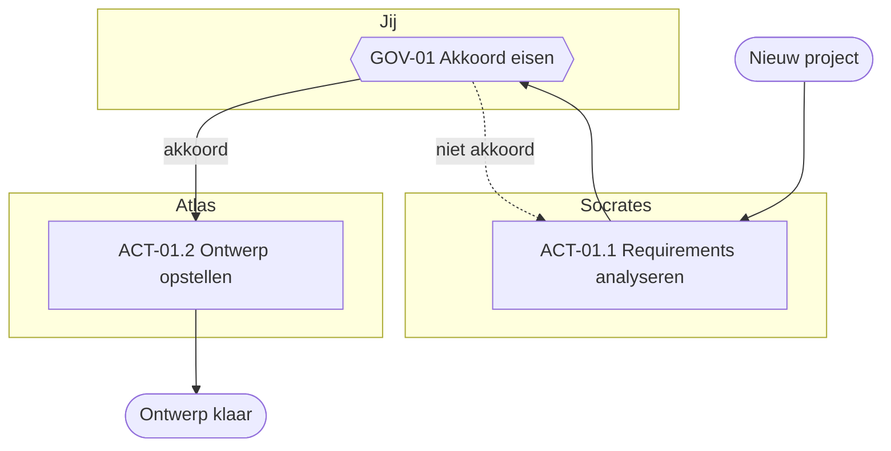

# Procesmodellering

## Doel
Een bedrijfsproces modelleren: hoe werk wordt gestart, uitgevoerd, beoordeeld, overgedragen en afgerond, inclusief de samenwerking tussen mensen en agents, de goedkeuringen en de loops. Het resultaat is een procesbeschrijving met een Mermaid-tussendiagram, gekoppeld aan `register.yaml`. Het eindontwerp als artifact maakt `bpmn-eindontwerp`. Een model beschrijft het proces zoals het moet lopen, ook als de huidige werkwijze afwijkt.

## Gebruik wat er al is
- **Conventies, ID's en register:** skill `bpmn-conventies`. Lees die eerst.
- **Het proces (PRC), de rollen en de agents** komen uit `bpmn-organisatieanalyse`.
- **Vragen stellen:** skill `grilling`.
- **Daarna:** `bpmn-rollen-en-skillmodel` koppelt de activiteiten aan capabilities, skills en verantwoordelijkheden.

## Voorwaarde
Het proces staat als PRC in het register. Is er al een goedgekeurd model? Volg dan "Een goedgekeurd model wijzigen" in `bpmn-conventies`.

## BPMN-notatie
Modelleer met BPMN 2.0-begrippen: pools voor afzonderlijke deelnemers, lanes voor rollen en agents binnen een deelnemer, tasks voor activiteiten, start- en end-events, gateways voor beslissingen en vertakkingen, sequence flows binnen een pool, message flows tussen pools, data objects en data stores voor relevante informatie, en boundary events voor onderbrekingen en fouten. Elk element heeft een functie in het proces.

## Stappen
1. **Baken het proces af.** Neem uit het register over: doel, trigger, start- en eindconditie, eigenaar, input, output, betrokken rollen en systemen, relatie met andere processen. Klaar als elk veld gevuld is of een OPEN-vraag heeft.
2. **Beschrijf het proces in gewone taal**, kort. Klaar als elke stap een rol heeft.
3. **Leg de activiteiten vast.** Elke activiteit krijgt een ACT-ID, een naam met een concreet werkwoord (bijvoorbeeld "Requirements analyseren", "Architectuurontwerp opstellen", "Securityreview uitvoeren"), de verantwoordelijke rol of agent, de input, het resultaat en de mogelijke vervolgstap. Klaar als elke activiteit deze vijf onderdelen heeft.
4. **Leg de beslissingen vast.** Elke beslissing heeft een duidelijke vraag, uitgaande routes met voorwaarden (exclusief waar dat zo is) en een afhandeling voor negatieve of afwijkende uitkomsten. Klaar als elke route bij een activiteit of een einde uitkomt.
5. **Leg uitzonderingen en loops vast** binnen de scope van het proces: afgekeurd ontwerp, ontbrekende informatie, mislukte test, afgewezen review, niet-beschikbare agent, mislukte integratie. Elke terugloop wijst naar een bestaande activiteit en heeft een uitgang. Klaar als geen enkel pad eindeloos kan terugkeren.
6. **Markeer menselijke controle.** Elke activiteit of poort die goedkeuring vraagt, krijgt een GOV-ID en de bevoegde rol. Een agent krijgt geen bevoegdheid die niet is vastgesteld.
7. **Teken het tussendiagram in Mermaid** volgens de conventie hieronder. Klaar als elke activiteit zowel in het diagram als in het register staat, en omgekeerd.
8. **Controleer de proceslogica:** elke activiteit is bereikbaar, elk pad bereikt een einde, parallelle takken komen samen. Een technisch geldig diagram kan nog steeds een onjuist proces tonen: toets het ook aan de beschrijving uit stap 2.
9. **Werk register en overzichten bij**, draai `bpmn-modelcontrole` en leg voor volgens `bpmn-conventies`.

## Mermaid-conventie
`flowchart TB` met één `subgraph` per rol of agent (lane). Elk label bevat het ID.

| BPMN-element | Mermaid-vorm |
|---|---|
| start- en end-event | `([tekst])` |
| task | `[ACT-… tekst]` |
| gateway | `{tekst}` |
| goedkeuring door een mens | `{{GOV-… tekst}}` |
| terugloop | `-. label .->` |



## Een .bpmn-bestand (op verzoek)
Maak alleen een `.bpmn`-bestand als de gebruiker erom vraagt én een BPMN 2.0-validator beschikbaar is. Is er geen validator, meld dan dat BPMN-validatie niet mogelijk is. Sla coördinaten op in BPMN Diagram Interchange. Valideer: geldige elementen en verwijzingen, geldige flows, correct gebruik van gateways, bereikbaarheid, logische start en einde, overeenstemming tussen XML, diagram en beschrijving. Leg het validatieresultaat vast.

## Procesbeschrijving
Één bestand per proces: `organisatie/processen/PRC-xx-<slug>.md`.

```markdown
# PRC-01 – <naam>
Status: Concept | Ter goedkeuring | Goedgekeurd (<datum>, <wie>) · Versie: 0.1

## Doel en uitkomst
## Trigger, start- en eindconditie
## Eigenaar, rollen en systemen
## Input en output
## Relatie met andere processen
## Activiteiten
| ID | Activiteit | Rol of agent | Input | Resultaat | Vervolg |
## Beslissingen en goedkeuringen
| ID | Vraag | Uitkomsten | Bij afwijzing |
## Uitzonderingen en loops
## Tussendiagram
(Mermaid)
## Aannames en open vragen
## Wijzigingshistorie
| Versie | Datum | Wijziging | Door |
```

## Regels
- Elk element in het model dient het proces, niet de opmaak.
- Een goedgekeurd model wijzig je via een voorstel met de geraakte rijen, en na het akkoord in hetzelfde document (`documenten-bijwerken`). Geen kopie.
