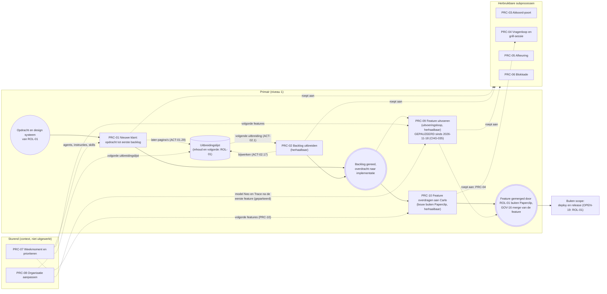

# Organisatieanalyse AI coding factory (ronde 1)

| | |
| --- | --- |
| Status | Weergave van model 0.18 (register r29, B-27), bijgewerkt 2026-11-18 (CHG-036 – weergaven van model 0.18). Eerdere stand: weergave van model 0.17 (register r26, B-25), bijgewerkt 2026-11-11 (CHG-034 – weergaven van model 0.16 en 0.17); zie de revisies en `wijzigingen`. |
| Versie | **0.18, CHG-036 (2026-11-18): weergave van model 0.18 (register r29, B-27), afgeleid uit `register` v0.18.** Aantallen volgens het register: 113 activiteiten, 35 beslissingen, 13 goedkeuringen, 34 capabilities, 85 skills, 6 systemen, 7 rollen, 6 agents, 10 processen; daarvan gepauzeerd (2026-11-18, CHG-035): 3 agents, 3 rollen, 1 proces (PRC-09), 22 stappen, 13 beslispunten, 7 capabilities en 1 systeem; ongebruikt: 15 skills. Wat er in 0.18 veranderde: zie *Wat is er veranderd in 0.18* hieronder. Daarvoor: **0.17, CHG-034 (2026-11-11): weergave van model 0.17 (register r26, B-25), afgeleid uit `register` v0.17.** Aantallen volgens het register: 106 activiteiten, 34 beslissingen, 13 goedkeuringen, 34 capabilities, 85 skills, 5 systemen, 7 rollen, 6 agents, 9 processen. Wat er in 0.16 en 0.17 veranderde: zie *Wat is er veranderd in 0.16 en 0.17* hieronder. Eerdere versies: zie de revisies en `wijzigingen`. |
| Geldende versie | **Het geldende model is 0.18 (Goedgekeurd, 2026-11-18, Carlo, kaart `835d7148`; CHG-035; B-27).** Daarvoor gold 0.17 (Goedgekeurd, 2026-11-11, Carlo, kaarten `c5c48ddf`, `3a0909d3`, `3de7be3d`, `6f17eb2b`; CHG-033; B-25). Eerdere goedgekeurde weergaven: zie de revisies en `wijzigingen`. |
| Opdracht | comment `a5a789fe` op WEB-17; besluiten B-01 t/m B-05 (plan §0). Voor 0.10: B-10 (ontwerp eerst en architectuurprofielen; comment `6e69ec6e`) en B-11 (skills bij naam, niet nummer; comment `081ea763`), goedgekeurd in B-12 (model 0.10 goedgekeurd; kaart `f261b9ac`). Voor 0.11: B-13 (je antwoorden op de open vragen, comments `f06fede2` en `a690e8f3`) en het herstel van de gaten in register 0.10 (CHG-018 – gaten in register 0.10 hersteld), goedgekeurd in B-14 (model 0.11 goedgekeurd; kaart `fa26d50e`). Voor 0.12: B-15 (grill-sessies, kaart `d57f0546`) en B-16 (minder grill-momenten, optie A, kaart `a5523ebd`) en het herstel van de gaten in model 0.11 (CHG-021 – gaten in model 0.11 hersteld, opdracht op kaart `8215b600`), goedgekeurd op kaart `2ddaa565`. Voor 0.13: B-17 (OpenAPI) en B-18 (codes met een korte naam), beide kaart `42b39ff5`, goedgekeurd in B-19 (model 0.13 goedgekeurd; kaart `226c7ce7`). Deze weergave is aangekondigd in comment `0e24368a`: "Daarna de overzichten en pagina 0.6" (CHG-025 – weergaven van model 0.13). Voor 0.14: het herstel van de gaten in model 0.13 (CHG-026 – gaten in model 0.13 hersteld, opdracht op kaart `ea488144`) en de aannames ASM-56 t/m ASM-59, goedgekeurd in B-20 (model 0.14 goedgekeurd; kaart `e9c7f866`). De weergave van 0.14 is aangekondigd in `v014-voorstel` §5 (CHG-027 – weergaven van model 0.14). Voor 0.15: het pakket PRC-08 (organisatie aanpassen), uitgevoerd op WEB-26 na je akkoord op kaart `54896ae0` en de afronding op kaart `4279e5f7` (besluit B-21 – pakket PRC-08 goedgekeurd en uitgevoerd), en CHG-028 (PRC-08 doorgevoerd in het model) met de aannames ASM-60 en ASM-61, goedgekeurd in B-22 (model 0.15 goedgekeurd; kaart `cf1337ff`). De weergave van 0.15 is aangekondigd in `v015-voorstel` §8 (CHG-029 – weergaven van model 0.15). Voor 0.16: B-24 (domeinmodel en sequenties intern, één akkoord voor klassendiagram en database; comment `2e2ec31e` en kaart `af882679` op WEB-19) en B-23 (afspraken over akkoorden; kaarten `643c6ee8` en `9739d819`), CHG-032. Voor 0.17: de opdracht op WEB-152 met de bijsturing `fb48a390` op WEB-17, goedgekeurd in B-25 (model 0.17 goedgekeurd; kaarten `c5c48ddf`, `3a0909d3`, `3de7be3d`, `6f17eb2b`), CHG-033. Deze weergave is CHG-034 (weergaven van model 0.16 en 0.17); volgens B-23 vraagt een weergave geen akkoord als de inhoud al is goedgekeurd. |
| Bron van waarheid | `register` v0.18 (r29; daarvoor v0.17, r26). Details: `bevindingen`, `voorstellen`, `proces-catalogus`, `prc-01`, `prc-02`, `prc-04`, `prc-09` (gepauzeerd) en `prc-10`; de korte namen: `codes-en-namen`; onderbouwing van 0.18: `voorstel-model-chg035` en `controle-chg035`, van 0.17: `controle-chg033`, van 0.16: `voorstel-model-chg032`, van 0.15: `v015-voorstel`, van 0.14: `v014-voorstel`, van 0.13: `v013-voorstel`, van 0.12: `v012-voorstel`, van 0.11: `v011-voorstel`, van 0.10: `v010-voorstel`. |

**Wat de codes betekenen** (B-18 – codes met een korte naam): PRC = proces of subproces · ACT = stap (het nummer zegt niets over de volgorde) · G = beslispunt · GOV = akkoordmoment van jou · GS = grill-moment · ROL / AGT = rol / agent · CAP = capability · B = een besluit van jou · TL-V = jouw besluit over de tech lead · TL = tech-leadtaak van Atlas · PRP = voorstel · FND = bevinding · ASM = aanname · OPEN = open vraag · CHG = wijziging · P1 / P2 / P3 = architectuurprofiel (CMS / component-app / maatwerk) · M = plek waar Paperclip niet netjes past · K = punt uit de modelcontrole · UC / AC / BR / FR = use case / acceptatiecriterium / bedrijfsregel / functionele eis van een klantproject. Lokale codes: A-1, B-2, C-5 enz. = een gat uit een lijst `register-gaten-…` (groep A, B of C; niet te verwarren met je besluiten B-01 enz.) · V1 t/m V5 = vraag op een vragenkaart · D1 t/m D4 = doel · GK-1 t/m GK-4 = de vier goedkeuringsrondes. De korte naam staat de eerste keer per alinea, lijstpunt of tabelrij bij de code; de volledige lijst staat in `codes-en-namen`.

**Wat is er veranderd in 0.2** (details in `wijzigingen`):
- **CHG-002, feitencheck door Dr. Evil en Atlas** ([WEB-20](/WEB/issues/WEB-20), [WEB-21](/WEB/issues/WEB-21)): twee overdrachten van Atlas bestaan al (as-is) en twee ontbraken (§5); In en Uit van Atlas aangevuld (§3); de zin over hoe Dr. Evil gewekt wordt is preciezer (FND-013 – orchestrator zonder eigen ritme). Geen andere correcties.
- **CHG-003 (eerste tech-leadbesluiten van Carlo verwerkt), jouw besluiten over de tech lead** (TL-V1 t/m TL-V5, kaart `d58a1a60` op WEB-17): verwerkt in §3, §5 en §6. Een deel van de bevindingen is daarmee beslist. Nieuw: FND-016, PRP-015 en OPEN-08 over de grens van de kern. Het volledige profiel van de tech lead volgt de rolanalyse op WEB-17 zodra die is goedgekeurd (TL-V7: geen rol tech lead meer).

**Wat is er veranderd in 0.4** (details in `wijzigingen`):
- **CHG-005 (use cases en database besloten), jouw antwoorden op de kaart *PRC-01 (nieuwe klant: opdracht tot eerste backlog): use cases en database*** (`1f7ca238`): **B-06** Socrates maakt de use cases en Atlas toetst ze vóór jouw akkoord, in UC1 én UC2. **B-07** het volledige databaseontwerp van de kern komt na het klassendiagram en vóór het backlog. FND-001 en FND-002 zijn daarmee beslist; OPEN-06 (architectuur en database vóór backlog) is beantwoord.
- **CHG-006, jouw besluit TL-V6** (comment `aa764887` op WEB-17): Atlas voert de rol tech lead uit. De rol blijft in het model (TL-V7: geen rol tech lead meer). FND-012 (proces hangt aan ontbrekende agent) is opgelost; PRP-012, ASM-05, ASM-06 en AGT-04 vervallen; OPEN-02 en OPEN-07 zijn beantwoord. Nieuw: FND-017 (Atlas toetst zijn eigen werk), FND-018 (alles na analyse hangt aan Atlas; Atlas als knelpunt), PRP-017 en PRP-018.

**Wat is er veranderd in 0.5** (details in `wijzigingen`):
- **CHG-007, jouw besluit TL-V7** (comment `8a27fe15` op WEB-17): er komt geen rol tech lead. De taken TL-01 t/m TL-09 horen bij Atlas (ROL-04 – systeemarchitect). ROL-05 (tech lead) vervalt. Meelezen door Atlas van zijn eigen werk vervalt (ASM-15 – meelezen door Atlas), en PRP-009 (tweede ontwerper of toets) vervalt. FND-017 en PRP-018 zijn herschreven.

**Wat is er veranderd in 0.18** (details in `wijzigingen`, `voorstel-model-chg035`, `controle-chg035`, `bevindingen` en `voorstellen`):
- **CHG-036, weergave van model 0.18.** Het model zelf veranderde in CHG-035 (PRC-09 gepauzeerd, bouw buiten Paperclip), naar aanleiding van **B-26 – bouw buiten Paperclip, backlogloop blijft** (jouw besluit op WEB-344). Je keurde alle 20 vragen goed op kaart `835d7148` (besluit **B-27 – model 0.18 goedgekeurd**); volgens B-23 vraagt een weergave geen akkoord als de inhoud al is goedgekeurd. De inhoud van het model verandert in CHG-036 niet: dit document toont het register (r29).
- **Wat B-26 betekent:** de backlogloop (PRC-01, PRC-02, PRC-04, PRC-07 en wat daarbij hoort) blijft. Bouwen, testen en reviewen gebeurt voorlopig buiten Paperclip, door jou met Claude Code. Paperclip voert PRC-09 (uitvoeringsloop per feature) niet meer uit. Neo (AGT-06), Trace (AGT-07) en Sentinel (AGT-05) zijn gepauzeerd, niet verwijderd; weer aanzetten moet eenvoudig zijn.
- **Nieuw proces PRC-10 (feature overdragen aan Carlo):** primair (niveau 1), eigenaar ROL-02 (orchestrator en scrum master), 7 stappen (ACT-10.1 – overdracht controleren t/m ACT-10.7 – feature terugzetten), 1 beslispunt (G-10.1 – feature compleet, niets open?) en geen eigen akkoord: jij bouwt buiten Paperclip, meldt de oplevering en de merge op het epic (ACT-10.4, ACT-10.5), en Dr. Evil rondt na de merge-melding af (ACT-10.6). GOV-16 (merge van de feature) geldt nu voor PRC-10, zonder kaart en zonder telling. **PRC-09 blijft ongewijzigd staan met de status *gepauzeerd (2026-11-18, CHG-035)*** (PRP-059 – PRC-09 pauzeren, PRC-10 erbij); weer aanzetten is een omkering van een lijst.
- **Gepauzeerd (2026-11-18, CHG-035):** Neo, Trace en Sentinel (AGT-05 t/m AGT-07), hun rollen ROL-06, ROL-07 en ROL-08, PRC-09 met 22 stappen en 13 beslispunten, CAP-28 t/m CAP-34, Bugbot als systeem, ASM-65, 66, 67, 69, 70 en 72, en OPEN-20. **Ongebruikt:** 15 skills (`browser-testing-with-devtools`, `code-review-and-quality`, `code-simplification`, `debugging-and-error-recovery`, `frontend-ui-engineering`, `git-workflow-and-versioning`, `incremental-implementation`, `performance-optimization`, `security-and-hardening`, `test-driven-development`, `testplan-en-rapport`, `code-reviewer`, `dotnet-test`, `npm-test` en `clerk-auth`; PRP-061 – statuswaarden gepauzeerd en ongebruikt); ze blijven gekoppeld, niets is ontkoppeld of verwijderd. **Geparkeerd:** OPEN-18, 21, 22 en 23, PRP-057 en PRP-058.
- **Claude Code** is een nieuw systeem (jij bouwt, test en reviewt daarmee; het kan namens jou de oplevering op het epic melden). GitHub blijft voor de PR, CI en jouw merge, buiten Paperclip; de review-comments en de GitHub-hook zijn gepauzeerd.
- **PRC-04 (vragenloop en grill-sessie tussen agents):** jij bent vrager tijdens de bouw, zonder telling, escalatie of contextverslag (ASM-75 – vraag van Carlo zonder telling); TL-07 (implementatievragen van developers beantwoorden) geldt voor jouw vragen, TL-09 (ontwerpafwijkingen van Sentinel afhandelen) is gepauzeerd. PRC-01, PRC-02 en PRC-07 verwijzen naar PRC-10.
- **Aannames en open vragen:** ASM-73 (epic blijft bij Dr. Evil, op `in_review` met jou als reviewer; PRP-071), ASM-74 (één feature tegelijk bij Carlo), ASM-75, ASM-76 (open feature in weekmoment), ASM-77 (taken done na merge) en ASM-78 (taken op naam van Carlo); OPEN-24 (bewust geen maximum?) en OPEN-25 (telregel koppelen) blijven open buiten CHG-035, OPEN-29 (comment van Claude Code wekt Dr. Evil?) blijft open tot de eerste overdracht; OPEN-26, 27, 28 en 30 zijn beantwoord. Nieuw: FND-061 t/m FND-087 en PRP-059 t/m PRP-071. De routines *Weekmoment klaarzetten* en *Dagstart* draaiden tot 2026-11-16 en staan op pauze; Dr. Evil zet ze weer aan (OPEN-26, FND-085).
- **Aantallen (register r29):** 113 (was 106) activiteiten (7 nieuw in PRC-10; 22 van PRC-09 gepauzeerd), 35 (was 34) beslissingen (1 nieuw; 13 gepauzeerd), 13 goedkeuringen (gelijk), 34 capabilities (gelijk; 7 gepauzeerd), **85 skills** (gelijk; 15 ongebruikt), 6 (was 5) systemen, 7 rollen (3 gepauzeerd), 6 agents (3 gepauzeerd) en 10 processen (was 9; PRC-09 gepauzeerd). Skillstatus per stap, met dezelfde regel als in 0.17: **54 aanwezig, 11 gedeeltelijk, 34 ontbreekt, 14 n.v.t.** (was 54, 7, 34 en 11; 113 stappen; Feit: nagerekend met het telscript op register 0.18). De 22 gepauzeerde stappen tellen mee (5 gedeeltelijk, 15 ontbreekt, 2 n.v.t.); zonder die stappen: 91 stappen, 54 aanwezig, 6 gedeeltelijk, 19 ontbreekt, 12 n.v.t.

**Wat is er veranderd in 0.16 en 0.17** (details in `wijzigingen`, `voorstel-model-chg032`, `controle-chg033`, `bevindingen` en `voorstellen`):
- **CHG-034, weergave van model 0.16 en 0.17.** Het model zelf veranderde in CHG-032 (0.16, besluit **B-24 – domeinmodel en sequenties intern, één akkoord klassendiagram en database**, kaart `af882679`, met B-23 – afspraken over akkoorden) en CHG-033 (0.17, besluit **B-25 – model 0.17 goedgekeurd**, vier kaarten op WEB-152). Je keurde alles goed (B-24, B-25); volgens B-23 vraagt een weergave geen akkoord als de inhoud al is goedgekeurd. De inhoud van het model verandert in CHG-034 niet: dit document toont het register (r26).
- **0.16 (CHG-032 – ontwerp intern, klassendiagram en database samen; B-24 – domeinmodel en sequenties intern, één akkoord klassendiagram en database, B-23 – afspraken over akkoorden):** Domeinmodel en sequentiediagrammen intern, klassendiagram en databaseontwerp één document in GOV-11 (akkoord technisch ontwerp volgens profiel); 4 akkoorden in UC1 blijven. Bij P3 gaat in UC2 alleen het klassendiagram met databaseontwerp nog langs ROL-01 (GOV-05 – akkoord klassendiagram en databaseontwerp); GOV-03 (akkoord domeinmodel), GOV-04 (akkoord sequentiediagrammen) en GOV-13 (akkoord databaseontwerp) vervallen; domeinmodel en sequentiediagrammen worden intern bijgewerkt. Nieuw: ASM-62 (Atlas kiest sequenties voor de kern) en FND-044 (intern ontwerp zonder tweede lezer). De rollen ROL-02 (orchestrator en scrum master), ROL-03 (business analist) en ROL-04 (§3) en de repository van het klantproject (§4) zijn aangepast; ASM-18 (afgekeurd document apart herzien), ASM-20 (kleine ontwerpwijziging ook langs akkoord), ASM-36 (skills van Atlas volgens de matrix), ASM-43 (vragen-en-akkoordrondes als skill), ASM-44 (to-tickets niet vereist), ASM-60 (aanvulling gaat voor op oudere stappen) en OPEN-03 (wanneer de uitbreiding start) hebben een nieuwe tekst (§7). De telling van de skillstatus bleef in 0.16 gelijk (CHG-032).
- **0.17 (CHG-033 – agentorganisatie op agent-skills en uitvoeringsloop; B-25 – model 0.17 goedgekeurd):** nieuwe rollen ROL-06 (developer, senior programmeur), ROL-07 (tester van features) en ROL-08 (reviewer code en security); nieuwe agents Neo (AGT-06 – agent Neo, developer) en Trace (AGT-07 – agent Trace, tester); Sentinel (AGT-05 – agent Sentinel) krijgt ROL-08 en is alleen reviewer (PRP-047 – Sentinel alleen reviewer, Opus). Nieuw proces PRC-09 (uitvoeringsloop per feature) met 22 stappen (ACT-09.1 – feature starten t/m ACT-09.22 – eindreviews aanvragen), 13 beslispunten (G-09.1 – feature klaar om te starten? t/m G-09.13 – eindreviews samenvoegen) en het akkoord GOV-16 (merge van de feature) voor doel D4. Nieuwe systemen: GitHub en de externe reviewbot Bugbot; de repository van het klantproject is aangepast. 36 nieuwe skills en 7 nieuwe capabilities (CAP-28 – implementeren via TDD t/m CAP-34 – documentatie schrijven). PRC-01 (nieuwe klant: opdracht tot eerste backlog), PRC-02 (backlog uitbreiden met volgende slice) en PRC-04 (vragenloop en grill-sessie tussen agents): alleen skillkoppelingen, de naam van ACT-01.56 (regelbestanden en kwaliteitslat opstellen) en de routering van vragen; stappen, beslissingen en akkoorden blijven. Nieuw: ASM-63 (feature is een epic) t/m ASM-72 (ASM-68 vervalt; ASM-65 – review wekt zonder pollen en ASM-72 blijven aannames tot OPEN-22 – GitHub-hook in Paperclip is uitgezocht en het model is gemeten), OPEN-16 (wat zit achter de review-comments) t/m OPEN-23 (OPEN-16 t/m OPEN-20 beantwoord; OPEN-21 – DevTools-MCP in Paperclip, OPEN-22 – GitHub-hook in Paperclip en OPEN-23 – effort per taak zijn open), FND-045 (geen bouwer of tester) t/m FND-060 (FND-056 vervalt) en PRP-045 (nieuwe agent Neo) t/m PRP-058 (evaluatie na eerste feature), goedgekeurd met B-25.
- **Aantallen (register r26):** 106 (was 84) activiteiten, 34 (was 21) beslissingen, 13 (was 15) goedkeuringen (GOV-03 – akkoord domeinmodel, GOV-04 – akkoord sequentiediagrammen en GOV-13 – akkoord databaseontwerp vervallen, GOV-16 – merge van de feature nieuw), 34 (was 27) capabilities, **85 skills** (was 49), 5 (was 3) systemen, 7 rollen (ROL-01 – project owner t/m ROL-04 – systeemarchitect en ROL-06 – developer, senior programmeur t/m ROL-08 – reviewer code en security; ROL-05 – tech lead vervallen) en 6 agents (AGT-04 – aparte tech-lead-agent vervallen). Skillstatus per stap, met de zwakste status van de skills bij de stap (afgeleid uit de definitie van aanwezig – gekoppeld en de tekst dekt de stap – telt koppelen, bestaat maar nog niet gekoppeld, als gedeeltelijk): **54 aanwezig, 7 gedeeltelijk, 34 ontbreekt, 11 n.v.t.** (was 75, 0, 0 en 9; 106 stappen; Feit: nagerekend met het telscript op register 0.17). Het verschil komt door de nieuwe stappen en skills met status *nieuw*; "aanwezig" betekent nog steeds alleen: gekoppeld en de tekst dekt de stap (OPEN-11 – proefrun van de skills).

**Wat is er veranderd in 0.15** (details in `wijzigingen`, `v015-voorstel` en `bevindingen`):
- **CHG-029, weergave van model 0.15.** Het model zelf veranderde in CHG-028 (PRC-08 – organisatie aanpassen doorgevoerd in het model). Je keurde alles goed op kaart `cf1337ff` (besluit **B-22** – model 0.15 goedgekeurd, alle 3 onderdelen): CHG-028 en de aannames ASM-60 (aanvulling gaat voor op oudere stappen) en ASM-61 (processtappen blijven to-be tot ze draaien). Dit document geeft dat goedgekeurde model weer; er is niets nieuws besloten. Processen, stappen, beslissingen, routes en diagrammen zijn niet veranderd, en UC1 houdt 4 akkoorden.
- **PRC-08 (organisatie aanpassen) is uitgevoerd (B-21 – pakket PRC-08 goedgekeurd en uitgevoerd).** Dr. Evil voerde het pakket uit op WEB-26, na je akkoord op kaart `54896ae0` en de afronding op kaart `4279e5f7`. Wat in 0.14 "besloten, via PRC-08", "nog te maken" of "werknaam" heette, staat nu in Paperclip (Feit: nagekeken in de Paperclip-API en in de bestanden, 2026-11-01).
- **Skills: 49 in plaats van 41.** De 10 nieuwe skills zijn gemaakt en hebben geen werknaam meer: `architect-vertical-slices`, `architect-api-contracts`, `architect-use-case-review`, `architect-conventions`, `architect-clarification`, `vragen-en-akkoordrondes`, `paginalijst-en-paginabrieven`, `architectuurprofielen`, `architect-cms-configuratie` en `architect-componentontwerp`. De 16 uit te breiden skills zijn uitgebreid; 15 daarvan hebben een sectie *Aanvulling PRC-08 (organisatie aanpassen; model 0.14)* die voorgaat op de oudere stappen (ASM-60 – aanvulling gaat voor op oudere stappen). `domain-modeling` komt uit GitHub; die is voor Atlas aangevuld via zijn instructies. `paginaontwerp` is bewust niet gemaakt en blijft de enige werknaam: alleen jij ontwerpt (ACT-01.28, ACT-02.16), dus geen agent gebruikt hem en hij telt niet mee. Nieuw in het register, gekoppeld maar zonder stap die ze gebruikt: `para-memory-files` (Dr. Evil, met twee regels), `improve-codebase-architecture` (Atlas) en de zes `bpmn-`-skills (Socrates; modelleerskills voor dit organisatiemodel, los van UC1 en UC2). `complain` en `suggestion-box` staan bij alle vier de agents, ook bij Sentinel; alleen jij kunt de ingediende klachten en suggesties lezen, de agents niet.
- **Koppelingen per agent** (Feit: Paperclip-API, 2026-11-01): bij Atlas zijn 8 koppelingen weg (`paperclip-board`, `paperclip-create-agent`, `to-spec`, `to-tickets`, `first-task`, `para-memory-files`, `paperclip-converting-plans-to-tasks`, `architect-use-cases`; dat is de Paperclip-naam van `uml-use-cases`, die Socrates houdt) en 9 erbij (nieuwe skills). Dr. Evil heeft er `vragen-en-akkoordrondes` en `architectuurprofielen` bij; Socrates `vragen-en-akkoordrondes`, `architectuurprofielen` en `paginalijst-en-paginabrieven`. `uml-use-cases` heeft nu alleen Socrates, `paperclip-converting-plans-to-tasks` alleen Dr. Evil en `to-tickets` geen enkele agent.
- **Skillstatus per stap: 75 aanwezig, 0 gedeeltelijk, 0 ontbreekt, 9 n.v.t.** (was 17, 23, 35 en 9; 84 stappen; Feit: nagerekend met het telscript op register 0.15). **"Aanwezig" betekent alleen: de skill is gekoppeld en de tekst dekt de stap.** Of de skills in de praktijk goed werken, weten we niet: geen van de nieuwe of uitgebreide skills is al gebruikt (OPEN-11 – proefrun van de skills). De telling zegt daardoor niets meer over hoe goed de organisatie werkt.
- **FND-042 (skills uitgebreid met een aanvulling).** Dr. Evil heeft de skills aangevuld, niet herschreven, en de aanvulling gaat voor. Bij 8 skills (`requirements-analysis`, `uml-use-cases`, `architect-architecture-choice`, `architect-modeling`, `uml-domain-modelling`, `uml-sequence-diagrams`, `uml-class-diagram` en `architect-database`) staat daardoor de oude stop of het oude goedkeuringsmoment (akkoord per document of per fase) nog in de tekst. Jij koos er niet voor ze alsnog te laten herschrijven; het is een restrisico. **FND-043 (TL-07 – implementatievragen van developers beantwoorden niet meer expliciet bij Atlas):** bij het herschrijven van zijn instructies is de zin over een implementatieplan op verzoek van een developer weggevallen. Dat speelt pas als er developers zijn; nu is geen maatregel nodig.
- **Rollen en agents:** wat bij Dr. Evil (ROL-02 – orchestrator en scrum master), Socrates (ROL-03 – business analist) en Atlas (ROL-04, AGT-03) "to-be (B-08 – keuze uit de voorstellen)" heette, staat nu in hun instructies (Feit: AGENTS.md, 2026-11-01). Bij Atlas staan TL-01 t/m TL-06, TL-08 en TL-09 inhoudelijk in zijn instructies; TL-07 (implementatievragen van developers beantwoorden) niet meer expliciet (FND-043 – TL-07 niet meer expliciet bij Atlas).
- **Routines:** het weekmoment (maandag 04:00) en de dagstart (werkdagen 09:00) bestaan, in Nederlandse tijd en toegewezen aan Dr. Evil (Feit: Paperclip-API, 2026-11-01). De eerste run is op 2026-11-02; ze zijn nog niet gezien draaien (PRC-02, PRC-07, ASM-32).
- **Claude Design:** optie A. De agents krijgen geen eigen toegang; de ontwerper zet altijd een export als vaste versie op het issue.
- **Open vragen:** OPEN-05 (koppeling van skills aan Atlas) is uitgevoerd; OPEN-11 (proefrun van de skills) is belangrijker geworden; OPEN-14 (plek van design systeem en ontwerpen) zegt nu dat de export de bron is; OPEN-15 (mogen agents een project aanmaken) blijft open tot de eerste echte opdracht; OPEN-03 (wanneer de uitbreiding start) noemt dat de routines bestaan.
- **Gaten in model 0.14 hersteld** (punt 1 t/m 6 van `register-gaten-0-14`, door jou goedgekeurd op kaart `7a725bdb`): ASM-42 (inhoud van het contextverslag) zegt nu hetzelfde als ACT-04.55 (contextverslag opstellen), namelijk het issue waarop de vrager zijn stap doet; GOV-06 (akkoord bouwcontract per slice) en GOV-08 (escalatiebesluit) noemen de route van ASM-56 (revisiecontrole OpenAPI faalt); `quality-gates` noemt ASM-56; bij ACT-02.53 (vaste controles uitvoeren) volgt ACT-02.11 (taken maken en op backlog zetten) pas als de controles slagen; `architect-use-case-review` heeft het veld `grill_sessie`; de dekking van `vragen-en-akkoordrondes` is per capability gelijk aan de koppelingen. Bij GOV-07 (keuze van de volgende wens) is alleen de bron bijgewerkt.
- Aantallen: 84 activiteiten, 21 beslissingen, 15 goedkeuringen, 27 capabilities, **49 skills** (was 41), 3 systemen. Skillstatus per stap: 75 aanwezig, 0 gedeeltelijk, 0 ontbreekt, 9 n.v.t. Nieuw: B-21, B-22, FND-042, FND-043, ASM-60 en ASM-61 (beide bevestigd in B-22). Geen nieuwe open vragen. Nog open: OPEN-11, OPEN-13 en OPEN-15.

**Wat is er veranderd in 0.14** (details in `wijzigingen`, `register-gaten-0-13` en `v014-voorstel`):
- **CHG-027, weergave van model 0.14.** Het model zelf veranderde in CHG-026 (gaten in model 0.13 hersteld; groep A van de lijst `register-gaten-0-13`, behalve de legenda in de overzichten) en in de aannames ASM-56 t/m ASM-59 (groep B). Je keurde alles goed op kaart `e9c7f866` (besluit **B-20** – model 0.14 goedgekeurd, alle 5 onderdelen). Dit document geeft dat goedgekeurde model weer; er is niets nieuws besloten. Stappen, akkoorden, routes en diagrammen zijn niet veranderd.
- **Revisiecontrole van het OpenAPI-bestand (ASM-56 – revisiecontrole OpenAPI faalt).** Faalt de controle van Dr. Evil vóór de taken (de revisie van het bestand in de repository wijkt af van die in het goedgekeurde bouwcontract; ASM-52 – controles op het OpenAPI-bestand), dan maakt hij geen taken voor die slice en meldt hij het aan Atlas op het issue van het bouwcontract. Atlas maakt uit het huidige bestand een nieuwe leesbare versie (ook als hij de wijziging terugdraait, want dat geeft een nieuwe revisie), en de slice gaat altijd opnieuw langs GOV-06 (akkoord bouwcontract per slice). Faalt de controle voor dezelfde slice een tweede keer, dan legt Dr. Evil het aan jou voor (GOV-08 – escalatiebesluit van Carlo). Dit staat in het register bij ACT-01.20 (epics en taken slice 1 maken) en ACT-02.53 (vaste controles uitvoeren), niet als aparte stap of route. De aanpassing van `quality-gates` gaat mee in het pakket voor Dr. Evil (PRC-08 – organisatie aanpassen).
- **Geen tweede controle op het OpenAPI-bestand (ASM-57 – geen tweede controle op OpenAPI).** Atlas controleert geldigheid en revisie vóór GOV-06 (akkoord bouwcontract per slice), Dr. Evil de revisie vóór de taken. Dat niemand anders het werk van Atlas leest, blijft het bekende restrisico (FND-017 – Atlas beoordeelt eigen ontwerp zelf; FND-022 – opdeling, plan en taken zonder controle). PRP-018 (tech-leadtaken bij aparte agent later) is goedgekeurd als signaal; een aparte agent vraagt een nieuw besluit van jou.
- **De ontvanger controleert het contextverslag (ASM-58 – controleur bij het contextverslag).** Bij ACT-04.55 (contextverslag opstellen) is dat bewust zo: de bevestiging van de ontvanger (ACT-04.56 – contextverslag bevestigen of aanvullen) is de controle. De plek van het verslag staat overal in dezelfde woorden: op het issue waarop de vrager zijn stap doet; bij de toets het toets-issue (ASM-42 – inhoud van het contextverslag).
- **Elk beslispunt heeft een beslisser (ASM-59 – beslisser bij elk beslispunt).** Alle 21 beslissingen hebben er nu een in het register (was: alleen G-02.8 – loopt er al een uitbreiding?). Bij G-02.7 (is er een ontwerp nodig?) beslis jij, met het ontwerpniveau dat je bij GOV-02 (akkoord use cases en paginabrieven) goedkeurt; bij G-04.1 (wijziging of productkeuze nodig?) beslist de ontvanger van de vraag; bij G-01.7 t/m G-01.9 (parallel splitsen en samenvoegen) is het n.v.t. De lijst per beslispunt staat in `verantwoordelijkheden`.
- **Skills: 41 in plaats van 39.** `complain` en `suggestion-box` staan nu in het register als platformskills, gekoppeld aan Dr. Evil, Socrates en Atlas (Feit: Paperclip-API, 2026-10-31). Geen stap gebruikt ze: beschikbaar, niet vereist, zoals `to-tickets` (ASM-44 – to-tickets niet vereist). Ze tellen niet mee in de skillstatus. Drie andere skills die bij Atlas gekoppeld zijn (`para-memory-files`, `first-task`, `improve-codebase-architecture`) staan niet in het register; of die blijven, legt Dr. Evil voor in het pakket (PRC-08, ASM-36 – skills van Atlas volgens de matrix).
- **Kleiner:** ROL-04 (systeemarchitect) noemt bij de uitvoer van het bouwcontract nu het OpenAPI-bestand met de leesbare versie (B-17 – OpenAPI voor het bouwcontract); ASM-36 (skills van Atlas volgens de matrix) heeft over `to-tickets` dezelfde tekst als ASM-44 (to-tickets niet vereist); ASM-40 en ASM-41 hebben de bevestiging (B-16 – minder grill-momenten, optie A) ook in het veld *bevestigd*; bij ACT-02.6 (globaal ontwerp of profiel bijwerken) ben jij nu ook geraadpleegd, alleen bij GS14 (grill-sessie bij wijziging van architectuur); OPEN-10 (mechanisme voor Carlo's akkoord) toont alleen nog het antwoord; de dekking van zes skills en de verwijzing naar `vragen-en-akkoordrondes` bij drie skills staan nu in het register (zie `capabilities-en-skills`).
- Aantallen: 84 activiteiten, 21 beslissingen, 15 goedkeuringen, 27 capabilities, **41 skills** (was 39), 3 systemen. Skillstatus per stap: 17 aanwezig, 23 gedeeltelijk, 35 ontbreekt, 9 n.v.t. (gelijk). Nieuw: ASM-56 t/m ASM-59 (bevestigd in B-20 – model 0.14 goedgekeurd). Geen nieuwe open vragen. Besloten is nog niet uitgevoerd: wijzigingen aan skills stelt Dr. Evil voor, en jij beslist (PRC-08 – organisatie aanpassen).

**Wat is er veranderd in 0.12 en 0.13** (details in `wijzigingen`, `v012-voorstel` en `v013-voorstel`):
- **CHG-025, weergave van model 0.12 en 0.13.** Het model zelf veranderde in 0.12 door CHG-022 (je antwoorden over de grill-sessies, besluit **B-15** – grill-sessies om context te verzamelen, en je keuze voor optie A, besluit **B-16** – minder grill-momenten, optie A) en CHG-021 (herstel van de gaten in model 0.11). Je keurde 0.12 goed op kaart `2ddaa565`. In 0.13 veranderde het door CHG-023 (OpenAPI voor het bouwcontract, besluit **B-17** – OpenAPI voor het bouwcontract) en CHG-024 (codes met een korte naam, besluit **B-18** – codes met een korte naam); je keurde 0.13 goed op kaart `226c7ce7` (besluit **B-19**, alle 11 onderdelen). Dit document geeft dat goedgekeurde model weer; er is niets nieuws besloten.
- **Grill-sessies (B-15, B-16):** waar context voor het eerst van de ene partij naar de andere gaat en er nog niets als contract vastligt, begint de stap met een grill-sessie: per ronde alle vragen, genummerd en elk met een aanbevolen antwoord. Er zijn zeven vaste grill-momenten, plus GS14 (grill-sessie bij wijziging van architectuur) alleen als de architectuur of het profiel verandert: met jou GS1, GS2, GS4 (UC1) en GS9, GS10, GS14 (UC2); tussen Atlas en Socrates GS3 en GS11, bij de toets. Elke vraag tussen agents is ook een grill-sessie (PRC-04 – vragenloop en grill-sessie tussen agents). GS5 t/m GS8, GS12, GS13 en GS15 zijn vervallen (B-16). Een nieuwe vraag krijg je alleen bij GS9, en bij GS14 als de architectuur of het profiel verandert.
- **Contextverslag (B-15 – grill-sessies om context te verzamelen; ASM-41, ASM-42):** de uitkomst van een sessie, op het issue waarop de vrager zijn stap doet (bij de toets het toets-issue), als er iets besproken is. De partner bevestigt het; met jou is dat de laatste vraag van de sessie, **geen akkoord**. UC1 houdt 4 akkoorden. Geen open punten: geen sessie, geen vraag en geen verslag.
- **PRC-04 heet nu "Vragenloop en grill-sessie tussen agents"** (B-15 – grill-sessies om context te verzamelen). Alleen rondes zonder voortgang tellen; na 2 rondes achter elkaar zonder voortgang gaat het naar jou (GOV-08 – escalatiebesluit van Carlo). Dat verandert B-08 (keuze uit de voorstellen) voor PRC-04; afkeuringen (PRC-05 – afkeuring en herziening) en de toets-lussen houden het maximum van 2. Elke agent beslist alleen in zijn eigen vakgebied; een productkeuze gaat naar jou (GOV-12, nu "wijzigingsverzoek of productkeuze"). Nieuw: ACT-04.55, ACT-04.56 en G-04.52 (het contextverslag).
- **Bouwcontract als OpenAPI (B-17):** bij P2 en P3 is het API-contract per slice een OpenAPI-bestand. Jij keurt bij GOV-06 (akkoord bouwcontract per slice) de leesbare versie goed die eruit is gemaakt: uitleg in het Nederlands, namen van velden en routes in het Engels, bovenaan de revisie (commit-hash) van het bestand. Bij P1 blijft het templatecontract een tabel; OpenAPI alleen waar echt een API is. Atlas controleert vóór je akkoord, Dr. Evil vóór de taken (ASM-52). Het OpenAPI-bestand staat in de repository, de leesbare versie op het issue van het bouwcontract (ASM-53 – plek van bestand en leesbare versie). Welke OpenAPI-versie en welk hulpmiddel kiest Atlas in de architectuurkeuze (ASM-51 – Atlas kiest OpenAPI-versie en hulpmiddel).
- **Codes met een korte naam (B-18):** bovenaan staat een legenda; in de tabellen een kolom Naam; in de tekst staat de korte naam de eerste keer bij de code (ASM-55 – waar de korte naam komt). Het voorstel om `bpmn-conventies` daarop aan te passen, PRP-044 (korte namen in de conventies), is besloten in B-19 (model 0.13 goedgekeurd).
- **Herstel van de gaten in model 0.11 (CHG-021 – gaten in model 0.11 hersteld):** onder meer: `to-tickets` is "beschikbaar, niet vereist" (ASM-44 – to-tickets niet vereist; ASM-36 – skills van Atlas volgens de matrix zei ten onrechte dat het model hem gebruikt); per toetsronde een nieuw toets-issue (ASM-45 – nieuw toets-issue per toetsronde); bij P1 maakt Atlas het contentmodel bij het technisch ontwerp (ASM-46 – contentmodel bij CMS-projecten); bij G-02.8 (loopt er al een uitbreiding?) beslist Dr. Evil (ASM-47 – Dr. Evil beslist over lopende doorloop). De omschrijving van `grilling` klopt nu (FND-038 – register beschreef grilling verkeerd).
- Nieuw: FND-038 t/m FND-041; ASM-40 t/m ASM-55 (ASM-40 en ASM-41 besloten met B-16 – minder grill-momenten, optie A, de andere bevestigd op de kaarten `2ddaa565` en `226c7ce7`); PRP-044 (korte namen in de conventies; besloten, B-19 – model 0.13 goedgekeurd); M-15 t/m M-17 in `paperclip-mapping`. Geen nieuwe open vragen; nog open: OPEN-11, OPEN-13 en OPEN-15.
- Aantallen: 84 activiteiten (was 82: ACT-04.55 en ACT-04.56), 21 beslissingen (was 20: G-04.52 – bevestigt ontvanger het contextverslag?), 15 goedkeuringen (gelijk), 27 capabilities, 39 skills (geen nieuwe; `vragen-en-akkoordrondes` bestond al als werknaam), 3 systemen. Skillstatus per stap: 17 aanwezig, 23 gedeeltelijk, 35 ontbreekt, 9 n.v.t. (was 21, 27, 25 en 9). Besloten is nog niet uitgevoerd: wijzigingen aan skills en conventies stelt Dr. Evil voor, en jij beslist (PRC-08 – organisatie aanpassen).

**Wat is er veranderd in 0.11** (details in `wijzigingen` en `v011-voorstel`):
- **CHG-020, weergave van model 0.11.** Het model zelf veranderde in CHG-019 (je antwoorden op de open vragen, besluit **B-13** – antwoorden op de open vragen) en CHG-018 (herstel van de gaten in register 0.10). Je keurde alles goed op kaart `fa26d50e` (besluit **B-14**, alle 18 onderdelen). Dit document geeft dat goedgekeurde model weer; er is niets nieuws besloten.
- **Repository en project (OPEN-04):** jij maakt de git-repository aan en zet de link in de opdracht (ACT-01.1). Wie de opdracht van jou krijgt, maakt het Paperclip-project aan: Dr. Evil in ACT-01.2 (project aanmaken en opdracht overdragen), of Socrates in ACT-01.51 (project aanmaken en directe opdracht melden); Socrates begint inhoudelijk pas na toewijzing, dus één loket blijft (B-13 – antwoorden op de open vragen; ASM-31, ASM-34, bevestigd in B-14 – model 0.11 goedgekeurd). Of een agent een project mag aanmaken, is nog open (OPEN-15 – mogen agents een project aanmaken).
- **UC2 heeft drie starts (OPEN-03 – wanneer de uitbreiding start):** het weekmoment (maandag 04:00), de dagstart (werkdagen 09:00) met de flowcheck ACT-02.51, en jouw verzoek. De flowcheck start bij nog 5 of minder open taken in de lopende slice (B-13 – antwoorden op de open vragen; ASM-30, ASM-32). Nieuw is de beslissing G-02.8: per project loopt er hoogstens één doorloop (ASM-33 – hoogstens één doorloop per project).
- **Herinnering (OPEN-09 – termijn voor Carlo's akkoord):** Dr. Evil stuurt elke werkdag om 09:00 één bericht met alles wat op jou wacht (B-13 – antwoorden op de open vragen; ASM-35 – inhoud van het herinneringsbericht). Dit vervangt "pas op het weekmoment" uit B-09 (wanneer Dr. Evil de wens vraagt).
- **Akkoord en toets (OPEN-10 – mechanisme voor Carlo's akkoord):** elk akkoord geef je via een kaart op het issue; geen decisions en geen approval-stage (B-14: PRP-040 – akkoord altijd via kaart op issue). Atlas toetst de use cases en de paginabrieven via een toets-issue, zodat het issue van Socrates niet op `done` springt vóór jouw akkoord (B-14: PRP-041 – toets van Atlas via toets-issue). Punt M-9 (akkoord na toets van Atlas) in `paperclip-mapping` vervalt daarmee.
- **Claude Design (OPEN-14):** het design systeem en de ontwerpen staan in de regel in Claude Design (B-13 – antwoorden op de open vragen). De agents kunnen daar nu niet bij (FND-035 – agents kunnen Claude Design niet openen). Tot dat werkt, zet de ontwerper een export als vaste versie op het issue; Dr. Evil zoekt de toegang uit (B-14: PRP-042 – toegang tot Claude Design).
- **Skills van de agents (OPEN-05):** de koppeling van elke agent volgt de agent-skillmatrix; Dr. Evil legt de lijst aan je voor (B-13 – antwoorden op de open vragen; ASM-36 – skills van Atlas volgens de matrix, bevestigd).
- **Herstel van het register (CHG-018 – gaten in register 0.10 hersteld):** ASM-19 (de vorm met 3 akkoorden) staat nu bij de vervallen ID's; bij ROL-01 t/m ROL-04 zijn In en Uit aangevuld; GOV-03 (akkoord domeinmodel), 04, 05 en 13 gelden in UC2 alleen bij P3; CAP-11 heet nu "Bouwcontract ontwerpen"; het templatecontract bij P1 is verdeeld over twee skills (B-14: PRP-043 – templatecontract bij CMS-projecten); bij GOV-14 (akkoord paginaontwerp) geeft één kaart een oordeel per document (ASM-37 – oordeel per document bij paginaontwerp); de poorten van `quality-gates` horen per stap (ASM-38 – kwaliteitspoorten bij stappen van Dr. Evil); de uitbreidingslijst heeft bewust geen controleur (ASM-39 – uitbreidingslijst zonder controleur). De processen zelf veranderen niet.
- Nieuw: FND-035 t/m FND-037, PRP-040 t/m PRP-043 (besloten, B-14 – model 0.11 goedgekeurd), ASM-30 t/m ASM-39 (bevestigd, B-14) en OPEN-15 (mogen agents een project aanmaken). Beantwoord: OPEN-03 (wanneer de uitbreiding start), 04, 05, 09, 10 en 14. Nog open: OPEN-11, OPEN-13 en OPEN-15.
- Aantallen: 82 activiteiten (gelijk), 20 beslissingen (was 19), 15 goedkeuringen (gelijk), 27 capabilities, 39 skills (geen nieuwe), 3 systemen (was 2: nieuw is Claude Design). Besloten is nog niet uitgevoerd: wijzigingen aan instructies, skills en routines stelt Dr. Evil voor, en jij beslist (PRC-08 – organisatie aanpassen).

**Wat is er veranderd in 0.10** (details in `wijzigingen` en `v010-voorstel`):
- **CHG-017, weergave van model 0.10.** Het model zelf veranderde in CHG-015 (jouw opdracht **B-10** *ontwerp-eerst en architectuurprofielen*, comment `6e69ec6e`) en CHG-016 (jouw besluit **B-11**: skills bij naam, comment `081ea763`). Je keurde alles goed op kaart `f261b9ac` (besluit **B-12**). Dit document geeft dat goedgekeurde model weer; er is niets nieuws besloten.
- **UC1 is ontwerp-eerst:** jij levert bij de start het design systeem (ACT-01.52 – design systeem maken en aanleveren). Socrates maakt de visie met het projecttype (ACT-01.26 – visie en projecttype vastleggen) en de paginalijst met "nu" en "later", ontwerpniveau en paginabrieven (ACT-01.27 – paginalijst en paginabrieven opstellen). Daarna werken Atlas en jij tegelijk: Atlas kiest het architectuurprofiel (ACT-01.11 – architectuurkeuze en profiel vastleggen), jij ontwerpt de sleutelpagina's (ACT-01.28 – sleutelpagina's en paginatypen ontwerpen). Het bouwcontract volgt uit de goedgekeurde brieven en ontwerpen (ACT-01.17 – bouwcontract van slice 1 opstellen). Aan het eind zet Dr. Evil de "later"-pagina's op de uitbreidingslijst (ACT-01.29 – later-pagina's op uitbreidingslijst zetten). (B-12: PRP-029 t/m PRP-033)
- **Drie architectuurprofielen:** P1 configuratie/CMS, P2 component-app, P3 maatwerk met domeinmodel. Eén keuze in de flow (G-01.6 – welk architectuurprofiel is goedgekeurd?) bepaalt welk technisch ontwerp Atlas maakt. TL-V5 en B-07 gelden volledig voor P3. (B-12: PRP-034 – drie architectuurprofielen)
- **4 akkoorden in UC1** in plaats van 3: GOV-10 analysepakket, GOV-15 *Richting* (nieuw: profiel en eerste ontwerpen), GOV-11 technisch ontwerp volgens profiel, GOV-06 bouwcontract van slice 1 (B-12: PRP-036 – vier akkoorden bij nieuwe klant). In UC2 komt GOV-14 (paginaontwerp) erbij, alleen bij een nieuw patroon of een bijzondere pagina.
- **Rollen (§3):** jij bent ook de ontwerper, zolang er geen designer- of frontend-agent is (ASM-28). Daarvoor is er een nieuwe generieke lane `ontwerper`. Er komt nu geen nieuwe agent (B-12: PRP-035 – geen nieuwe agent nu).
- Nieuw: FND-028 t/m FND-034, PRP-029 t/m PRP-039 (besloten, B-12 – model 0.10 goedgekeurd), ASM-26 t/m ASM-29 (bevestigd, B-12) en OPEN-14 (plek van design systeem en ontwerpen). PRP-011 (design systeem bij de start) vervalt (FND-011d is opgelost door B-10 – ontwerp eerst en architectuurprofielen). ASM-19 (vorm met 3 akkoorden) vervalt volgens het register zodra je PRP-036 (vier akkoorden bij nieuwe klant) goedkeurt; dat deed je in B-12. In 0.11 staat ze bij de vervallen ID's in het register (CHG-018 – gaten in register 0.10 hersteld).
- Skills staan overal bij hun naam (B-11 – skills bij naam, niet nummer), ook in de oudere teksten. De betekenis blijft gelijk.
- Besloten is nog niet uitgevoerd: wijzigingen aan instructies en skills stelt Dr. Evil voor, en jij beslist (PRC-08 – organisatie aanpassen).

**Wat is er veranderd in 0.9** (details in `wijzigingen`):
- **CHG-013 (moment van vraag naar volgende wens), jouw besluit B-09** (wanneer Dr. Evil de wens vraagt; kaart `e2fd31e9`): vindt de flowcheck te weinig klare taken en blijkt uit jouw volgorde niet welke wens de volgende is, dan vraagt Dr. Evil het je direct, één keer, op een issue (GOV-07 – keuze van de volgende wens). Antwoord je niet, dan herinnert hij je op het weekmoment; daarbuiten niet tussendoor. Je wordt één keer extra gestoord. (In 0.11 vervangen door B-13: de herinnering komt elke werkdag om 09:00.) Nieuw: FND-027 (moment van de vraag bij wenskeuze; opgelost door B-09). §3 en §5 noemen het moment; §6 punt 6 heeft de stand. De skill `escalation-management` krijgt hiervoor een uitzondering; dat loopt via PRC-08 (organisatie aanpassen). Dat ook `weekmoment` wordt aangepast, is een aanname (ASM-24); ASM-25 (vraag naar wens op weekmoment-issue) gaat over de start op het weekmoment. Beide zijn bevestigd op de GK-4-kaart (kaart `4d0845d3`).

**Wat is er veranderd in 0.8** (details in `wijzigingen`):
- **CHG-011, jouw keuze uit de voorstellen** (kaart `2b7a6d2d`, besluit **B-08**): 21 voorstellen goedgekeurd (PRP-001 – één loket voor opdrachten, 003, 005, 006, 007, 010, 013, 014, 015, 017 t/m 028), PRP-011 (design systeem bij de start) uitgesteld. §3: de rollen hebben de besloten taken erbij (to-be). §6 (b) en (c): per voorstel de stand. §7: ASM-16 (vrager oordeelt vastgelopen) vervalt, ASM-17 (overdracht pas na analysepakket) is herschreven, ASM-18 t/m 23 zijn nieuw; OPEN-01 (opdracht rechtstreeks bij Socrates), 08 en 12 zijn beantwoord, OPEN-03 (wanneer de uitbreiding start) deels; OPEN-13 (drempel voor aparte agent naast Atlas) is nieuw. Besloten is nog niet uitgevoerd: wijzigingen aan instructies en skills stelt Dr. Evil voor, en jij beslist (PRC-08 – organisatie aanpassen).
- **Na de modelcontrole `controle-model-v08`:** §3 en §6: de tussentijdse weekmelding bij PRP-018 (tech-leadtaken bij aparte agent later) is een Aanname (ASM-23 – wachttijd van uitbreidingen op Atlas), niet Besloten; beide aanleidingen van PRP-018 staan erbij (L-06). §5: drie overdrachten rond de toets van de taken en het conventiebestand (L-09). §7: ASM-18 (afgekeurd document apart herzien) uitgebreid (GOV-10 – akkoord analysepakket; pas handelen als elk document een oordeel heeft), ASM-21 (poort bouwcontract in vaste controles), 22 en 23 nieuw.

**Labels:** **Besloten** = uit jouw opdracht of B-01 t/m B-27, TL-V1 t/m TL-V7; `B-12: PRP-0xx` = een voorstel dat je in 0.10 hebt goedgekeurd; `B-14: PRP-04x` = een voorstel dat je in 0.11 hebt goedgekeurd (PRP-040 t/m PRP-043); `B-19: PRP-044` = het voorstel dat je in 0.13 hebt goedgekeurd; `B-13` = jouw antwoord op een open vraag; `B-15`, `B-16` = jouw besluiten over de grill-sessies (0.12); `B-17`, `B-18` = jouw besluiten over OpenAPI en de codes (0.13); `B-20` = jouw besluit dat model 0.14 goedkeurt (CHG-026 – gaten in model 0.13 hersteld en de aannames ASM-56 t/m ASM-59); `B-21` = jouw besluit dat het pakket PRC-08 (organisatie aanpassen) goedkeurt en uitgevoerd is (0.15; wat in PRC-08 is uitgevoerd, staat bij **Feit** met de datum van het nakijken); `B-22` = jouw besluit dat model 0.15 goedkeurt (CHG-028 – PRC-08 doorgevoerd in het model en de aannames ASM-60 en ASM-61). `B-23` = jouw afspraken over akkoorden (0.16; geen akkoord op weergaven als de inhoud al is goedgekeurd); `B-24` = jouw besluit over domeinmodel en sequenties intern en één akkoord voor klassendiagram en database (0.16; CHG-032); `B-25` = jouw besluit dat model 0.17 goedkeurt (CHG-033: agentorganisatie op agent-skills en uitvoeringsloop PRC-09); `B-26` = jouw besluit op WEB-344 dat bouwen, testen en reviewen buiten Paperclip gebeurt en de backlogloop blijft (0.18); `B-27` = jouw besluit dat model 0.18 goedkeurt (CHG-035: PRC-09 gepauzeerd, bouw buiten Paperclip; kaart `835d7148`). **Feit** = huidige situatie, met bron (bijvoorbeeld "Feit: Paperclip-API 2026-11-01"). **Voorstel** (PRP), **Aanname** (ASM; ASM-26 t/m ASM-29 zijn bevestigd in B-12, ASM-30 t/m ASM-39 in B-14, ASM-42 t/m ASM-48 op kaart `2ddaa565`, ASM-49 t/m ASM-55 in B-19, ASM-56 t/m ASM-59 in B-20, ASM-60 en ASM-61 in B-22, ASM-62 op kaart `af882679`; ASM-63 t/m ASM-72 (zonder ASM-68, dat vervalt) staan in het register zonder bevestiging; ASM-73 t/m ASM-78 komen uit CHG-035 en staan in het met B-27 goedgekeurde model 0.18; ASM-40 en ASM-41 zijn besloten met B-16 – minder grill-momenten, optie A), **Open** (OPEN). Afgeleid en niet letterlijk uit het register: "afgeleid, nog niet besloten".

---

## 1. Scope en doelen

| Onderdeel | Inhoud | Label |
| --- | --- | --- |
| Missie | Een opdracht voor een website of applicatie met AI-agents omzetten in een backlog dat klaar is voor implementatie. | Besloten (samengevat uit je opdracht) |
| Doelen | **D1** Nieuwe klant: van opdracht tot eerste backlog → PRC-01 (nieuwe klant: opdracht tot eerste backlog). **D2** Backlog aanvullen met de volgende slice → PRC-02 (backlog uitbreiden met volgende slice). **D3** Jouw tijd beschermen: jij bent de enige mens die prioriteert en goedkeurt → doorsnijdend, via PRC-03, PRC-05 en PRC-07 (maatregelen: PRP-003, PRP-006, PRP-007, besloten in B-08 – keuze uit de voorstellen). **D4** Een feature uit de backlog bouwen, testen en reviewen tot jij hem merget → PRC-09 (uitvoeringsloop per feature) (nieuw in 0.17); sinds 0.18 is PRC-09 gepauzeerd (2026-11-18, CHG-035) en loopt D4 via PRC-10 (feature overdragen aan Carlo), waar jij zelf bouwt buiten Paperclip (B-26 – bouw buiten Paperclip, backlogloop blijft). | Besloten (D3: rolanalyse §1; maatregelen: B-08; D4: WEB-152) |
| Begrippen (0.2) | **Globaal ontwerp** = het ontwerp van Atlas (B-02 – ontwerp per slice, program design). **Kernontwerp** = het deel daarvan dat Atlas vooraf volledig maakt: "in principe alles voor de kernfunctionaliteit" (TL-V5 – kern vooraf volledig ontwerpen). Het kernontwerp omvat ook de architectuurkeuze (Feit, instructies van Atlas) en het volledige databaseontwerp van de kern (B-07 – volledig databaseontwerp van de kern). Wat buiten de kern valt, ontwerpt Atlas per slice (ASM-09 – Atlas ontwerpt buiten kern per slice). **Stand 0.10:** zo geldt het bij profiel P3. Bij P1 en P2 maakt Atlas een lichter technisch ontwerp volgens het profiel (B-12: PRP-034 – drie architectuurprofielen). | Besloten (B-02, TL-V5, B-07; B-12: PRP-034), Aanname (ASM-09) |
| Begrippen (0.10) | **Design systeem** = kleuren, typografie, basiscomponenten en toon; jij levert het bij de start (ACT-01.52 – design systeem maken en aanleveren), in de regel in Claude Design met een export als vaste versie (B-13 – antwoorden op de open vragen; B-14: PRP-042 – toegang tot Claude Design). **Visie** = de productvisie: doel, doelgroepen, kernboodschap, hoofdstructuur, en in principe wat nu en wat later komt; Socrates maakt haar (ASM-27 – visie is de productvisie). **Paginalijst** = alle pagina's met doel, paginatype, "nu" of "later" met de reden, en het ontwerpniveau. **Paginabrief** = per "nu"-pagina wat erop staat: gegevens, acties, toestanden en de use cases; de brief is bindend voor het bouwcontract. **Ontwerpniveau** = "brief" als de pagina een bestaand patroon volgt; "ontwerp" als ze de eerste van haar paginatype is, een nieuwe component heeft, of merkbepalend of conversiegevoelig is (bijvoorbeeld home, aanmelden, bestellen). **Patroonbibliotheek** = de paginatypen en componenten uit de goedgekeurde ontwerpen. **Bouwcontract** = de API-contracten (P2, P3) of het templatecontract (P1, velden per template), met per veld een bron. **Uitbreidingslijst** = de lijst met mogelijke uitbreidingen waaruit UC2 de volgende neemt. | Besloten (B-10 – ontwerp eerst en architectuurprofielen; B-12: PRP-030, PRP-031, PRP-032, PRP-033, PRP-034), Aanname (ASM-27, bevestigd) |
| Begrippen (0.11) | **Weekmoment** = maandag om 04:00, een routine van Dr. Evil (PRC-07 – weekmoment en prioriteren). **Dagstart** = elke werkdag om 09:00, een routine van Dr. Evil met de flowcheck (ACT-02.51 – open taken in lopende slice tellen) en het herinneringsbericht. **Open taak** = een taak die niet `done` of `cancelled` is; geblokkeerd en in review tellen mee. **Lopende slice** = de epic die het laatst op het backlog is gezet. **Doorloop** = een run van PRC-02, van de start van een uitbreiding (ACT-02.1 – volgende wens bepalen uit de volgorde) tot die op "in backlog" staat (ACT-02.17 – uitbreidingslijst bijwerken). **Herinneringsbericht** = één bericht met alles wat op jou wacht, oudste bovenaan. **Toets-issue** = een issue voor Atlas om use cases of brieven te toetsen. | Besloten (B-13 – antwoorden op de open vragen; B-14: PRP-041 – toets van Atlas via toets-issue); Aanname (ASM-30, ASM-32, ASM-33, ASM-35, bevestigd in B-14 – model 0.11 goedgekeurd) |
| Begrippen (0.12) | **Grill-sessie** = een sessie waarin de uitvoerder van een stap per ronde alle vragen stelt die nu te beantwoorden zijn, genummerd en elk met een aanbevolen antwoord; feiten zoekt hij zelf op. Met jou in de vorm van `grilling`, tussen agents via PRC-04 (vragenloop en grill-sessie tussen agents). **Grill-moment** (GS) = een vaste plek in het proces waar een stap met een grill-sessie begint (GS1 t/m GS4, GS9 t/m GS11, GS14). **Contextverslag** = de uitkomst van een sessie: wat vaststaat, wat beslist is en door wie, wat naar jou ging, en de documenten met revisie; een document op het issue waarop de vrager zijn stap doet (bij de toets het toets-issue), alleen als er iets besproken is. **Ronde zonder voortgang** = een ronde waarin geen enkel punt is beslist. | Besloten (B-15, B-16); Aanname (ASM-40 en ASM-41, besloten met B-16; ASM-42, ASM-48, bevestigd) |
| Begrippen (0.13) | **OpenAPI-bestand** = het API-contract per slice in een vaste, door tools leesbare vorm; de bron van het contract, in de repository van het project (`docs/architecture/`). **Leesbare versie** = het document dat uit het OpenAPI-bestand wordt gemaakt en niet apart geschreven: per pagina de gegevens, acties, foutmeldingen en de bron per veld, en per operatie een korte tabel; uitleg in het Nederlands, namen van velden en routes in het Engels. **Revisie** = de commit-hash van de laatste commit die het OpenAPI-bestand wijzigde; die staat bovenaan de leesbare versie. **Bouwcontract** (aangevuld) = bij P2 en P3 het OpenAPI-bestand met de leesbare versie; bij P1 het templatecontract als tabel, met OpenAPI alleen waar echt een API is (eigen endpoints, koppelingen, of een headless CMS waarvan de frontend de API aanroept). **Korte naam** = een paar woorden bij elke code, uit de naam of titel van het element of uit `korte_namen` in het register. | Besloten (B-17, B-18); Aanname (ASM-49, ASM-50, ASM-52, ASM-53, ASM-54, bevestigd in B-19 – model 0.13 goedgekeurd) |
| Begrippen (0.14) | **Beslisser** = wie bij een beslispunt (G) kiest welke kant het opgaat; alle 21 beslispunten hebben er een, bij parallel splitsen of samenvoegen (G-01.7 t/m G-01.9) is het n.v.t. De beslisser volgt in de regel uit de stap ervoor (bij een toets de toetser, bij een akkoord jij). **Platformskill** = een skill die (afgeleid uit de bron van de skill) Paperclip zelf aanbiedt en die geen stap in het model gebruikt: `complain` (een klacht indienen) en `suggestion-box` (een verbetervoorstel indienen). Beschikbaar, niet vereist; ze tellen niet mee in de skillstatus. | Besloten (B-20 – model 0.14 goedgekeurd); Aanname (ASM-59 – beslisser bij elk beslispunt, bevestigd in B-20); Feit (Paperclip-API, 2026-10-31) |
| Begrippen (0.15) | **Aanvulling PRC-08** (organisatie aanpassen) = een sectie *Aanvulling PRC-08 (model 0.14)* in 15 uitgebreide skills; ze zegt zelf dat ze voorgaat op de oudere stappen in de skill (ASM-60 – aanvulling gaat voor op oudere stappen). **Aanwezig** (bij de skillstatus) = de skill is gekoppeld en de tekst dekt de stap; of hij in de praktijk werkt, is niet getest (OPEN-11 – proefrun van de skills). **To-be en as-is** = de processtappen blijven *to-be* tot ze in de praktijk zijn gezien (ASM-61 – processtappen blijven to-be tot ze draaien); de skills, instructies en routines zelf zijn feit. **Gekoppeld, geen stap** = een skill die een agent heeft, maar die geen stap in UC1 of UC2 gebruikt; hij telt niet mee in de skillstatus. | Besloten (B-21 – pakket PRC-08 goedgekeurd en uitgevoerd; B-22 – model 0.15 goedgekeurd); Aanname (ASM-60, ASM-61, bevestigd in B-22); Feit (Paperclip-API en SKILL.md, 2026-11-01) |
| Begrippen (0.17) | **Feature** = één epic uit het backlog: één featurebranch en één PR per epic (ASM-63 – feature is een epic). **Uitvoeringsloop** = PRC-09 (uitvoeringsloop per feature): een feature bouwen, testen en reviewen tot jij hem merget (D4). **Fouten en opmerkingen** (bij reviews): fouten zijn *Critical*- en verplichte bevindingen (zonder label) of rode CI; opmerkingen zijn *Optional* en *Nit*; *FYI* vraagt niets (ASM-67 – fouten en opmerkingen). **Bugbot** (`@cursor-reviewer`) = een externe reviewbot buiten Paperclip met een ander model dan Neo; hij reviewt één keer per PR de hele PR (ASM-66 – cursor-reviewer is Bugbot; keuze 16). **Merge is afname** = jouw merge (GOV-16 – merge van de feature) is ook de afname van de feature (ASM-71 – merge is afname). **Review wekt zonder pollen** = via een GitHub-hook wordt een PR-comment een Paperclip-issue dat de taak van Neo blokkeert; Paperclip kan die hook misschien niet ontvangen (ASM-65 – review wekt zonder pollen, OPEN-22 – GitHub-hook in Paperclip). **Geen grill-momenten in PRC-09**: vragen gaan via PRC-04 (ASM-69 – geen grill-momenten). **Eén feature tegelijk** voor Neo (ASM-70 – één feature per coding agent). | Besloten (B-25 – model 0.17 goedgekeurd; WEB-152); Aanname (ASM-63 – feature is een epic, ASM-65 – review wekt zonder pollen, ASM-66 – cursor-reviewer is Bugbot, ASM-67 – fouten en opmerkingen, ASM-69 – geen grill-momenten, ASM-70 – één feature per coding agent, ASM-71 – merge is afname, nog niet bevestigd) |
| Begrippen (0.18) | **Gepauzeerd** = tijdelijk uit, niet verwijderd: rij, model, skills en bron blijven staan; geldt voor een rol, agent, proces, stap, beslispunt, capability, systeem, aanname of open vraag, met datum en CHG (PRP-061 – statuswaarden gepauzeerd en ongebruikt). **Ongebruikt** = een skill die in het model geen actieve stap meer dekt maar gekoppeld blijft. **Geparkeerd** = een open vraag of voorstel dat wacht tot het weer aan staat. **Overdracht aan Carlo** = PRC-10 (feature overdragen aan Carlo): Dr. Evil controleert een feature-epic, draagt het over met een comment "gereed voor bouw" en rondt het na jouw merge-melding af. **Bouwen buiten Paperclip** = jij bouwt, test en reviewt met Claude Code en merget zelf; dat valt buiten het model (ACT-10.3 – bouwen buiten Paperclip). | Besloten (B-26 – bouw buiten Paperclip, backlogloop blijft; B-27 – model 0.18 goedgekeurd); Voorstel besloten met B-27 (PRP-059, PRP-061) |
| Uitgangspunt (0.10) | Het ontwerp en de visie zijn leidend; de API-contracten volgen. De UI wordt nooit afgeleid van de API-contracten. Mock data (voorbeeldgegevens in een ontwerp) is niet bindend voor het contract. | Besloten (B-10 – ontwerp eerst en architectuurprofielen) |
| Architectuurprofielen (0.10) | **P1** configuratie/CMS, **P2** component-app, **P3** maatwerk met domeinmodel. De keuze gaat op twee vragen: (1) haalt een standaardplatform de eisen met configuratie, thema en plugins? Ja → P1. (2) Zo niet: is er bedrijfslogica met eigen regels en toestanden? Ja → P3, nee → P2. Socrates signaleert het projecttype (ACT-01.26 – visie en projecttype vastleggen), Atlas kiest het profiel en legt het vast in een profiel-ADR (ACT-01.11 – architectuurkeuze en profiel vastleggen), jij keurt het goed (GOV-15 – akkoord richting: architectuur en ontwerpen). Later kan het profiel alleen zwaarder worden, via UC2 (groeisignalen, G-02.3 – raakt de wens het globale ontwerp?). Welke producten bij welk profiel horen: `register`, sectie `profielen`. | Besloten (B-12: PRP-034 – drie architectuurprofielen) |
| Eis aan het model | Uitbreidbaar: een nieuwe use case of agent wijzigt bestaande diagrammen niet → herbruikbare subprocessen, één eindpunt, uitbreidingsgids (ronde 4). In 0.10: komt er een ontwerp-agent, dan krijgt alleen de lane `ontwerper` een rol erbij. | Besloten |
| Producten | Websites en applicaties voor klanten. Elk project in UC1 heeft een gebruikersinterface (ASM-29 – elk project heeft een gebruikersinterface). | Besloten; Aanname (ASM-29, bevestigd) |
| Automatisering | Agents doen het analyse-, technisch ontwerp- en plannings­werk. Vragen tussen agents lopen als grill-sessie, met een contextverslag (B-15 – grill-sessies om context te verzamelen). Het visuele ontwerp doe jij, zolang er geen designer- of frontend-agent is (ASM-28 – Carlo is de ontwerper; B-12: PRP-035 – geen nieuwe agent nu), in de regel in Claude Design (B-13 – antwoorden op de open vragen). Sinds 0.17 bouwen, testen en reviewen agents ook: Neo (ROL-06), Trace (ROL-07) en Sentinel (ROL-08) in PRC-09; jij merget (GOV-16). Sinds 0.18 is dat gepauzeerd (2026-11-18, CHG-035): jij bouwt, test en reviewt zelf buiten Paperclip, met Claude Code (PRC-10 – feature overdragen aan Carlo). | Besloten; Aanname (ASM-28, bevestigd); B-25 – model 0.17 goedgekeurd; B-26, B-27 |
| Onder menselijke controle | Opdracht, antwoorden, goedkeuring van documenten, prioriteit en scope, klantcontact (B-03 – Carlo is enige klantcontact), nieuwe agents, instructies en skills (V7). In 0.10 ook: het design systeem en het ontwerp van de sleutelpagina's en nieuwe patronen (ASM-28 – Carlo is de ontwerper), en de inhoud en volgorde van de uitbreidingslijst (B-12: PRP-033). In 0.11 ook: de git-repository per klant (B-13 – antwoorden op de open vragen) en het verzoek om een uitbreiding (B-13). In 0.12 ook: elke productkeuze die in een sessie tussen agents opduikt, en elke wijziging van iets wat jij goedkeurde (GOV-12, B-15). In 0.13: bij GOV-06 (akkoord bouwcontract per slice) de leesbare versie van het OpenAPI-bestand (B-17 – OpenAPI voor het bouwcontract). In 0.14 ook: de beslissing bij G-02.7 (is er een ontwerp nodig?), met het ontwerpniveau dat je bij GOV-02 (akkoord use cases en paginabrieven) goedkeurt (ASM-59 – beslisser bij elk beslispunt), en een slice met een afwijkende revisie van het OpenAPI-bestand gaat altijd opnieuw langs GOV-06 (ASM-56 – revisiecontrole OpenAPI faalt). In 0.17 ook: de merge van elke feature, die ook de afname is (GOV-16 – merge van de feature, ASM-71 – merge is afname); levert het designsysteem vóór UI-werk; deployt (OPEN-19 – wie deployt); laat Chrome in de runner zetten (OPEN-21 – DevTools-MCP in Paperclip); beslist na de eerste feature over het model van Neo en Trace (PRP-058 – evaluatie na eerste feature). In 0.18 ook: bouwen, testen en reviewen buiten Paperclip en melden van de oplevering en de merge op het epic (PRC-10 – feature overdragen aan Carlo; B-26 – bouw buiten Paperclip, backlogloop blijft); Chrome in de runner (OPEN-21) en het besluit na de eerste feature (PRP-058) zijn geparkeerd. | Besloten / Feit (B-25 – model 0.17 goedgekeurd; B-26, B-27); Aanname (ASM-56, ASM-59, bevestigd in B-20 – model 0.14 goedgekeurd; ASM-71 – merge is afname, niet bevestigd) |
| Werkwijze | Flow zonder sprints, met weekmoment. "Sprint 1" = de eerste vertical slice (B-01 – flow zonder sprints). | Besloten |
| Start van UC2 (0.11) | Drie starts: het weekmoment (maandag 04:00), de dagstart (werkdagen 09:00) als er in de lopende slice nog 5 of minder taken open zijn, en jouw verzoek. Per project loopt er hoogstens één doorloop tegelijk (G-02.8); een verzoek tijdens een lopende doorloop zet de wens bovenaan de uitbreidingslijst. | Besloten (B-13 – antwoorden op de open vragen); Aanname (ASM-30, ASM-32, ASM-33, bevestigd) |
| Akkoord geven (0.11) | Elk akkoord van jou is een kaart op het issue, met één item per document, ook als het er maar één is. Geen decisions en geen approval-stage. Atlas toetst via een toets-issue, niet via een review-stage. Wacht er iets op jou, dan staat het elke werkdag om 09:00 in het herinneringsbericht van Dr. Evil; een akkoord vervalt niet (geen termijn). | Besloten (B-13 – antwoorden op de open vragen; B-14: PRP-040, PRP-041); Aanname (ASM-35 – inhoud van het herinneringsbericht, bevestigd) |
| Eindpunt | **Backlog gereed, overdracht naar implementatie** (het eindpunt van PRC-01 – nieuwe klant: opdracht tot eerste backlog en PRC-02 – backlog uitbreiden met volgende slice). Sinds 0.17 loopt daarna PRC-09 (uitvoeringsloop per feature): de uitvoering van een feature uit de backlog door Neo (ROL-06 – developer, senior programmeur), Trace (ROL-07 – tester van features) en Sentinel (ROL-08 – reviewer code en security) tot jij de feature merget (GOV-16 – merge van de feature; D4). Dat valt dus binnen het model. Buiten het model blijven: deploy en release (OPEN-19 – wie deployt: jij deployt; PRC-09 eindigt bij de merge) en andere rollen daarna. (In 0.15 stond hier: testers, developers, Sentinel en andere rollen daarna vallen buiten het model.) Sinds 0.18 (CHG-035) is PRC-09 gepauzeerd en loopt na het eindpunt PRC-10 (feature overdragen aan Carlo): jij bouwt, test, reviewt en merget buiten Paperclip en meldt de merge op het epic; Dr. Evil rondt af. | Besloten (WEB-152; B-25 – model 0.17 goedgekeurd; B-26, B-27) |

## 2. Proceslandschap (niveau 0)

De subprocessen PRC-03 t/m PRC-06 worden één keer gedefinieerd (ronde 2) en door PRC-01, PRC-02 en PRC-09 aangeroepen. Een nieuwe use case wordt een nieuw PRC dat dezelfde subprocessen aanroept en op hetzelfde eindpunt uitkomt. Sinds 0.17 sluit PRC-09 (feature uitvoeren) aan op het eindpunt "Backlog gereed" van PRC-01 en PRC-02; deploy en release blijven buiten het model (OPEN-19). Sinds 0.18 is PRC-09 gepauzeerd (gestippeld in het diagram) en sluit PRC-10 (feature overdragen aan Carlo) aan op hetzelfde eindpunt; PRC-10 roept alleen PRC-04 aan.

*De stands 0.10 t/m 0.15 hieronder zijn de geschiedenis: ze beschrijven wat toen gold. Wat nu geldt, staat bij* Stand 0.16 en 0.17 *onderaan, aangevuld met* Stand 0.18.*

**Stand 0.10:** PRC-01 (nieuwe klant: opdracht tot eerste backlog) begint met twee dingen tegelijk: jouw opdracht en het design systeem (G-01.7 – opdracht en design systeem tegelijk starten). Vlak voor het eindpunt zet Dr. Evil de "later"-pagina's op de uitbreidingslijst (ACT-01.29 – later-pagina's op uitbreidingslijst zetten). PRC-02 neemt daar de volgende uitbreiding van (ACT-02.1 – volgende wens bepalen uit de volgorde) en werkt de lijst aan het eind bij (ACT-02.17 – uitbreidingslijst bijwerken). Jij bepaalt de inhoud en de volgorde van de lijst, onder meer op het weekmoment (PRC-07 – weekmoment en prioriteren) (B-12: PRP-033 – uitbreidingslijst en stappen per uitbreiding). PRC-03, PRC-04 en PRC-05 kregen alleen een kleine tekstwijziging (GOV-15 – akkoord richting: architectuur en ontwerpen, paginabrieven, de ontwerper); hun diagrammen zijn niet veranderd. PRC-06 (blokkade afhandelen) is ongewijzigd.

**Stand 0.11:** PRC-01 (nieuwe klant: opdracht tot eerste backlog) begint met jouw opdracht, met de link naar de git-repository die jij hebt aangemaakt (ACT-01.1). Wie de opdracht ontvangt, maakt het Paperclip-project aan (ACT-01.2 of ACT-01.51). Het diagram van PRC-01 verandert niet. PRC-02 (backlog uitbreiden met volgende slice) heeft drie starts: het weekmoment (PRC-07 – weekmoment en prioriteren, maandag 04:00), de dagstart (werkdagen 09:00) en jouw verzoek. Direct na de start vraagt de nieuwe beslissing G-02.8 of er al een doorloop loopt; zo ja, dan start er geen tweede. In PRC-03 (akkoord-poort van de project owner) verandert alleen de tekst bij *geen reactie*: elke werkdag om 09:00 komt er een herinneringsbericht. De overige subprocessen zijn ongewijzigd. De routines *weekmoment* en *dagstart* bestaan nog niet (FND-013, M-4).

**Stand 0.12 en 0.13:** het landschap verandert niet. PRC-04 heet nu "Vragenloop en grill-sessie tussen agents" (B-15 – grill-sessies om context te verzamelen) en is het enige diagram dat veranderde: na de laatste ronde stelt de vrager het contextverslag op (ACT-04.55 – contextverslag opstellen) en bevestigt de ontvanger het (ACT-04.56, G-04.52); alleen rondes zonder voortgang tellen. PRC-01 en PRC-02 roepen PRC-04 nu ook aan bij de toets van Atlas (GS3, GS11); de grill-sessies met jou lopen via de bestaande vraagstappen, zonder nieuw akkoord. In PRC-03 (akkoord-poort van de project owner) mag een contextverslag als achtergrond bij een akkoord worden genoemd (ASM-48 – tellen van rondes bij contextverslag). Het bouwcontract in PRC-01 en PRC-02 is bij P2 en P3 een OpenAPI-bestand met een leesbare versie (B-17 – OpenAPI voor het bouwcontract); de processtappen en diagrammen van PRC-01 en PRC-02 blijven gelijk. PRC-05 en PRC-06 zijn ongewijzigd.

**Stand 0.14:** het landschap en alle diagrammen blijven gelijk. PRC-04 (vragenloop en grill-sessie tussen agents) is versie 0.14 (B-20 – model 0.14 goedgekeurd): alleen de plek van het contextverslag staat nu overal in dezelfde woorden, op het issue waarop de vrager zijn stap doet; bij de toets het toets-issue. PRC-01 en PRC-02 hebben geen nieuwe stap en geen nieuwe route: de revisiecontrole van het OpenAPI-bestand vóór de taken (ACT-01.20 – epics en taken slice 1 maken; ACT-02.53 – vaste controles uitvoeren) en wat er gebeurt als die faalt (ASM-56 – revisiecontrole OpenAPI faalt) staan in het register bij de koppelingen, niet in het diagram. De beslispunten hebben een beslisser (ASM-59 – beslisser bij elk beslispunt). PRC-03, PRC-05 en PRC-06 zijn ongewijzigd.

**Stand 0.15:** het landschap en alle diagrammen blijven gelijk, en de processtappen blijven to-be tot ze draaien (ASM-61 – processtappen blijven to-be tot ze draaien). Het pakket PRC-08 (organisatie aanpassen) uit model 0.14 is uitgevoerd op WEB-26 (B-21 – pakket PRC-08 goedgekeurd en uitgevoerd); PRC-08 zelf blijft een sturend proces dat niet is uitgewerkt. PRC-07 (weekmoment en prioriteren) en PRC-02 (backlog uitbreiden met volgende slice) hebben nu echte routines: *Weekmoment klaarzetten* (maandag 04:00) en *Dagstart: flowcheck en herinnering* (werkdagen 09:00), beide van Dr. Evil (Feit: Paperclip-API, 2026-11-01). De eerste run is op 2026-11-02; ze zijn nog niet gezien draaien (ASM-32 – weekmoment en dagstart van Dr. Evil). Alleen de tekst van GOV-06 (akkoord bouwcontract per slice), GOV-07 (keuze van de volgende wens), GOV-08 (escalatiebesluit) en ACT-02.53 (vaste controles uitvoeren) is veranderd: ACT-02.11 (taken maken en op backlog zetten) volgt pas als de controles in ACT-02.53 slagen. UC1 houdt 4 akkoorden.

**Stand 0.16 en 0.17** (B-24 – domeinmodel en sequenties intern, één akkoord klassendiagram en database; B-25 – model 0.17 goedgekeurd; Feit: register 0.17): het landschap krijgt één proces erbij, **PRC-09 (uitvoeringsloop per feature)**: een primair proces (niveau 1; situatie to-be) met ROL-02 (orchestrator en scrum master) als eigenaar. Doel: Een feature uit de backlog bouwen, testen en reviewen tot jij hem merget (D4). Start: feature-epic met taken, AC-ID's, eigenaar en afhankelijkheden; bouwcontract goedgekeurd (GOV-06 – akkoord bouwcontract per slice); CLAUDE.md, AGENTS.md en CONSTRAINTS.md in de repo; bij UI-werk een aangeleverd designsysteem (eindpunt PRC-01 – nieuwe klant: opdracht tot eerste backlog en PRC-02 – backlog uitbreiden met volgende slice, volgorde PRC-07 – weekmoment en prioriteren). Einde: PR gemerged door ROL-01 (GOV-16 – merge van de feature) en feature afgerond; anders: feature gestopt of terug naar de backlog na GOV-08 (escalatiebesluit van Carlo). PRC-09 roept PRC-03 (akkoord-poort van de project owner), PRC-04 (vragenloop en grill-sessie tussen agents), PRC-05 (afkeuring en herziening) en PRC-06 (blokkade afhandelen) aan; de rollen zijn ROL-01, ROL-02, ROL-03 (business analist), ROL-04 (systeemarchitect), ROL-06 (developer, senior programmeur), ROL-07 (tester van features) en ROL-08 (reviewer code en security). Het loopt los van de backlogloop: PRC-01 en PRC-02 vullen de backlog, PRC-09 voert hem uit (`prc-09`). Maximum: de review-, test- en eindreviewlus via G-09.4 (reviewlus vastgelopen?), G-09.10 (testlus vastgelopen?) en G-09.11 (2 rondes achter elkaar zonder voortgang, daarna escalatie); de vraag bij G-09.8 (oorzaak gefaalde test?) via de grens van PRC-04 (GOV-08, stoppen → einde anders); de merge via PRC-05 (na de 3e afkeuring GOV-08); blokkades via de escalatie van PRC-06. **0.16 (B-24):** de diagrammen blijven, de inhoud van de stappen verandert. PRC-01: domeinmodel en sequentiediagrammen intern, klassendiagram en databaseontwerp één document in GOV-11 (akkoord technisch ontwerp volgens profiel); 4 akkoorden in UC1 blijven. PRC-02: bij P3 gaat in UC2 alleen het klassendiagram met databaseontwerp nog langs ROL-01 (GOV-05 – akkoord klassendiagram en databaseontwerp); GOV-03 (akkoord domeinmodel), GOV-04 (akkoord sequentiediagrammen) en GOV-13 (akkoord databaseontwerp) vervallen; domeinmodel en sequentiediagrammen worden intern bijgewerkt. **0.17:** PRC-01 en PRC-02: alleen skillkoppelingen en de naam van ACT-01.56 (regelbestanden en kwaliteitslat opstellen); stappen, beslissingen en akkoorden ongewijzigd. PRC-04: vragers ROL-06, ROL-07, ROL-08 (lane vrager); routering: implementatievraag van Neo of Trace → ROL-04 (TL-07 – implementatievragen van developers beantwoorden); ontwerpafwijking die Sentinel vindt → ROL-04 (TL-09 – ontwerpafwijkingen van Sentinel afhandelen); nieuw component zonder goedgekeurd ontwerp → de ontwerper, rechtstreeks op het eigen issue (ASM-28 – Carlo is de ontwerper). Stappen, beslissingen en diagram ongewijzigd.

**Stand 0.18** (B-27 – model 0.18 goedgekeurd; CHG-035 – PRC-09 gepauzeerd, bouw buiten Paperclip, volgens B-26; Feit: register r29): het landschap krijgt één proces erbij, **PRC-10 (feature overdragen aan Carlo)**, en PRC-09 (uitvoeringsloop per feature) is gepauzeerd (2026-11-18, CHG-035), met ongewijzigde inhoud. PRC-10 is een primair proces (niveau 1; situatie to-be) met ROL-02 (orchestrator en scrum master) als eigenaar. Doel: D4, zolang PRC-09 gepauzeerd is. Start: het eindpunt "Backlog gereed" van PRC-01 (nieuwe klant: opdracht tot eerste backlog) of PRC-02 (backlog uitbreiden met volgende slice), in de volgorde van PRC-07 (weekmoment en prioriteren). Einde: merge gemeld door ROL-01 (project owner) en epic afgerond; anders: ROL-01 meldt stoppen, of het epic is onvolledig, en het epic is terug in de backlog of gesloten. PRC-10 roept alleen PRC-04 (vragenloop en grill-sessie tussen agents) aan; de rollen zijn ROL-01, ROL-02, ROL-03 (business analist) en ROL-04 (systeemarchitect). Maximum: een onvolledig epic gaat 2 keer terug naar ACT-01.57 of ACT-02.54, daarna GOV-08 (escalatiebesluit van Carlo); bouwlus en merge liggen buiten Paperclip en ROL-01 beslist. PRC-01, PRC-02 en PRC-07 verwijzen er nu naar (PRC-01 en PRC-02: alleen `afhankelijkheden`; PRC-07: `einde`, met ASM-76 – open feature in weekmoment); PRC-04 heeft ROL-01 als vrager tijdens de bouw (ASM-75 – vraag van Carlo zonder telling). Stappen, beslissingen en akkoorden van PRC-01, PRC-02 en PRC-04 veranderen niet; PRC-03, PRC-05 en PRC-06 evenmin. Zie `prc-10`, `prc-09` (gepauzeerd) en `proces-catalogus`.

## 3. Rollenregister

| ID | Rol | Doel | Plek in de keten | In | Uit | Agent | Situatie | Label |
| --- | --- | --- | --- | --- | --- | --- | --- | --- |
| ROL-01 | Project owner | Richting, prioriteit en akkoord | Begin, akkoord-poorten, escalaties. Maakt zelf de git-repository aan en zet de link in de opdracht (ACT-01.1, B-13). Geeft elk akkoord via een kaart op het issue (B-14: PRP-040 – akkoord altijd via kaart op issue). In UC1 vier akkoorden (B-12: PRP-036 – vier akkoorden bij nieuwe klant): analysepakket met de kern, de visie en de paginalijst (GOV-10 – akkoord analysepakket), *Richting*: architectuurkeuze met profiel en de eerste ontwerpen (GOV-15 – akkoord richting: architectuur en ontwerpen), technisch ontwerp volgens profiel (GOV-11 – akkoord technisch ontwerp volgens profiel) en het bouwcontract van slice 1 met inhoud en volgorde (GOV-06 – akkoord bouwcontract per slice). In 0.8 en 0.9 waren het er drie (B-08: PRP-003, PRP-015). In UC2 ook de paginabrieven (GOV-02 – akkoord use cases en paginabrieven) en, alleen bij een nieuw patroon of een bijzondere pagina, het paginaontwerp (GOV-14 – akkoord paginaontwerp). Ook **ontwerper**, zolang er geen designer- of frontend-agent is (ASM-28 – Carlo is de ontwerper): het design systeem bij de start (ACT-01.52, B-10), de sleutelpagina's en paginatypen (ACT-01.28), en in UC2 pagina's en nieuwe patronen (ACT-02.16 – pagina's en nieuwe patronen ontwerpen). Een ontwerp dat je zelf maakt, keur je niet apart goed (ASM-28). Bepaalt de inhoud en de volgorde van de uitbreidingslijst (B-12: PRP-033). Kan PRC-02 (backlog uitbreiden met volgende slice) starten met een verzoek om een uitbreiding (B-13). Sinds 0.12 beantwoordt hij in de grill-sessies van Socrates en Atlas per ronde alle vragen, elk met een aanbevolen antwoord; de laatste vraag is de bevestiging van het contextverslag, geen akkoord (GS1, GS2, GS4 in UC1; GS9, GS10 en, alleen als architectuur of profiel verandert, GS14 – grill-sessie bij wijziging van architectuur in UC2; B-15, B-16). Beslist elke productkeuze die in een sessie tussen agents opduikt (GOV-12, B-15). Sinds 0.14 heeft elk beslispunt een beslisser (ASM-59 – beslisser bij elk beslispunt): jij beslist bij G-01.1 (bij wie komt de opdracht binnen?: je kiest aan wie je de opdracht geeft), G-01.6 (welk architectuurprofiel is goedgekeurd?: bij GOV-15) en G-02.7 (is er een ontwerp nodig?: met het ontwerpniveau dat je bij GOV-02 goedkeurt; Socrates stelt het voor, Atlas toetst). Bij ACT-02.6 (globaal ontwerp of profiel bijwerken) word je geraadpleegd, alleen bij GS14. Sinds 0.13 keurt hij bij GOV-06 de leesbare versie van het OpenAPI-bestand goed, met de revisie bovenaan en het bestand erbij (B-17 – OpenAPI voor het bouwcontract; ASM-53 – plek van bestand en leesbare versie) **Stand 0.17 (register r26):** merget features; de merge is ook de afname (GOV-16 – merge van de feature, ASM-71 – merge is afname); levert het designsysteem vóór UI-werk; deployt (OPEN-19 – wie deployt); laat Chrome in de runner zetten (OPEN-21 – DevTools-MCP in Paperclip); beslist na de eerste feature over het model van Neo en Trace (PRP-058 – evaluatie na eerste feature). **Stand 0.18 (register r29, CHG-035):** bouwt, test en reviewt features buiten Paperclip met Claude Code (ACT-10.3 – bouwen buiten Paperclip); meldt de oplevering en de merge op het epic (ACT-10.4, ACT-10.5); merget buiten Paperclip (GOV-16 – merge van de feature); vrager in PRC-04 tijdens de bouw, zonder telling, escalatie of contextverslag (ASM-75 – vraag van Carlo zonder telling); eigenaar van de taken in een overgedragen epic (ASM-78 – taken op naam van Carlo) en reviewer van het epic zolang hij bouwt (PRP-071 – epic op in_review met Carlo als reviewer); maakt de technische en gebruikersdocumentatie bij de bouw (`docs/`, `docs/user/`; documentatie door Neo gepauzeerd, PRP-051); Chrome in de runner (OPEN-21) en het besluit na de eerste feature (PRP-058) zijn geparkeerd. | Vragen (ook over het ontwerp, ASM-28; sinds 0.12 als grill-vragen met aanbevolen antwoord en het contextverslag om te bevestigen, B-15), documenten ter goedkeuring (ook de paginalijst en de paginabrieven, het profiel en de ontwerpen van anderen, het technisch ontwerp en het bouwcontract, TL-V4 – Carlo keurt API-contracten goed; CHG-018 – gaten in register 0.10 hersteld), escalaties; melding van Dr. Evil dat de sleutelpagina's kunnen worden ontworpen (ACT-01.8 – ontwerp overdragen aan Atlas en ontwerper); het herinneringsbericht van Dr. Evil elke werkdag om 09:00 (B-13, ASM-35); productkeuzes uit sessies tussen agents (GOV-12, B-15); bij GOV-06 de leesbare versie van het bouwcontract (B-17) | Opdracht met de link naar de git-repository die je aanmaakt (B-13), design systeem in Claude Design met een export als vaste versie (ACT-01.52; B-13, B-14: PRP-042 – toegang tot Claude Design), ontwerpen van de sleutelpagina's en nieuwe patronen met de patroonbibliotheek (ACT-01.28, ACT-02.16, ook in Claude Design met een export), antwoorden, akkoord of afkeuring (bij een pakket per document), volgorde backlog en van de wensen (TL-V2 – Carlo bepaalt de volgorde van wensen), inhoud en volgorde van de uitbreidingslijst; antwoord op de directe vraag welke wens de volgende is (B-09 – wanneer Dr. Evil de wens vraagt); een verzoek om een uitbreiding (B-13); antwoorden in de grill-sessies en de bevestiging van het contextverslag (B-15) | Carlo (mens) | as-is; de taken uit B-12, B-13, B-15 en B-17 zijn to-be | Besloten (B-08, B-09, B-10, B-12, B-13; B-14: PRP-040, PRP-042; B-15, B-16, B-17); Aanname (ASM-28, bevestigd; ASM-35, bevestigd in B-14; ASM-53, bevestigd in B-19 – model 0.13 goedgekeurd; ASM-59, bevestigd in B-20 – model 0.14 goedgekeurd) |
| ROL-02 | Orchestrator en scrum master | Werk in de juiste volgorde langs de juiste agents | **Stand 0.15 (Feit: AGENTS.md Dr. Evil en Paperclip-API, 2026-11-01):** wat hieronder "To-be (B-08 – keuze uit de voorstellen)" heet, staat sinds PRC-08 (organisatie aanpassen; B-21 – pakket PRC-08 goedgekeurd en uitgevoerd) in zijn instructies: enig loket, het project aanmaken bij een opdracht aan hem, de flowcheck met drempel 5 en hoogstens één doorloop per project, de herinnering elke werkdag om 09:00 en het signaal voor een aparte agent. `para-memory-files` is gekoppeld, met twee regels: het register, de issues en de documenten gaan voor, en hij wijzigt nooit zijn eigen instructies of skills via die skill. De twee routines bestaan; de eerste run is op 2026-11-02 en ze zijn nog niet gezien draaien. De processtappen blijven to-be (ASM-61 – processtappen blijven to-be tot ze draaien). Intake (enig loket, B-08: PRP-001 – één loket voor opdrachten), elke overdracht, backlog maken. To-be (B-08 – keuze uit de voorstellen): flowcheck die PRC-02 (backlog uitbreiden met volgende slice) start (PRP-014), vaste controles vóór de taken (PRP-007 – uitbreiden zonder akkoord, met controles), controle "backlog gereed" (PRP-013 – controle backlog gereed), signaal voor een aparte agent als er developers zijn of uitbreidingen aantoonbaar op Atlas wachten (PRP-018 – tech-leadtaken bij aparte agent later). Tot de drempel er is (OPEN-13 – drempel voor aparte agent naast Atlas): op het weekmoment melden hoe lang elke uitbreiding op Atlas wacht (Aanname, ASM-23 – wachttijd van uitbreidingen op Atlas). To-be (B-09 – wanneer Dr. Evil de wens vraagt): is de volgende wens niet duidelijk uit jouw volgorde, dan direct één vraag aan ROL-01 (project owner; GOV-07 – keuze van de volgende wens); zonder antwoord een herinnering op het weekmoment. To-be (B-13 – antwoorden op de open vragen): de herinnering komt elke werkdag om 09:00, als één bericht met alles wat op ROL-01 wacht (ASM-35 – inhoud van het herinneringsbericht). Twee routines: het weekmoment (maandag 04:00) en de dagstart (werkdagen 09:00) met de flowcheck, die PRC-02 start bij nog 5 of minder open taken in de lopende slice (ACT-02.51 – open taken in lopende slice tellen; ASM-30, ASM-32). Start geen tweede doorloop als er al een loopt (G-02.8, ASM-33) en zet een verzoek van ROL-01 in dat geval bovenaan de uitbreidingslijst. Maakt het Paperclip-project aan als de opdracht bij hem binnenkomt (ACT-01.2, ASM-31). To-be (B-12: PRP-029, PRP-033): houdt de uitbreidingslijst bij in Paperclip: zet aan het eind van UC1 de "later"-pagina's erop (ACT-01.29 – later-pagina's op uitbreidingslijst zetten), neemt in UC2 de volgende wens van die lijst (ACT-02.1 – volgende wens bepalen uit de volgorde) en werkt de lijst bij aan het eind van elke doorloop (ACT-02.17 – uitbreidingslijst bijwerken); meldt na GOV-10 (akkoord analysepakket) ook de ontwerper (ACT-01.8 – ontwerp overdragen aan Atlas en ontwerper); de poort vóór de taken in UC2 vraagt ook GOV-02 (akkoord use cases en paginabrieven) met de brieven en, waar nodig, GOV-14 (akkoord paginaontwerp; ACT-02.53 – vaste controles uitvoeren). Beslist bij G-02.8 of er al een doorloop loopt (ASM-47 – Dr. Evil beslist over lopende doorloop). Sinds 0.14 beslist hij ook bij G-02.1 (is de volgende wens duidelijk?), G-02.2 (zijn eisen en brieven al goedgekeurd?) en G-06.2 (kan Dr. Evil de blokkade oplossen?) (ASM-59 – beslisser bij elk beslispunt). To-be (B-15): eigenaar van PRC-04, nu "Vragenloop en grill-sessie tussen agents"; is hij zelf vrager of ontvanger (bijvoorbeeld bij een verschil dat Atlas vindt bij de toets van de taken), dan werkt hij in grill-vorm en staat het contextverslag op het issue waarop hij de taken maakt (ASM-42 – inhoud van het contextverslag). To-be (B-17 – OpenAPI voor het bouwcontract): vóór ACT-01.20 (epics en taken slice 1 maken) en in ACT-02.53 controleert hij met `quality-gates` dat de goedgekeurde leesbare versie dezelfde commit-hash noemt als de laatste wijziging van het OpenAPI-bestand in de repository (ASM-52 – controles op het OpenAPI-bestand). Wijkt die af (ASM-56 – revisiecontrole OpenAPI faalt), dan maakt hij geen taken voor die slice en meldt hij het aan Atlas op het issue van het bouwcontract; Atlas maakt een nieuwe leesbare versie en de slice gaat opnieuw langs GOV-06 (akkoord bouwcontract per slice); faalt de controle voor dezelfde slice een tweede keer, dan legt hij het aan ROL-01 (project owner) voor (GOV-08 – escalatiebesluit van Carlo) **Stand 0.17 (register r26):** eigenaar van PRC-09 (uitvoeringsloop per feature); start en rondt features af, controleert de poorten en vraagt de merge (ACT-09.1 – feature starten, 09.19, 09.20); zoekt bij de inrichting uit of Paperclip de GitHub-hook kan ontvangen en test hem (PRP-057 – reviews via GitHub-hook, OPEN-22 – GitHub-hook in Paperclip); test effort per taak (OPEN-23 – effort per taak); evaluatie na de eerste feature (PRP-058 – evaluatie na eerste feature). **Stand 0.18 (register r29, CHG-035):** eigenaar van PRC-10 (feature overdragen aan Carlo); controleert en draagt de feature over, werkt na de merge-melding de backlog bij en rondt het epic af (ACT-10.1, ACT-10.2, ACT-10.6, ACT-10.7); geen poortcontrole bij de merge; de PRC-09-taken (feature starten, poorten controleren, afronden) zijn gepauzeerd, en OPEN-22, OPEN-23 en PRP-058 geparkeerd. | Opdracht met de link naar de repository (B-13), goedgekeurde documenten, ontwerp en werkpakketten per slice van Atlas (TL-V3 – Dr. Evil maakt taken uit werkpakketten); opmerkingen van Atlas op de taken (B-08, PRP-027); jouw lijst met mogelijke uitbreidingen en de "later"-pagina's uit de paginalijst (B-12: PRP-033); een verzoek van ROL-01 (B-13); de goedgekeurde leesbare versie en het OpenAPI-bestand in de repository (B-17, ASM-52) | Paperclip-project met de repository (ACT-01.2, B-13), overdrachtsissues, epics en taken, escalaties; melding aan de ontwerper; de uitbreidingslijst (één issue per uitbreiding); het herinneringsbericht elke werkdag om 09:00 (B-13, ASM-35); bij een afwijkende revisie van het OpenAPI-bestand een melding aan Atlas (ASM-56) | AGT-01 Dr. Evil | as-is; instructies, skills en routines zijn feit (Stand 0.15); de processtappen uit B-08, B-12, B-13, B-15 en B-17 blijven to-be (ASM-61) | Besloten (B-08, B-09, B-12, B-13, B-15, B-17); Aanname (ASM-23; ASM-30 t/m ASM-35, bevestigd in B-14 – model 0.11 goedgekeurd; ASM-42, ASM-47, bevestigd; ASM-52, bevestigd in B-19 – model 0.13 goedgekeurd; ASM-56 en ASM-59, bevestigd in B-20 – model 0.14 goedgekeurd; ASM-61, bevestigd in B-22 – model 0.15 goedgekeurd); Besloten (B-21, B-22); Feit (AGENTS.md Dr. Evil, 2026-11-01) |
| ROL-03 | Business analist | Wat en waarom | **Stand 0.15 (Feit: AGENTS.md Socrates, 2026-11-01):** wat hieronder "To-be (B-08 – keuze uit de voorstellen)" heet, staat sinds PRC-08 (organisatie aanpassen; B-21 – pakket PRC-08 goedgekeurd en uitgevoerd) in zijn instructies: één loket (een rechtstreekse opdracht melden aan Dr. Evil, inhoudelijk pas na toewijzing), het project aanmaken, eigenaar van de bedrijfstermen, de toets door Atlas via een toets-issue, het akkoord via een kaart, de export van Claude Design als vaste versie, en de `bpmn-`-skills alleen op verzoek. Die zes `bpmn-`-skills zijn modelleerskills voor dit organisatiemodel, los van UC1 en UC2. De processtappen blijven to-be (ASM-61 – processtappen blijven to-be tot ze draaien). Na intake; vraagbaak voor eisen. To-be (B-08 – keuze uit de voorstellen): markeert de kern (PRP-015 – kern markeren bij de requirements); meldt een rechtstreekse opdracht aan Dr. Evil en begint pas na toewijzing (PRP-001 – één loket voor opdrachten). To-be (B-12: PRP-029 t/m PRP-032, PRP-038): legt de productvisie met het projecttype vast (ACT-01.26, ASM-27); maakt de paginalijst met "nu" en "later", ontwerpniveau en paginabrieven (ACT-01.27 – paginalijst en paginabrieven opstellen, in UC2 ACT-02.15); stemt de brieven af op het ontwerp (ACT-01.58, ACT-02.56); stelt de vorm van de use cases voor (licht bij P1). To-be (B-13 – antwoorden op de open vragen): komt de opdracht bij hem binnen, dan maakt hij eerst het Paperclip-project aan (ACT-01.51 – project aanmaken en directe opdracht melden) en meldt de opdracht daarna aan Dr. Evil; inhoudelijk begint hij pas na toewijzing (ASM-31 – project aanmaken bij directe opdracht). To-be (B-15, B-16): begint de analyse en de use cases met een grill-sessie met ROL-01 (project owner; GS1 – grill-sessie bij de analyse bij ACT-01.3, GS2 bij ACT-01.9 – use cases met acceptatiecriteria opstellen; in UC2 GS9 – grill-sessie bij analyse van wens bij ACT-02.3 en GS10 bij ACT-02.12 – use cases van de wens opstellen) en legt de uitkomst vast in een contextverslag als er iets besproken is; is partner in de grill-sessie van Atlas bij de toets (GS3, GS11); beslist in een sessie alleen over de bedoeling van de eisen (B-15) | Opdracht (bij een rechtstreekse opdracht met de link naar de repository, B-13), design systeem als het er al is, antwoorden van ROL-01, toetsopmerkingen van Atlas op de use cases en de brieven; de ontwerpen, om de brieven af te stemmen (B-12 – model 0.10 goedgekeurd); grill-vragen van Atlas bij de toets, op het toets-issue (B-15, ASM-45) | Requirements (analysedocument, ASM-01 – betekenis van het analysedocument), use cases met acceptatiecriteria (B-06 – Socrates maakt, Atlas toetst use cases), bedrijfsregels, glossary (eigenaar van de bedrijfstermen, B-08: PRP-026 – één eigenaar per soort term); visie met projecttype, paginalijst met paginabrieven, bijgewerkte brieven met de lijst van verschillen (B-12); het Paperclip-project bij een rechtstreekse opdracht (B-13); contextverslagen van zijn grill-sessies met ROL-01 (B-15, ASM-42) | AGT-02 Socrates | as-is; instructies en skills zijn feit (Stand 0.15); de processtappen uit B-08, B-12, B-13 en B-15 blijven to-be (ASM-61) | Besloten (B-08, B-12, B-13, B-15, B-16); Aanname (ASM-27, bevestigd; ASM-31, ASM-34, bevestigd in B-14 – model 0.11 goedgekeurd; ASM-41 – geen sessie zonder open punten, besloten met B-16; ASM-42, bevestigd; ASM-61, bevestigd in B-22 – model 0.15 goedgekeurd); Besloten (B-21, B-22); Feit (AGENTS.md Socrates, 2026-11-01) |
| ROL-04 | Systeemarchitect | Technisch ontwerp: globaal, en per vertical slice | **Stand 0.15 (Feit: AGENTS.md Atlas, 2026-11-01):** sinds PRC-08 (organisatie aanpassen; B-21 – pakket PRC-08 goedgekeurd en uitgevoerd) is het deel Skills en Werkwijze van zijn instructies herschreven. De taken TL-01 t/m TL-06, TL-08 en TL-09 staan er inhoudelijk in, zonder de TL-codes: opdelen in slices, bouwcontract per slice, implementatieplan met werkpakketten, taken van Dr. Evil toetsen, vragen van Dr. Evil of Socrates over het ontwerp beantwoorden, ontwerpafwijkingen van de code reviewer. Wat hieronder "To-be (B-08 – keuze uit de voorstellen)" heet (conventiebestand, taken van Dr. Evil toetsen, ADR bij elke wijziging van het globale ontwerp, alleen technische termen in `GLOSSARY.md`) staat er nu ook in. **TL-07** (een implementatieplan op verzoek van een developer of andere agent) staat er niet meer expliciet in (FND-043 – TL-07 niet meer expliciet bij Atlas); dat speelt pas als er developers zijn (TL-V1 – tech lead komt er, later vervallen), dus nu merk je het niet. De processtappen blijven to-be (ASM-61 – processtappen blijven to-be tot ze draaien). Toetst de use cases vóór jouw akkoord (B-06 – Socrates maakt, Atlas toetst use cases); daarna na de goedgekeurde analyse; vraagbaak voor het globale ontwerp; na het kernontwerp: opdeling in slices, API-contracten en implementatieplan (UC1); begin van elke slice (UC2). To-be (B-08 – keuze uit de voorstellen): conventiebestand in slice 1 (PRP-010 – afspraken voor developers in slice 1), taken van Dr. Evil toetsen tegen zijn werkpakketten (PRP-027 – Atlas toetst taken tegen werkpakketten), ADR bij elke wijziging van het globale ontwerp (PRP-017 – ontwerpbesluit bij elke ontwerpwijziging), alleen technische termen in `GLOSSARY.md` (PRP-026 – één eigenaar per soort term). To-be (B-12: PRP-031, PRP-032, PRP-034, PRP-037): kiest het architectuurprofiel en legt het vast in een profiel-ADR (ACT-01.11 – architectuurkeuze en profiel vastleggen, akkoord in GOV-15 – akkoord richting: architectuur en ontwerpen), tegelijk met jouw ontwerp; maakt het technisch ontwerp volgens het profiel (P1 ACT-01.60 – contentmodel en platformconfiguratie opstellen, P2 ACT-01.59 – componenten-, route- en dataontwerp opstellen, P3 ACT-01.10 – domeinmodel opstellen bij maatwerk, 01.12, 01.13 en 01.24); toetst ook de paginabrieven (ACT-01.23, ACT-02.13), via een toets-issue (B-14: PRP-041 – toets van Atlas via toets-issue); leidt het bouwcontract af van de goedgekeurde brieven en ontwerpen, nooit van mock data (ACT-01.17, ACT-02.8); neemt UI-conventies op in het conventiebestand (ACT-01.56 – regelbestanden en kwaliteitslat opstellen); toetst bij elke uitbreiding of het profiel nog past (groeisignalen, G-02.3 – raakt de wens het globale ontwerp?). To-be (B-15, B-16): de toets van de use cases en de brieven is een grill-sessie met Socrates op het toets-issue, met een nieuw toets-issue per toetsronde (GS3, GS11; ASM-45 – nieuw toets-issue per toetsronde); de architectuurkeuze begint met een grill-sessie met ROL-01 (project owner; GS4), en in UC2 alleen als de architectuur of het profiel verandert (GS14 – grill-sessie bij wijziging van architectuur); beslist in een sessie alleen over het ontwerp (B-15). Sinds 0.14 is hij beslisser bij zijn toetsresultaten (G-01.4 en G-02.5: use cases of brieven aanpassen?; G-01.5 en G-02.6: taken aanpassen?) en bij G-02.3 (raakt de wens het globale ontwerp?), over zijn eigen ontwerp (ASM-59 – beslisser bij elk beslispunt; FND-017 – Atlas beoordeelt eigen ontwerp zelf). To-be (B-17): maakt het API-contract per slice als OpenAPI-bestand, met de bron per veld als eigen veld (ASM-50 – bron per veld in OpenAPI), en maakt daaruit met een hulpmiddel de leesbare versie voor GOV-06 (akkoord bouwcontract per slice); kiest de OpenAPI-versie en het hulpmiddel in de architectuurkeuze en legt die vast in `architecture.md` (ASM-51 – Atlas kiest OpenAPI-versie en hulpmiddel); controleert vóór GOV-06 dat het bestand geldig is en de leesbare versie uit precies die revisie is gemaakt (ASM-52 – controles op het OpenAPI-bestand); meldt Dr. Evil dat de revisie afwijkt, dan maakt hij uit het huidige bestand een nieuwe leesbare versie (ASM-56 – revisiecontrole OpenAPI faalt). Een tweede inhoudelijke controle op het bestand is er niet (ASM-57 – geen tweede controle op OpenAPI). Bij P1 maakt hij het contentmodel bij het technisch ontwerp en werkt het per slice bij (ASM-46 – contentmodel bij CMS-projecten) **Stand 0.16 en 0.17 (register r26):** `verantwoordelijkheid` en `uit`: domeinmodel en sequentiediagrammen intern, klassendiagram en databaseontwerp één document voor akkoord, keuzes buiten de eisen als vraag op de kaart van het klassendiagram; bij P2 sequentiediagrammen voor de kernflows. beantwoordt implementatievragen van Neo en Trace (TL-07 – implementatievragen van developers beantwoorden) en ontwerpafwijkingen die Sentinel vindt (TL-09 – ontwerpafwijkingen van Sentinel afhandelen) via PRC-04 (vragenloop en grill-sessie tussen agents); legt CLAUDE.md (met de indeling van docs/), AGENTS.md en CONSTRAINTS.md vast in slice 1 (ACT-01.56 – regelbestanden en kwaliteitslat opstellen); beslist over werk buiten het bouwcontract (keuze 14); alleen Atlas schrijft ADR's. | Use cases ter toetsing, goedgekeurde eisen, use cases met bedrijfsregels, verzoeken om een implementatieplan (Feit), de volgende wens van ROL-01 via ROL-02 (orchestrator en scrum master; TL-V2 – Carlo bepaalt de volgorde van wensen), vragen van Dr. Evil over de opdeling (TL-08 – vragen van Dr. Evil beantwoorden); epics en taken van Dr. Evil ter toetsing (B-08, PRP-027); paginalijst en brieven ter toetsing, het design systeem, de goedgekeurde brieven en ontwerpen (B-12 – model 0.10 goedgekeurd); antwoorden van Socrates in de grill-sessie bij de toets (B-15) | Toetsresultaat use cases en brieven, met een contextverslag op het toets-issue als er iets besproken is (B-15, ASM-42); architectuurkeuze met ADR's en het profiel-ADR (B-12: PRP-034); bij P3 domeinmodel, sequentiediagrammen, ontwerpklassendiagram en databaseontwerp: in principe voor de hele kern vooraf (TL-V5 – kern vooraf volledig ontwerpen; database: B-07 – volledig databaseontwerp van de kern; plek van de architectuurkeuze: Feit, instructies van Atlas); bij P1 contentmodel en platformconfiguratie, bij P2 componenten-, route- en dataontwerp (B-12: PRP-034); `GLOSSARY.md`, `docs/architecture/STATUS.md` (Feit); opdeling in slices en hun technische volgorde (TL-V2), ontwerp per slice, bouwcontract ter goedkeuring: API-contracten als OpenAPI-bestand met een leesbare versie die eruit wordt gemaakt, of bij P1 het templatecontract als tabel, met per veld een bron (TL-V4 – Carlo keurt API-contracten goed; B-12: PRP-032, PRP-034; sinds 0.13 bij P2 en P3 een OpenAPI-bestand in `docs/architecture/` met een leesbare versie als document op het issue van het bouwcontract, bij P1 de tabel en OpenAPI alleen waar echt een API is, B-17, ASM-53; bij P1 levert `architect-cms-configuratie` eenmaal het contentmodel en de velden per template en blok, en maakt `architect-api-contracts` daaruit per slice het contract, B-14: PRP-043 – templatecontract bij CMS-projecten), implementatieplan met werkpakketten (TL-V3 – Dr. Evil maakt taken uit werkpakketten); conventiebestand (in 0.10 met UI-conventies), toetsresultaat van de taken, ADR bij een wijziging van het globale ontwerp of het profiel (B-08, B-12); later antwoorden op implementatievragen van developers (TL-07 – implementatievragen van developers beantwoorden, buiten de scope). **Stand 0.18 (register r29, CHG-035):** TL-07 voor implementatievragen van ROL-01 (project owner) tijdens de bouw (PRC-04); TL-09 (ontwerpafwijkingen van Sentinel afhandelen) gepauzeerd | AGT-03 Atlas | as-is; sinds PRC-08 staan TL-01 t/m TL-06, TL-08 en TL-09 inhoudelijk in zijn instructies en is TL-07 niet meer expliciet (FND-043); TL-07 en TL-09 spelen pas bij developers (TL-V1). Tot 0.14: TL-01 t/m TL-06 en TL-08 to-be (gecorrigeerd in 0.7, WEB-23). De processtappen uit B-08, B-12, B-15 en B-17 blijven to-be (ASM-61) | Besloten / Feit (TL-V7, B-08, B-12; B-14: PRP-041, PRP-043; B-15, B-16, B-17; B-20 – model 0.14 goedgekeurd: de uitvoer van de rol noemt het OpenAPI-bestand); Aanname (ASM-45, ASM-46, bevestigd; ASM-50 t/m ASM-53, bevestigd in B-19 – model 0.13 goedgekeurd; ASM-56, ASM-57 en ASM-59, bevestigd in B-20 – model 0.14 goedgekeurd; ASM-61, bevestigd in B-22 – model 0.15 goedgekeurd); Besloten (B-21, B-22); Feit (AGENTS.md Atlas, 2026-11-01) |
| ROL-06 | Developer (senior programmeur) | Taken bouwen via TDD, refactoren, PR en reviews verwerken, technische en gebruikersdocumentatie; mergt nooit | In PRC-09 (uitvoeringsloop per feature): ACT-09.3 (taak bouwen via TDD), ACT-09.4 (lichte refactor per taak), ACT-09.5 (draft-PR aanmaken), ACT-09.6 (codereview aanvragen), ACT-09.8 (bevindingen oplossen), ACT-09.9 (opmerkingen meenemen), ACT-09.10 (brede refactor feature), ACT-09.11 (documentatie bijwerken), ACT-09.14 (testbevindingen oplossen), ACT-09.17 (eindbevindingen verwerken), ACT-09.18 (PR gereed melden), ACT-09.22 (eindreviews aanvragen). De agent: Neo. | zie de stappen in `prc-09` (veld `input` van de activiteit) | zie de stappen in `prc-09` (veld `output` van de activiteit) | Neo (AGT-06) | to-be (nieuw in 0.17); **gepauzeerd (2026-11-18, CHG-035, B-26)** | besloten (WEB-152 punt 6; naam van de agent: bijsturing fb48a390); opdracht WEB-152; PRP-045 |
| ROL-07 | Tester | Testplan vooraf en achteraf, UI-, e2e- en ontbrekende tests, testrun en testrapport; schrijft alleen testcode | In PRC-09 (uitvoeringsloop per feature): ACT-09.2 (testplan vooraf opstellen), ACT-09.12 (UI- en e2e-tests schrijven), ACT-09.13 (testrun en rapport). De agent: Trace. | zie de stappen in `prc-09` (veld `input` van de activiteit) | zie de stappen in `prc-09` (veld `output` van de activiteit) | Trace (AGT-07) | to-be (nieuw in 0.17); **gepauzeerd (2026-11-18, CHG-035, B-26)** | besloten (naam en agent: bijsturing fb48a390 op WEB-17); opdracht WEB-152 (tester test de hele feature); PRP-046 |
| ROL-08 | Reviewer (code en security) | Codereview per taak en na de laatste taak vanaf de laatst goedgekeurde review, en securityreview over de hele PR; schrijft, installeert, commit en mergt niets | In PRC-09 (uitvoeringsloop per feature): ACT-09.7 (codereview vanaf laatste akkoord), ACT-09.15 (securityreview hele PR), ACT-09.21 (laatste codereview). De agent: Sentinel. | zie de stappen in `prc-09` (veld `input` van de activiteit) | zie de stappen in `prc-09` (veld `output` van de activiteit) | Sentinel (AGT-05) | to-be (nieuw in 0.17); **gepauzeerd (2026-11-18, CHG-035, B-26)** | feit (agent en AGENTS.md); besloten (rol, PRP-047); AGENTS.md Sentinel; opdracht WEB-152 |

ROL-05 (tech lead) is vervallen door TL-V7 (geen rol tech lead). De taken TL-01 t/m TL-09 horen bij ROL-04 (systeemarchitect). Het ID wordt niet hergebruikt.

**Nieuw in 0.17 (CHG-033 – agentorganisatie op agent-skills en uitvoeringsloop; B-25 – model 0.17 goedgekeurd):** drie rollen bij, alle drie AI-rollen (geen mens): ROL-06 (developer, senior programmeur; agent Neo, AGT-06 – agent Neo, developer), ROL-07 (tester van features; tester; agent Trace, AGT-07 – agent Trace, tester) en ROL-08 (reviewer code en security; agent Sentinel, AGT-05 – agent Sentinel). De register-velden `in` en `uit` ontbreken bij deze drie rollen (ROL-01 t/m ROL-04 hebben ze wel); de stappen staan in `prc-09`.

**Stand 0.18 (CHG-035 – PRC-09 gepauzeerd, bouw buiten Paperclip; B-27 – model 0.18 goedgekeurd):** ROL-06, ROL-07 en ROL-08 en hun agents Neo, Trace en Sentinel zijn gepauzeerd (2026-11-18, CHG-035, B-26): rij, model, skills en bron blijven staan; de stappen van PRC-09 staan nog in `prc-09`. ROL-01 (project owner) bouwt, test en reviewt nu zelf, buiten Paperclip, met Claude Code (ACT-10.3 – bouwen buiten Paperclip; zie `prc-10`).

**De ontwerper (nieuw in 0.10).** Er komt geen nieuwe rol en geen nieuwe agent (B-12: PRP-035 – geen nieuwe agent nu). Wel is er een nieuwe generieke lane `ontwerper` in PRC-01 en PRC-02: wie het ontwerp maakt. Nu is dat alleen ROL-01 (project owner; ASM-28). Ook in de lane `producent` (PRC-03, PRC-05) staat ROL-01 nu als ontwerper. Komt er via PRC-08 (organisatie aanpassen) een designer- of frontend-agent, dan krijgt alleen de lane `ontwerper` een rol erbij (uitbreidingsgids §3). Vragen aan de ontwerper zijn nu vragen aan jou, rechtstreeks op het eigen issue (ACT-01.21 – vragen van Atlas aan Carlo/01.22 of ACT-01.4 – vragen van Socrates aan Carlo/01.5), niet via PRC-04 (vragenloop en grill-sessie tussen agents). **Stand 0.11:** je ontwerpt in de regel in Claude Design en deelt een link of projectnaam (B-13 – antwoorden op de open vragen). Bij elk design systeem en elk ontwerp dat naar de bouw gaat, zet je een export als vaste versie op het issue (B-14: PRP-042 – toegang tot Claude Design); een link kan later veranderen, een bijlage niet. Dat kost je één extra handeling per ontwerp, zolang jij de ontwerper bent. Jij bent ontwerper én goedkeurder en de enige mens, en je ontwerpwerk ligt op het kritieke pad van slice 1 en van elke uitbreiding met een ontwerp (FND-033). **Stand 0.12:** er komt geen vaste grill-sessie tussen Socrates en de ontwerper over brieven en ontwerp; GS5 en GS12 zijn vervallen, want een verschil komt bij je akkoord (GOV-15, GOV-14) toch op tafel. Bij een echt verschil stelt Socrates je een vraag, rechtstreeks (B-16 – minder grill-momenten, optie A). **Stand 0.15:** voor Claude Design is in PRC-08 optie A gekozen (B-21 – pakket PRC-08 goedgekeurd en uitgevoerd, WEB-26 O9): de agents krijgen geen eigen toegang, en de ontwerper zet altijd een export als vaste versie op het issue. Dat staat in de instructies van Socrates en Atlas en in `paginalijst-en-paginabrieven` (Feit, 2026-11-01). Er is nog steeds geen designer- of frontend-agent. De skill `paginaontwerp` is bewust niet gemaakt: zolang jij ontwerpt (ACT-01.28, ACT-02.16), gebruikt geen agent hem.

## 4. Huidige situatie: agents en systemen (Feit, Paperclip-API en AGENTS.md, 2026-10-27; bijgewerkt 2026-11-01; stand 0.17: register r26, to-be voor Neo en Trace; stand 0.18: register r29, Neo, Trace en Sentinel gepauzeerd)

Skills hieronder volgens de agentconfiguratie (`desiredSkills`). Of ze goed werken is in ronde 3 `onbekend` tot jij het bevestigt. Sinds 0.15 heeft elke skill die een stap gebruikt de status *bestaat*; of ze in de praktijk werken, blijft niet getest (OPEN-11 – proefrun van de skills). De tabel geeft de stand van 2026-11-01, met per agent wat sinds PRC-08 (organisatie aanpassen; B-21 – pakket PRC-08 goedgekeurd en uitgevoerd) anders is.

| Agent | Rol | Rapporteert aan | Opvallend |
| --- | --- | --- | --- |
| AGT-01 Dr. Evil | ROL-02 (orchestrator en scrum master) | — | De 12 skills uit de rolanalyse zijn gekoppeld, plus `complain` en `suggestion-box`. Sinds PRC-08 (organisatie aanpassen; Feit: Paperclip-API, 2026-11-01) ook `vragen-en-akkoordrondes` en `architectuurprofielen`; `para-memory-files` blijft, met twee regels. Heartbeat uit, wel `wakeOnDemand`. Er zijn twee routines, actief en aan hem toegewezen, in Nederlandse tijd: *Weekmoment klaarzetten* (maandag 04:00) en *Dagstart: flowcheck en herinnering* (werkdagen 09:00, met het dagelijkse herinneringsbericht; B-13, ASM-32, ASM-35). Tot PRC-08 waren er geen routines (FND-013 – orchestrator zonder eigen ritme). De eerste run is op 2026-11-02; ze zijn nog niet gezien draaien. Sinds 0.18: de routines draaiden tot 2026-11-16 en staan op pauze (OPEN-26 – routines gedraaid?); Dr. Evil zet ze weer aan; hij is eigenaar van PRC-10 (feature overdragen aan Carlo). |
| AGT-02 Socrates | ROL-03 (business analist) | Dr. Evil | Requirements-, domein- en bpmn-skills; `uml-use-cases`; ook `complain` en `suggestion-box` (Feit: Paperclip-API, 2026-10-31; sinds 0.14 in het register). Sinds PRC-08 (organisatie aanpassen; Feit: Paperclip-API, 2026-11-01) erbij: `vragen-en-akkoordrondes`, `architectuurprofielen` en `paginalijst-en-paginabrieven`. De zes `bpmn-`-skills blijven, eventueel aangepast; ze staan sinds 0.15 in het register (modelleerskills voor dit organisatiemodel, los van UC1 en UC2). |
| AGT-03 Atlas | ROL-04 (systeemarchitect), met de taken TL-01 t/m TL-09 (TL-V7 – geen rol tech lead). Sinds PRC-08 (organisatie aanpassen) staan TL-01 t/m TL-06, TL-08 en TL-09 inhoudelijk in zijn instructies; TL-07 (implementatievragen van developers beantwoorden) niet meer expliciet (FND-043 – TL-07 niet meer expliciet bij Atlas). TL-07 en TL-09 wachtten op developers (Feit: AGENTS.md Atlas, 2026-11-01); sinds 0.17 spelen ze, met Neo, Trace en Sentinel, en komt TL-07 terug in zijn AGENTS.md (FND-057 – implementatievragen niet bij Atlas; PRP-048 – eigen skills aanpassen; register r26, to-be). Sinds 0.18 (CHG-035): TL-07 met ROL-01 als vrager tijdens de bouw (nog niet in zijn AGENTS.md: FND-066 – AGENTS.md Atlas mist TL-07, PRP-065 – AGENTS.md Atlas bijwerken); TL-09 gepauzeerd | Dr. Evil | Architect- en UML-skills, `architect-implementation-plan`; `complain` en `suggestion-box` (sinds 0.14 in het register). Tot PRC-08 (Feit: Paperclip-API, 2026-10-31) ook `paperclip-converting-plans-to-tasks`, `to-tickets`, `paperclip-create-agent` (FND-004 – koppeling van Atlas wijkt af) en drie skills die niet in het register stonden: `para-memory-files`, `first-task` en `improve-codebase-architecture`. Sinds PRC-08 (Feit: Paperclip-API, 2026-11-01): 8 koppelingen weg (`paperclip-board`, `paperclip-create-agent`, `to-spec`, `to-tickets`, `first-task`, `para-memory-files`, `paperclip-converting-plans-to-tasks`, `architect-use-cases`; dat is de Paperclip-naam van `uml-use-cases`, die Socrates houdt) en 9 erbij (nieuwe skills: `vragen-en-akkoordrondes`, `architectuurprofielen`, `architect-vertical-slices`, `architect-api-contracts`, `architect-use-case-review`, `architect-conventions`, `architect-clarification`, `architect-cms-configuratie` en `architect-componentontwerp`). `improve-codebase-architecture` blijft; hij staat in zijn instructies en staat sinds 0.15 in het register. Heartbeat aan. |
| AGT-05 Sentinel | ROL-08 (reviewer code en security; sinds 0.17) | Dr. Evil | **Gepauzeerd (2026-11-18, CHG-035, B-26)**; scope was in (PRC-09), nu gepauzeerd; ook voor `@ck-paperclip-sentinel` in de sprintworkflow van `dotnet-invoices` (OPEN-27 – Sentinel in de repo). Sinds 0.17 binnen het model (scope: in (PRC-09 – uitvoeringsloop per feature)): alleen reviewer (PRP-047 – Sentinel alleen reviewer, Opus); model claude-opus-5-5, high (zoals nu; ander en sterker model dan AGT-06 – agent Neo, developer, ASM-72 – Sentinel op ander model). `complain` en `suggestion-box` staan ook bij hem (Feit: Paperclip-API, 2026-11-01; B-21 – pakket PRC-08 goedgekeurd en uitgevoerd: WEB-26 O1b). |
| AGT-06 Neo | ROL-06 (developer, senior programmeur) | AGT-01 (Dr. Evil) | **Gepauzeerd (2026-11-18, CHG-035, B-26)**; de agent bestaat in Paperclip (situatie as-is, FND-069 – Neo en Trace onterecht to-be). Nieuw in 0.17 (to-be; besloten (agent: WEB-152 punt 6; naam: bijsturing fb48a390 op WEB-17); besloten (model, keuze 10)). Scope: in. Model: claude-sonnet-5-5, medium; high bij ACT-09.10 (brede refactor feature) en bij taken met inloggen, rechten of datamigratie (OPEN-23 – effort per taak). Taken bouwen via TDD, refactoren, PR en reviews verwerken, technische en gebruikersdocumentatie; mergt nooit. Bron: opdracht WEB-152 punt 6; bijsturing fb48a390 op WEB-17; PRP-045 (nieuwe agent Neo). |
| AGT-07 Trace | ROL-07 (tester van features) | AGT-01 (Dr. Evil) | **Gepauzeerd (2026-11-18, CHG-035, B-26)**; de agent bestaat in Paperclip (situatie as-is, FND-069). Nieuw in 0.17 (to-be; besloten (agent en naam: bijsturing fb48a390 op WEB-17); besloten (model, keuze 13)). Scope: in. Model: claude-sonnet-5-5: high voor het testplan vooraf (ACT-09.2 – testplan vooraf opstellen) en het aanvullen van het plan (in ACT-09.12 – UI- en e2e-tests schrijven), medium voor de rest, ook tests schrijven en de testrun (OPEN-23 – effort per taak). Testplan vooraf en achteraf, UI-, e2e- en ontbrekende tests, testrun en testrapport; schrijft alleen testcode. Bron: bijsturing fb48a390 op WEB-17; PRP-046 (nieuwe agent Trace). |

**Stand 0.16 en 0.17** (B-24 – domeinmodel en sequenties intern, één akkoord klassendiagram en database; B-25 – model 0.17 goedgekeurd; Feit voor Dr. Evil, Socrates, Atlas en Sentinel, to-be voor Neo en Trace en voor de skills die nog moeten worden geïmporteerd of gekoppeld: register r26, sectie `agents` en `skills`):
- **Agents:** er zijn zes agents (was vier): Dr. Evil (AGT-01 – agent Dr. Evil), Socrates (AGT-02 – agent Socrates), Atlas (AGT-03 – agent Atlas), Sentinel (AGT-05 – agent Sentinel, nu ROL-08 – reviewer code en security), en nieuw Neo (AGT-06 – agent Neo, developer, ROL-06 – developer, senior programmeur) en Trace (AGT-07 – agent Trace, tester, ROL-07 – tester van features). Alle zes rapporteren aan AGT-01. AGT-04 (aparte tech-lead-agent) blijft vervallen.
- **Skills per agent volgens het model (to-be):** Dr. Evil 18, Socrates 24, Atlas 32, Sentinel 12, Neo 27, Trace 16, nog geen agent (ROL-01 – project owner doet het, ASM-28 – Carlo is de ontwerper) 1. Het register telt 85 skills (was 49): 36 erbij (agent-skills uit `addyosmani/agent-skills`, bedrijfsskills en skills die al bij een agent stonden, FND-059 – gekoppelde skills niet in register); 9 vervallen bij een agent. Zie `agent-skillmatrix` en `capabilities-en-skills`. Telling van de skillstatus per stap: 54 aanwezig, 7 gedeeltelijk, 34 ontbreekt, 11 n.v.t. (106 stappen; was 75 / 0 / 0 / 9). "Aanwezig" betekent alleen: gekoppeld en de tekst dekt de stap (OPEN-11 – proefrun van de skills).
- **Systemen (nu vijf, was drie):** Paperclip, de repository van het klantproject (nu ook code, tests en documentatie op een featurebranch per feature; het ontwerpdocument en de interne modelbestanden in docs/architecture/), Claude Design, **GitHub** (featurebranch, draft-PR, PR-comments @code-review, @security-review, @cursor-reviewer, reviews als comment, CI, merge door ROL-01 – project owner; een GitHub-hook maakt van een reviewcomment een Paperclip-issue en wekt Neo (PRP-057 – reviews via GitHub-hook, OPEN-22 – GitHub-hook in Paperclip); besloten (WEB-152 workflow; hook: keuze 4 en 18)) en de **externe reviewbot Bugbot** (codereview over de hele PR met een ander model, één keer per PR, aangevraagd door Neo (ACT-09.16 – Bugbot-review hele PR); besloten (Carlo: OPEN-16 – wat zit achter de review-comments; keuze 16 t/m 18)). Of Paperclip de GitHub-hook kan ontvangen, is niet onderzocht (OPEN-22); de DevTools-MCP (OPEN-21 – DevTools-MCP in Paperclip) en effort per taak (OPEN-23 – effort per taak) ook niet.

**Stand 0.18** (B-27 – model 0.18 goedgekeurd; CHG-035; register r29, sectie `agents`, `systemen` en `skills`):
- **Agents:** er blijven zes agents. Neo (AGT-06 – agent Neo, developer), Trace (AGT-07 – agent Trace, tester) en Sentinel (AGT-05 – agent Sentinel, ROL-08 – reviewer code en security) zijn *gepauzeerd (2026-11-18, CHG-035, B-26)*: AGENTS.md, skills en modellen blijven ongewijzigd, niets wordt verwijderd. Neo en Trace staan nu als *as-is*: ze bestaan in Paperclip (FND-069 – Neo en Trace onterecht to-be). Sentinel heeft scope *gepauzeerd* (was in PRC-09 – uitvoeringsloop per feature); de pauze geldt ook voor `@ck-paperclip-sentinel` in de sprintworkflow van `dotnet-invoices` (OPEN-27 – Sentinel in de repo: ja; ROL-01 haalt het daar weg). Dr. Evil (AGT-01) is eigenaar van PRC-10 en heeft geen PRC-09-taken meer; Atlas (AGT-03) beantwoordt TL-07 voor vragen van ROL-01, TL-09 is gepauzeerd; Socrates (AGT-02) beantwoordt vragen van ROL-01 over eisen tijdens de bouw.
- **Skills per agent volgens het model:** ongewijzigd (Dr. Evil 18, Socrates 24, Atlas 32, Sentinel 12, Neo 27, Trace 16, nog geen agent 1). Het register telt nog steeds 85 skills, waarvan **15 ongebruikt** (2026-11-18, CHG-035; de lijst staat bij *Wat is er veranderd in 0.18*); ze blijven gekoppeld. `dotnet-test`, `npm-test` en `clerk-auth` zijn ook repo-skills die jij in Claude Code gebruikt: in het model (Paperclip) ongebruikt, in de repo verandert niets. Telling van de skillstatus per stap: 54 aanwezig, 11 gedeeltelijk, 34 ontbreekt, 14 n.v.t. (113 stappen; was 54 / 7 / 34 / 11). De voorwaarde "in de bibliotheek tot de eerste gemergede feature" van de zes skills van Atlas wacht tot PRC-09 weer draait; een merge buiten Paperclip telt niet (OPEN-28 – merge buiten Paperclip telt?: nee).
- **Systemen (nu zes, was vijf):** erbij **Claude Code** (jij bouwt, test en reviewt daarmee buiten Paperclip; kan namens jou de oplevering op het epic melden; besloten, B-26). **GitHub**: PR, CI en jouw merge buiten Paperclip (PRC-10); de review-comments en de GitHub-hook zijn gepauzeerd. **Bugbot** is gepauzeerd; wat jij buiten Paperclip gebruikt, staat niet in het model. Paperclip, de repository van het klantproject en Claude Design zijn niet veranderd.
- **Routines:** *Weekmoment klaarzetten* en *Dagstart: flowcheck en herinnering* draaiden tot 2026-11-16 en staan op pauze (OPEN-26 – routines gedraaid?; feitencheck WEB-351); Dr. Evil zet ze weer aan (FND-085 – weekmoment-routine gepauzeerd).

*De stands 0.10 t/m 0.14 hieronder zijn de geschiedenis: ze beschrijven wat toen gold en wat toen nog moest gebeuren. Wat nu geldt, staat bij* Stand 0.15 *na de stand van 0.14.*

**Stand 0.10** (Feit: Paperclip-API en skilllijst van het bedrijf, 2026-10-30; FND-033 – geen ontwerper behalve Carlo): er zijn nog steeds deze vier agents. Er is geen designer- of frontend-agent en geen skill voor ontwerp; het ontwerp doe jij (ASM-28 – Carlo is de ontwerper). De nieuwe skills uit 0.10 bestaan nog niet; hun namen zijn werknamen: `paginalijst-en-paginabrieven` (Socrates), `architectuurprofielen` (gedeelde referentie voor Atlas, Socrates en Dr. Evil), `architect-cms-configuratie` en `architect-componentontwerp` (Atlas), en `paginaontwerp` (pas als er een ontwerp-agent komt). Een frontend-agent komt pas als de bouw begint, een designer-agent pas als jouw ontwerptijd aantoonbaar het knelpunt is; dat signaleert Dr. Evil (B-12: PRP-035 – geen nieuwe agent nu). Maken en aanpassen van agents en skills loopt via PRC-08 (organisatie aanpassen).

**Stand 0.11** (B-13, B-14; Feit: Paperclip-API en zoekopdracht in de koppelingen van Paperclip, 2026-10-30): de agents en de 39 skills zijn gelijk aan 0.10; er komt geen nieuwe skill bij. Nieuw is wat Dr. Evil moet aanpassen en inrichten (PRC-08 – organisatie aanpassen), nog niet uitgevoerd:
- **Routines** *weekmoment* (maandag 04:00) en *dagstart* (werkdagen 09:00), Nederlandse tijd. De skills `delivery-management`, `escalation-management` en `weekmoment` verbieden nu een herinnering tussendoor (FND-037 – dagelijkse herinnering botst met skills); die regels moeten worden aangepast, en tot dat gebeurt doet Dr. Evil het niet. Ook `requirements-orchestration` en de instructies van Socrates krijgen de stap *project aanmaken* (ASM-31 – project aanmaken bij directe opdracht).
- **Koppeling van de agents (OPEN-05):** die volgt de agent-skillmatrix. Skills die het model niet bij Atlas legt, zoals `paperclip-create-agent`, `paperclip-board` en `to-spec`, gaan weg; `to-tickets` blijft, want het model gebruikt hem. Ontbrekende skills komen erbij. Dr. Evil legt de lijst aan je voor (ASM-36 – skills van Atlas volgens de matrix).
- **Claude Design:** de agents kunnen een Claude Design-project nu niet openen (FND-035 – agents kunnen Claude Design niet openen). Dr. Evil zoekt de toegang uit (B-14: PRP-042 – toegang tot Claude Design).
- **Project aanmaken:** of Dr. Evil en Socrates in Paperclip een project mogen aanmaken, is niet vastgesteld (OPEN-15, M-14). Mag het niet, dan maak jij het project aan, samen met de repository.
- De werknaam `architect-use-case-review` (nog te maken) volgt de toets via een toets-issue (B-14: PRP-041 – toets van Atlas via toets-issue).

**Stand 0.12 en 0.13** (B-15 t/m B-19; Feit: register 0.13, sectie `skills`): de agents, de 27 capabilities en de 39 skills zijn gelijk aan 0.11; er komt geen nieuwe skill bij. Wat Dr. Evil moet maken of aanpassen (PRC-08 – organisatie aanpassen), nog niet uitgevoerd:
- **`vragen-en-akkoordrondes`** (werknaam, nog te maken; B-08: PRP-023 – skill voor vragen- en akkoordrondes, uitgebreid in B-15 en B-16): de gedeelde skill voor Dr. Evil, Socrates en Atlas krijgt de grill-sessie tussen agents, wie wat beslist, het contextverslag en de telling van rondes zonder voortgang. Zolang die skill er niet is, telt elke stap met een grill-sessie als *ontbreekt* (ASM-43 – vragen-en-akkoordrondes als skill, bevestigd); daardoor is de skillstatus per stap nu 17 aanwezig, 23 gedeeltelijk, 35 ontbreekt en 9 n.v.t. (84 stappen).
- **Eén regel in vier skills** op een grill-moment, die naar `vragen-en-akkoordrondes` verwijst: `requirements-analysis` (GS1, GS9), `uml-use-cases` (GS2, GS10), `architect-use-case-review` (GS3, GS11) en `architect-architecture-choice` (GS4, GS14).
- **`grilling`** verandert niet. Het register beschreef hem verkeerd ("één vraag tegelijk", FND-038 – register beschreef grilling verkeerd); hij stelt per ronde alle vragen, genummerd, elk met een aanbevolen antwoord. Hij blijft de vorm voor vragen aan jou (B-15 – grill-sessies om context te verzamelen).
- **`to-tickets`** is "beschikbaar, niet vereist": geen stap gebruikt hem (ASM-44 – to-tickets niet vereist, bevestigd). De zin hierboven bij *Stand 0.11* dat het model hem gebruikt, klopte niet (ASM-36 – skills van Atlas volgens de matrix). Of hij bij Atlas gekoppeld blijft, legt Dr. Evil voor in het pakket met de skilllijst per agent.
- **OpenAPI (B-17):** `architect-api-contracts` (werknaam, nog te maken) levert het OpenAPI-bestand, maakt er als laatste stap de leesbare versie uit en controleert de revisie (ASM-52 – controles op het OpenAPI-bestand); `quality-gates` controleert vóór de taken de commit-hash (ASM-52); `architect-architecture-choice` legt de OpenAPI-versie en het hulpmiddel vast in `architecture.md` (ASM-51 – Atlas kiest OpenAPI-versie en hulpmiddel). Het hulpmiddel draait zonder dat Atlas iets aan het project toevoegt, want Atlas wijzigt niets buiten `docs/` en `GLOSSARY.md` (Feit: AGENTS.md Atlas; WEB-25). De status van deze skills verandert niet.
- **Korte namen (B-19: PRP-044):** `bpmn-conventies` en `bpmn-eindontwerp` krijgen de regel dat elk element een korte naam heeft, met een legenda.
- **Paperclip:** drie nieuwe punten waar Paperclip niet netjes past: M-15 (rondes zonder voortgang tellen), M-16 (contextverslag bij meer grill-sessies) en M-17 (rondes op hetzelfde issue: wie wordt gewekt). Zie `paperclip-mapping`.

**Stand 0.14** (B-20 – model 0.14 goedgekeurd; Feit: register 0.14, sectie `skills`, en Paperclip-API, 2026-10-31): de agents en de 27 capabilities zijn gelijk aan 0.13. Het register telt nu **41 skills** (was 39): `complain` en `suggestion-box` zijn erbij gekomen, platformskills die aan Dr. Evil, Socrates en Atlas gekoppeld zijn. Geen stap gebruikt ze: beschikbaar, niet vereist, zoals `to-tickets` (ASM-44 – to-tickets niet vereist). Ze tellen niet mee in de skillstatus, die gelijk blijft: 17 aanwezig, 23 gedeeltelijk, 35 ontbreekt en 9 n.v.t. (84 stappen). Wat Dr. Evil moet maken of aanpassen (PRC-08 – organisatie aanpassen) blijft zoals bij *Stand 0.12 en 0.13*, nog niet uitgevoerd, met drie aanvullingen:
- **Drie andere skills bij Atlas** staan niet in het register: `para-memory-files`, `first-task` en `improve-codebase-architecture`. Het model gebruikt ze niet. Of ze bij Atlas gekoppeld blijven, legt Dr. Evil voor in het pakket met de skilllijst per agent (ASM-36 – skills van Atlas volgens de matrix, sinds 0.14 met dezelfde tekst over `to-tickets` als ASM-44 – to-tickets niet vereist).
- **`quality-gates`** krijgt de revisiecontrole en wat er gebeurt als die faalt: geen taken voor die slice, een melding aan Atlas, een nieuwe leesbare versie, opnieuw GOV-06 (akkoord bouwcontract per slice) en de tweede keer voor dezelfde slice GOV-08 (escalatiebesluit van Carlo; ASM-56 – revisiecontrole OpenAPI faalt, bevestigd in B-20 – model 0.14 goedgekeurd). De aanpassing gaat mee in het pakket voor Dr. Evil.
- **Dekking en verwijzing in het register:** bij zes skills noemt de dekking nu alle stappen uit de koppelingen, en `requirements-analysis`, `uml-use-cases` en `architect-architecture-choice` verwijzen zelf naar `vragen-en-akkoordrondes` (veld `grill_sessie`). Zie `capabilities-en-skills` en `skill-specificaties`. De telling van de skillstatus blijft 17 / 23 / 35 / 9 (Feit: nagerekend met het telscript op register 0.14).

**Stand 0.15** (B-21 – pakket PRC-08 goedgekeurd en uitgevoerd; B-22 – model 0.15 goedgekeurd; Feit: register 0.15, sectie `skills`, en Paperclip-API, 2026-11-01): de agents en de 27 capabilities zijn gelijk aan 0.14. Het register telt nu **49 skills** (was 41). Wat Dr. Evil in 0.14 nog moest maken of aanpassen (PRC-08 – organisatie aanpassen), is uitgevoerd op WEB-26:
- **De 10 nieuwe skills zijn gemaakt** en hebben geen werknaam meer: `architect-vertical-slices`, `architect-api-contracts`, `architect-use-case-review`, `architect-conventions`, `architect-clarification`, `vragen-en-akkoordrondes`, `paginalijst-en-paginabrieven`, `architectuurprofielen`, `architect-cms-configuratie` en `architect-componentontwerp`. Status *bestaat* (in de dekking: `was: nieuw`). **`paginaontwerp`** is bewust niet gemaakt en blijft de enige werknaam; hij telt niet mee, want geen stap van een agent gebruikt hem (ACT-01.28 en ACT-02.16 zijn stappen van jou).
- **De 16 uit te breiden skills zijn uitgebreid** (in de dekking: `was: uitbreiden`). Bij 15 staat een sectie *Aanvulling PRC-08 (organisatie aanpassen; model 0.14)* die voorgaat op de oudere stappen (ASM-60 – aanvulling gaat voor op oudere stappen). `domain-modeling` komt uit GitHub; die is voor Atlas aangevuld via zijn instructies (een ADR bij elke wijziging van het globale ontwerp, alleen technische termen in `GLOSSARY.md`). De uitzondering voor de vraag bij GOV-07 (keuze van de volgende wens) staat in `escalation-management` en de herinnering in `weekmoment`; de revisiecontrole met de route van ASM-56 (revisiecontrole OpenAPI faalt) staat in `quality-gates` (Feit: SKILL.md, 2026-11-01).
- **Oude stop in 8 skills (FND-042 – skills uitgebreid met een aanvulling).** Bij `requirements-analysis`, `uml-use-cases`, `architect-architecture-choice`, `architect-modeling`, `uml-domain-modelling`, `uml-sequence-diagrams`, `uml-class-diagram` en `architect-database` staat het oude goedkeuringsmoment of de oude stop nog in de tekst, met een aanvulling die het overschrijft. Alleen bij `architect-implementation-plan` zijn de strijdige stappen zelf aangepast. Jij koos er niet voor de 8 skills alsnog te laten herschrijven; het is een restrisico.
- **Wie welke skill heeft:** `uml-use-cases` alleen Socrates, `paperclip-converting-plans-to-tasks` alleen Dr. Evil, `to-tickets` geen enkele agent. De koppelingen per agent staan in de tabel hierboven.
- **Gekoppeld, geen stap:** `para-memory-files` (Dr. Evil, met twee regels), `improve-codebase-architecture` (Atlas) en de zes `bpmn-`-skills (Socrates; `bpmn-conventies`, `bpmn-organisatieanalyse`, `bpmn-procesmodellering`, `bpmn-rollen-en-skillmodel`, `bpmn-modelcontrole`, `bpmn-eindontwerp`). Beschikbaar, niet vereist; ze tellen niet mee in de skillstatus, net als `complain`, `suggestion-box` en `to-tickets`. `bpmn-conventies`, `bpmn-eindontwerp` en `bpmn-modelcontrole` zijn in PRC-08 (organisatie aanpassen) aangepast (skills bij naam, korte namen, de kaart als vast akkoord; PRP-039, PRP-044).
- **Telling:** 75 aanwezig, 0 gedeeltelijk, 0 ontbreekt, 9 n.v.t. (84 stappen). "Aanwezig" betekent alleen dat de skill gekoppeld is en de tekst de stap dekt. Geen van de nieuwe of uitgebreide skills is al gebruikt (OPEN-11 – proefrun van de skills).
- **Routines en project:** de twee routines bestaan (zie de tabel); de eerste run is op 2026-11-02. Of Dr. Evil en Socrates een project mogen aanmaken, is in PRC-08 (organisatie aanpassen) niet getest, want testen laat een los project achter; dat blijkt bij de eerste echte opdracht (OPEN-15 – mogen agents een project aanmaken). De regel staat in `requirements-orchestration` en in de instructies van Socrates.

Systemen (0.11: drie): **Paperclip** (issues, toewijzing, comments, documenten, bijlagen, goedkeuringskaarten, blockers, bovenliggende issues, routines), de **repository van het klantproject** (`docs/architecture/`, `GLOSSARY.md`) en, sinds 0.11, **Claude Design** voor het design systeem en de ontwerpen (B-13 – antwoorden op de open vragen; toegang voor de agents: optie A sinds 0.15, zie *Stand 0.15* in §3). Wie project en repository per klant aanmaakt (OPEN-04, beantwoord in 0.11): jij maakt de repository aan, wie de opdracht ontvangt maakt het project aan (B-13; ASM-31 – project aanmaken bij directe opdracht). Waar het design systeem en de ontwerpen staan (OPEN-14, beantwoord in 0.11): in de regel in Claude Design, als derde systeem (B-13); Paperclip heeft zelf geen ontwerpfunctie en geen koppeling met Claude Design (M-11 – ontwerp in een designtool, `paperclip-mapping`; FND-035 – agents kunnen Claude Design niet openen). **Stand 0.13:** het OpenAPI-bestand van het bouwcontract staat in de repository van het klantproject, bij de andere ontwerpdocumenten (`docs/architecture/`); de leesbare versie staat als document op het issue waarop Atlas het bouwcontract opstelt, en de kaart van GOV-06 (akkoord bouwcontract per slice) hoort bij een revisie van dat document. Maakt Atlas de leesbare versie opnieuw, dan vervalt je kaart (B-17 – OpenAPI voor het bouwcontract; ASM-53 – plek van bestand en leesbare versie, bevestigd). Het contextverslag (0.12) is een document in Paperclip, op het issue waarop de vrager zijn stap doet; bij de toets is dat het toets-issue (ASM-42 – inhoud van het contextverslag). Er komt geen nieuw systeem bij. **Stand 0.15:** Claude Design blijft het derde systeem; de agents krijgen geen eigen toegang (optie A, B-21 – pakket PRC-08 goedgekeurd en uitgevoerd): de export als vaste versie op het issue is de bron. Het OpenAPI-bestand, de leesbare versie en het contextverslag staan op dezelfde plek als in 0.13 en 0.14. **Stand 0.17:** er zijn vijf systemen: ook GitHub (featurebranch, draft-PR, PR-comments, CI, merge door ROL-01 – project owner; GitHub-hook, PRP-057 – reviews via GitHub-hook) en de externe reviewbot Bugbot (@cursor-reviewer; ASM-66 – cursor-reviewer is Bugbot). De repository krijgt in 0.16 het ontwerpdocument en de interne modelbestanden in `docs/architecture/` (B-24 – domeinmodel en sequenties intern, één akkoord klassendiagram en database) en in 0.17 CLAUDE.md, AGENTS.md en CONSTRAINTS.md (ACT-01.56 – regelbestanden en kwaliteitslat opstellen) en de gebruikersdocumentatie in `docs/user/` (PRP-051 – documentatie door Neo).

## 5. Overdrachten

Rijen met label Feit bestaan nu al in de instructies (as-is). Rijen met label Besloten komen uit jouw workflow en zijn nog to-be: de processtappen blijven to-be tot ze in de praktijk zijn gezien, ook nu de instructies, skills en routines er zijn (ASM-61 – processtappen blijven to-be tot ze draaien). Sinds PRC-08 (organisatie aanpassen; B-21 – pakket PRC-08 goedgekeurd en uitgevoerd) staan de taken TL-01 t/m TL-06, TL-08 en TL-09 van ROL-04 (systeemarchitect) inhoudelijk in de instructies van Atlas; TL-07 (implementatievragen van developers beantwoorden) staat er niet meer expliciet in (FND-043 – TL-07 niet meer expliciet bij Atlas), en TL-07 en TL-09 wachten op developers. Nieuw in 0.8 (B-08 – keuze uit de voorstellen): de eerste rij, en de drie rijen over het conventiebestand en de toets van de taken (PRP-010, PRP-027). Nieuw in 0.10 (B-12 – model 0.10 goedgekeurd): zeven rijen over het design systeem, de ontwerper, de pakketten *Richting* (GOV-15 – akkoord richting: architectuur en ontwerpen) en paginaontwerp (GOV-14 – akkoord paginaontwerp) en de uitbreidingslijst; aangevuld zijn de rijen over het analysepakket, de toets (nu ook de brieven), de volgende wens, het bouwcontract en het eindpunt. Nieuw in 0.11 (B-13, B-14): twee rijen over het project met de repository en over het verzoek van jou en het herinneringsbericht; aangepast zijn de rijen over de opdracht, het design systeem, de toets van Atlas, de ontwerpen, de volgende wens, het bouwcontract en GOV-14. Nieuw in 0.12 (B-15, B-16): drie rijen over de vragen tussen agents in grill-vorm, de productkeuze die naar jou gaat en het contextverslag bij een akkoord; aangepast zijn de rijen over de analyse en de use cases, de toets van Atlas, de vragen over het ontwerp en de vragen aan de ontwerper. Nieuw in 0.13 (B-17): één rij over de controle vóór de taken; aangepast is de rij over het bouwcontract. Nieuw in 0.14 (B-20 – model 0.14 goedgekeurd): één rij over de melding als die controle faalt (ASM-56 – revisiecontrole OpenAPI faalt); aangevuld zijn de rij over de vragen tussen agents (ASM-58 – controleur bij het contextverslag) en de rij over de vragen van Atlas aan jou over het ontwerp (GS14 – grill-sessie bij wijziging van architectuur). Nieuw in 0.15 (B-22 – model 0.15 goedgekeurd): geen nieuwe rijen; aangevuld zijn de rij over het project met de repository (de regel staat nu in de instructies), de rij over het design systeem (Claude Design, optie A), de rij over het herinneringsbericht (de routine bestaat) en de rij over het akkoord per fase van Atlas (FND-042 – skills uitgebreid met een aanvulling). **Nieuw in 0.17:** de rijen voor PRC-09 (uitvoeringsloop per feature; feature uitvoeren) onderaan, en één rij over het interne ontwerp van Atlas (B-24 – domeinmodel en sequenties intern, één akkoord klassendiagram en database; 0.16). Alle nieuwe rijen zijn Besloten (B-25 – model 0.17 goedgekeurd) en to-be, tot ze in de praktijk zijn gezien (ASM-61 – processtappen blijven to-be tot ze draaien). Nieuw in 0.18 (B-27 – model 0.18 goedgekeurd; CHG-035): vier rijen onderaan over PRC-10 (feature overdragen aan Carlo): de overdracht, de oplevering en de merge-melding, de vragen van jou tijdens de bouw en het afronden of terugzetten; de rijen over PRC-09 (ACT-09.x) zijn gepauzeerd (2026-11-18, CHG-035).

| Van | Naar | Wat | Bron | Label | Situatie |
| --- | --- | --- | --- | --- | --- |
| ROL-01 (project owner) | ROL-02 (orchestrator en scrum master; of ROL-03, FND-008; Socrates meldt door en begint pas na toewijzing, B-08: PRP-001 – één loket voor opdrachten) | Opdracht, met de link naar de git-repository die jij hebt aangemaakt (ontbreekt de link, dan vraagt de ontvanger hem na, ASM-34 – link naar git-repository in opdracht) | UC1 stap 1; ACT-01.1 (opdracht geven) | Besloten (B-13 – antwoorden op de open vragen); Aanname (ASM-34, bevestigd) | to-be |
| ROL-02 (orchestrator en scrum master), of ROL-03 (business analist) bij een rechtstreekse opdracht (wie de opdracht ontvangt) | Paperclip | Project aanmaken met de repository; eerst controleren of het al bestaat. Socrates meldt de opdracht daarna aan Dr. Evil en begint inhoudelijk pas na toewijzing (één loket blijft). Sinds PRC-08 (organisatie aanpassen) staat de regel in de instructies van Dr. Evil en Socrates (Feit: AGENTS.md, 2026-11-01); of zij een project mogen aanmaken, is niet getest (OPEN-15 – mogen agents een project aanmaken) | ACT-01.2, ACT-01.51 | Besloten (B-13, B-08: PRP-001 – één loket voor opdrachten); Aanname (ASM-31 – project aanmaken bij directe opdracht, bevestigd) | to-be |
| ROL-01 (project owner; ontwerper) | ROL-03, ROL-04 | Design systeem, bij de start en tegelijk met de opdracht (G-01.7 – opdracht en design systeem tegelijk starten). Socrates gebruikt het als het er al is; Atlas en de ontwerper hebben het nodig vóór de architectuurkeuze en het ontwerp (G-01.8 – analysepakket en design systeem samenvoegen). Het staat in de regel in Claude Design: je deelt een link of projectnaam en zet een export als vaste versie op het issue. Sinds PRC-08 (organisatie aanpassen) is dat optie A: de agents krijgen geen eigen toegang, de export is de bron (B-21: WEB-26 O9) | ACT-01.52 (design systeem maken en aanleveren); B-10 (ontwerp eerst en architectuurprofielen) UC1 stap 1 | Besloten (B-10; B-12: PRP-029 – volgorde van stappen bij nieuwe klant; B-13 – antwoorden op de open vragen; B-14: PRP-042 – toegang tot Claude Design) | to-be |
| ROL-02 (orchestrator en scrum master) | ROL-03 (business analist) | Opdracht voor analyse (overdrachtsissue) | `requirements-orchestration` | Feit | as-is |
| ROL-03 (business analist) ↔ ROL-01 (project owner) | | Vragen en antwoorden; het analysepakket ter goedkeuring: requirements, use cases, bedrijfsregels, kern, visie en paginalijst met brieven (GOV-10). Sinds 0.12 beginnen de analyse en de use cases met een grill-sessie: Socrates stelt per ronde alle vragen, genummerd en elk met een aanbevolen antwoord. Is er iets besproken, dan bevestig je als laatste vraag het contextverslag; dat is geen akkoord. In UC1 gaat dat via de vragenkaart (GS1 – grill-sessie bij de analyse bij ACT-01.3, GS2 bij ACT-01.9 – use cases met acceptatiecriteria opstellen; ACT-01.4, ACT-01.5), in UC2 rechtstreeks op het eigen issue (GS9 – grill-sessie bij analyse van wens bij ACT-02.3, GS10 bij ACT-02.12 – use cases van de wens opstellen). Heeft Socrates na het lezen geen open punten, dan krijg je geen vraag | UC1 stap 2; B-06 (Socrates maakt, Atlas toetst use cases); ACT-01.54 (kern markeren); GS1, GS2, GS9, GS10 | Besloten (B-06, B-08; B-12: PRP-036 – vier akkoorden bij nieuwe klant; B-15, B-16); Aanname (ASM-41 – geen sessie zonder open punten, besloten met B-16; ASM-42 – inhoud van het contextverslag, bevestigd) | to-be |
| ROL-03 (business analist) ↔ ROL-04 (systeemarchitect) | | Use cases en paginabrieven ter toetsing, en toetsopmerkingen terug (UC1 en UC2). Dat loopt via een toets-issue voor Atlas; het issue van Socrates wacht zolang op `blocked`. Heeft Atlas geen opmerkingen meer, dan legt Socrates het pakket aan jou voor. Sinds 0.12 is de toets een grill-sessie van Atlas met Socrates (GS3 – grill-sessie bij de toets door Atlas in UC1, GS11 – grill-sessie bij toets van wens in UC2): Atlas stelt per ronde alle vragen met een aanbevolen antwoord. Per toetsronde komt een nieuw toets-issue; de rondes binnen één toetsronde lopen op hetzelfde issue (ASM-45 – nieuw toets-issue per toetsronde) | B-06 (Socrates maakt, Atlas toetst use cases); ACT-01.23, ACT-02.13; GS3, GS11 | Besloten (B-06; brieven: B-12, PRP-031; toets-issue: B-14, PRP-041; B-15, B-16); Aanname (ASM-45, bevestigd) | to-be |
| ROL-02, ROL-03 of ROL-04 (vrager) | de agent die erover gaat (ontvanger) | Elke vraag tussen agents, in grill-vorm via PRC-04 (vragenloop en grill-sessie tussen agents) op een issue dat aan de ontvanger is toegewezen (bij de toets is het toets-issue van Atlas, de vrager: ASM-08, M-17). De vrager stelt per ronde alle vragen met een aanbevolen antwoord en zoekt feiten zelf op. De ontvanger beantwoordt ze en beslist alleen in zijn eigen vakgebied. Alleen rondes zonder voortgang tellen: na 2 achter elkaar gaat het naar jou (GOV-08 – escalatiebesluit van Carlo). Is er niets meer open, dan stelt de vrager een contextverslag op (ACT-04.55 – contextverslag opstellen) en bevestigt of vult de ontvanger het aan (ACT-04.56, G-04.52); een aanvulling telt als ronde (ASM-48 – tellen van rondes bij contextverslag). Het verslag staat op het issue waarop de vrager zijn stap doet; bij de toets is dat het toets-issue (ASM-42 – inhoud van het contextverslag). De bevestiging van de ontvanger is bewust de controle op het verslag; er komt geen aparte controleur (ASM-58 – controleur bij het contextverslag) | PRC-04; ACT-04.2 t/m ACT-04.6, ACT-04.51, ACT-04.55, ACT-04.56 | Besloten (B-15, B-16); Aanname (ASM-42, ASM-48, bevestigd; ASM-58, bevestigd in B-20 – model 0.14 goedgekeurd) | to-be |
| ROL-02, ROL-03 of ROL-04 (vrager of ontvanger) | ROL-01 (project owner) | Een productkeuze, of een wijziging van iets wat jij goedkeurde, die in een sessie tussen agents opduikt. De agent legt die als wijzigingsverzoek of productvraag aan jou voor (ACT-04.4 – wijzigingsverzoek of productvraag opstellen); jij beslist (GOV-12 – akkoord wijzigingsverzoek of productkeuze) | G-04.1, ACT-04.4; GOV-12 | Besloten (B-15 – grill-sessies om context te verzamelen) | to-be |
| ROL-03, ROL-04 of ROL-02 (maker) | ROL-01 (project owner) | Bij een akkoord (PRC-03 – akkoord-poort van de project owner) mag de maker het contextverslag noemen als achtergrond. Het is geen item op de kaart en geen extra akkoord | PRC-03; ASM-48 (tellen van rondes bij contextverslag) | Aanname (ASM-48, bevestigd) | to-be |
| ROL-03 (business analist) | ROL-02 (orchestrator en scrum master) | Melding: analyse goedgekeurd | AGENTS.md Socrates | Feit | as-is |
| ROL-02 (orchestrator en scrum master) | ROL-04 (systeemarchitect) | Opdracht voor ontwerp (overdrachtsissue) | `requirements-orchestration` stap 4 | Feit | as-is |
| ROL-02 (orchestrator en scrum master) | ROL-01 (project owner; ontwerper) | Melding na GOV-10 (akkoord analysepakket): de sleutelpagina's kunnen worden ontworpen | ACT-01.8 (ontwerp overdragen aan Atlas en ontwerper) | Besloten (B-12: PRP-029 – volgorde van stappen bij nieuwe klant) | to-be |
| ROL-04 (systeemarchitect) ↔ ROL-03 (business analist) | | Vragen over eisen, via een issue | AGENTS.md Atlas; UC1 stap 3 | Feit | as-is |
| ROL-04 (systeemarchitect) → ROL-01 (project owner) | | Documenten ter goedkeuring, expliciet akkoord per fase. Het model heeft een pakketakkoord (B-08: PRP-003 – minder, betere akkoordmomenten); bij 8 skills staat nog het oude akkoord per document of per fase in de tekst, met een aanvulling die voorgaat (FND-042 – skills uitgebreid met een aanvulling; ASM-60 – aanvulling gaat voor op oudere stappen) | AGENTS.md Atlas; `architect-modeling`; UC1 stap 3 | Feit | as-is |
| ROL-04 (systeemarchitect) → ROL-01 (project owner) | | Vragen over het ontwerp. Sinds 0.12 begint de architectuurkeuze met een grill-sessie (GS4 bij ACT-01.11, via ACT-01.21 en ACT-01.22). In UC2 is er alleen een grill-sessie als de architectuur of het profiel verandert (GS14 – grill-sessie bij wijziging van architectuur bij ACT-02.6 – globaal ontwerp of profiel bijwerken, rechtstreeks op het eigen issue); jij wordt daarbij geraadpleegd, zoals bij GS1 en GS9 | UC1 stap 3 ("de architect kan vragen aan jou stellen"); GS4, GS14 | Besloten (B-15, B-16; B-20 – model 0.14 goedgekeurd) | to-be |
| ROL-01 (project owner; ontwerper) | ROL-03 (business analist) | Ontwerpen van de sleutelpagina's en paginatypen met de patroonbibliotheek, om de brieven af te stemmen; in UC2 de ontwerpen van pagina's en nieuwe patronen. De ontwerpen staan in Claude Design; bij elk ontwerp dat naar de bouw gaat, zet de ontwerper een export als vaste versie op het issue | ACT-01.28 (sleutelpagina's en paginatypen ontwerpen) → ACT-01.58 (paginabrieven en ontwerp afstemmen); ACT-02.16 (pagina's en nieuwe patronen ontwerpen) → ACT-02.56 (brieven en ontwerp van wens afstemmen) | Besloten (B-12: PRP-032 – wie ontwerpt pagina's en waarin; B-13 – antwoorden op de open vragen; B-14: PRP-042 – toegang tot Claude Design) | to-be |
| ROL-03 (business analist) ↔ ROL-01 (project owner; ontwerper) | | Vragen over het ontwerp, rechtstreeks (geen PRC-04 – vragenloop en grill-sessie tussen agents zolang jij de ontwerper bent). Een vaste grill-sessie over brieven en ontwerp is er niet (GS5 en GS12 zijn vervallen); bij een echt verschil stelt Socrates je een vraag | ACT-01.58 (paginabrieven en ontwerp afstemmen) via ACT-01.4 (vragen van Socrates aan Carlo)/01.5 | Besloten (B-12: PRP-032 – wie ontwerpt pagina's en waarin; B-16 – minder grill-momenten, optie A); Aanname (ASM-28 – Carlo is de ontwerper, bevestigd) | to-be |
| ROL-04, ROL-01 (ontwerper), ROL-03 (business analist) | ROL-01 | Pakket *Richting* ter goedkeuring (GOV-15): architectuurkeuze met profiel-ADR (Atlas), de ontwerpen voor zover jij ze niet zelf maakte, en de bijgewerkte brieven met de lijst van verschillen (Socrates). Elke producent handelt zijn eigen afgekeurde document; Dr. Evil zet het pakket pas door als elk document een oordeel heeft | ACT-01.11, ACT-01.28, ACT-01.58 | Besloten (B-12: PRP-034, PRP-036); Aanname (ASM-26 – oordeel per document bij ontwerppakket, bevestigd) | to-be |
| ROL-03, ROL-01 (ontwerper) | ROL-01 | UC2, alleen als G-02.7 "ja" zegt: paginaontwerp en bijgewerkte brieven ter goedkeuring (GOV-14 – akkoord paginaontwerp). Een ontwerp dat je zelf maakte, keur je niet apart goed; dan beoordeel je alleen de brieven. Het is één kaart met een oordeel per document; Dr. Evil gaat pas verder als elk document een oordeel heeft, en elke maker herstelt zijn eigen afgekeurde document | ACT-02.16, ACT-02.56 | Besloten (B-12: PRP-031, PRP-036); Aanname (ASM-28 – Carlo is de ontwerper, bevestigd; ASM-37 – oordeel per document bij paginaontwerp, bevestigd in B-14 – model 0.11 goedgekeurd) | to-be |
| ROL-04 (systeemarchitect) | ROL-02 (orchestrator en scrum master) | Voortgang; technisch bezwaar | AGENTS.md Atlas (feitencheck WEB-21) | Feit | as-is |
| ROL-04 (systeemarchitect) | ROL-03 (business analist) | Eis die technisch problematisch is (wijzigingsverzoek) | AGENTS.md Atlas en Socrates (feitencheck WEB-21) | Feit | as-is |
| ROL-01 (project owner) ↔ ROL-02 (orchestrator en scrum master) | | Uitbreidingslijst: jij bepaalt de inhoud en de volgorde (een nieuwe wens geef je via Dr. Evil, de volgorde op het weekmoment); Dr. Evil zet aan het eind van UC1 jouw lijst en de "later"-pagina's erop en werkt de lijst bij aan het eind van elke doorloop van UC2 | ACT-01.29, ACT-02.17; B-10 (ontwerp eerst en architectuurprofielen) UC2 stap 1 | Besloten (B-10; B-12: PRP-033 – uitbreidingslijst en stappen per uitbreiding) | to-be |
| ROL-02 (orchestrator en scrum master) ↔ ROL-01 (project owner) | | Welke wens komt als volgende (UC2), van de uitbreidingslijst; is dat niet duidelijk uit jouw volgorde, dan vraagt Dr. Evil het direct, één keer, op een issue; zonder antwoord staat de vraag elke werkdag om 09:00 in het herinneringsbericht, en op het weekmoment | TL-V2, B-09, B-13; ACT-02.1, ACT-02.2 | Besloten (B-09, B-13; lijst: B-12, PRP-033) | to-be |
| ROL-01 (project owner) | ROL-02 (orchestrator en scrum master) | Verzoek om een uitbreiding, als comment of issue voor Dr. Evil. Het start PRC-02 (backlog uitbreiden met volgende slice). Loopt er al een doorloop, dan start het niets: Dr. Evil zet de wens bovenaan de uitbreidingslijst en meldt dat (G-02.8 – loopt er al een uitbreiding?) | PRC-02 (start), ACT-02.1 (volgende wens bepalen uit de volgorde) | Besloten (B-13 – antwoorden op de open vragen); Aanname (ASM-33 – hoogstens één doorloop per project, bevestigd) | to-be |
| ROL-02 (orchestrator en scrum master) | ROL-01 (project owner) | Herinneringsbericht, elke werkdag om 09:00, als comment op het lopende weekmoment-issue: alles wat op jou wacht (akkoordkaarten, vragenkaarten, de keuze van de volgende wens, escalaties), met links, oudste bovenaan. Wacht er niets, dan komt er geen bericht. Geen termijn: een akkoord vervalt niet. De dagstart-routine die dit bericht stuurt, bestaat sinds PRC-08 (organisatie aanpassen); de eerste run is op 2026-11-02 en ze is nog niet gezien draaien (Feit: Paperclip-API, 2026-11-01) | PRC-03 (akkoord-poort van de project owner; geen reactie), GOV-07 (keuze van de volgende wens) | Besloten (B-13 – antwoorden op de open vragen); Aanname (ASM-35 – inhoud van het herinneringsbericht, bevestigd) | to-be |
| ROL-02 (orchestrator en scrum master) | ROL-04 (systeemarchitect) | Vraag om program design en slices | UC1 stap 4, UC2 | Besloten | to-be |
| ROL-04 (systeemarchitect) → ROL-01 (project owner) | | Bouwcontract ter goedkeuring (GOV-06 – akkoord bouwcontract per slice): bij P2 en P3 het API-contract als OpenAPI-bestand, met de leesbare versie die eruit is gemaakt (Nederlandse uitleg, Engelse namen, bovenaan de revisie, ASM-49 – inhoud van de leesbare versie); bij P1 een templatecontract als tabel, en OpenAPI alleen waar echt een API is. Jij keurt de leesbare versie goed; het OpenAPI-bestand staat in de repository. Elk veld heeft een bron in een goedgekeurde brief, UC/AC of BR, niet in mock data (de bron staat in het OpenAPI-bestand zelf, ASM-50 – bron per veld in OpenAPI). Bij P1 levert `architect-cms-configuratie` eenmaal het contentmodel en de velden per template en blok; `architect-api-contracts` maakt daaruit per slice het contract | TL-V4 (Carlo keurt API-contracten goed); ACT-01.17, ACT-02.8 | Besloten (TL-V4; B-12: PRP-032, PRP-034; B-14: PRP-043 – templatecontract bij CMS-projecten; B-17 – OpenAPI voor het bouwcontract); Aanname (ASM-49, ASM-50, ASM-53, bevestigd in B-19 – model 0.13 goedgekeurd) | to-be |
| ROL-04 (systeemarchitect) → ROL-02 (orchestrator en scrum master) | | Het goedgekeurde bouwcontract. Vóór de taken (vóór ACT-01.20 – epics en taken slice 1 maken en in ACT-02.53 – vaste controles uitvoeren) controleert Dr. Evil dat de leesbare versie die jij goedkeurde dezelfde revisie noemt als de laatste wijziging van het OpenAPI-bestand in de repository. Zo valt een wijziging na je akkoord op voordat er taken komen. Bij P1 zonder API is er geen bestand en vervalt de controle. Faalt de controle, dan staat wat er gebeurt in de rij hieronder | ACT-01.20, ACT-02.53; ASM-52 (controles op het OpenAPI-bestand) | Besloten (B-17 – OpenAPI voor het bouwcontract); Aanname (ASM-52, bevestigd in B-19 – model 0.13 goedgekeurd) | to-be |
| ROL-02 (orchestrator en scrum master) | ROL-04 (systeemarchitect) | Melding op het issue van het bouwcontract: de revisie van het OpenAPI-bestand in de repository wijkt af van de revisie in de leesbare versie die jij goedkeurde. Dr. Evil maakt dan geen taken voor die slice. Atlas maakt uit het huidige bestand een nieuwe leesbare versie (ook als hij de wijziging terugdraait, want dat geeft een nieuwe revisie), en de slice gaat altijd opnieuw langs GOV-06 (akkoord bouwcontract per slice). Faalt de controle voor dezelfde slice een tweede keer, dan legt Dr. Evil het aan jou voor (GOV-08 – escalatiebesluit van Carlo). Een tweede inhoudelijke controle op het bestand is er niet (ASM-57 – geen tweede controle op OpenAPI) | ACT-01.20, ACT-02.53; ASM-56 (revisiecontrole OpenAPI faalt) | Aanname (ASM-56, ASM-57, bevestigd in B-20 – model 0.14 goedgekeurd) | to-be |
| ROL-04 (systeemarchitect) ↔ ROL-03 (business analist) | | Vragen over eisen bij het opdelen | UC1 stap 5, UC2 | Besloten | to-be |
| ROL-04 (systeemarchitect) | ROL-02 (orchestrator en scrum master) | Ontwerp per slice met werkpakketten (implementatieplan) | UC1 stap 4, UC2; TL-V3 (Dr. Evil maakt taken uit werkpakketten) | Besloten | to-be |
| ROL-02 (orchestrator en scrum master) ↔ ROL-04 (systeemarchitect) | | Vragen van Dr. Evil over de opdeling of het implementatieplan | UC2 (ASM-03 – vragen over implementatie naar Atlas); TL-08 (vragen van Dr. Evil beantwoorden) | Besloten | to-be |
| ROL-04 (systeemarchitect) | ROL-02 (orchestrator en scrum master) | Melding: `CLAUDE.md`, `AGENTS.md` en `CONSTRAINTS.md` staan in de repo (slice 1; tot 0.16 het conventiebestand) | ACT-01.56 (regelbestanden en kwaliteitslat opstellen); B-08 (keuze uit de voorstellen; PRP-010 – afspraken voor developers in slice 1) | Besloten (B-08) | to-be |
| ROL-02 (orchestrator en scrum master) | ROL-04 (systeemarchitect) | Epics en taken ter toetsing tegen de werkpakketten | ACT-01.25, ACT-02.14; B-08 (keuze uit de voorstellen; PRP-027 – Atlas toetst taken tegen werkpakketten) | Besloten (B-08) | to-be |
| ROL-04 (systeemarchitect) | ROL-02 (orchestrator en scrum master) | Opmerkingen op de taken (max. 2 rondes, daarna GOV-08 – escalatiebesluit van Carlo) | G-01.5, G-02.6; B-08 (keuze uit de voorstellen; PRP-027 – Atlas toetst taken tegen werkpakketten) | Besloten (B-08) | to-be |
| ROL-02 (orchestrator en scrum master) | Eindpunt | Epics en taken op het backlog; daarna is de uitbreidingslijst bijgewerkt (ACT-01.29, ACT-02.17) | UC1 stap 4, UC2 | Besloten (B-12: PRP-033 – uitbreidingslijst en stappen per uitbreiding) | to-be |
| ROL-04 (systeemarchitect) → ROL-01 (project owner) |  | Bij P3 maakt Atlas het domeinmodel en de sequentiediagrammen intern (modelbestand met regeldocument, geen akkoord, geen document op het issue; B-24 – domeinmodel en sequenties intern, één akkoord klassendiagram en database). Het klassendiagram met het databaseontwerp gaat als één document met één akkoord naar jou (GOV-05 – akkoord klassendiagram en databaseontwerp); keuzes buiten de goedgekeurde eisen en bedrijfsregels legt hij als vraag voor op de kaart (ASM-62 – Atlas kiest sequenties voor de kern; FND-044 – intern ontwerp zonder tweede lezer) | ACT-01.10, ACT-01.12, ACT-01.13, ACT-01.24; GOV-05 | Besloten (B-24 – domeinmodel en sequenties intern, één akkoord klassendiagram en database); Aanname (ASM-62 – Atlas kiest sequenties voor de kern) | to-be |
| ROL-02 (orchestrator en scrum master) | ROL-06 (developer, senior programmeur), ROL-07 (tester) | Feature starten: epic toegewezen aan AGT-06 (agent Neo, developer), testplantaak aan AGT-07 (agent Trace, tester), naam featurebranch | ACT-09.1 (feature starten) | Besloten (B-25 – model 0.17 goedgekeurd) | to-be; gepauzeerd (2026-11-18, CHG-035) |
| ROL-07 (tester) → ROL-06 (developer) |  | Testplan vooraf: document testplan op het epic: testgevallen per AC met AC-ID en niveau (unit, integratie, UI/e2e). Neo gebruikt het en meldt gaten via PRC-04 (vragenloop en grill-sessie tussen agents) | ACT-09.2 (testplan vooraf opstellen) | Besloten (B-25) | to-be; gepauzeerd (2026-11-18, CHG-035) |
| ROL-06 (developer) | ROL-08 (reviewer code en security) | comment @code-review op de PR; via de GitHub-hook wordt dat een review-issue voor AGT-05 (agent Sentinel) dat de taak blokkeert (wachten zonder pollen); bij de eindreviews ook comments @code-review en @security-review op de PR; zolang Bugbot deze PR nog niet heeft gereviewd ook @cursor-reviewer (één keer per PR); de review-issues voor AGT-05 blokkeren de taak en de review van Bugbot wekt hem via de GitHub-hook (wachten zonder pollen) | ACT-09.6, ACT-09.22; ASM-65 – review wekt zonder pollen | Besloten (B-25; keuze 4 en 18); Aanname (ASM-65, OPEN-22 – GitHub-hook in Paperclip niet onderzocht) | to-be; gepauzeerd (2026-11-18, CHG-035) |
| ROL-08 (reviewer code en security) | ROL-06 (developer) | icoon op de comment zodra de review begint; review als comment op de PR (labels volgens code-review-and-quality) met bereikregel en marker; verlaagde lat (CONSTRAINTS.md) is een bevinding; lijst open bevindingen bijgewerkt; ontwerpafwijking ook gemeld aan ROL-04 (systeemarchitect; TL-09 – ontwerpafwijkingen van Sentinel afhandelen); review-issue gesloten. Securityreview: icoon op de comment zodra de review begint; review als comment op de PR: securityas, secrets, dependencies; review-issue gesloten | ACT-09.7, ACT-09.15, ACT-09.21 | Besloten (B-25) | to-be; gepauzeerd (2026-11-18, CHG-035) |
| Externe reviewbot Bugbot | ROL-06 (developer) | review op de PR door een ander model; wekt AGT-06 (agent Neo, developer) via de GitHub-hook; één keer per PR, aangevraagd door Neo (ACT-09.22 – eindreviews aanvragen); ASM-66 – cursor-reviewer is Bugbot | ACT-09.16 | Besloten (B-25; keuze 16 t/m 18) | to-be; gepauzeerd (2026-11-18, CHG-035) |
| ROL-07 (tester) ↔ ROL-06 (developer) |  | Testrapport: document testrapport op het epic: per AC geslaagd of gefaald, met bewijs; stappen uit de gebruikersdocumentatie nagelopen via tests; de bevindingen gaan terug naar Neo (ACT-09.14 – testbevindingen oplossen) | ACT-09.13, ACT-09.14 | Besloten (B-25) | to-be; gepauzeerd (2026-11-18, CHG-035) |
| ROL-06 (developer) en ROL-07 (tester) | ROL-03 (business analist), ROL-04 (systeemarchitect) | Vragen over eisen of ontwerp tijdens de bouw via PRC-04 (vragenloop en grill-sessie tussen agents): implementatievragen aan Atlas (TL-07 – implementatievragen van developers beantwoorden), ontwerpafwijkingen van de reviewer aan Atlas (TL-09 – ontwerpafwijkingen van Sentinel afhandelen); een nieuw component zonder goedgekeurd ontwerp is een vraag aan de ontwerper (Carlo, rechtstreeks, ASM-28 – Carlo is de ontwerper) | PRC-04; ASM-03 | Besloten (B-25) | to-be; gepauzeerd (2026-11-18, CHG-035; vragen van Neo en Trace) |
| ROL-02 (orchestrator en scrum master) | ROL-01 (project owner) | poortcontrole vastgelegd (ook: elke afgewezen bevinding heeft een reden in de PR); kaart voor ROL-01 (project owner). Carlo merget zelf (GOV-16 – merge van de feature; ASM-71 – merge is afname) | ACT-09.19; GOV-16 | Besloten (B-25; WEB-152: een mens merget) | to-be; gepauzeerd (2026-11-18, CHG-035; GOV-16 geldt nu voor PRC-10) |
| ROL-02 (orchestrator en scrum master) | ROL-01, ROL-03, ROL-04 | taken en epic op done; ROL-03 (business analist) en ROL-04 (systeemarchitect) geïnformeerd; na de eerste feature ook een kaart voor ROL-01 (project owner) met reviewrondes per taak, tokens per taak als Paperclip die toont, en advies over het model van AGT-06 (agent Neo, developer) en AGT-07 (agent Trace, tester; PRP-058 – evaluatie na eerste feature; een wijziging van het model gaat via PRC-08 – organisatie aanpassen) | ACT-09.20 | Besloten (B-25; PRP-058 – evaluatie na eerste feature) | to-be; gepauzeerd (2026-11-18, CHG-035) |
| ROL-02 (orchestrator en scrum master) | ROL-01 (project owner) | Overdracht van een compleet feature-epic (PRC-10 – feature overdragen aan Carlo): comment "gereed voor bouw" op het epic met de links naar de taken, het bouwcontract, het implementatieplan en de paginabrieven; de taken staan op naam van ROL-01 (ASM-78 – taken op naam van Carlo); het epic blijft bij Dr. Evil op `in_review` met ROL-01 als reviewer (ASM-73 – epic blijft bij Dr. Evil; PRP-071 – epic op in_review met Carlo als reviewer); één feature tegelijk (ASM-74 – één feature tegelijk bij Carlo) | ACT-10.1 (overdracht controleren), ACT-10.2 (feature overdragen); G-10.1 (feature compleet, niets open?) | Besloten (B-26, B-27 – model 0.18 goedgekeurd) | to-be |
| ROL-01 (project owner) | ROL-02 (orchestrator en scrum master) | Oplevering: comment op het epic met de link naar de PR en het testrapport, door ROL-01 of door Claude Code namens hem (OPEN-29 – comment van Claude Code wekt Dr. Evil?). Merge: comment op het epic dat de PR is gemerged. Bouwen, testen, reviewen en mergen gebeuren buiten Paperclip (ACT-10.3 – bouwen buiten Paperclip; GOV-16 – merge van de feature, zonder kaart en zonder telling) | ACT-10.3, ACT-10.4 (oplevering melden), ACT-10.5 (merge melden); GOV-16 | Besloten (B-26, B-27); Open (OPEN-29) | to-be |
| ROL-01 (project owner) | ROL-03 (business analist), ROL-04 (systeemarchitect) | Vragen tijdens de bouw via PRC-04 (vragenloop en grill-sessie tussen agents): eisen en paginabrieven aan Socrates, ontwerp en implementatie aan Atlas (TL-07 – implementatievragen van developers beantwoorden); zonder telling, escalatie en contextverslag: het antwoord op het vraag-issue is het verslag | PRC-04; ASM-75 – vraag van Carlo zonder telling; PRP-070 – Carlo als vrager in de skills | Besloten (B-27 – model 0.18 goedgekeurd) | to-be |
| ROL-02 (orchestrator en scrum master) | ROL-01, ROL-03, ROL-04 | Na de merge-melding: taken en epic op done, afhankelijke epics vrijgegeven, ROL-03 en ROL-04 geïnformeerd, volgende feature via ACT-10.1 (ASM-77 – taken done na merge). Meldt ROL-01 dat de feature stopt, of is het epic onvolledig: het epic terug in de backlog of gesloten, wat ontbreekt gemeld aan de eigenaar ervan, en bij de tweede keer onvolledig GOV-08 (escalatiebesluit van Carlo) | ACT-10.6 (backlog bijwerken en afronden), ACT-10.7 (feature terugzetten) | Besloten (B-27); Voorstel (ACT-10.7) | to-be |

---

## 6. Kritische review

### (a) Jouw workflow zoals beschreven

UC1 = PRC-01 (nieuwe klant: opdracht tot eerste backlog), UC2 = PRC-02 (backlog uitbreiden met volgende slice). Jouw stappen in je eigen woorden; "sprint" staat er zoals jij het schreef (B-01: eerste sprint = eerste vertical slice).

**UC1 Nieuwe klant:** (1) opdracht naar Socrates of de orchestrator → (2) Socrates onderzoekt plan, bedrijf en domein, stelt vragen; jij keurt het analysedocument goed → (3) de architect maakt use cases, domeinmodel, sequentiediagrammen en ontwerpklassendiagram; akkoord per document; de architect kan Socrates vragen stellen → (4) de orchestrator vraagt de tech lead (= Atlas, TL-V7 – geen rol tech lead) om program design en vertical slices ("eerst globale opzet en eerste sprint") en maakt de epics en taken van "sprint 1" → (5) vragenloop tussen tech lead, architect en analist.

**UC2 Backlog uitbreiden (herhaalbaar):** de orchestrator vraagt de tech lead (= Atlas, TL-V7) wat er nu gebouwd moet worden → de tech lead overlegt zo nodig met architect en analist → program design en API-contracten → de orchestrator deelt in taken in en zet ze op het backlog → vragen over implementatie gaan terug naar de tech lead. Geen akkoord van jou.

**Aanvulling in 0.10, jouw opdracht B-10** (ontwerp eerst en architectuurprofielen; comment `6e69ec6e`): **UC1:** (1) bij de start een design systeem, van jou → (2) visie en architectuur met architectuurprofiel → (3) een paginalijst met instructies wat nu en wat later → (4) de eerste pagina's ontwerpen, door jou, een designer-agent of een frontend developer, ook in code met mock data → (5) daarna de slices en API-contracten, afgeleid van de goedgekeurde pagina's en de visie → (6) backlog. **UC2:** (1) een lijst met mogelijke uitbreidingen → (2) per uitbreiding nagaan welk ontwerp nodig is en dat ontwerp maken → (3) slices en API-contracten met de visie in gedachten, afgeleid van de ontwerpen → (4) backlog. **Uitgangspunt:** het ontwerp en de visie zijn leidend, de API-contracten volgen; de UI wordt nooit afgeleid van de API-contracten; mock data is niet bindend. Hoe dit precies loopt, is uitgewerkt in PRP-029 t/m PRP-038 en goedgekeurd in B-12 (model 0.10 goedgekeurd).

**Aanvulling in 0.11, jouw antwoorden B-13** (antwoorden op de open vragen; comments `f06fede2` en `a690e8f3`): **OPEN-03** (wanneer de uitbreiding start) UC2 start op het weekmoment (maandag 04:00), als er in de huidige slice nog 5 taken open zijn, en als jij erom vraagt. **OPEN-04** jij maakt de git-repository aan; wie van jou de opdracht krijgt, Dr. Evil of Socrates, maakt het project in Paperclip aan. **OPEN-05** (koppeling van skills aan Atlas) wijs de skills correct toe. **OPEN-09** (termijn voor Carlo's akkoord) elke dag van maandag tot en met vrijdag een herinnering om 09:00. **OPEN-10** (mechanisme voor Carlo's akkoord) kan het via decisions? Wat raad je aan? **OPEN-14** het design systeem maak je in de regel in Claude Design; je deelt een link of projectnaam, en de agents moeten toegang hebben. Hoe dit in het model loopt, staat in `v011-voorstel` en is goedgekeurd in B-14 (model 0.11 goedgekeurd).

**Aanvulling in 0.12, jouw besluiten B-15 en B-16** (kaarten `d57f0546` en `a5523ebd`; aanleiding je comments `e6670fea` en `cfa68ac1`): **V1** grill-sessies om context te verzamelen, eerst breed (bij (bijna) alle skills die context verzamelen), daarna smaller met optie A (B-16): alleen waar context voor het eerst van de ene partij naar de andere gaat en nog niets als contract is vastgelegd. **V2** in de vragenloop tellen alleen rondes zonder voortgang; na 2 achter elkaar ga je ernaartoe (GOV-08 – escalatiebesluit van Carlo). Afkeuringen en de toets-lussen houden het maximum van 2. **V3** in een sessie tussen agents beslist elke agent alleen in zijn eigen vakgebied (Socrates: de bedoeling van de eisen; Atlas: het ontwerp); een productkeuze of een wijziging van iets wat jij goedkeurde gaat naar jou (GOV-12 – akkoord wijzigingsverzoek of productkeuze); feiten zoekt de vrager zelf op. **V4** overeenstemming is: geen open punten en de ander bevestigt het contextverslag; met jou is die bevestiging de laatste vraag, geen akkoord, dus UC1 houdt 4 akkoorden. **V5** één gedeelde skill, `vragen-en-akkoordrondes`; de skills op de grill-momenten krijgen één regel die ernaar verwijst; `grilling` blijft de vorm voor vragen aan jou. Hoe dit in het model loopt, staat in `v012-voorstel`; je keurde het goed op kaart `2ddaa565`.

**Aanvulling in 0.13, jouw besluiten B-17 en B-18** (kaart `42b39ff5`; aanleiding je comments `ec7d3ac6` en `b4a55cab`, uitleg in comment `09d57446`): **B-17** het API-contract per slice is een OpenAPI-bestand, dat is de bron; de leesbare versie die jij goedkeurt, wordt eruit gemaakt en niet apart geschreven, zodat ze niet uit elkaar kunnen lopen (Nederlandse uitleg, Engelse namen, bovenaan de revisie). Bij P1 alleen OpenAPI waar echt een API is; het templatecontract blijft een tabel. **B-18** de codes blijven, en er komt overal een korte naam bij, met een legenda bovenaan. Je keurde alles goed op kaart `226c7ce7` (besluit **B-19**, alle 11 onderdelen). Hoe dit in het model loopt, staat in `v013-voorstel`.

**Aanvulling in 0.17, jouw opdracht WEB-152 en de bijsturing `fb48a390` op WEB-17** (goedgekeurd in B-25 – model 0.17 goedgekeurd): **UC3 Feature uitvoeren (PRC-09 – uitvoeringsloop per feature):** Een feature uit de backlog bouwen, testen en reviewen tot ROL-01 (project owner) hem merget (D4). Start: feature-epic met taken, AC-ID's, eigenaar en afhankelijkheden; bouwcontract goedgekeurd (GOV-06 – akkoord bouwcontract per slice); CLAUDE.md, AGENTS.md en CONSTRAINTS.md in de repo; bij UI-werk een aangeleverd designsysteem (eindpunt PRC-01 – nieuwe klant: opdracht tot eerste backlog en PRC-02 – backlog uitbreiden met volgende slice, volgorde PRC-07 – weekmoment en prioriteren). Einde: PR gemerged door ROL-01 (GOV-16 – merge van de feature) en feature afgerond; anders: feature gestopt of terug naar de backlog na GOV-08 (escalatiebesluit van Carlo). Rollen: ROL-01, ROL-02 (orchestrator en scrum master), ROL-03 (business analist), ROL-04 (systeemarchitect), ROL-06 (developer, senior programmeur), ROL-07 (tester van features), ROL-08 (reviewer code en security). De agents Neo (ROL-06), Trace (ROL-07) en Sentinel (ROL-08) werken ze uit; Dr. Evil start en rondt af; jij merget (GOV-16). Maximum van de lussen: de review-, test- en eindreviewlus via G-09.4 (reviewlus vastgelopen?), G-09.10 (testlus vastgelopen?) en G-09.11 (eindreviewlus vastgelopen?; 2 rondes achter elkaar zonder voortgang, daarna escalatie); de vraag bij G-09.8 (oorzaak gefaalde test?) via de grens van PRC-04 (vragenloop en grill-sessie tussen agents; GOV-08, stoppen → einde anders); de merge via PRC-05 (afkeuring en herziening; na de 3e afkeuring GOV-08); blokkades via de escalatie van PRC-06 (blokkade afhandelen).

**Aanvulling in 0.18, jouw besluit B-26 op WEB-344 en je akkoord B-27** (kaart `835d7148`; CHG-035 – PRC-09 gepauzeerd, bouw buiten Paperclip): **PRC-09 (uitvoeringsloop per feature) is gepauzeerd; UC3 loopt nu als PRC-10 (feature overdragen aan Carlo).** Dr. Evil controleert of het feature-epic compleet is en of er geen andere feature bij jou openstaat (ACT-10.1 – overdracht controleren, G-10.1) en draagt het over met een comment "gereed voor bouw" (ACT-10.2); jij bouwt, test en reviewt buiten Paperclip met Claude Code en merget (ACT-10.3), en meldt de oplevering en de merge op het epic (ACT-10.4, ACT-10.5); Dr. Evil werkt daarna de backlog bij en rondt het epic af (ACT-10.6), of zet het terug als het stopt of onvolledig is (ACT-10.7). Neo, Trace en Sentinel zijn gepauzeerd, niet verwijderd. Vragen over eisen of ontwerp tijdens de bouw gaan via PRC-04, zonder telling, escalatie of contextverslag (ASM-75).

### (b) Bevindingen en alternatieven

| Jouw vraag | Bevinding | Alternatief (variant) | Afweging |
| --- | --- | --- | --- |
| Volgorde analyse → architectuur → backlog? | De volgorde klopt. Het risico zit in de hoeveelheid ontwerp vooraf (FND-006, FND-002). | PRP-004: vooraf alleen architectuurkeuze, domeinmodel en globaal klassendiagram; de rest per slice. | Sneller een werkende slice en minder weggegooid ontwerp, tegen meer consistentiebewaking door Atlas. **Stand 0.2:** beslist voor de kern door TL-V5: Atlas ontwerpt de kern vooraf. PRP-004 vervalt voor de kern. Restpunt: waar de kern ophoudt (FND-016, PRP-015). **Stand 0.4:** B-07: ook het volledige databaseontwerp van de kern komt vóór het backlog. **Stand 0.8:** PRP-004 stond niet op de kaart. Het restpunt is besloten (B-08, PRP-015): Socrates markeert de kern, jij legt die vast bij GOV-10 (akkoord analysepakket; OPEN-08 – welke eisen tot de kern horen beantwoord). **Stand 0.10:** de keten is ontwerp-eerst (B-10 – ontwerp eerst en architectuurprofielen; B-12: PRP-029 – volgorde van stappen bij nieuwe klant): analyse met visie en paginalijst (GOV-10) → architectuurkeuze met profiel en ontwerp van de sleutelpagina's, tegelijk (GOV-15 – akkoord richting: architectuur en ontwerpen) → technisch ontwerp volgens profiel (GOV-11 – akkoord technisch ontwerp volgens profiel) → slices en bouwcontract (GOV-06 – akkoord bouwcontract per slice) → backlog. De paginalijst staat vóór de architectuurkeuze, omdat ze input is voor het profiel. De profielen brengen "licht" terug, per projecttype in plaats van per slice (PRP-034 – drie architectuurprofielen); PRP-004 blijft vervallen. TL-V5 en B-07 gelden voor P3. |
| Akkoord-poorten juist? | Te veel bij het ontwerp (5+), geen bij de inhoud van slice 1 (FND-005, FND-011b). | PRP-003: drie gebundelde akkoorden (analysepakket, globaal ontwerp, eerste slice). | Minder wachten op jou; je akkoord ligt bij productbesluiten. Afkeuren per document blijft mogelijk. **Stand 0.2:** TL-V4 (Carlo keurt API-contracten goed) voegt een akkoord toe op de API-contracten per slice. In de variant (ronde 2) valt het akkoord op de inhoud van slice 1 daarmee samen. **Stand 0.4:** de basis heeft nu 8 akkoorden (ook GOV-09 – akkoord architectuurkeuze en profiel architectuur en GOV-13 database); de variant blijft op 3. **Stand 0.8:** besloten (B-08, PRP-003), in de vorm met 3 akkoorden (ASM-19 – vorm met drie akkoorden, toen bevestigd; sinds 0.10 vervallen): GOV-10, GOV-11 en GOV-06 met de inhoud en volgorde van slice 1. Afkeuren per document blijft mogelijk (ASM-18 – afgekeurd document apart herzien). In UC2 blijven de akkoorden per document. **Stand 0.10:** 4 akkoorden in UC1 (B-12: PRP-036 – vier akkoorden bij nieuwe klant): GOV-10 (nu ook visie en paginalijst), GOV-15 *Richting* (nieuw: profiel en eerste ontwerpen), GOV-11 (technisch ontwerp volgens profiel, zonder de architectuurkeuze) en GOV-06 (bouwcontract). Dat is de tussenvorm met 4 uit PRP-003, aangevuld met het ontwerp; ASM-19 (vorm met 3) is daarmee vervallen; het register legt dat vast in 0.11 (CHG-018 – gaten in register 0.10 hersteld). Zo keur je het profiel goed vóórdat Atlas het technisch ontwerp maakt. Een ontwerp dat je zelf maakt, keur je niet apart goed (ASM-28). In UC2 keur je de brieven goed bij GOV-02, en het ontwerp alleen bij een nieuw patroon of een bijzondere pagina (GOV-14). **Stand 0.11:** de vier akkoorden blijven (B-14 – model 0.11 goedgekeurd). Elk akkoord geef je via een kaart op het issue (B-14: PRP-040 – akkoord altijd via kaart op issue). In UC2 gelden GOV-03 (akkoord domeinmodel), 04, 05 en 13 alleen bij P3; bij P1 en P2 keur je per document via GOV-11 (CHG-018). GOV-14 is één kaart met een oordeel per document (ASM-37 – oordeel per document bij paginaontwerp, bevestigd). **Stand 0.12:** de vier akkoorden in UC1 blijven (B-15). Een grill-sessie met jou geeft geen nieuw akkoord: de bevestiging van het contextverslag is de laatste vraag van de sessie. **Stand 0.13:** bij GOV-06 keur je de leesbare versie van het OpenAPI-bestand goed (B-17 – OpenAPI voor het bouwcontract). **Stand 0.14:** de vier akkoorden blijven. Faalt de revisiecontrole van Dr. Evil, dan gaat de slice opnieuw langs GOV-06; het aantal akkoorden in UC1 verandert niet (afgeleid, nog niet besloten; ASM-56 – revisiecontrole OpenAPI faalt, bevestigd in B-20 – model 0.14 goedgekeurd). **Stand 0.15:** de vier akkoorden blijven. GOV-06 (akkoord bouwcontract per slice) en GOV-08 (escalatiebesluit) noemen nu de route van ASM-56. Het pakketakkoord blijft het model, maar bij 8 skills staat nog het oude akkoord per document of per fase in de tekst, met een aanvulling die voorgaat (FND-042 – skills uitgebreid met een aanvulling; ASM-60 – aanvulling gaat voor op oudere stappen). Merk je bij de eerste opdracht dat Atlas om een losse goedkeuring per document vraagt, dan is herschrijven van die 8 skills de maatregel. |
| Orchestrator te veel of te weinig? | Rol is goed afgebakend in de rolanalyse, maar de grens tussen orchestrator en architect is open (FND-009, FND-003). Dr. Evil heeft geen eigen ritme: zonder heartbeat en routines wordt hij alleen op verzoek gewekt (`wakeOnDemand`, bijvoorbeeld een toegewezen issue), dus UC2 heeft geen vaste trigger (FND-013 – orchestrator zonder eigen ritme). | PRP-008 (Verdeling orchestrator en architect): Atlas kiest slices en ontwerpt, Dr. Evil deelt op. PRP-014 (vaste start voor de uitbreiding): trigger via routine. | Duidelijke eigenaar per beslissing; vraagt aanpassing van de instructies van Dr. Evil en Atlas. **Stand 0.2:** TL-V2 en TL-V3 leggen de verdeling grotendeels vast: jij kiest de wens, Atlas de slices en het plan, Dr. Evil maakt de taken. Het laatste woord blijft OPEN-02 (laatste woord bij technisch bezwaar). **Stand 0.4:** TL-V6: Atlas heeft beide rollen (TL-V7: geen rol tech lead meer); OPEN-02 is beantwoord. **Stand 0.5:** TL-V7: geen rol tech lead, Atlas doet het. FND-009 is beslist door TL-V2, TL-V3 en TL-V7. Door TL-V6 en TL-V7 blijft het implementatieplan bij Atlas (FND-003). **Stand 0.8:** PRP-014 besloten (B-08 – keuze uit de voorstellen): de flowcheck-routine start PRC-02 (backlog uitbreiden met volgende slice) als er minder klare taken zijn dan een drempel, en op het weekmoment. De drempel is open (OPEN-03 – wanneer de uitbreiding start), de routine bestaat nog niet (FND-013). **Stand 0.11:** de drempel is gekozen (B-13 – antwoorden op de open vragen): nog 5 open taken in de lopende slice (ASM-30 – wat telt als open taak); OPEN-03 is beantwoord. PRC-02 heeft drie starts: het weekmoment (maandag 04:00), de dagstart (werkdagen 09:00) met de flowcheck, en jouw verzoek. Per project loopt hoogstens één doorloop (G-02.8, ASM-33; FND-036 – drie triggers voor tweede doorloop). Het herinneringsbericht komt elke werkdag om 09:00 (ASM-35 – inhoud van het herinneringsbericht; FND-037 – dagelijkse herinnering botst met skills). De twee routines bestaan nog niet (FND-013, M-4). **Stand 0.15:** de twee routines bestaan sinds PRC-08 (organisatie aanpassen; B-21 – pakket PRC-08 goedgekeurd en uitgevoerd; Feit: Paperclip-API, 2026-11-01): *Weekmoment klaarzetten* (maandag 04:00) en *Dagstart: flowcheck en herinnering* (werkdagen 09:00), beide van Dr. Evil. De eerste run is op 2026-11-02; ze zijn nog niet gezien draaien (FND-013, M-4, ASM-32). |
| Vragenloops afgebakend? | Nee: geen maximum, geen escalatie, geen kanaal (FND-010 – vragenloops zonder uitgang). | PRP-005 (begrensde vragenloop): één subproces, vraag als toegewezen issue, max. 2 rondes, dan escalatie. Eiswijziging is een wijzigingsverzoek. | Elke loop heeft een uitgang; iets meer escalaties bij zwakke documenten. **Stand 0.8:** besloten (B-08, PRP-005). ASM-16 (vrager oordeelt vastgelopen) vervalt. **Stand 0.12:** PRC-04 is nu een grill-sessie tussen agents (B-15 – grill-sessies om context te verzamelen). Alleen rondes zonder voortgang tellen; na 2 achter elkaar gaat het naar jou (GOV-08 – escalatiebesluit van Carlo). Dat verandert B-08 voor PRC-04. Afkeuringen (PRC-05 – afkeuring en herziening) en de toets-lussen houden het maximum van 2. Daarna stelt de vrager een contextverslag op en bevestigt de ontvanger het (ACT-04.55, ACT-04.56). FND-039 (context verloren bij overdracht) is daarmee besloten (B-15); nog niet uitgevoerd, want `vragen-en-akkoordrondes` moet nog worden gemaakt (PRC-08 – organisatie aanpassen). **Stand 0.15:** `vragen-en-akkoordrondes` is gemaakt in PRC-08 (B-21 – pakket PRC-08 goedgekeurd en uitgevoerd; Feit: Paperclip-API en SKILL.md, 2026-11-01) en bij Dr. Evil, Socrates en Atlas gekoppeld. Of hij in de praktijk goed werkt, is niet getest (OPEN-11 – proefrun van de skills). |
| Mist er een stap of rol? | Use cases hebben twee eigenaren (FND-001 – use cases: twee eigenaren); geen criteria voor "backlog gereed", geen afspraken voor developers, geen moment voor ontwerp en huisstijl (FND-011 – stappen vóór definition of done ontbreken); ontwerp per slice zonder controle (FND-014 – ontwerp per slice zonder controle). | PRP-002 (use cases bij Socrates), PRP-013 (controle backlog gereed), PRP-010 (afspraken voor developers in slice 1; conventiebestand), PRP-011 (design systeem bij de start; ontwerp als input van jou), ~~PRP-009 (tweede ontwerper of toets; Atlas toetst)~~ (vervalt, TL-V7). Geen designer-agent nu. | Weinig extra werk, veel minder vragen na het backlog. **Stand 0.4:** use cases bij Socrates is beslist (B-06 – Socrates maakt, Atlas toetst use cases). **Stand 0.5:** FND-014 is deels beslist door TL-V4 (Carlo keurt API-contracten goed). Door TL-V7 is er geen meelezen meer: het zou een zelfcontrole zijn (FND-017 – Atlas beoordeelt eigen ontwerp zelf). PRP-009 vervalt. **Stand 0.8:** PRP-013 en PRP-010 besloten (B-08 – keuze uit de voorstellen). PRP-011 is uitgesteld; FND-011d blijft open. **Stand 0.10:** FND-011d is opgelost door B-10: het design systeem bij de start staat in de basis (ACT-01.52 – design systeem maken en aanleveren). PRP-011 vervalt; het ID wordt niet hergebruikt. Er komt nog steeds geen designer-agent (B-12: PRP-035 – geen nieuwe agent nu, zie de rij hieronder). |
| UC2 zonder akkoord verstandig? | Kan, maar "wat nu bouwen" is een prioriteitsbesluit en dat ligt bij jou (FND-007 – uitbreiden zonder akkoord botst met route). | PRP-007 (uitbreiden zonder akkoord, met controles): geen poort; de volgorde van jouw backlog en het focusdoel sturen, Dr. Evil toetst vier vaste checks; je ziet het op het weekmoment. | UC2 loopt zonder jou door, zonder ongemerkte productbesluiten. **Stand 0.2:** beslist door TL-V2 en TL-V4: jij kiest de wens en keurt de API-contracten goed. De vier controles van PRP-007 blijven een voorstel. **Stand 0.8:** PRP-007 besloten (B-08 – keuze uit de voorstellen): na GOV-06 (akkoord bouwcontract per slice) voert Dr. Evil de controles 1, 2 en 4 uit (ACT-02.53 – vaste controles uitvoeren); controle 3 doet Atlas (ACT-02.14, PRP-027). **Stand 0.10:** UC2 heeft ook een akkoord op de paginabrieven (GOV-02 – akkoord use cases en paginabrieven) en, alleen bij een nieuw patroon of een bijzondere pagina, op het ontwerp (GOV-14). De poort in ACT-02.53 vraagt die akkoorden ook (B-12: PRP-032, PRP-036). **Stand 0.11:** GOV-03 (akkoord domeinmodel), 04, 05 en 13 gelden in UC2 alleen bij P3 (CHG-018 – gaten in register 0.10 hersteld). |
| Opdracht direct naar de orchestrator? | Dat is de standaardroute (OR-01). Het probleem is de route via Socrates (FND-008 – twee loketten, V15 open). | PRP-001 (één loket voor opdrachten): altijd via Dr. Evil; Socrates meldt door. | Eén loket, niets raakt zoek. **Stand 0.8:** besloten (B-08, PRP-001). OPEN-01 is beantwoord: optie (a). **Stand 0.11:** bij een rechtstreekse opdracht maakt Socrates eerst het Paperclip-project aan en meldt de opdracht daarna aan Dr. Evil; inhoudelijk begint hij pas na toewijzing, dus één loket blijft (B-13 – antwoorden op de open vragen; ASM-31 – project aanmaken bij directe opdracht). **Stand 0.15:** de regel staat sinds PRC-08 (organisatie aanpassen) in de instructies van Socrates (Feit: AGENTS.md Socrates, 2026-11-01); of hij een project mag aanmaken, blijkt bij de eerste echte opdracht (OPEN-15 – mogen agents een project aanmaken). |
| Hangt alles aan de tech lead? | Ja (FND-012 – proces hangt aan ontbrekende agent). | PRP-012: tech lead eerst instellen via Dr. Evil; tot dan stopt UC1 na het globale ontwerp (OPEN-07 – uitwerking zonder tech lead). | Het proces kan pas volledig draaien als de agent bestaat. **Stand 0.2:** TL-V1 (tech lead komt er, later vervallen): de rol komt er nu. Het formele voorstel voor de agent loopt via Dr. Evil (PRC-08 – organisatie aanpassen). **Stand 0.4:** TL-V6: Atlas voert de rol uit (TL-V7: geen rol tech lead meer), PRP-012 vervalt. Nieuw risico: alles hangt nu aan Atlas, en hij toetst zijn eigen werk (FND-017, FND-018; PRP-017, PRP-018). **Stand 0.5:** TL-V7: geen rol tech lead, Atlas voert de taken TL-01 t/m TL-09 uit. FND-012 is opgelost. FND-017 is herschreven: Atlas maakt zowel het globale ontwerp als het ontwerp per slice, en niemand anders leest het ontwerp per slice. Dat is deels afgedekt door jouw akkoord op de API-contracten (TL-V4, GOV-06) en op elk bijgewerkt ontwerpdocument (GOV-09 – akkoord architectuurkeuze en profiel, 03, 04, 05, 13). Restrisico: het ontwerp per slice zelf heeft geen akkoord, en of een uitbreiding het globale ontwerp raakt, beslist Atlas zelf (G-02.3 – raakt de wens het globale ontwerp?). PRP-009 (tweede ontwerper of toets) vervalt. PRP-018 is herschreven: de taken alsnog bij een aparte agent zodra daar aanleiding voor is; nog een voorstel, niet bevestigd. **Stand 0.8:** PRP-017 en PRP-018 besloten (B-08 – keuze uit de voorstellen); PRP-018 als signaal bij twee aanleidingen (er zijn developers, of uitbreidingen wachten aantoonbaar op Atlas), de drempel is OPEN-13 (drempel voor aparte agent naast Atlas). Tot je die kiest, meldt Dr. Evil op het weekmoment hoe lang elke uitbreiding op Atlas wacht: een Aanname (ASM-23 – wachttijd van uitbreidingen op Atlas, bevestigd), geen besluit. Bij een voorwaarde van `architect-implementation-plan` stap 5 keur je ontwerp en plan mee bij GOV-06 (PRP-028 – voorwaardelijk akkoord op ontwerp en plan). Restrisico: Atlas beslist nog zelf of een uitbreiding het globale ontwerp raakt (G-02.3), en PRP-027 (Atlas toetst taken tegen werkpakketten) maakt hem drukker (FND-018). |
| Ontwerp en visie leidend, API volgt? (B-10 – ontwerp eerst en architectuurprofielen, nieuw in 0.10) | In 0.9 niet. Er was geen ontwerpstap vóór de slices en het contract (FND-028 – geen ontwerpstap vóór slices en contract). De afleiding liep de verkeerde kant op: de contracten volgden uit slice en kernontwerp, en de UI kwam pas in het implementatieplan, dus in de praktijk volgde de UI de API (FND-029 – afleiding loopt verkeerde kant op). Er was geen visie en geen paginalijst (FND-030), de lijst met uitbreidingen was geen vast onderdeel (FND-032 – uitbreidingslijst is geen vast onderdeel), en niemand bewaakte dat de bouw bij het design systeem blijft (FND-034 – niemand bewaakt het design systeem). | PRP-029 (volgorde in UC1), PRP-030 (paginalijst), PRP-032 (wie ontwerpt pagina's en waarin; paginaontwerp; mock data niet bindend), PRP-033 (uitbreidingslijst), PRP-037 (design-consistentie). | Het contract volgt uit wat jij hebt goedgekeurd: brief → ontwerp → bijgewerkte brief → akkoord → technisch ontwerp → contract. Het contract is nooit de bron van een brief of ontwerp; de enige weg terug is een vraag (max. 2 rondes) of een wijzigingsverzoek (GOV-12 – akkoord wijzigingsverzoek of productkeuze). **Stand 0.10:** besloten (B-12). FND-028, 029, 030, 032 en 034 zijn opgelost in het model. |
| Ontwerpniveau: per pagina, alles vooraf, of per paginatype? (jouw eerste open vraag in B-10 – ontwerp eerst en architectuurprofielen) | Jij bent de enige ontwerper (FND-033 – geen ontwerper behalve Carlo). Een ontwerp per pagina laat je werk groeien met elke pagina; alles vooraf ontwerpen veroudert, want "later"-pagina's en uitbreidingen zijn nog niet bekend. | PRP-031: per paginatype met paginabrief. Een ontwerp alleen voor de eerste pagina van een type, een pagina met een nieuwe component, en merkbepalende of conversiegevoelige pagina's; de rest krijgt alleen een brief. Socrates stelt het niveau voor, Atlas toetst, jij beslist (GOV-10, GOV-02). | Je ontwerpwerk groeit met het aantal paginatypen, niet met het aantal pagina's; de pagina's blijven consistent. Bij een applicatie met veel unieke schermen krijgen meer pagina's een ontwerp. **Stand 0.10:** besloten (B-12: PRP-031). |
| Architectuurprofielen: hoeveel, en wanneer kiezen? (jouw tweede open vraag in B-10 – ontwerp eerst en architectuurprofielen) | Eén zware modelleermethode voor elk project: domeinmodel, sequentie, klassen en database. Bij een site op een CMS levert die keten documenten zonder functie op (FND-031 – één zware modelleermethode voor alles). | PRP-034: drie profielen (P1, P2, P3) en één keuze in de flow (G-01.6 – welk architectuurprofiel is goedgekeurd?). Atlas kiest het profiel in een profiel-ADR, jij keurt het goed in GOV-15 (akkoord richting: architectuur en ontwerpen). Later kan het profiel alleen zwaarder worden, via de groeisignalen bij elke uitbreiding (G-02.3 – raakt de wens het globale ontwerp?). PRP-038: lichtere use cases bij een eenvoudige site. | Bij P1 en P2 één technisch document in GOV-11 (akkoord technisch ontwerp volgens profiel) in plaats van vier (geteld in het model, niet gemeten in tijd). Risico: te weinig ontwerp bij een project dat groeit; de groeisignalen vangen dat op. **Stand 0.10:** besloten (B-12: PRP-034, PRP-038). TL-V5 en B-07 gelden voor P3; TL-V4 (Carlo keurt API-contracten goed) blijft, bij P1 met een templatecontract. |
| Is een designer- of frontend-agent nodig? (nieuw in 0.10) | Er is geen ontwerper behalve jij; al het ontwerpwerk komt bij de enige mens, bovenop de akkoorden (FND-033, doel D3). | PRP-035: nu geen nieuwe agent; jij ontwerpt. Een frontend-agent als de bouw begint, een designer-agent als jouw ontwerptijd aantoonbaar het knelpunt wordt. Dr. Evil signaleert dat (PRC-08 – organisatie aanpassen). | Geen nieuwe agent of skill om te beheren, tegen meer werk voor jou: je ontwerpwerk ligt op het kritieke pad van slice 1. **Stand 0.10:** besloten (B-12: PRP-035); ASM-28 bevestigd. FND-033 is deels opgelost; het restrisico blijft. **Stand 0.11:** je ontwerpt in de regel in Claude Design (B-13 – antwoorden op de open vragen). Een designer-agent is nog niet nodig; de agents kunnen Claude Design ook nog niet lezen (FND-035 – agents kunnen Claude Design niet openen). **Stand 0.15:** er komt nog steeds geen designer-agent. De skill `paginaontwerp` is in PRC-08 bewust niet gemaakt (B-21: WEB-26 O6), want zolang jij ontwerpt gebruikt geen agent hem. De agents krijgen geen eigen toegang tot Claude Design (optie A). |
| Hoe geef je je akkoord: kaart, decision of approval-stage? (jouw vraag OPEN-10 – mechanisme voor Carlo's akkoord, nieuw in 0.11) | Een review-stage van Atlas op het issue van Socrates zet dat issue op `done` vóór jouw akkoord (M-9 – akkoord na toets van Atlas). Een decision geeft geen oordeel per document en vervalt standaard na 7 dagen; een approval-stage geeft één ja of nee voor het hele issue. | PRP-040: elk akkoord via een kaart `request_item_verdicts` op het issue, één item per document. PRP-041: de toets van Atlas via een toets-issue in plaats van een review-stage. | Je oordeel per document blijft, ook bij de pakketten. De toets-issue gaat in tegen een regel van de skill `paperclip` (geen toets als onderliggend issue); dat weegt hier minder zwaar, want Atlas geeft alleen opmerkingen en het besluit blijft bij jou. **Stand 0.11:** besloten (B-14: PRP-040, PRP-041). OPEN-10 is beantwoord; M-9 vervalt. |
| Waar staan het design systeem en de ontwerpen, en kunnen de agents erbij? (jouw antwoord op OPEN-14 – plek van design systeem en ontwerpen, nieuw in 0.11) | In de regel in Claude Design (B-13 – antwoorden op de open vragen). Paperclip heeft geen koppeling met Claude Design, dus de agents kunnen een link nu niet openen (FND-035 – agents kunnen Claude Design niet openen). Een link is ook geen vaste versie: het ontwerp kan veranderen nadat je het hebt goedgekeurd. | PRP-042: Dr. Evil regelt de toegang (PRC-08 – organisatie aanpassen); de ontwerper zet bij elk design systeem en elk ontwerp dat naar de bouw gaat een export als vaste versie op het issue. | Eén extra handeling per ontwerp voor jou, zolang jij de ontwerper bent (ASM-28 – Carlo is de ontwerper); in ruil daarvoor een vaste versie waarop je akkoord gaat en waarnaar de taken verwijzen. **Stand 0.11:** besloten (B-14: PRP-042); de toegang voor de agents is nog open. **Stand 0.15:** in PRC-08 is optie A gekozen (B-21: WEB-26 O9): de agents krijgen geen eigen toegang tot Claude Design; de export als vaste versie op het issue is de bron (OPEN-14, FND-035). Dat staat in de instructies van Socrates en Atlas en in `paginalijst-en-paginabrieven`. |
| Passen drie starts en een dagelijkse herinnering bij de huidige skills? (nieuw in 0.11) | Drie starts kunnen twee doorlopen naast elkaar starten (FND-036 – drie triggers voor tweede doorloop). De skills `weekmoment`, `delivery-management` en `escalation-management` verbieden nu een herinnering tussendoor (FND-037 – dagelijkse herinnering botst met skills). | G-02.8 (loopt er al een uitbreiding?): per project hoogstens één doorloop (ASM-33 – hoogstens één doorloop per project). De drie skills aanpassen via Dr. Evil (PRC-08 – organisatie aanpassen). | Je besluit B-13 (antwoorden op de open vragen) gaat voor de skills. Tot ze zijn aangepast, stuurt Dr. Evil het bericht niet. **Stand 0.11:** FND-036 opgelost (B-14: ASM-33); FND-037 besloten (B-13), nog niet uitgevoerd. **Stand 0.15:** de drie skills van Dr. Evil zijn aangepast in PRC-08 (B-21 – pakket PRC-08 goedgekeurd en uitgevoerd; Feit: SKILL.md, 2026-11-01) en de dagstart-routine bestaat (werkdagen 09:00). Het herinneringsbericht gaat vanaf de eerste run op 2026-11-02 (FND-037). |
| Waar komen grill-sessies, en kost dat jou extra vragen? (jouw vragen in B-15 – grill-sessies om context te verzamelen, nieuw in 0.12) | Context ging bij een overdracht verloren: PRC-04 (vragenloop en grill-sessie tussen agents) kende alleen losse vragen met een maximum van 2 rondes, en nergens lag vast wat de agents samen hadden vastgesteld (FND-039 – context verloren bij overdracht). Het register beschreef `grilling` ook verkeerd, als "één vraag tegelijk" (FND-038 – register beschreef grilling verkeerd). | Een grill-sessie waar context voor het eerst van de ene partij naar de andere gaat en nog niets als contract is vastgelegd (B-16 – minder grill-momenten, optie A): met jou GS1, GS2, GS4 (UC1) en GS9, GS10 (UC2), GS14 (grill-sessie bij wijziging van architectuur) alleen als architectuur of profiel verandert; tussen Atlas en Socrates GS3 en GS11 bij de toets. Elke vraag tussen agents loopt ook in grill-vorm (PRC-04). Een contextverslag komt er alleen als er iets besproken is. | Je krijgt geen nieuwe akkoorden. Een nieuwe vraag krijg je alleen bij GS9 (de analyse van een wens), en bij GS14 als de architectuur of het profiel verandert; bij de andere momenten werd je al gevraagd. Heeft de uitvoerder na het lezen geen open punten, dan is er geen sessie, geen vraag en geen verslag (ASM-41 – geen sessie zonder open punten). **Stand 0.12:** besloten (B-15, B-16). FND-038 is opgelost (de omschrijving van `grilling` is aangepast); FND-039 is besloten, nog niet uitgevoerd (PRC-08 – organisatie aanpassen). GS5 t/m GS8, GS12, GS13 en GS15 uit het eerste concept zijn vervallen (B-16). **Stand 0.14:** het contextverslag staat op het issue waarop de vrager zijn stap doet; bij de toets is dat het toets-issue. De ontvanger is bewust de controleur: zijn bevestiging is de controle dat het verslag klopt (ASM-58 – controleur bij het contextverslag, bevestigd in B-20 – model 0.14 goedgekeurd). Bij GS14 word je ook geraadpleegd bij ACT-02.6 (globaal ontwerp of profiel bijwerken). **Stand 0.15:** `vragen-en-akkoordrondes` is gemaakt in PRC-08 (B-21 – pakket PRC-08 goedgekeurd en uitgevoerd), en de vier skills met een grill-moment verwijzen ernaar (FND-039 – context verloren bij overdracht; Feit: SKILL.md, 2026-11-01). Werking is niet getest (OPEN-11 – proefrun van de skills). |
| Hoe ziet het API-contract eruit dat je goedkeurt? (jouw vragen in B-17 – OpenAPI voor het bouwcontract, nieuw in 0.13) | Het formaat van het API-contract lag niet vast, en een leesbare versie voor jouw akkoord stond nergens (FND-040 – formaat API-contract lag niet vast). | Een OpenAPI-bestand als bron, met een leesbare versie die eruit wordt gemaakt en niet apart wordt geschreven; bij P1 alleen waar echt een API is. | De leesbare versie en het bestand kunnen niet uit elkaar lopen, want de ene volgt uit de andere. Twee controles: Atlas vóór je akkoord (geldig bestand, leesbare versie uit precies die revisie), Dr. Evil vóór de taken (dezelfde revisie in de repository, ASM-52 – controles op het OpenAPI-bestand). **Stand 0.13:** besloten (B-17); ASM-49 t/m ASM-53 bevestigd in B-19; FND-040 is opgelost in het model. **Stand 0.14:** faalt de controle van Dr. Evil, dan geen taken voor die slice, een nieuwe leesbare versie van Atlas en opnieuw GOV-06 (akkoord bouwcontract per slice); de tweede keer voor dezelfde slice gaat het naar jou (GOV-08 – escalatiebesluit van Carlo; ASM-56 – revisiecontrole OpenAPI faalt). Er komt geen tweede inhoudelijke controle op het bestand; het restrisico blijft (ASM-57 – geen tweede controle op OpenAPI; FND-017, FND-022). Beide bevestigd in B-20 (model 0.14 goedgekeurd). **Stand 0.15:** `architect-api-contracts` is gemaakt in PRC-08 (organisatie aanpassen; B-21 – pakket PRC-08 goedgekeurd en uitgevoerd), met OpenAPI en de leesbare versie, en `quality-gates` noemt de revisiecontrole en de route van ASM-56 (FND-040; Feit: SKILL.md, 2026-11-01). |
| Zijn de codes te lezen? (jouw opmerking in comment `b4a55cab`, nieuw in 0.13) | Je wist niet waar GOV-06, PRC-04, PRP-032 en TL-04 voor staan; `bpmn-conventies` zegt niets over een naam erbij voor de lezer (FND-041). | De codes blijven (agents, reviewer en tester verwijzen ermee), met een korte naam erbij, een kolom Naam in de tabellen en een legenda bovenaan. PRP-044 (korte namen in de conventies): `bpmn-conventies` en `bpmn-eindontwerp` aanpassen. | Elke code blijft bruikbaar als verwijzing; jij leest de naam. Overleg tussen agents gebruikt alleen de code (ASM-55 – waar de korte naam komt). **Stand 0.13:** besloten (B-18 – codes met een korte naam); PRP-044 en ASM-54, ASM-55 goedgekeurd in B-19 (model 0.13 goedgekeurd). De aanpassing van de conventies loopt via Dr. Evil (PRC-08 – organisatie aanpassen). **Stand 0.15:** `bpmn-conventies`, `bpmn-eindontwerp` en `bpmn-modelcontrole` zijn aangepast in PRC-08 (B-21 – pakket PRC-08 goedgekeurd en uitgevoerd): skills bij naam, korte namen en de kaart als vast akkoord (PRP-039, PRP-044). |
| Is het intern houden van domeinmodel en sequenties verstandig? (jouw besluit B-24, nieuw in 0.16) | Intern ontwerp zonder tweede lezer. Sinds B-24 (domeinmodel en sequenties intern, één akkoord klassendiagram en database) ziet Carlo het domeinmodel en de sequentiediagrammen (P3) niet meer; niemand anders leest ze. Een fout daarin komt pas aan het licht in het klassendiagram of bij de bouw. | Besloten (B-24 – domeinmodel en sequenties intern, één akkoord klassendiagram en database): Atlas maakt ze intern; klassendiagram en databaseontwerp zijn één document met één akkoord (GOV-05 – akkoord klassendiagram en databaseontwerp). Opvang: herleiding in het regeldocument en vragen op de kaart (ASM-62 – Atlas kiest sequenties voor de kern). | Minder akkoorden voor jou; de fout komt later aan het licht (FND-044 blokkeert niets). |
| Wie bouwt en test? (nieuw in 0.17; gepauzeerd (2026-11-18, CHG-035): sinds 0.18 bouwt Carlo zelf buiten Paperclip, B-26) | Er is niemand die bouwt of test. Neo en Sentinel zouden hetzelfde model gebruiken, dus een review door een ander model ontbreekt. | Nieuwe agent Neo (AGT-06 – agent Neo, developer, ROL-06 – developer, senior programmeur), een senior programmeur. Schrijft code en tests via TDD, en technische en gebruikersdocumentatie. Mergt nooit. Model: Claude Sonnet 5.5, medium; high bij de brede refactor (ACT-09.10 – brede refactor feature) en bij taken met inloggen, rechten of datamigratie. Nieuwe agent Trace (AGT-07 – agent Trace, tester, ROL-07 – tester van features). Maakt het testplan vooraf en achteraf, schrijft UI-, e2e- en ontbrekende tests, draait de tests en rapporteert. Schrijft alleen testcode. Model: Claude Sonnet 5.5, high voor het testplan vooraf (ACT-09.2 – testplan vooraf opstellen) en het aanvullen van het plan (in ACT-09.12 – UI- en e2e-tests schrijven), medium voor de rest. Sentinel krijgt ROL-08 (reviewer code en security) en blijft alleen reviewer, voor code en security. Voert @code-review (vanaf de laatst goedgekeurde review, ook de laatste codereview) en @security-review (altijd de hele PR) uit. Blijft op Claude Opus 5.5, high: een ander en sterker model dan Neo. | Besloten (B-25 – model 0.17 goedgekeurd): nieuwe agents Neo en Trace, Sentinel alleen reviewer op een ander model (ASM-72 – Sentinel op ander model; Aanname, niet getoetst). |
| Hoe wacht Neo op een review, en wie merget? (nieuw in 0.17; gepauzeerd (2026-11-18, CHG-035)) | Wachten op een review door te pollen kost tokens: tien keer per minuut, of zonder grens. sprint-taken-afronden laat de agent zelf mergen; dat botst met merge door een mens. | Reviews via een GitHub-hook. Neo vraagt reviews aan met een comment op de PR: @code-review en @security-review, en één keer per PR @cursor-reviewer (Bugbot). De hook maakt van een comment voor Sentinel een Paperclip-issue dat de taak van Neo blokkeert; Sentinel zet een icoon op de comment zodra hij begint en zijn review als comment in GitHub. De review van Bugbot wekt Neo via dezelfde hook. @code-review vervangt @ck-review (Grok-bot). AGT-01 (agent Dr. Evil) zoekt bij de inrichting uit of Paperclip de hook kan ontvangen en test hem (OPEN-22 – GitHub-hook in Paperclip). Regels bij botsingen in de AGENTS.md van de agent, niet in de skill (analyse §5); ook voor alle agents: een verwijzing naar interview-me volgt de agent als grilling, een verwijzing naar een andere niet-gekoppelde skill volgt hij niet. | Besloten (B-25): reviews via een GitHub-hook die een review-issue maakt (ASM-65); een mens merget (GOV-16). Of Paperclip de hook kan ontvangen, is niet onderzocht (OPEN-22). |
| Hoe gaat het met de skills van de agents? (nieuw in 0.17; 15 skills ongebruikt sinds 2026-11-18, CHG-035) | Er is geen skill voor een lichte refactor per taak, voor @security-review en voor documentatie. refactor stopt bij een open PR en is CRM-specifiek. De bibliotheek bevat dubbele en projectgebonden skills: 44 records voor 12 namen. Er zijn dode verwijzingen (tester-agent, ai-tester). Ponytail en TDD botsen: ponytail vraagt achteraf één kleine test, TDD eerst een test per gedrag. Eigen skills en agent-skills dekken hetzelfde werk met tegengestelde regels: o.a. architect-implementation-plan en planning-and-task-breakdown (plaats van de takenlijst), domain-modeling en documentation-and-adrs (ADR's), code-reviewer en code-review-and-quality (labels), tdd en test-driven-development (akkoord op testplekken). Zonder keuze volgt een agent twee werkwijzen. kort en documenten-bijwerken zijn aan alle agents gekoppeld en ontwerppagina aan Atlas, maar ze staan niet in het register. De skills van Sentinel staan er ook niet in. Een agent-skill vraagt soms een akkoord of interview van de mens dat ons akkoordproces niet kent (spec-driven-development, planning-and-task-breakdown, constraint-driven-development, idea-refine). | Eigen skills aanpassen en testplan-en-rapport maken volgens skillwijzigingen §3 en §4. Ponytail: de hele ponytail-tekst, ook de openingsalinea, in de instructies van Neo, zonder de testregel; altijd stand full; bij tests alleen de vorm, bij documentatie alleen 'comment only the why'; drie regels voor de loop (analyse §5, Neo 9). Een compacte AGENTS.md in de projectrepo, geïmporteerd door CLAUDE.md. Rangorde: eisen en ontwerp, regels van het project, agent-skills, ponytail. De skillbibliotheek opschonen volgens skillwijzigingen §6. agent-skills is de basis: 22 skills ongewijzigd importeren en koppelen volgens rollen-en-skillmodel §5; interview-me, using-agent-skills en shipping-and-launch niet. Regels bij botsingen in de AGENTS.md van de agent, niet in de skill (analyse §5); ook voor alle agents: een verwijzing naar interview-me volgt de agent als grilling, een verwijzing naar een andere niet-gekoppelde skill volgt hij niet. Eigen skills die agent-skills afdekt laten vervallen of inkorten volgens skillwijzigingen §1 en §2. | Besloten (B-25): agent-skills als basis, botsingsregels in de instructies, eigen skills laten vervallen of inkorten. Werking niet vastgesteld (OPEN-11 – proefrun van de skills). |
| Wie schrijft de documentatie, wie deployt en wat met het ontwerp? (nieuw in 0.17; documentatie door Neo gepauzeerd (2026-11-18, CHG-035): Carlo maakt ze bij de bouw) | Na de merge is er geen proces voor deploy en release. Documentatie heeft geen eigenaar. | Documentatie: Neo schrijft technische en gebruikersdocumentatie in dezelfde PR. Gebruikersdocumentatie staat in docs/user/, voor de eindgebruikers van de app; de rest van docs/ is technisch, voor developers en agents; Atlas legt die indeling vast in CLAUDE.md. Atlas houdt de ADR's en docs/architecture. Nu geen designer-agent: Carlo blijft ontwerper (ASM-28 – Carlo is de ontwerper). Groeisignaal: Carlo levert geen ontwerpen meer, of nieuwe componenten worden de regel. Neemt het ontwerpdeel van PRP-035 (geen nieuwe agent nu) over met dezelfde inhoud; voor bouwen en testen vervangen PRP-045 (nieuwe agent Neo) en PRP-046 (nieuwe agent Trace) dat voorstel. Nu geen DevOps-agent: de loop eindigt bij de merge en Carlo houdt de controle over productie. Groeisignaal: meerdere projecten live of vaak deployen. Dan krijgt die agent shipping-and-launch en de productiekant van ci-cd-and-automation en observability-and-instrumentation. | Besloten (B-25): documentatie door Neo (gebruikersdocumentatie in `docs/user/`), nu geen designer-agent en nu geen DevOps-agent; Carlo deployt buiten PRC-09 (OPEN-19 – wie deployt). |

Extra: Atlas heeft volgens zijn configuratie (`desiredSkills`) skills gekoppeld die niet passen bij zijn instructies, waaronder agents aanmaken (FND-004, OPEN-05). **Stand 0.11:** OPEN-05 is beantwoord (B-13: "wijs de skills correct toe"): de koppeling van elke agent volgt de agent-skillmatrix (ASM-36 – skills van Atlas volgens de matrix, bevestigd in B-14 – model 0.11 goedgekeurd). Dr. Evil legt de lijst aan je voor (PRC-08 – organisatie aanpassen). **Stand 0.12:** ASM-36 zei dat `to-tickets` blijft, omdat het model hem gebruikt. Dat klopte niet: geen stap gebruikt hem (ASM-44 – to-tickets niet vereist, bevestigd). Of hij bij Atlas gekoppeld blijft, legt Dr. Evil voor in het pakket met de lijst per agent. **Stand 0.14:** ASM-36 heeft nu dezelfde tekst over `to-tickets` als ASM-44 (B-20 – model 0.14 goedgekeurd). Bij Atlas zijn ook `complain` en `suggestion-box` gekoppeld (nu in het register, beschikbaar en niet vereist) en drie skills die het model niet gebruikt en niet in het register staan: `para-memory-files`, `first-task` en `improve-codebase-architecture`. Of die blijven, legt Dr. Evil ook voor in dat pakket. **Stand 0.15:** uitgevoerd in PRC-08 (B-21 – pakket PRC-08 goedgekeurd en uitgevoerd; Feit: Paperclip-API, 2026-11-01). Bij Atlas zijn 8 koppelingen weg (`paperclip-board`, `paperclip-create-agent`, `to-spec`, `to-tickets`, `first-task`, `para-memory-files`, `paperclip-converting-plans-to-tasks`, `architect-use-cases`; dat is de Paperclip-naam van `uml-use-cases`, die Socrates houdt) en 9 erbij; `improve-codebase-architecture` blijft. `para-memory-files` blijft bij Dr. Evil, met twee regels. OPEN-05 is daarmee uitgevoerd.

### (c) Aanbeveling

*Stand 0.2: jouw besluiten TL-V1 t/m TL-V5 maken punt 3 achterhaald en beslissen punt 4 en een deel van punt 6. Zie de opmerkingen per punt.*

*Stand 0.4: B-06 (Socrates maakt, Atlas toetst use cases) beslist de use cases in punt 1; TL-V6 (Atlas voert tech-leadtaken uit) beslist punt 4 helemaal. Nieuw punt 7.*

*Stand 0.5: TL-V7: geen rol tech lead, Atlas doet het. PRP-009 (tweede ontwerper of toets) vervalt (punt 3). FND-017 en PRP-018 zijn herschreven (punt 7).*

*Stand 0.18: je besluit B-26 (bouw buiten Paperclip, backlogloop blijft) en je akkoord B-27 (model 0.18 goedgekeurd; kaart `835d7148`) veranderen punt 11 (de uitvoeringsloop PRC-09 is gepauzeerd; PRC-10 – feature overdragen aan Carlo loopt ervoor in de plaats) en laten de andere punten ongewijzigd.*

*Stand 0.16 en 0.17: je besluit B-24 (domeinmodel en sequenties intern, één akkoord klassendiagram en database; kaart `af882679`; domeinmodel en sequenties intern, één akkoord voor klassendiagram en database) en je besluit B-25 (model 0.17 goedgekeurd; kaarten `c5c48ddf`, `3a0909d3`, `3de7be3d`, `6f17eb2b`) voegen punt 11 toe (de uitvoeringsloop PRC-09 – uitvoeringsloop per feature met Neo, Trace en Sentinel) en veranderen punt 8 en punt 2 niet. UC1 houdt vier akkoorden (ASM-19 – vorm met drie akkoorden blijft vervallen); GOV-03 (akkoord domeinmodel), GOV-04 (akkoord sequentiediagrammen) en GOV-13 (akkoord databaseontwerp) vervallen in 0.16.*

*Stand 0.15: je besluit B-22 (model 0.15 goedgekeurd; kaart `cf1337ff`) keurt CHG-028 (PRC-08 – organisatie aanpassen doorgevoerd in het model) en de aannames ASM-60 en ASM-61 goed. Er komt geen nieuw punt bij en geen nieuwe stap. De vier akkoorden in punt 2 blijven. Wat bij de punten "nog niet uitgevoerd" heette, is uitgevoerd in PRC-08 (B-21 – pakket PRC-08 goedgekeurd en uitgevoerd; Feit, 2026-11-01); de punten 6, 9 en 10 hebben een regel erbij. Het restrisico FND-042 (8 skills met een oude stop) en de proefrun van de skills (OPEN-11 – proefrun van de skills) blijven open.*

*Stand 0.14: je besluit B-20 (model 0.14 goedgekeurd; kaart `e9c7f866`) herstelt de gaten in model 0.13 (CHG-026 – gaten in model 0.13 hersteld) en bevestigt ASM-56 t/m ASM-59. Er komt geen nieuw punt bij en geen nieuwe stap. De vier akkoorden in punt 2 blijven; punt 10 heeft een regel erbij over de revisiecontrole die faalt. Besloten is nog niet uitgevoerd (PRC-08 – organisatie aanpassen).*

*Stand 0.12 en 0.13: jouw besluiten B-15 en B-16 (kaarten `d57f0546` en `a5523ebd`) en B-17 en B-18 (kaart `42b39ff5`), samen goedgekeurd als model 0.12 (kaart `2ddaa565`) en 0.13 (B-19 – model 0.13 goedgekeurd, kaart `226c7ce7`), voegen de punten 9 en 10 toe en geven punt 5 een nieuwe regel voor de telling. De vier akkoorden in punt 2 blijven. Besloten is nog niet uitgevoerd (PRC-08 – organisatie aanpassen).*

*Stand 0.11: jouw antwoorden B-13 (antwoorden op de open vragen) en je besluit B-14 (model 0.11 goedgekeurd; kaart `fa26d50e`) beslissen OPEN-03 (wanneer de uitbreiding start), 04, 05, 09, 10 en 14. De vier akkoorden in punt 2 blijven; ASM-19 (vorm met drie akkoorden) is vervallen. Punt 6 heeft nu drie starts en een dagelijkse herinnering. Besloten is nog niet uitgevoerd (PRC-08 – organisatie aanpassen).*

*Stand 0.10: jouw opdracht B-10 en je besluit B-12 (model 0.10 goedgekeurd; kaart `f261b9ac`) voegen punt 8 toe (ontwerp-eerst en architectuurprofielen) en maken van de drie akkoorden in punt 2 er vier. PRP-011 (design systeem bij de start) vervalt. Besloten is nog niet uitgevoerd (PRC-08 – organisatie aanpassen).*

*Stand 0.9: jouw besluit B-09 (wanneer Dr. Evil de wens vraagt) beslist het moment van de vraag bij GOV-07 (keuze van de volgende wens; punt 6, FND-027 – moment van de vraag bij wenskeuze). Besloten is nog niet uitgevoerd (PRC-08 – organisatie aanpassen).*

*Stand 0.8: jouw keuze B-08 (keuze uit de voorstellen; kaart `2b7a6d2d`) beslist de punten 1, 2, 3, 5, 6 en 7 en het conventiebestand. PRP-011 (design systeem bij de start) is uitgesteld. Ook de voorstellen uit ronde 3 (PRP-019 t/m PRP-028) zijn besloten; zie `voorstellen`. Besloten is nog niet uitgevoerd (PRC-08 – organisatie aanpassen).*

Houd jouw keten aan (analyse → globaal ontwerp → ontwerp per slice → backlog) en voeg de variant toe op zes punten:
1. **Eén loket** via Dr. Evil (PRP-001 – één loket voor opdrachten) en **use cases bij Socrates** (PRP-002 – use cases bij de business analist, **beslist door B-06** – Socrates maakt, Atlas toetst use cases). **Eén loket besloten: B-08** (keuze uit de voorstellen; PRP-001).
2. **Drie akkoorden** in UC1 in plaats van vijf of meer, met een nieuw akkoord op de inhoud van slice 1 (PRP-003 – minder, betere akkoordmomenten). **Besloten: B-08** (keuze uit de voorstellen; vorm met 3 akkoorden, ASM-19 – vorm met drie akkoorden, sinds 0.10 vervallen). **Stand 0.10:** vier akkoorden (B-12: PRP-036 – vier akkoorden bij nieuwe klant), met GOV-15 *Richting* vóór het technisch ontwerp. **Stand 0.11:** ASM-19 is vervallen en staat bij de vervallen ID's in het register (CHG-018 – gaten in register 0.10 hersteld).
3. ~~**Licht globaal ontwerp**, detail per slice~~ **(vervalt, TL-V5: de kern wordt vooraf ontworpen).** Wat overblijft: leg bij de requirements vast wat de kern is (PRP-015 – kern markeren bij de requirements, **besloten: B-08** – keuze uit de voorstellen). ~~En laat Atlas het ontwerp per slice toetsen (PRP-009 – tweede ontwerper of toets, deels beslist door TL-V4 – Carlo keurt API-contracten goed).~~ **(vervalt, TL-V7 – geen rol tech lead: dat zou een zelfcontrole zijn)** **Stand 0.10:** de kern vooraf (TL-V5, B-07) geldt voor profiel P3; bij P1 en P2 is het technisch ontwerp lichter (B-12: PRP-034 – drie architectuurprofielen).
4. **Heldere verdeling:** Atlas kiest en ontwerpt de slices en bewaakt het globale ontwerp, Dr. Evil deelt op (PRP-008, Verdeling orchestrator en architect). **Beslist** door B-02, TL-V2, TL-V3 en TL-V7.
5. **Begrensde loops:** max. 2 rondes per vraag en per afkeuring, daarna escalatie (PRP-005, PRP-006). **Besloten: B-08 (keuze uit de voorstellen).** **Stand 0.12:** in de vragenloop tellen alleen rondes zonder voortgang; na 2 achter elkaar gaat het naar jou (GOV-08 – escalatiebesluit van Carlo). Afkeuringen en de toets-lussen houden het maximum van 2 (B-15 – grill-sessies om context te verzamelen).
6. **UC2 zonder akkoord, mét vaste controles** en een vaste trigger (PRP-007, PRP-013, PRP-014). **Deels beslist:** UC2 heeft wel een akkoord, op de keuze van de wens (TL-V2 – Carlo bepaalt de volgorde van wensen) en de API-contracten (TL-V4 – Carlo keurt API-contracten goed). De controles en de trigger blijven een voorstel. **Stand 0.8:** besloten (B-08: PRP-007, PRP-013, PRP-014). De flowcheck-routine bestaat nog niet (FND-013 – orchestrator zonder eigen ritme). **Stand 0.9:** het moment van de vraag bij GOV-07 (keuze van de volgende wens) is besloten (B-09, FND-027): direct, één keer. **Stand 0.11:** de trigger is nu drie starts (weekmoment maandag 04:00, dagstart werkdagen 09:00 bij nog 5 of minder open taken, jouw verzoek; B-13 – antwoorden op de open vragen), met G-02.8 (loopt er al een uitbreiding?) tegen een tweede doorloop. Zonder antwoord staat de vraag bij GOV-07 elke werkdag om 09:00 in het herinneringsbericht (B-13, ASM-35), en op het weekmoment. De routines bestaan nog niet (FND-013). **Stand 0.15:** de routines bestaan sinds PRC-08 (organisatie aanpassen; B-21 – pakket PRC-08 goedgekeurd en uitgevoerd), eerste run 2026-11-02, nog niet gezien draaien.

Klein maar nuttig: een conventiebestand voor developers in slice 1 (PRP-010 – afspraken voor developers in slice 1) en jouw ontwerp en huisstijl als input bij de analyse (PRP-011 – design systeem bij de start). **Stand 0.8:** PRP-010 besloten (B-08 – keuze uit de voorstellen); PRP-011 uitgesteld. **Stand 0.10:** PRP-011 vervalt: B-10 (ontwerp eerst en architectuurprofielen) besloot het design systeem bij de start (ACT-01.52 – design systeem maken en aanleveren, in de basis). PRP-037 (design-consistentie bewaken) vult het conventiebestand aan met UI-conventies (B-12 – model 0.10 goedgekeurd).

7. **Nieuw in 0.4: Atlas niet ongemerkt zijn eigen architectuur laten verschuiven.** Een ADR bij elke wijziging van het globale ontwerp (PRP-017 – ontwerpbesluit bij elke ontwerpwijziging), en de taken alsnog bij een aparte agent zodra daar aanleiding voor is (PRP-018 – tech-leadtaken bij aparte agent later). **Besloten: B-08** (keuze uit de voorstellen); PRP-018 als signaal bij twee aanleidingen (developers, of aantoonbaar wachten op Atlas), de drempel is OPEN-13 (drempel voor aparte agent naast Atlas). De tussentijdse weekmelding is een Aanname (ASM-23 – wachttijd van uitbreidingen op Atlas).
8. **Nieuw in 0.10: ontwerp-eerst en architectuurprofielen** (jouw opdracht B-10 – ontwerp eerst en architectuurprofielen). Visie en paginalijst in het analysepakket (PRP-029, PRP-030), ontwerp per paginatype met paginabrief (PRP-031 – ontwerpniveau per paginatype), het contract volgt uit brief en ontwerp en mock data is niet bindend (PRP-032 – wie ontwerpt pagina's en waarin), een vaste uitbreidingslijst (PRP-033 – uitbreidingslijst en stappen per uitbreiding), drie architectuurprofielen (PRP-034 – drie architectuurprofielen), geen nieuwe agent nu (PRP-035 – geen nieuwe agent nu), vier akkoorden in UC1 (PRP-036 – vier akkoorden bij nieuwe klant), design-consistentie (PRP-037 – design-consistentie bewaken), lichtere use cases bij een eenvoudige site (PRP-038 – lichtere use cases bij eenvoudige site) en skills bij naam (PRP-039, B-11). **Besloten: B-12 (model 0.10 goedgekeurd).** Restrisico: jij bent de ontwerper én de goedkeurder (FND-033 – geen ontwerper behalve Carlo).
9. **Nieuw in 0.12: grill-sessies waar context voor het eerst van de ene partij naar de andere gaat** (jouw besluiten B-15 en B-16, optie A). Zeven vaste grill-momenten (GS1, GS2, GS3, GS4, GS9, GS10, GS11), GS14 alleen als de architectuur of het profiel verandert; elke vraag tussen agents in grill-vorm via PRC-04 (vragenloop en grill-sessie tussen agents); alleen rondes zonder voortgang tellen; elke agent beslist in zijn eigen vakgebied en een productkeuze gaat naar jou (GOV-12 – akkoord wijzigingsverzoek of productkeuze); een contextverslag als er iets besproken is. Eén gedeelde skill, `vragen-en-akkoordrondes`; `grilling` blijft de vorm voor vragen aan jou. UC1 houdt 4 akkoorden. **Besloten: B-15, B-16.** **Stand 0.15:** `vragen-en-akkoordrondes` is gemaakt in PRC-08 (organisatie aanpassen; B-21 – pakket PRC-08 goedgekeurd en uitgevoerd); werking niet getest (OPEN-11 – proefrun van de skills).
10. **Nieuw in 0.13: OpenAPI voor het bouwcontract en codes met een korte naam** (jouw besluiten B-17 en B-18). Het API-contract per slice is een OpenAPI-bestand, met een leesbare versie die eruit wordt gemaakt en die jij goedkeurt bij GOV-06 (akkoord bouwcontract per slice); bij P1 alleen waar echt een API is. Elke code krijgt een korte naam in alles wat jij leest, met een legenda en een kolom Naam. **Besloten: B-17, B-18; het model is goedgekeurd in B-19 (model 0.13 goedgekeurd).** **Stand 0.14:** faalt de revisiecontrole van Dr. Evil, dan geen taken, een nieuwe leesbare versie van Atlas en opnieuw GOV-06; de tweede keer voor dezelfde slice GOV-08 (escalatiebesluit van Carlo; ASM-56 – revisiecontrole OpenAPI faalt). Geen tweede inhoudelijke controle op het bestand (ASM-57 – geen tweede controle op OpenAPI). Beide bevestigd in B-20 (model 0.14 goedgekeurd). **Stand 0.15:** `architect-api-contracts` en de revisiecontrole in `quality-gates` zijn gemaakt of aangevuld in PRC-08 (organisatie aanpassen; B-21 – pakket PRC-08 goedgekeurd en uitgevoerd); `bpmn-conventies` en `bpmn-eindontwerp` zijn aangepast (PRP-044 – korte namen in de conventies).
11. **Nieuw in 0.17: de uitvoeringsloop (PRC-09 – uitvoeringsloop per feature) met nieuwe agents** (jouw opdracht WEB-152 en bijsturing `fb48a390`; PRP-045 t/m PRP-058; B-25 – model 0.17 goedgekeurd). Een feature wordt per taak gebouwd via TDD door Neo, getest door Trace, en gereviewd door Sentinel en Bugbot; jij merget (GOV-16 – merge van de feature). **Besloten** (B-25); de werking is niet getest (OPEN-11 – proefrun van de skills) en de GitHub-hook is niet onderzocht (OPEN-22 – GitHub-hook in Paperclip). **Stand 0.18:** gepauzeerd (2026-11-18, CHG-035; B-26 – bouw buiten Paperclip, backlogloop blijft): Neo, Trace en Sentinel bouwen en reviewen niet meer in Paperclip; jij bouwt zelf buiten Paperclip en meldt de oplevering en de merge op het epic (PRC-10 – feature overdragen aan Carlo; B-27 – model 0.18 goedgekeurd). Weer aanzetten is een omkering van een lijst, nadat PRC-09 is hersteld (PRP-063 – PRC-09 herstellen vóór weer aanzetten).

~~De tech lead moet er eerst zijn (PRP-012).~~ Vervalt door TL-V6 (Atlas voert tech-leadtaken uit; TL-V7: geen rol tech lead meer). In ronde 2 modelleer ik jouw versie als basis en deze punten als aparte variant. **Stand 0.8:** de besloten punten staan nu in de basis; alleen ACT-01.52 (design systeem maken en aanleveren; PRP-011 – design systeem bij de start) blijft variant. **Stand 0.10:** er is geen variant meer; ACT-01.52 staat in de basis (B-10 – ontwerp eerst en architectuurprofielen).

## 7. Aannames en open vragen

Zie `register`: ASM-01 t/m ASM-78 (ASM-19 – vorm met drie akkoorden is vervallen, naast een aantal andere vervallen ID's) en OPEN-01 t/m OPEN-30. In 0.18 zijn ASM-73 t/m ASM-78 en OPEN-24 t/m OPEN-30 nieuw (zie *Stand 0.18* hieronder; goedgekeurd met B-27 – model 0.18 goedgekeurd). In 0.15 zijn ASM-60 en ASM-61 nieuw, beide bevestigd in B-22 (model 0.15 goedgekeurd; kaart `cf1337ff`); ASM-32, ASM-36 en ASM-44 hebben een regel *uitvoering* gekregen, ASM-42 en ASM-56 zijn aangepast (CHG-028 – PRC-08 doorgevoerd in het model). Er zijn in 0.15 geen open vragen bijgekomen; OPEN-03, OPEN-05, OPEN-11, OPEN-14 en OPEN-15 hebben een regel erbij (OPEN-05 is uitgevoerd). In 0.14 zijn ASM-56 t/m ASM-59 nieuw, alle bevestigd in B-20 (model 0.14 goedgekeurd; kaart `e9c7f866`); ASM-36 (skills van Atlas volgens de matrix) is aangevuld, ASM-40 en ASM-41 hebben de bevestiging nu ook in het veld *bevestigd*, en OPEN-10 (mechanisme voor Carlo's akkoord) toont alleen nog het antwoord (CHG-026 – gaten in model 0.13 hersteld). Er zijn in 0.14 geen open vragen bijgekomen of beantwoord. In 0.13 zijn ASM-49 t/m ASM-55 nieuw, alle bevestigd in B-19 (model 0.13 goedgekeurd; kaart `226c7ce7`). In 0.12 zijn ASM-40 t/m ASM-48 nieuw: ASM-40 en ASM-41 zijn besloten met B-16 (minder grill-momenten, optie A; kaart `a5523ebd`), ASM-42 t/m ASM-48 zijn bevestigd op kaart `2ddaa565`; ASM-08, ASM-24 en ASM-36 zijn aangevuld (CHG-021 – gaten in model 0.11 hersteld). Er zijn in 0.12 en 0.13 geen open vragen bijgekomen of beantwoord. In 0.11 zijn ASM-30 t/m ASM-39 nieuw, alle bevestigd in B-14 (model 0.11 goedgekeurd; kaart `fa26d50e`), en OPEN-15 is nieuw; OPEN-03 (wanneer de uitbreiding start), 04, 05, 09, 10 en 14 zijn beantwoord. In 0.10 zijn ASM-26 t/m ASM-29 nieuw, alle vier bevestigd in B-12 (model 0.10 goedgekeurd; kaart `f261b9ac`), en OPEN-14 (plek van design systeem en ontwerpen) is nieuw. In 0.9 zijn ASM-24 en ASM-25 nieuw; beide bevestigd op de GK-4-kaart (kaart `4d0845d3`). In 0.4 zijn OPEN-02, OPEN-06 en OPEN-07 beantwoord en vervallen ASM-05 en ASM-06. In 0.5 vervalt ASM-15 (Atlas leest mee vóór GOV-06, TL-V7). Geen ervan blokkeert ronde 2; ik werk met de aannames tot je ze beantwoordt. In 0.2 hebben OPEN-02, 03, 06 en 07 een regel *stand* gekregen: wat jouw besluiten TL-V1 t/m TL-V5 er al over zeggen. OPEN-08 (welke eisen tot de kern horen; wat is de kern?) is nieuw. In 0.16 is ASM-62 (Atlas kiest sequenties voor de kern) nieuw (B-24 – domeinmodel en sequenties intern, één akkoord klassendiagram en database) en zijn ASM-18 (afgekeurd document apart herzien), ASM-20 (kleine ontwerpwijziging ook langs akkoord), ASM-36 (skills van Atlas volgens de matrix), ASM-43 (vragen-en-akkoordrondes als skill), ASM-44 (to-tickets niet vereist) en ASM-60 (aanvulling gaat voor op oudere stappen) en OPEN-03 (wanneer de uitbreiding start) aangepast (CHG-032 – ontwerp intern, klassendiagram en database samen); in 0.17 zijn ASM-63 t/m ASM-72 (zonder ASM-68, dat vervalt) en OPEN-16 t/m OPEN-23 nieuw en is ASM-03 (vragen over implementatie naar Atlas) aangepast (CHG-033 – agentorganisatie op agent-skills en uitvoeringsloop). Teksten uit het `register`:

**Stand 0.18** (B-27 – model 0.18 goedgekeurd; CHG-035 – PRC-09 gepauzeerd, bouw buiten Paperclip, hier weergegeven in CHG-036 – weergaven van model 0.18). Teksten uit het `register`:

| ID | Naam | Stand 0.18 | Tekst | Label |
| --- | --- | --- | --- | --- |
| ASM-03 | vragen over implementatie naar Atlas | aangevuld in 0.18 (CHG-035) | TL-07 geldt voor vragen van ROL-01 (project owner) tijdens de bouw; die van Neo en Trace zijn gepauzeerd. | Aanname |
| ASM-08, ASM-12 | vraag tussen agents via issue; Dr. Evil pas bij blokkade | aangevuld in 0.18 (CHG-035) | Geldt ook als ROL-01 de vrager is (PRC-10 – feature overdragen aan Carlo). | Aanname |
| ASM-65, ASM-66, ASM-67, ASM-69, ASM-70, ASM-72 | review wekt zonder pollen; cursor-reviewer is Bugbot; fouten en opmerkingen; geen grill-momenten; één feature per coding agent; Sentinel op ander model | gepauzeerd (2026-11-18, CHG-035) | PRC-09 is gepauzeerd; de tekst is gelijk aan *Stand 0.16 en 0.17* hieronder. Zolang geldt ASM-74 (één feature tegelijk bij Carlo). | Aanname |
| ASM-73 | epic blijft bij Dr. Evil | nieuw in 0.18 (CHG-035) | Het epic blijft bij Dr. Evil terwijl ROL-01 bouwt, met status `in_review` en ROL-01 als reviewer (PRP-071 – epic op in_review met Carlo als reviewer); een comment van ROL-01 wekt hem (feitencheck WEB-351: wake `issue_commented`). Of een comment van Claude Code namens ROL-01 hem wekt, hangt af van wie de comment plaatst (OPEN-29). | Aanname |
| ASM-74 | één feature tegelijk bij Carlo | nieuw in 0.18 (CHG-035) | Eén feature tegelijk bij ROL-01; de volgende na de merge-melding of het stoppen. | Aanname |
| ASM-75 | vraag van Carlo zonder telling | nieuw in 0.18 (CHG-035) | Vraag van ROL-01 tijdens de bouw: geen telling, geen escalatie, geen apart contextverslag; het antwoord op het vraag-issue is het verslag. De skills dekken dit nog niet (FND-083 – skills dekken Carlo als vrager niet, PRP-070). | Aanname |
| ASM-76 | open feature in weekmoment | nieuw in 0.18 (CHG-035) | Een feature die bij ROL-01 openstaat, ziet Dr. Evil in het weekmoment; hij vraagt dan naar de stand. De routine *Weekmoment klaarzetten* staat sinds 2026-11-16 op pauze (FND-085). | Aanname |
| ASM-77 | taken done na merge | nieuw in 0.18 (CHG-035) | Taken gaan pas op `done` bij ACT-10.6 (na de merge-melding). De flowcheck die PRC-02 start (ACT-02.51, ASM-30) telt ze tot dan als open (FND-080 – flowcheck telt taken tot merge). | Aanname |
| ASM-78 | taken op naam van Carlo | nieuw in 0.18 (CHG-035) | ROL-01 is de eigenaar van de taken in een overgedragen epic, ook voor een blokkade; het epic blijft bij Dr. Evil (ASM-73). Dr. Evil zet `assigneeUserId` (technisch mogelijk); of hij dat als agent mag, toetst hij bij de eerste overdracht. Lukt het niet, dan staat de eigenaar in de tekst van de taak. | Aanname |
| OPEN-18, OPEN-21, OPEN-22, OPEN-23 | leest Claude AGENTS.md; DevTools-MCP in Paperclip; GitHub-hook in Paperclip; effort per taak | geparkeerd (2026-11-18, CHG-035) | Alleen nodig voor reviews of Neo en Trace in Paperclip, of voor jouw eigen gebruik van Claude Code (OPEN-18); de tekst is gelijk aan *Stand 0.16 en 0.17* hieronder. | Open (geparkeerd) |
| OPEN-20 | modellen voor Sentinel | gepauzeerd (2026-11-18, CHG-035) | Beantwoord; geldt weer bij het aanzetten van Sentinel. | Beantwoord |
| OPEN-24 | bewust geen maximum? | **open** (nieuw in 0.18) | Is "geen maximum bij vragen aan Carlo" een bewuste keuze? (FND-062 – vragen aan Carlo onbegrensd). Niet op de kaart; buiten CHG-035, Dr. Evil plant het apart (PRP-069 – bevindingen apart plannen). | Open |
| OPEN-25 | telregel koppelen | **open** (nieuw in 0.18) | Telt de skillstatus *koppelen* als gedeeltelijk of als aanwezig? (FND-076). Niet op de kaart; buiten CHG-035, Dr. Evil plant het apart (PRP-069). | Open |
| OPEN-26 | routines gedraaid? | **beantwoord** (nieuw in 0.18) | Hebben *Weekmoment klaarzetten* en *Dagstart* gedraaid? (FND-077). Ja, tot 2026-11-16 (feitencheck WEB-351); sindsdien op pauze. Dr. Evil zet ze weer aan (kaart `835d7148`, vraag 11); FND-085 is opgelost na uitvoering. | Beantwoord |
| OPEN-27 | Sentinel in de repo | **beantwoord** (nieuw in 0.18) | Geldt de pauze van Sentinel ook voor `@ck-paperclip-sentinel` in de eigen sprintworkflow in `dotnet-invoices`? Ja (vraag 15); ROL-01 haalt het daar weg. | Beantwoord |
| OPEN-28 | merge buiten Paperclip telt? | **beantwoord** (nieuw in 0.18) | Telt een merge buiten Paperclip als "eerste gemergede feature" voor de zes skills van Atlas? Nee (vraag 16); de voorwaarde wacht tot PRC-09 weer draait. | Beantwoord |
| OPEN-29 | comment van Claude Code wekt Dr. Evil? | **open** (nieuw in 0.18) | Wekt een oplevering die Claude Code namens ROL-01 op het epic plaatst Dr. Evil? Dat hangt af van wie de comment plaatst. Dr. Evil toetst het bij de eerste overdracht; tot dan meldt ROL-01 de merge zelf (ACT-10.5) en vangt het weekmoment de rest op (ASM-76). | Open |
| OPEN-30 | overdracht dotnet-invoices | **beantwoord** (nieuw in 0.18) | Mag Dr. Evil epics van `dotnet-invoices` overdragen zolang `CONSTRAINTS.md` en de ponytail-regels ontbreken? (FND-086). Nee (vraag 13); eerst voegt Atlas ze toe (ACT-01.56), vóór de eerste overdracht. | Beantwoord |

Nog open na 0.18: OPEN-11 (proefrun van de skills), OPEN-13 (drempel voor aparte agent naast Atlas), OPEN-15 (mogen agents een project aanmaken), OPEN-24 (bewust geen maximum?), OPEN-25 (telregel koppelen) en OPEN-29 (comment van Claude Code wekt Dr. Evil?).

**Stand 0.16 en 0.17** (B-24 – domeinmodel en sequenties intern, één akkoord klassendiagram en database; B-25 – model 0.17 goedgekeurd; CHG-032 – ontwerp intern, klassendiagram en database samen en CHG-033 – agentorganisatie op agent-skills en uitvoeringsloop, hier weergegeven in CHG-034 – weergaven van model 0.16 en 0.17). Teksten uit het `register`:

| ID | Naam | Stand 0.17 | Tekst | Label |
| --- | --- | --- | --- | --- |
| ASM-62 | Atlas kiest sequenties voor de kern | nieuw in 0.16 (CHG-032) | Atlas kiest zelf welke use cases een sequentiediagram krijgen: alle use cases met de markering 'kern' (ACT-01.54 – kern markeren, TL-V5); er is geen mini-goedkeuring van de selectie door ROL-01 (project owner) meer. Een kern-use case zonder sequentiediagram, en elke andere keuze van Atlas in domeinmodel, sequentiediagrammen, klassendiagram of databaseontwerp die niet uit de goedgekeurde eisen of bedrijfsregels volgt, komt als vraag (met aanbevolen antwoord) op de kaart van het klassendiagram met databaseontwerp (GOV-11 – akkoord technisch ontwerp volgens profiel bij P3 in UC1, GOV-05 – akkoord klassendiagram en databaseontwerp in UC2). | Aanname |
| ASM-63 | feature is een epic | nieuw in 0.17 (CHG-033) | Een feature is één epic zoals in ASM-02 (epic als bovenliggend issue; epic is een bovenliggend issue); één featurebranch en één PR per epic. | Aanname |
| ASM-64 | backlog in Paperclip | nieuw in 0.17 (CHG-033) | De backlog staat in Paperclip-issues, niet in docs/backlog/ (F: AGENTS.md Dr. Evil, skill backlog-management). | Aanname |
| ASM-65 | review wekt zonder pollen | nieuw in 0.17 (CHG-033) | @code-review en @security-review voert Sentinel uit; via een GitHub-hook wordt de PR-comment een Paperclip-issue voor Sentinel dat de taak van Neo blokkeert, zodat die gewekt wordt zonder te pollen. De review van Bugbot wekt Neo via dezelfde hook. De werkwijze is besloten (keuze 4 en 18); aanname is alleen dat Paperclip de hook kan ontvangen, ook bij een review van Bugbot (OPEN-22 – GitHub-hook in Paperclip). | Aanname |
| ASM-66 | cursor-reviewer is Bugbot | nieuw in 0.17 (CHG-033) | @cursor-reviewer is Bugbot, een externe reviewbot buiten Paperclip met een ander model dan Neo (ROL-01 – project owner, antwoord op OPEN-16 – wat zit achter de review-comments). Hij reviewt één keer per PR de hele PR (keuze 16). | Aanname |
| ASM-67 | fouten en opmerkingen | nieuw in 0.17 (CHG-033) | Fouten zijn Critical- en verplichte bevindingen (zonder label) of rode CI; opmerkingen zijn Optional en Nit; FYI vraagt niets. Volgt uit code-review-and-quality (vraag 2 van WEB-17, bevestigd met de kaart). | Aanname |
| ASM-69 | geen grill-momenten | nieuw in 0.17 (CHG-033) | PRC-09 (uitvoeringsloop per feature) heeft geen grill-momenten; taken, AC's, bouwcontract en testplan zijn het contract en vragen gaan via PRC-04 (vragenloop en grill-sessie tussen agents; ASM-40 – waar grill-sessies komen en ASM-41 – geen sessie zonder open punten: één sessie per moment, geen sessie zonder open punten). | Aanname |
| ASM-70 | één feature per coding agent | nieuw in 0.17 (CHG-033) | Eén feature tegelijk voor Neo. | Aanname |
| ASM-71 | merge is afname | nieuw in 0.17 (CHG-033) | De merge door Carlo is ook de afname van de feature. | Aanname |
| ASM-72 | Sentinel op ander model | nieuw in 0.17 (CHG-033) | Sentinel draait op een ander model dan Neo: Opus 5.5 high, Neo Sonnet 5.5 (keuze 10, 11). Aanname, niet getoetst: Opus 5.5 is sterker dan Sonnet 5.5, en Sentinel heeft voor reviews niet meer nodig dan Opus 5.5 high. | Aanname |
| ASM-18 | afgekeurd document apart herzien | aangepast in 0.16 (CHG-032) | Bij GOV-11 (akkoord technisch ontwerp volgens profiel) werkt Atlas de documenten van het technisch ontwerp volgens het profiel af in de vaste volgorde (bij P3: domeinmodel en sequentiediagrammen intern, daarna klassendiagram met databaseontwerp als één document dat in GOV-11 wordt voorgelegd; de architectuurkeuze zit sinds 0.10 niet meer in GOV-11 maar in GOV-15 – akkoord richting: architectuur en ontwerpen) en legt ze samen voor. Keurt ROL-01 (project owner) een document af, dan gaat alleen dat document door PRC-05 (afkeuring en herziening). Latere documenten die door de herziening geraakt worden, werkt Atlas mee bij, en die komen opnieuw in hetzelfde pakket. De rest blijft goedgekeurd. Alleen het afgekeurde document telt een herzieningsronde (PRC-05); een document dat alleen wordt meegewerkt, telt geen ronde, maar keurt ROL-01 het daarna af, dan telt dat wel als afkeuring van dat document. Bij GOV-10 (akkoord analysepakket) geldt hetzelfde: keurt ROL-01 de requirements af, dan werkt Socrates de use cases en de kern mee bij als ze geraakt worden, toetst Atlas de gewijzigde use cases opnieuw (ACT-01.23 – use cases en paginabrieven toetsen), en komen ze opnieuw in hetzelfde pakket. Bij een pakket handelt de producent pas als elk document een oordeel heeft; de kaart kent alleen goedkeuren en afkeuren. Bij P3 is het pakket één document: een afkeuring telt als herziening van dat document; de interne modelbestanden werkt Atlas zelf mee bij, zonder teller en zonder akkoord (B-24 – domeinmodel en sequenties intern, één akkoord klassendiagram en database). | Aanname (bevestigd) |
| ASM-20 | kleine ontwerpwijziging ook langs akkoord | aangepast in 0.16 (CHG-032) | PRP-024 (skills voor plan en modelleren uitbreiden) is goedgekeurd zonder toelichting. Het model gebruikt optie (a), het advies: de skills volgen het model en de instructies van Atlas; elke wijziging van een goedgekeurd document gaat langs zijn GOV, ook een kleine, aantoonbaar niet-breaking aanvulling. Documenten zonder akkoord (domeinmodel en sequentiediagrammen bij P3, B-24 – domeinmodel en sequenties intern, één akkoord klassendiagram en database) werkt Atlas zelf bij; dat is geen goedgekeurd document. | Aanname (bevestigd) |
| ASM-36 | skills van Atlas volgens de matrix | aangepast in 0.16 (CHG-032) | 'Wijs skills correct toe' (OPEN-05 – koppeling van skills aan Atlas) lees ik als: de koppeling van elke agent volgt de agent-skillmatrix van het model. Skills die het model niet bij Atlas legt (zoals paperclip-create-agent, paperclip-board en to-spec), gingen bij hem weg; to-tickets gebruikt geen stap: of hij bleef, legde Dr. Evil voor (ASM-44 – to-tickets niet vereist); skills die het model wel bij hem legt maar die nog niet gekoppeld waren, kwamen erbij. Dr. Evil legde de lijst voor (PRC-08 – organisatie aanpassen) en ROL-01 (project owner) keurde die goed (B-21 – pakket PRC-08 goedgekeurd en uitgevoerd). | Aanname (bevestigd) |
| ASM-43 | vragen-en-akkoordrondes als skill | aangepast in 0.16 (CHG-032) | Elke stap met een grill-sessie (de beginstap en de stappen waarin de rondes lopen: ACT-01.4 – vragen van Socrates aan Carlo, ACT-01.21 – vragen van Atlas aan Carlo en PRC-04 – vragenloop en grill-sessie tussen agents) krijgt vragen-en-akkoordrondes als skill. Zolang die skill niet bestond (tot PRC-08 – organisatie aanpassen), telde de stap als ontbreekt. | Aanname (bevestigd) |
| ASM-44 | to-tickets niet vereist | aangepast in 0.16 (CHG-032) | to-tickets staat in het model als 'beschikbaar, niet vereist': geen stap gebruikt hem. Of hij bij Atlas gekoppeld bleef, legde Dr. Evil voor in het pakket met de volledige skilllijst per agent (PRC-08 – organisatie aanpassen, ASM-36 – skills van Atlas volgens de matrix); hij is daar weggehaald (B-21 – pakket PRC-08 goedgekeurd en uitgevoerd). (gat B-1) | Aanname (bevestigd) |
| ASM-60 | aanvulling gaat voor op oudere stappen | aangepast in 0.16 (CHG-032) | Een skill die in PRC-08 (organisatie aanpassen) is uitgebreid met een sectie Aanvulling PRC-08 (model 0.14), telt in het model als bestaat, ook waar de oudere stappen nog in de tekst staan (bij requirements-analysis, uml-use-cases, architect-architecture-choice, architect-modeling, uml-domain-modelling, uml-sequence-diagrams, uml-class-diagram en architect-database staat het oude goedkeuringsmoment of de oude stop er nog; alleen bij architect-implementation-plan zijn de strijdige stappen zelf aangepast). De aanvulling zegt zelf dat zij voorgaat. Of een agent dat in de praktijk zo leest, blijkt pas bij gebruik (OPEN-11 – proefrun van de skills, FND-042 – skills uitgebreid met een aanvulling). Voor uml-domain-modelling, uml-sequence-diagrams, uml-class-diagram, architect-database en architect-modeling zegt B-24 (domeinmodel en sequenties intern, één akkoord klassendiagram en database) daarnaast iets anders dan de aanvulling; die skills kregen op WEB-96 (2026-11-08) een tweede aanvulling die voorgaat. | Aanname (bevestigd) |
| ASM-03 | vragen over implementatie naar Atlas | aangepast in 0.17 (CHG-033) | 'Vragen over implementatie gaan terug naar de tech lead' (UC2): de tech lead is Atlas (TL-V7). Het gaat om vragen van Dr. Evil bij het opdelen (TL-08 – vragen van Dr. Evil beantwoorden). Vragen van developers (TL-07 – implementatievragen van developers beantwoorden) vallen buiten de scope. 0.17: met PRC-09 (uitvoeringsloop per feature) vallen vragen van Neo en Trace (TL-07) binnen de scope, via PRC-04 (vragenloop en grill-sessie tussen agents) | Aanname |
| OPEN-03 | wanneer de uitbreiding start | stand aangepast in 0.16 (CHG-032) | TL-V2: ROL-01 (project owner) kiest welke wens als volgende komt. B-08 (keuze uit de voorstellen; PRP-014 – vaste start voor de uitbreiding, 0.8): de flowcheck-routine start PRC-02 (backlog uitbreiden met volgende slice) als er minder klare taken zijn dan een drempel, en op het weekmoment. De drempel is 5 of minder open taken in de lopende slice, per project (B-13 – antwoorden op de open vragen, ASM-30 – wat telt als open taak). De routine bestaat nog niet (FND-013 – orchestrator zonder eigen ritme; sinds PRC-08 – organisatie aanpassen wel, zie ASM-32 – weekmoment en dagstart van Dr. Evil, 2026-11-01). Beantwoord: B-13 (0.11): weekmoment maandag 04:00; nog 5 open taken in de lopende slice (ASM-30); verzoek van ROL-01 | open vraag, beantwoord |
| OPEN-16 | wat zit achter de review-comments | **beantwoord** (nieuw in 0.17) | Wat zit er achter @code-review, @security-review en @cursor-reviewer (app, bot, model), hoe komt het verzoek bij Sentinel, en is @code-review de opvolger van @ck-review? Bron nu: trigger @ck-review in de skill code-reviewer, ck-review[bot] in het pollscript van implement-sprint-task en in WEB-126 en WEB-148. Antwoord: ROL-01 (project owner; comment 1e15d0f6 op WEB-152): Sentinel luistert naar @code-review en @security-review via GitHub-hooks, reviews staan als comment in GitHub met een icoon zodra de review begint; @code-review vervangt @ck-review (Grok-bot); @cursor-reviewer is Bugbot, een tweede codereview één keer per PR, die Neo aanvraagt (keuze 16 t/m 18) Wie: ROL-01. | Besloten (beantwoord door ROL-01) |
| OPEN-17 | plek gebruikersdocumentatie | **beantwoord** (nieuw in 0.17) | Waar staat de gebruikersdocumentatie en voor wie is die? Antwoord: ROL-01 (project owner): in /docs, gescheiden van de technische documentatie; uitgewerkt in keuze 6: docs/user/, voor de eindgebruikers van de app (PRP-051 – documentatie door Neo) Wie: ROL-01. | Besloten (beantwoord door ROL-01) |
| OPEN-18 | leest Claude AGENTS.md | **beantwoord** (nieuw in 0.17) | Leest Claude Code AGENTS.md via de import (@AGENTS.md) in CLAUDE.md? Deels beantwoord: Claude Code leest CLAUDE.md, niet AGENTS.md zelf (WEB-154, niet getest). Antwoord: ROL-01 (project owner): CLAUDE.md verwijst naar AGENTS.md, die dan altijd gelezen wordt; de werking test AGT-01 (agent Dr. Evil) bij de inrichting Wie: AGT-01 (bij de inrichting). | Besloten (beantwoord door ROL-01) |
| OPEN-19 | wie deployt | **beantwoord** (nieuw in 0.17) | Wie deployt na de merge? Buiten PRC-09 (uitvoeringsloop per feature; FND-054 – geen deployproces). Antwoord: ROL-01 (project owner) deployt; PRC-09 eindigt bij de merge Wie: ROL-01. | Besloten (beantwoord door ROL-01) |
| OPEN-20 | modellen voor Sentinel | **beantwoord** (nieuw in 0.17) | Welke modellen, ook van andere leveranciers, kan Paperclip voor Sentinel gebruiken? Dr. Evil kan de modellenlijst niet zien (WEB-154). Antwoord: ROL-01 (project owner): in principe alle Claude-modellen en modellen van Grok en Cursor, met een sterke voorkeur voor Claude; Sentinel blijft op claude-opus-5-5 high (keuze 11) Wie: ROL-01 of een boardgebruiker. | Besloten (beantwoord door ROL-01) |
| OPEN-21 | DevTools-MCP in Paperclip | **open** (nieuw in 0.17) | Werkt de Chrome DevTools-MCP in Paperclip voor Neo en Trace (browser-testing-with-devtools)? Zonder MCP test Trace met het testgereedschap van het project. Stand: test 2026-11-11: de MCP-server start, Chrome niet (systeembibliotheken ontbreken in de runner; een agent mag niets installeren). Besloten (keuze 7): ROL-01 (project owner) laat Chrome met de bibliotheken in de runner zetten, daarna test AGT-01 (agent Dr. Evil) opnieuw; tot dan UI- en e2e-tests alleen in CI Wie: ROL-01 (Chrome in de runner), daarna AGT-01 (test). | Open |
| OPEN-22 | GitHub-hook in Paperclip | **open** (nieuw in 0.17) | Kan Paperclip een GitHub-hook ontvangen die van een PR-comment @code-review of @security-review een issue voor Sentinel maakt, en wekt die hook Neo ook bij een review van Bugbot? Niet onderzocht (ASM-65 – review wekt zonder pollen, PRP-057 – reviews via GitHub-hook). Wie: AGT-01 (agent Dr. Evil; bij de inrichting); lukt het niet, dan legt hij ROL-01 (project owner) een alternatief voor. | Open |
| OPEN-23 | effort per taak | **open** (nieuw in 0.17) | Kan Paperclip per taak een andere effort instellen (Neo high bij ACT-09.10 – brede refactor feature en bij inloggen, rechten of datamigratie; Trace high bij het testplan, ACT-09.2 – testplan vooraf opstellen en het aanvullen van het plan in ACT-09.12 – UI- en e2e-tests schrijven)? Zo niet, dan draaien Neo en Trace overal op high (keuze 10, 13). Wie: AGT-01 (agent Dr. Evil; bij de inrichting). | Open |

**Stand 0.15** (B-21 – pakket PRC-08 goedgekeurd en uitgevoerd; B-22 – model 0.15 goedgekeurd; CHG-028 – PRC-08 doorgevoerd in het model, hier weergegeven in CHG-029 – weergaven van model 0.15). Teksten uit het `register`:

| ID | Naam | Stand 0.15 | Tekst | Label |
| --- | --- | --- | --- | --- |
| ASM-32 | weekmoment en dagstart van Dr. Evil | uitvoering toegevoegd (CHG-028 – PRC-08 doorgevoerd in het model) | Twee routines van Dr. Evil: het weekmoment op maandag om 04:00, en een dagstart elke werkdag (maandag tot en met vrijdag) om 09:00 met de flowcheck (ACT-02.51 – open taken in lopende slice tellen) en het herinneringsbericht (ASM-35 – inhoud van het herinneringsbericht). Tijden in Nederlandse tijd. Raakt de slice in het weekend leeg, dan start PRC-02 (backlog uitbreiden met volgende slice) op maandag om 04:00 via het weekmoment. **Uitvoering:** beide routines bestaan sinds PRC-08 (organisatie aanpassen; Feit: Paperclip-API, 2026-11-01): *Weekmoment klaarzetten* (maandag 04:00) en *Dagstart: flowcheck en herinnering* (maandag t/m vrijdag 09:00), Europe/Amsterdam, toegewezen aan Dr. Evil. De eerste run is op 2026-11-02; ze zijn nog niet gezien draaien. | Aanname, bevestigd (B-14 – model 0.11 goedgekeurd); Feit (uitvoering, B-21 – pakket PRC-08 goedgekeurd en uitgevoerd) |
| ASM-36 | skills van Atlas volgens de matrix | uitvoering toegevoegd (CHG-028 – PRC-08 doorgevoerd in het model) | De tekst staat bij *Stand 0.14* hierboven. **Uitvoering:** uitgevoerd in PRC-08 (organisatie aanpassen; B-21: WEB-26 O1): bij Atlas 8 koppelingen weg en 9 nieuwe erbij (Feit: Paperclip-API, 2026-11-01). | Aanname, bevestigd (B-14 – model 0.11 goedgekeurd); Feit (uitvoering, B-21 – pakket PRC-08 goedgekeurd en uitgevoerd) |
| ASM-42 | inhoud van het contextverslag | aangepast (CHG-028 – PRC-08 doorgevoerd in het model, punt 1 uit `register-gaten-0-14`) | Het contextverslag komt er alleen als er in een sessie iets besproken is (B-16 – minder grill-momenten, optie A). Het is een document `contextverslag` op het issue waarop de vrager zijn stap doet (bij een vraag zijn eigen issue, bij de toets het toets-issue; zoals ACT-04.55 – contextverslag opstellen), met per sessie één sectie: (1) wat vaststaat en de bron, (2) wat in de sessie is beslist en door wie, (3) wat naar ROL-01 (project owner) ging (GOV-12 – akkoord wijzigingsverzoek of productkeuze) en de uitkomst, (4) de documenten met revisie. De partner bevestigt met een comment op het vraag- of toets-issue (tussen agents) of als laatste vraag op de vragenkaart (ROL-01). De volgende stap leest het verslag als input. | Aanname, bevestigd (kaart `2ddaa565`) |
| ASM-44 | to-tickets niet vereist | uitvoering toegevoegd (CHG-028 – PRC-08 doorgevoerd in het model) | `to-tickets` staat in het model als "beschikbaar, niet vereist": geen stap gebruikt hem. Of hij bij Atlas gekoppeld blijft, legt Dr. Evil voor in het pakket met de volledige skilllijst per agent (PRC-08, ASM-36). **Uitvoering:** in PRC-08 bij Atlas weggehaald (B-21 – pakket PRC-08 goedgekeurd en uitgevoerd); nu bij geen enkele agent gekoppeld (Feit: Paperclip-API, 2026-11-01). | Aanname, bevestigd (kaart `2ddaa565`) |
| ASM-56 | revisiecontrole OpenAPI faalt | aangepast (CHG-028 – PRC-08 doorgevoerd in het model) | Faalt de revisiecontrole van `quality-gates` (ASM-52 – controles op het OpenAPI-bestand: het OpenAPI-bestand in de repository heeft een andere revisie dan het goedgekeurde bouwcontract noemt), dan maakt Dr. Evil geen taken voor die slice. Hij meldt het aan Atlas op het issue van het bouwcontract. Atlas maakt uit het huidige bestand een nieuwe leesbare versie (ook als hij de wijziging terugdraait, want dat geeft een nieuwe revisie), en de slice gaat altijd opnieuw langs GOV-06 (akkoord bouwcontract per slice; ROL-01 – project owner). Faalt de controle voor dezelfde slice een tweede keer, dan escaleert Dr. Evil naar ROL-01 (GOV-08 – escalatiebesluit van Carlo). Geldt in ACT-01.20 (epics en taken slice 1 maken; vooraf) en ACT-02.53 (vaste controles uitvoeren); ACT-02.53 maakt zelf geen taken, ACT-02.11 (taken maken en op backlog zetten) volgt pas als de controle slaagt. Staat sinds PRC-08 (organisatie aanpassen) in `quality-gates` (Feit: SKILL.md, 2026-11-01). | Aanname, bevestigd (B-20 – model 0.14 goedgekeurd, kaart `e9c7f866`) |
| ASM-60 | aanvulling gaat voor op oudere stappen | nieuw, bevestigd (B-22 – model 0.15 goedgekeurd) | Een skill die in PRC-08 (organisatie aanpassen) is uitgebreid met een sectie *Aanvulling PRC-08 (model 0.14)*, telt in het model als *bestaat*, ook waar de oudere stappen nog in de tekst staan. Bij `requirements-analysis`, `uml-use-cases`, `architect-architecture-choice`, `architect-modeling`, `uml-domain-modelling`, `uml-sequence-diagrams`, `uml-class-diagram` en `architect-database` staat het oude goedkeuringsmoment of de oude stop er nog; alleen bij `architect-implementation-plan` zijn de strijdige stappen zelf aangepast. De aanvulling zegt zelf dat zij voorgaat. Of een agent dat in de praktijk zo leest, blijkt pas bij gebruik (OPEN-11 – proefrun van de skills; FND-042 – skills uitgebreid met een aanvulling). | Aanname, bevestigd (B-22, kaart `cf1337ff`) |
| ASM-61 | processtappen blijven to-be tot ze draaien | nieuw, bevestigd (B-22 – model 0.15 goedgekeurd) | De processtappen in PRC-01 t/m PRC-06 houden situatie *to-be*, ook nu de skills, instructies en routines er zijn. *As-is* betekent hier: de stap is in de praktijk gezien. Dat gebeurt pas bij de eerste echte opdracht (PRC-01) en de eerste uitbreiding (PRC-02 – backlog uitbreiden met volgende slice). De skills, instructies en routines zelf staan wel als feit. | Aanname, bevestigd (B-22, kaart `cf1337ff`) |
| OPEN-03 | wanneer de uitbreiding start | **beantwoord** (B-13 – antwoorden op de open vragen); regel toegevoegd (CHG-028 – PRC-08 doorgevoerd in het model) | Weekmoment maandag 04:00; nog 5 open taken in de lopende slice (ASM-30 – wat telt als open taak); en een verzoek van jou. De routine bestaat sinds PRC-08 (organisatie aanpassen; ASM-32 – weekmoment en dagstart van Dr. Evil; Feit: Paperclip-API, 2026-11-01). | Besloten (B-13); Feit (uitvoering, B-21 – pakket PRC-08 goedgekeurd en uitgevoerd) |
| OPEN-05 | koppeling van skills aan Atlas | **beantwoord en uitgevoerd** (B-21 – pakket PRC-08 goedgekeurd en uitgevoerd) | "Wijs skills correct toe." Uitwerking: ASM-36 (skills van Atlas volgens de matrix). Uitgevoerd in PRC-08 (organisatie aanpassen; B-21, 2026-11-01): bij Atlas 8 koppelingen weg en 9 erbij. | Besloten (B-13 – antwoorden op de open vragen); Feit (uitvoering, B-21) |
| OPEN-11 | proefrun van de skills | **open**; regel toegevoegd (CHG-028 – PRC-08 doorgevoerd in het model) | De status *bestaat* rust op de configuratie (`desiredSkills`) en de tekst van de skill. Of een skill in de praktijk goed werkt, is niet vastgesteld. Na PRC-08 (organisatie aanpassen) staat elke skill die een stap gebruikt op *bestaat* (75 van de 84 stappen aanwezig, 9 n.v.t.). De telling zegt daardoor niets meer over werking; een proefrun is nu de enige manier om dat vast te stellen (FND-042, ASM-60). Bevestig je dat dit genoeg is voor het model, of wil je eerst een proefrun? | Open (wie: ROL-01 – project owner) |
| OPEN-14 | plek van design systeem en ontwerpen | **beantwoord** (B-13 – antwoorden op de open vragen); regel toegevoegd (CHG-028 – PRC-08 doorgevoerd in het model) | In de regel in Claude Design; je deelt een link of projectnaam. In PRC-08 (organisatie aanpassen) is optie A gekozen (B-21: WEB-26 O9): de agents krijgen geen eigen toegang; de export als vaste versie op het issue is de bron. | Besloten (B-13; B-14: PRP-042 – toegang tot Claude Design); Feit (uitvoering, B-21 – pakket PRC-08 goedgekeurd en uitgevoerd) |
| OPEN-15 | mogen agents een project aanmaken | **open**; aangepast (CHG-028 – PRC-08 doorgevoerd in het model) | Mogen Dr. Evil en Socrates in Paperclip een project aanmaken? In PRC-08 (organisatie aanpassen) niet getest, want testen laat een los project achter. De regel staat in `requirements-orchestration` en in de instructies van Socrates. Dr. Evil stelt het vast bij de eerste echte opdracht (B-21: WEB-26 O10); mag het niet, dan maak jij het project aan, samen met de repository. | Open (wie: ROL-02 – orchestrator en scrum master; ROL-01 – project owner als de rechten moeten worden aangepast) |

Geen nieuwe open vragen in 0.15. Nog open na 0.15: OPEN-11 (proefrun van de skills), OPEN-13 (drempel voor aparte agent naast Atlas; wanneer wachten uitbreidingen aantoonbaar op Atlas) en OPEN-15 (mogen agents een project aanmaken). Geen ervan blokkeert het model.

**Stand 0.14** (B-20 – model 0.14 goedgekeurd; CHG-026 – gaten in model 0.13 hersteld en de aannames ASM-56 t/m ASM-59, hier weergegeven in CHG-027 – weergaven van model 0.14). Teksten uit het `register`:

| ID | Naam | Stand 0.14 | Tekst | Label |
| --- | --- | --- | --- | --- |
| ASM-36 | skills van Atlas volgens de matrix | aangevuld (CHG-026 – gaten in model 0.13 hersteld) | "Wijs skills correct toe" (OPEN-05 – koppeling van skills aan Atlas) lees ik als: de koppeling van elke agent volgt de agent-skillmatrix van het model. Skills die het model niet bij Atlas legt (zoals `paperclip-create-agent`, `paperclip-board` en `to-spec`), gaan bij hem weg; `to-tickets` gebruikt geen stap: of hij blijft, legt Dr. Evil voor (ASM-44 – to-tickets niet vereist); skills die het model wel bij hem legt maar die nog niet gekoppeld zijn, komen erbij. Dr. Evil legt de lijst voor (PRC-08 – organisatie aanpassen) en ROL-01 (project owner) keurt die goed. | Aanname, bevestigd (B-14 – model 0.11 goedgekeurd) |
| ASM-40 | waar grill-sessies komen | veld *bevestigd* ingevuld (CHG-026 – gaten in model 0.13 hersteld) | De tekst is gelijk aan *Stand 0.12 en 0.13* hieronder. De bevestiging (B-16 – minder grill-momenten, optie A, kaart `a5523ebd`) staat nu ook in het veld *bevestigd*, zoals bij ASM-42 t/m ASM-55. | Aanname, besloten met B-16 (kaart `a5523ebd`) |
| ASM-41 | geen sessie zonder open punten | veld *bevestigd* ingevuld (CHG-026 – gaten in model 0.13 hersteld) | De tekst is gelijk aan *Stand 0.12 en 0.13* hieronder. De bevestiging (B-16 – minder grill-momenten, optie A, kaart `a5523ebd`) staat nu ook in het veld *bevestigd*. | Aanname, besloten met B-16 (kaart `a5523ebd`) |
| ASM-56 | revisiecontrole OpenAPI faalt | nieuw, bevestigd (B-20 – model 0.14 goedgekeurd) | Faalt de revisiecontrole van `quality-gates` (ASM-52 – controles op het OpenAPI-bestand: het OpenAPI-bestand in de repository heeft een andere revisie dan het goedgekeurde bouwcontract noemt), dan maakt Dr. Evil geen taken voor die slice. Hij meldt het aan Atlas op het issue van het bouwcontract. Atlas maakt uit het huidige bestand een nieuwe leesbare versie (ook als hij de wijziging terugdraait, want dat geeft een nieuwe revisie), en de slice gaat altijd opnieuw langs GOV-06 (akkoord bouwcontract per slice; ROL-01 – project owner). Faalt de controle voor dezelfde slice een tweede keer, dan escaleert Dr. Evil naar ROL-01 (GOV-08 – escalatiebesluit van Carlo). Geldt in ACT-01.20 (epics en taken slice 1 maken; vooraf) en ACT-02.53 (vaste controles uitvoeren). De aanpassing van `quality-gates` gaat mee in het pakket voor Dr. Evil (PRC-08 – organisatie aanpassen). | Aanname, bevestigd (B-20, kaart `e9c7f866`) |
| ASM-57 | geen tweede controle op OpenAPI | nieuw, bevestigd (B-20 – model 0.14 goedgekeurd) | Er komt geen inhoudelijke tweede controle op het OpenAPI-bestand. De leesbare versie wordt uit het bestand gemaakt (B-17 – OpenAPI voor het bouwcontract), dus wat ROL-01 (project owner) bij GOV-06 (akkoord bouwcontract per slice) goedkeurt, is wat erin staat; Atlas controleert geldigheid en revisie (ASM-52 – controles op het OpenAPI-bestand, controle 1), Dr. Evil de revisie vóór de taken (controle 2). Dat niemand anders het werk van Atlas leest, blijft het bekende restrisico (FND-017 – Atlas beoordeelt eigen ontwerp zelf; FND-022 – opdeling, plan en taken zonder controle). De maatregel is PRP-018 (tech-leadtaken bij aparte agent later), goedgekeurd als signaal: Dr. Evil meldt het als er aanleiding is; een aparte agent vraagt een nieuw besluit van ROL-01. | Aanname, bevestigd (B-20, kaart `e9c7f866`) |
| ASM-58 | controleur bij het contextverslag | nieuw, bevestigd (B-20 – model 0.14 goedgekeurd) | Bij ACT-04.55 (contextverslag opstellen) is de ontvanger de controleur, en dat is bewust: zijn bevestiging (ACT-04.56 – contextverslag bevestigen of aanvullen; G-04.52 – bevestigt ontvanger het contextverslag?) is de controle dat het verslag klopt. Er komt geen aparte controleur bij. | Aanname, bevestigd (B-20, kaart `e9c7f866`) |
| ASM-59 | beslisser bij elk beslispunt | nieuw, bevestigd (B-20 – model 0.14 goedgekeurd) | Elk beslispunt heeft een veld beslisser, afgeleid uit de stap ervoor (bij een toets: de toetser; bij een akkoord: ROL-01 (project owner); bij een parallelle splitsing of samenvoeging: n.v.t.). G-02.8 (loopt er al een uitbreiding?) had het al (ASM-47 – Dr. Evil beslist over lopende doorloop). Bij G-01.1 (bij wie komt de opdracht binnen?) en G-01.6 (welk architectuurprofiel is goedgekeurd?) is de lane in het diagram de plek van de uitvoering, niet de beslisser. Twee zijn een keuze en geen afleiding: G-02.7 (is er een ontwerp nodig?) beslist ROL-01 met het ontwerpniveau dat hij bij GOV-02 (akkoord use cases en paginabrieven) goedkeurt (Socrates stelt het voor, Atlas toetst); G-04.1 (wijziging of productkeuze nodig?) beslist de ontvanger bij zijn antwoord, volgens de beslisregels V3 van B-15 (grill-sessies om context te verzamelen). | Aanname, bevestigd (B-20, kaart `e9c7f866`) |
| OPEN-10 | mechanisme voor Carlo's akkoord | **beantwoord**; het register toont alleen nog het antwoord (CHG-026 – gaten in model 0.13 hersteld) | Elk akkoord van jou via een kaart `request_item_verdicts` op het issue (geen decisions, geen approval-stage); de toets van Atlas via een toets-issue; M-9 (akkoord na toets van Atlas) vervalt. De oude tussenstanden van 0.4 en 0.11 zijn uit het register gehaald. | Besloten (B-14: PRP-040, PRP-041) |

Geen nieuwe open vragen in 0.14. Nog open na 0.14: OPEN-11 (proefrun van de skills), OPEN-13 (drempel voor aparte agent naast Atlas; wanneer wachten uitbreidingen aantoonbaar op Atlas) en OPEN-15 (mogen agents een project aanmaken). Geen ervan blokkeert het model.

**Stand 0.12 en 0.13** (B-15 t/m B-19; CHG-021, CHG-022, CHG-023 en CHG-024, hier weergegeven in CHG-025 – weergaven van model 0.13). Teksten uit het `register`:

| ID | Naam | Stand 0.13 | Tekst | Label |
| --- | --- | --- | --- | --- |
| ASM-08 | vraag tussen agents via issue | aangevuld (CHG-021 – gaten in model 0.11 hersteld) | Een vraag tussen agents loopt via een issue dat aan de ontvanger is toegewezen. Een vermelding wekt een agent niet (Feit: AGENTS.md Socrates). Uitzondering sinds 0.12: bij de toets (GS3, GS11) is het toets-issue van Atlas, de vrager (B-14: PRP-041 – toets van Atlas via toets-issue; M-17 – rondes op hetzelfde issue). | Aanname |
| ASM-24 | herinnering op het weekmoment | aangevuld (CHG-021 – gaten in model 0.11 hersteld) | Aangevuld door B-13 en ASM-35: zonder antwoord staat de vraag ook elke werkdag om 09:00 in het herinneringsbericht. De tekst van 0.9 staat hieronder bij *Stand 0.9*. | Aanname, bevestigd (kaart `4d0845d3`) |
| ASM-36 | skills van Atlas volgens de matrix | aangevuld (CHG-021 – gaten in model 0.11 hersteld) | De zin dat `to-tickets` blijft, omdat het model hem gebruikt, klopt niet: geen stap gebruikt hem (zie ASM-44 – to-tickets niet vereist). De rest van de tekst staat hieronder bij *Stand 0.11*. | Aanname, bevestigd (B-14 – model 0.11 goedgekeurd) |
| ASM-40 | waar grill-sessies komen | nieuw, besloten met B-16 (minder grill-momenten, optie A) | Een grill-sessie komt waar context voor het eerst van de ene partij naar de andere gaat en nog niets is vastgelegd dat als contract kan dienen (B-16, optie A): met ROL-01 (project owner) bij de start van een stuk werk (analyse GS1 en GS9, use cases GS2 en GS10, architectuurkeuze GS4 – grill-sessie bij de architectuurkeuze; GS14 – grill-sessie bij wijziging van architectuur alleen als architectuur of profiel verandert) en bij de overdracht van Socrates naar Atlas (toets van use cases en brieven, GS3 en GS11). Eén sessie per moment; die dekt ook de volgende stappen van dezelfde uitvoerder die op dezelfde context bouwen. Geen vaste sessie bij stappen die bouwen op wat ROL-01 heeft goedgekeurd of wat net is getoetst, bij stappen van ROL-01 zelf, bij doorgeven en melden, bij controleren, tellen en poorten, en bij het bijhouden van lijsten. Daarnaast is elke vraag tussen agents een grill-sessie (PRC-04 – vragenloop en grill-sessie tussen agents). | Aanname, besloten met B-16 (kaart `a5523ebd`) |
| ASM-41 | geen sessie zonder open punten | nieuw, besloten met B-16 (minder grill-momenten, optie A) | Heeft de uitvoerder na het lezen geen open punten, dan is er geen sessie, geen vraag en geen contextverslag (B-16: een contextverslag alleen als er iets besproken is). Zo krijgt ROL-01 (project owner) geen extra vraag als er niets te vragen is. | Aanname, besloten met B-16 (kaart `a5523ebd`) |
| ASM-42 | inhoud van het contextverslag | nieuw, bevestigd (kaart `2ddaa565`) | Het contextverslag komt er alleen als er in een sessie iets besproken is (B-16 – minder grill-momenten, optie A). Het is een document `contextverslag` op het issue waarop de uitvoerder de stap doet (bij de toets van Atlas: het toets-issue; bij Dr. Evil: het issue waarop hij de taken maakt), met per sessie één sectie: (1) wat vaststaat en de bron, (2) wat in de sessie is beslist en door wie, (3) wat naar ROL-01 (project owner) ging (GOV-12 – akkoord wijzigingsverzoek of productkeuze) en de uitkomst, (4) de documenten met revisie. De partner bevestigt met een comment op het vraag- of toets-issue (tussen agents) of als laatste vraag op de vragenkaart (ROL-01). De volgende stap leest het verslag als input. | Aanname, bevestigd (kaart `2ddaa565`) |
| ASM-43 | vragen-en-akkoordrondes als skill | nieuw, bevestigd (kaart `2ddaa565`) | Elke stap met een grill-sessie (de beginstap en de stappen waarin de rondes lopen: ACT-01.4, ACT-01.21 en PRC-04) krijgt `vragen-en-akkoordrondes` als skill. Zolang die skill niet bestaat, telt de stap als ontbreekt. | Aanname, bevestigd (kaart `2ddaa565`) |
| ASM-44 | to-tickets niet vereist | nieuw, bevestigd (kaart `2ddaa565`) | `to-tickets` staat in het model als 'beschikbaar, niet vereist': geen stap gebruikt hem. Of hij bij Atlas gekoppeld blijft, legt Dr. Evil voor in het pakket met de volledige skilllijst per agent (PRC-08, ASM-36). | Aanname, bevestigd (kaart `2ddaa565`) |
| ASM-45 | nieuw toets-issue per toetsronde | nieuw, bevestigd (kaart `2ddaa565`) | Per toetsronde komt er een nieuw toets-issue, want het vorige staat op done. De grill-rondes binnen één toetsronde lopen op hetzelfde toets-issue, zoals de rondes van een vraag in PRC-04 (vragenloop en grill-sessie tussen agents). | Aanname, bevestigd (kaart `2ddaa565`) |
| ASM-46 | contentmodel bij CMS-projecten | nieuw, bevestigd (kaart `2ddaa565`) | Bij P1 maakt Atlas het contentmodel bij het technisch ontwerp (ACT-01.60 – contentmodel en platformconfiguratie opstellen) en werkt het per slice bij als een uitbreiding dat vraagt (ACT-02.7 – ontwerp per slice opstellen), met `architect-cms-configuratie`. | Aanname, bevestigd (kaart `2ddaa565`) |
| ASM-47 | Dr. Evil beslist over lopende doorloop | nieuw, bevestigd (kaart `2ddaa565`) | Bij G-02.8 (loopt er al een doorloop?) beslist Dr. Evil (ROL-02 – orchestrator en scrum master). | Aanname, bevestigd (kaart `2ddaa565`) |
| ASM-48 | tellen van rondes bij contextverslag | nieuw, bevestigd (kaart `2ddaa565`) | (1) Een aanvulling op het contextverslag is een nieuwe ronde: G-04.52 (bevestigt ontvanger het contextverslag?) nee gaat naar de telling (ACT-04.51 – rondes zonder voortgang tellen). De vrager beoordeelt de aanvulling (ACT-04.5 – antwoorden beoordelen); neemt hij haar over, dan is er voortgang. (2) Na een escalatiebesluit begint de telling opnieuw, zoals ASM-11 (telling begint opnieuw na escalatie). (3) In een sessie met ROL-01 (project owner) telt niemand rondes: ROL-01 is zelf degene naar wie geëscaleerd zou worden. Antwoordt ROL-01 niet, dan staat de vraag in het herinneringsbericht (B-13 – antwoorden op de open vragen). (4) Het contextverslag mag bij een akkoord als achtergrond worden genoemd; het is geen item op de kaart. | Aanname, bevestigd (kaart `2ddaa565`) |
| ASM-49 | inhoud van de leesbare versie | nieuw, bevestigd (B-19 – model 0.13 goedgekeurd) | De leesbare versie van het API-contract bevat per pagina van de slice: welke gegevens de pagina toont of verstuurt, welke acties er zijn, welke foutmeldingen de gebruiker kan zien en per veld de bron. Daaronder per operatie een korte tabel: wat het doet, wat erin gaat, wat eruit komt en wie het mag gebruiken. | Aanname, bevestigd (B-19, kaart `226c7ce7`) |
| ASM-50 | bron per veld in OpenAPI | nieuw, bevestigd (B-19 – model 0.13 goedgekeurd) | De bron per veld (de bronkolom van PRP-032 – wie ontwerpt pagina's en waarin) staat in het OpenAPI-bestand zelf, als eigen veld (een extensie zoals `x-bron`). De leesbare versie toont die bron. Zo is er geen tweede plek voor de bron. | Aanname, bevestigd (B-19, kaart `226c7ce7`) |
| ASM-51 | Atlas kiest OpenAPI-versie en hulpmiddel | nieuw, bevestigd (B-19 – model 0.13 goedgekeurd) | Welke OpenAPI-versie en welk hulpmiddel de leesbare versie maakt, kiest Atlas in de architectuurkeuze (ACT-01.11 – architectuurkeuze en profiel vastleggen, `architect-architecture-choice`) en legt hij vast in `architecture.md`; een ADR alleen als de drie voorwaarden van stap 7 gelden. Hij draait het hulpmiddel zonder iets aan het project toe te voegen (npx of container). Dat is techniek, geen productkeuze. | Aanname, bevestigd (B-19, kaart `226c7ce7`), in de vorm na de feitencheck op WEB-25 |
| ASM-52 | controles op het OpenAPI-bestand | nieuw, bevestigd (B-19 – model 0.13 goedgekeurd) | Waar er een OpenAPI-bestand is, twee controles. De revisie van het bestand is de commit-hash van de laatste commit die het bestand wijzigde; de leesbare versie noemt die bovenaan. (1) `architect-api-contracts` controleert vóór GOV-06 (akkoord bouwcontract per slice) dat het bestand geldig is en dat de leesbare versie uit precies die revisie is gemaakt. (2) `quality-gates` controleert vóór ACT-01.20 (epics en taken slice 1 maken) en in ACT-02.53 (vaste controles uitvoeren) dat de goedgekeurde leesbare versie dezelfde commit-hash noemt als de laatste wijziging van het bestand in de repository. Zo valt een wijziging na je akkoord op voordat er taken komen. Bij P1 zonder API is er geen bestand en vervallen beide controles; dan geldt alleen de tabel. | Aanname, bevestigd (B-19, kaart `226c7ce7`) |
| ASM-53 | plek van bestand en leesbare versie | nieuw, bevestigd (B-19 – model 0.13 goedgekeurd) | Het OpenAPI-bestand staat in de repository van het project, bij de andere ontwerpdocumenten (`docs/architecture/`), en ligt bij GOV-06 (akkoord bouwcontract per slice) erbij. De leesbare versie (en bij P1 de tabel) staat als document op het issue waarop Atlas het bouwcontract opstelt (ACT-01.17, ACT-02.8); de epics en taken van de slice bestaan dan nog niet. De kaart van GOV-06 hoort bij een revisie van dat document (PRP-040 – akkoord altijd via kaart op issue). Maakt Atlas de leesbare versie opnieuw, dan vervalt de kaart, zoals op WEB-19 gebeurde bij een nieuwe revisie (kaart ad740f81; Feit: Paperclip-API, 2026-10-31). Een wijziging van het bestand zonder nieuwe leesbare versie vangt controle 2 van ASM-52 (controles op het OpenAPI-bestand). | Aanname, bevestigd (B-19, kaart `226c7ce7`) |
| ASM-54 | herkomst van de korte naam | nieuw, bevestigd (B-19 – model 0.13 goedgekeurd) | De korte naam van een code komt uit de naam of titel die het element al heeft (stap, proces, akkoord, rol, capability, bevinding, voorstel). Waar die ontbreekt of te lang is (aannames, open vragen, besluiten, wijzigingen, grill-momenten, M-punten, TL-taken), staat een korte naam in de sectie korte_namen. Verandert een korte naam, dan gaat dat via een CHG en blijft de oude naam vindbaar, zoals bij de skills (PRP-039 – skills bij naam in conventies). | Aanname, bevestigd (B-19, kaart `226c7ce7`) |
| ASM-55 | waar de korte naam komt | nieuw, bevestigd (B-19 – model 0.13 goedgekeurd) | Waar de korte naam komt: in alles wat ROL-01 (project owner) leest (comments, kaarten, voorsteldocumenten, procesbeschrijvingen, overzichten en de pagina) de eerste keer per alinea, lijstpunt of tabelrij als 'code (naam)', ook in de eerste kolom van een tabel als de naam er niet al naast staat; in de overzichten en de pagina een eigen kolom Naam; bovenaan een legenda. Op de telefoon tikken in plaats van aanwijzen. In de diagrammen blijft de code met het label van de stap, zoals nu. Overleg tussen agents mag de code alleen gebruiken. | Aanname, bevestigd (B-19, kaart `226c7ce7`) |

Geen nieuwe open vragen in 0.12 en 0.13. Nog open na 0.13: OPEN-11 (proefrun van de skills), OPEN-13 (drempel voor aparte agent naast Atlas; wanneer wachten uitbreidingen aantoonbaar op Atlas) en OPEN-15 (mogen agents een project aanmaken). Geen ervan blokkeert het model. Voorstel PRP-044 (korte namen in de conventies) is besloten in B-19: `bpmn-conventies` en `bpmn-eindontwerp` krijgen de regel dat elk element een korte naam heeft, met een legenda; Dr. Evil stelt de aanpassing voor (PRC-08 – organisatie aanpassen).

**Stand 0.11** (B-13, B-14; CHG-019 en CHG-018, hier weergegeven in CHG-020 – weergaven van model 0.11). Teksten uit het `register`:

| ID | Naam | Stand 0.11 | Tekst | Label |
| --- | --- | --- | --- | --- |
| ASM-14 | volgende wens uit de volgorde | aangevuld (CHG-018 – gaten in register 0.10 hersteld) | Dr. Evil neemt de volgende wens uit de volgorde van ROL-01 (project owner) op de uitbreidingslijst (sinds 0.10; tot 0.9: op het backlog) en het focusdoel; alleen als die niet duidelijk is, vraagt hij het (GOV-07 – keuze van de volgende wens). Het moment van die vraag is besloten in B-09: direct, één keer. | Aanname |
| ASM-17 | overdracht pas na analysepakket | aangevuld (CHG-018 – gaten in register 0.10 hersteld) | Het analysepakket (GOV-10 – akkoord analysepakket) bestaat uit requirements, use cases, bedrijfsregels, kern, visie en paginalijst met brieven. Dr. Evil draagt het ontwerp pas over aan Atlas als dat pakket is goedgekeurd. | Aanname |
| ASM-18 | afgekeurd document apart herzien | aangevuld (CHG-018 – gaten in register 0.10 hersteld) | Zie de tekst onder *Stand 0.8*. GOV-11 is het technisch ontwerp volgens het profiel (bij P3: domeinmodel, sequentiediagrammen, klassendiagram, databaseontwerp); de architectuurkeuze zit in GOV-15 (akkoord richting: architectuur en ontwerpen). | Aanname, bevestigd (kaart `66da5f92`) |
| ASM-19 | vorm met drie akkoorden (vervallen) | **vervallen** (CHG-018 – gaten in register 0.10 hersteld) | De vorm met 3 akkoorden in UC1 is vervangen door 4 akkoorden (B-12: PRP-036 – vier akkoorden bij nieuwe klant). Het register legt dat nu vast bij de vervallen ID's. ASM-19 geldt nergens meer. | Besloten (B-12: PRP-036) |
| ASM-30 | wat telt als open taak | nieuw, bevestigd (B-14 – model 0.11 goedgekeurd) | Een taak is "open" als haar status niet `done` of `cancelled` is; geblokkeerd en in review tellen mee. De "lopende slice" is de epic die het laatst op het backlog is gezet. "Nog 5 open" lees ik als: zodra het er 5 of minder zijn, per project. | Aanname, bevestigd |
| ASM-31 | project aanmaken bij directe opdracht | nieuw, bevestigd (B-14 – model 0.11 goedgekeurd) | Komt de opdracht bij Socrates binnen, dan maakt hij eerst het Paperclip-project aan en meldt de opdracht daarna aan Dr. Evil; inhoudelijk begint hij pas na toewijzing (PRP-001 – één loket voor opdrachten blijft). Komt ze bij Dr. Evil binnen, dan maakt hij het project aan. Dr. Evil controleert of het project al bestaat, zodat er nooit twee komen. | Aanname, bevestigd |
| ASM-32 | weekmoment en dagstart van Dr. Evil | nieuw, bevestigd (B-14 – model 0.11 goedgekeurd) | Twee routines van Dr. Evil, in Nederlandse tijd: het weekmoment op maandag om 04:00, en een dagstart elke werkdag om 09:00 met de flowcheck (ACT-02.51 – open taken in lopende slice tellen) en het herinneringsbericht (ASM-35 – inhoud van het herinneringsbericht). Raakt de slice in het weekend leeg, dan start PRC-02 (backlog uitbreiden met volgende slice) op maandag om 04:00 via het weekmoment. Het tijdstip van de flowcheck noemde je niet. | Aanname, bevestigd |
| ASM-33 | hoogstens één doorloop per project | nieuw, bevestigd (B-14 – model 0.11 goedgekeurd) | Per project loopt hoogstens één doorloop van PRC-02 (backlog uitbreiden met volgende slice) tegelijk (G-02.8). Komt er een trigger terwijl er al een loopt, dan start er geen tweede. Een verzoek van jou tijdens een lopende doorloop start niets: Dr. Evil zet de wens bovenaan de uitbreidingslijst en meldt dat; die wens komt bij de volgende start als eerste. | Aanname, bevestigd |
| ASM-34 | link naar git-repository in opdracht | nieuw, bevestigd (B-14 – model 0.11 goedgekeurd) | Jij zet de link naar de git-repository in de opdracht. Ontbreekt de link, dan maakt de ontvanger het project zonder repository aan en vraagt hij de link na; de repository wordt daarna aan het project gekoppeld. Paperclip maakt zelf geen GitHub-repository aan. | Aanname, bevestigd |
| ASM-35 | inhoud van het herinneringsbericht | nieuw, bevestigd (B-14 – model 0.11 goedgekeurd) | Het herinneringsbericht van 09:00 bevat alles wat op jou wacht: open goedkeuringskaarten, open vragenkaarten, een open GOV-07-vraag en escalaties, elk met een link en de datum waarop het klaarstond, oudste bovenaan. Wacht er niets, dan komt er geen bericht. Het staat als comment op het lopende weekmoment-issue. Er is geen termijn: een akkoord vervalt niet. | Aanname, bevestigd |
| ASM-36 | skills van Atlas volgens de matrix | nieuw, bevestigd (B-14 – model 0.11 goedgekeurd) | "Wijs skills correct toe" lees ik als: de koppeling van elke agent volgt de agent-skillmatrix. Skills die het model niet bij Atlas legt (zoals `paperclip-create-agent`, `paperclip-board` en `to-spec`; `to-tickets` blijft) gaan weg; ontbrekende komen erbij. Dr. Evil legt de lijst voor (PRC-08 – organisatie aanpassen) en jij keurt die goed. | Aanname, bevestigd |
| ASM-37 | oordeel per document bij paginaontwerp | nieuw, bevestigd (B-14 – model 0.11 goedgekeurd) | De regel van ASM-26 (oordeel per document bij ontwerppakket) geldt ook voor GOV-14 (akkoord paginaontwerp): Dr. Evil gaat pas verder (ACT-02.4 – Atlas vragen wat nu gebouwd wordt) als elk document een oordeel heeft, en elke producent herstelt zijn eigen afgekeurde document. GOV-14 is één kaart met een oordeel per document: het ontwerp door de ontwerper, de bijgewerkte brieven door Socrates. Heb jij het ontwerp zelf gemaakt, dan staan alleen de brieven op de kaart. | Aanname, bevestigd |
| ASM-38 | kwaliteitspoorten bij stappen van Dr. Evil | nieuw, bevestigd (B-14 – model 0.11 goedgekeurd) | De poorten van `quality-gates` horen bij deze stappen van Dr. Evil: GOV-15 (akkoord richting: architectuur en ontwerpen; met GOV-11 – akkoord technisch ontwerp volgens profiel) vóór ACT-01.15 (Atlas vragen om opdeling in slices); GOV-14 (akkoord paginaontwerp; waar een ontwerp nodig was), met GOV-01 en GOV-02, vóór ACT-02.4 (Atlas vragen wat nu gebouwd wordt); GOV-02 en waar nodig GOV-14 opnieuw in de vaste controles van ACT-02.53 (vaste controles uitvoeren), samen met GOV-06 (akkoord bouwcontract per slice). Welke documenten bij een poort verplicht zijn, volgt uit het profiel. | Aanname, bevestigd |
| ASM-39 | uitbreidingslijst zonder controleur | nieuw, bevestigd (B-14 – model 0.11 goedgekeurd) | De uitbreidingslijst heeft bewust geen controleur (ACT-01.29, ACT-02.17). Jij bepaalt de inhoud en de volgorde en ziet de lijst op het weekmoment (PRP-033 – uitbreidingslijst en stappen per uitbreiding). Dit is geen hiaat. | Aanname, bevestigd |
| OPEN-03 | wanneer de uitbreiding start | **beantwoord** (B-13 – antwoorden op de open vragen) | Weekmoment maandag 04:00; nog 5 open taken in de lopende slice (ASM-30 – wat telt als open taak); en een verzoek van jou. | Besloten (B-13) |
| OPEN-04 | wie project en repository aanmaakt | **beantwoord** (B-13 – antwoorden op de open vragen) | Jij maakt de repository aan; wie de opdracht ontvangt, maakt het project aan (ASM-31 – project aanmaken bij directe opdracht). De documenten staan in `docs/architecture/` (Feit: AGENTS.md Socrates en Atlas). Of agents een project mogen aanmaken: OPEN-15 (mogen agents een project aanmaken). | Besloten (B-13) |
| OPEN-05 | koppeling van skills aan Atlas | **beantwoord** (B-13 – antwoorden op de open vragen) | "Wijs skills correct toe." Uitwerking: ASM-36 (skills van Atlas volgens de matrix). Uitvoering via Dr. Evil (PRC-08 – organisatie aanpassen). | Besloten (B-13) |
| OPEN-09 | termijn voor Carlo's akkoord | **beantwoord** (B-13 – antwoorden op de open vragen) | Elke werkdag om 09:00 een herinneringsbericht (ASM-32, ASM-35). Dat er geen termijn komt, is een aanname (ASM-35). | Besloten (B-13) |
| OPEN-10 | mechanisme voor Carlo's akkoord | **beantwoord** (B-14 – model 0.11 goedgekeurd) | Elk akkoord van jou via een kaart `request_item_verdicts` op het issue (geen decisions, geen approval-stage); de toets van Atlas via een toets-issue; M-9 (akkoord na toets van Atlas) vervalt. | Besloten (B-14: PRP-040, PRP-041) |
| OPEN-14 | plek van design systeem en ontwerpen | **beantwoord** (B-13 – antwoorden op de open vragen) | In de regel in Claude Design; je deelt een link of projectnaam; de agents moeten toegang hebben. Die toegang is er nog niet (FND-035 – agents kunnen Claude Design niet openen). Tot dan zet de ontwerper een export als vaste versie op het issue (PRP-042 – toegang tot Claude Design). | Besloten (B-13; B-14: PRP-042) |
| OPEN-15 | mogen agents een project aanmaken | **nieuw** | Mogen Dr. Evil en Socrates in Paperclip een project aanmaken? De API heeft er een route voor, maar hun rechten noemen het niet en de skill `paperclip` noemt het een taak voor een CEO of manager; beide agents hebben de rol "general". Niet getest, want dan zou er een project ontstaan. Dr. Evil stelt het vast bij de inrichting; mag het niet, dan maak jij het project aan, samen met de repository. | Open (wie: ROL-02 – orchestrator en scrum master; ROL-01 – project owner als de rechten moeten worden aangepast) |

Nog open na 0.11: OPEN-11 (proefrun van de skills), OPEN-13 (drempel voor aparte agent naast Atlas; wanneer wachten uitbreidingen aantoonbaar op Atlas) en OPEN-15 (mogen agents een project aanmaken). Geen ervan blokkeert het model. Voorstellen PRP-040 t/m PRP-043 zijn besloten in B-14: PRP-040 (akkoord altijd via een kaart), PRP-041 (toets via een toets-issue), PRP-042 (Claude Design: toegang regelen en een export als vaste versie) en PRP-043 (bij P1 levert `architect-cms-configuratie` het contentmodel en de velden, en maakt `architect-api-contracts` per slice het contract).

**Stand 0.10** (B-10, B-12; CHG-015 – ontwerp-eerst en architectuurprofielen toegevoegd, hier weergegeven in CHG-017 – weergaven van model 0.10). Teksten uit het `register`:

| ID | Naam | Stand 0.10 | Tekst | Label |
| --- | --- | --- | --- | --- |
| ASM-18 | afgekeurd document apart herzien | aangevuld | Zie de tekst onder *Stand 0.8*. In 0.10 geldt ze ook voor GOV-15 (akkoord richting: architectuur en ontwerpen), per producent (ASM-26 – oordeel per document bij ontwerppakket). De architectuurkeuze zit niet meer in GOV-11 (akkoord technisch ontwerp volgens profiel), maar in GOV-15 (PRP-036 – vier akkoorden bij nieuwe klant). | Aanname, bevestigd (kaart `66da5f92`) |
| ASM-19 | vorm met drie akkoorden (vervallen) | vervalt zodra je PRP-036 (vier akkoorden bij nieuwe klant) goedkeurt (register 0.10); in 0.11 vervallen | ASM-19 vervalt volgens het register zodra je PRP-036 goedkeurt; dat deed je in B-12 (model 0.10 goedgekeurd). In 0.11 staat ze bij de vervallen ID's (zie *Stand 0.11*). UC1 heeft nu 4 akkoorden: GOV-10, GOV-15, GOV-11, GOV-06. | Besloten (B-12: PRP-036) |
| ASM-26 | oordeel per document bij ontwerppakket | nieuw, bevestigd (B-12 – model 0.10 goedgekeurd, kaart `f261b9ac`) | GOV-15 (akkoord richting: architectuur en ontwerpen) heeft meer producenten (Atlas, de ontwerper, Socrates). Elke producent handelt zijn eigen afgekeurde document; geraakte latere documenten werkt de eigen producent mee bij (ASM-18 – afgekeurd document apart herzien per producent). Dr. Evil zet het pakket pas door als elk document een oordeel heeft. | Aanname, bevestigd |
| ASM-27 | visie is de productvisie | nieuw, bevestigd (B-12 – model 0.10 goedgekeurd, kaart `f261b9ac`) | De visie in B-10 (ontwerp eerst en architectuurprofielen) is de productvisie (doel, doelgroepen, kernboodschap, hoofdstructuur, wat nu en later in principe). Socrates maakt haar in het analysepakket; de technische visie is de architectuurkeuze van Atlas. | Aanname, bevestigd |
| ASM-28 | Carlo is de ontwerper | nieuw, bevestigd (B-12 – model 0.10 goedgekeurd, kaart `f261b9ac`) | Zolang er geen designer- of frontend-agent is, is ROL-01 de ontwerper (Feit: AGENTS.md Dr. Evil: Carlo is product owner, designer, frontend developer en CEO). Een ontwerp dat ROL-01 zelf maakt, keurt hij niet apart goed; bij GOV-15 en GOV-14 beoordeelt hij dan alleen de bijgewerkte brieven. | Aanname, bevestigd |
| ASM-29 | elk project heeft een gebruikersinterface | nieuw, bevestigd (B-12 – model 0.10 goedgekeurd, kaart `f261b9ac`) | Elk project in PRC-01 (nieuwe klant: opdracht tot eerste backlog) heeft een gebruikersinterface (website of applicatie, opdracht `a5a789fe`). Zonder UI vervallen de paginalijst en het ontwerp. | Aanname, bevestigd |
| OPEN-14 | plek van design systeem en ontwerpen | **nieuw** (in 0.11 beantwoord, zie *Stand 0.11*) | Waar staan het design systeem en de ontwerpen: in een grafische tool (link), als bijlage op het issue, of als code in de repository? Paperclip heeft geen eigen ontwerpfunctie (M-11 – ontwerp in een designtool). | Open (wie: ROL-01 – project owner) |

PRP-011 (design systeem bij de start; ontwerp en huisstijl als input) vervalt in 0.10: B-10 (ontwerp eerst en architectuurprofielen) besloot het design systeem bij de start, en ACT-01.52 (design systeem maken en aanleveren) gaat met hetzelfde ID naar de basis. Het ID wordt niet hergebruikt (`register`, `vervallen_ids`). In 0.10 bleven de andere open vragen open: OPEN-03, OPEN-04, OPEN-09, OPEN-10, OPEN-11 en OPEN-13. In 0.11 zijn OPEN-03, 04, 05, 09, 10 en 14 beantwoord (zie *Stand 0.11*). Geen ervan blokkeert het model.

**Stand 0.9** (B-09, CHG-013). Teksten uit het `register`:

| ID | Naam | Stand 0.9 | Tekst | Label |
| --- | --- | --- | --- | --- |
| ASM-24 | herinnering op het weekmoment | nieuw, bevestigd op de GK-4-kaart (kaart `4d0845d3`) | B-09 (wanneer Dr. Evil de wens vraagt) zegt dat Dr. Evil je zonder antwoord pas op het weekmoment herinnert, en noemt alleen `escalation-management` als skill die moet veranderen. Om die herinnering uit te voeren, moet ook `weekmoment` een open GOV-07-vraag opnemen, want die skill neemt nu alleen open punten van het vorige weekmoment-issue over. De uitgewerkte werkwijzen van `escalation-management` en `weekmoment` in skill-specificaties zijn een voorstel. | Aanname |
| ASM-25 | vraag naar wens op weekmoment-issue | nieuw, bevestigd op de GK-4-kaart (kaart `4d0845d3`) | Start PRC-02 (backlog uitbreiden met volgende slice) op het weekmoment in plaats van via de flowcheck (PRP-014 – vaste start voor de uitbreiding), en blijkt de volgende wens niet uit de volgorde, dan komt de vraag van GOV-07 (keuze van de volgende wens) op het weekmoment-issue zelf. B-09 (wanneer Dr. Evil de wens vraagt) gaat alleen over de start via de flowcheck. | Aanname |

**Stand 0.8** (B-08, CHG-011). Teksten uit het `register`:

| ID | Naam | Stand 0.8 | Tekst | Label |
| --- | --- | --- | --- | --- |
| ASM-16 | vrager oordeelt vastgelopen (vervallen) | **vervalt** | B-08 (keuze uit de voorstellen; PRP-005): de vragenloop heeft een maximum van 2 rondes; "de vrager oordeelt vastgelopen" is niet meer de uitgang. Een ontvanger die niet reageert blijft een blokkade (PRC-06 – blokkade afhandelen). ID niet hergebruikt. | Besloten (B-08) |
| ASM-17 | overdracht pas na analysepakket | herschreven | Dr. Evil draagt het ontwerp pas over aan Atlas als het analysepakket (GOV-10 – akkoord analysepakket: requirements, use cases, bedrijfsregels, kern) is goedgekeurd. Atlas mag volgens zijn instructies de architectuurkeuze al na de requirements beginnen; het model kiest de eenvoudige volgorde. | Aanname |
| ASM-18 | afgekeurd document apart herzien | nieuw; uitgebreid na controle-model-v08 (L-04, L-13) | Bij GOV-11 (akkoord technisch ontwerp volgens profiel) werkt Atlas de documenten af in de vaste volgorde (architectuurkeuze, domeinmodel, sequentiediagrammen, klassendiagram, databaseontwerp) en legt ze samen voor. Keurt ROL-01 (project owner) een document af, dan gaat alleen dat document door PRC-05. Latere documenten die door de herziening geraakt worden, werkt Atlas mee bij, en die komen opnieuw in hetzelfde pakket. De rest blijft goedgekeurd. Alleen het afgekeurde document telt een herzieningsronde (PRC-05); een document dat alleen wordt meegewerkt, telt geen ronde, maar keurt ROL-01 het daarna af, dan telt dat wel als afkeuring van dat document. Bij GOV-10 (akkoord analysepakket) geldt hetzelfde: keurt ROL-01 de requirements af, dan werkt Socrates de use cases en de kern mee bij als ze geraakt worden, toetst Atlas de gewijzigde use cases opnieuw (ACT-01.23 – use cases en paginabrieven toetsen), en komen ze opnieuw in hetzelfde pakket. Bij een pakket handelt de producent pas als elk document een oordeel heeft; de kaart kent alleen goedkeuren en afkeuren. | Aanname, bevestigd (kaart `66da5f92`) |
| ASM-19 | vorm met drie akkoorden (vervallen) | nieuw, bevestigd op de GK-kaart van 0.8; **vervallen** in 0.10 (B-12: PRP-036 – vier akkoorden bij nieuwe klant), zie *Stand 0.11* | PRP-003 (minder, betere akkoordmomenten) is goedgekeurd zonder toelichting. Het model gebruikt de vorm met 3 akkoorden in UC1 (GOV-10, GOV-11, GOV-06 met de inhoud van slice 1), niet de tussenvorm met 4 akkoorden (architectuurkeuze apart). | Aanname, bevestigd (kaart `66da5f92`) |
| ASM-20 | kleine ontwerpwijziging ook langs akkoord | nieuw, bevestigd op de GK-kaart van 0.8 | PRP-024 (skills voor plan en modelleren uitbreiden) is goedgekeurd zonder toelichting. Het model gebruikt optie (a), het advies: de skills volgen het model en de instructies van Atlas; elke wijziging van een goedgekeurd document gaat langs zijn GOV, ook een kleine, aantoonbaar niet-breaking aanvulling. | Aanname, bevestigd (kaart `66da5f92`) |
| ASM-21 | poort bouwcontract in vaste controles | nieuw, bevestigd op de GK-kaart van 0.8 | PRP-025 (skill voor poortcontrole uitbreiden) zette de poort GOV-06 (akkoord bouwcontract per slice) vóór ACT-02.11 (taken maken en op backlog zetten). In 0.8 komt tussen GOV-06 en de taken eerst ACT-02.53 (vaste controles uitvoeren). Het model legt die poort daarom in ACT-02.53: Dr. Evil controleert daar dat GOV-06 er is en, als de wens het globale ontwerp raakte, ook de akkoorden op de geraakte documenten met het ADR. Atlas wacht zelf op die akkoorden vóór ACT-02.7 (ontwerp per slice opstellen; Feit: AGENTS.md Atlas, akkoord per fase). Controle 1 van PRP-007 (uitbreiden zonder akkoord, met controles; "elke taak verwijst naar FR/UC/AC") gebeurt in ACT-02.53 op de werkpakketten, omdat de taken dan nog niet bestaan; ACT-02.54 (backlog gereed van uitbreiding controleren) controleert daarna de taken zelf. | Aanname, bevestigd (kaart `66da5f92`) |
| ASM-22 | wachten op flowlimiet is geen herziening | nieuw | Controle 4 van ACT-02.53 (vaste controles uitvoeren; flowlimieten) is geen herzieningsronde. Dr. Evil wacht tot er ruimte is; dat telt niet mee voor het maximum van 2. Staat de slice daardoor tot het volgende weekmoment stil, dan meldt hij dat op het weekmoment (PRC-07 – weekmoment en prioriteren), en ROL-01 (project owner) beslist over de volgorde. | Aanname |
| ASM-23 | wachttijd van uitbreidingen op Atlas | nieuw, bevestigd op de GK-kaart van 0.8 | PRP-018 (tech-leadtaken bij aparte agent later) noemt twee aanleidingen voor een aparte agent: zodra er developers zijn, of zodra uitbreidingen aantoonbaar op Atlas wachten. Dan signaleert Dr. Evil dat en legt hij het voor (`escalation-management`, PRC-08 – organisatie aanpassen). Tot ROL-01 (project owner) een drempel kiest (OPEN-13 – drempel voor aparte agent naast Atlas), meldt Dr. Evil op het weekmoment hoe lang elke uitbreiding op Atlas wacht. Die tussentijdse melding staat niet in PRP-018: het is een aanvulling, bevestigd op de kaart van 0.8 (ASM-23). Het signaal hangt aan geen skill, want PRC-07 is niet gemodelleerd; kandidaten zijn `weekmoment` en `escalation-management`. | Aanname, bevestigd (kaart `66da5f92`) |
| OPEN-01 | opdracht rechtstreeks bij Socrates | **beantwoord** | Optie (a): Socrates meldt de opdracht aan Dr. Evil en begint pas na toewijzing (B-08, PRP-001). | Besloten (B-08) |
| OPEN-03 | wanneer de uitbreiding start | deels beantwoord | TL-V2 (Carlo bepaalt de volgorde van wensen): ROL-01 (project owner) kiest welke wens als volgende komt. B-08 (keuze uit de voorstellen; PRP-014 – vaste start voor de uitbreiding): de flowcheck-routine start PRC-02 (backlog uitbreiden met volgende slice) als er minder klare taken zijn dan een drempel, en op het weekmoment. Open blijft: de hoogte van de drempel. De routine bestaat nog niet (FND-013 – orchestrator zonder eigen ritme). | Besloten (B-08) / Open |
| OPEN-08 | welke eisen tot de kern horen | **beantwoord** | ROL-01 (project owner) legt de kern vast bij het akkoord op het analysepakket (GOV-10 – akkoord analysepakket); Socrates markeert de kern (ACT-01.54 – kern markeren) (B-08, PRP-015). Welke eisen het per klant zijn, beslist ROL-01 bij GOV-10. | Besloten (B-08) |
| OPEN-12 | eigenaar van GLOSSARY.md | **beantwoord** | Socrates is eigenaar van de bedrijfstermen; Atlas voegt alleen technische termen toe en kiest de Engelse naam van een bedrijfsterm; een wijziging aan een term van de ander loopt via PRC-04 (vragenloop en grill-sessie tussen agents; B-08, PRP-026). | Besloten (B-08) |
| OPEN-13 | drempel voor aparte agent naast Atlas | **nieuw** | Wanneer wachten uitbreidingen "aantoonbaar" op Atlas (PRP-018 – tech-leadtaken bij aparte agent later)? Welke meetbare drempel geldt, bijvoorbeeld een aantal wensen dat langer dan een bepaalde tijd op de opdeling of het ontwerp wacht? Tot je beslist, meldt Dr. Evil op het weekmoment hoe lang elke uitbreiding op Atlas wacht (ASM-23 – wachttijd van uitbreidingen op Atlas, bevestigd). | Open (wie: ROL-01 – project owner) |