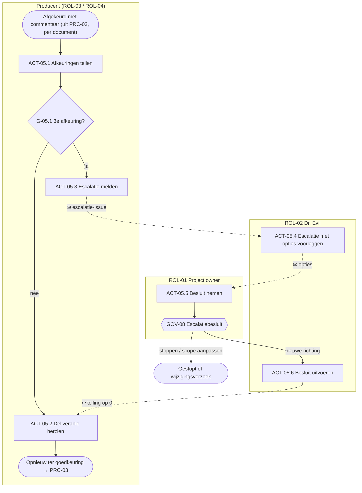

# PRC-05 – Afkeuring

Status: **Goedgekeurd (2026-11-01, Carlo, kaart `783a477a`)** (versie 0.15, CHG-029 – weergaven van model 0.15): weergave van het goedgekeurde model 0.15 (B-22, kaart `cf1337ff`). Daarvoor gold revisie 15 van dit document (Goedgekeurd 2026-11-01, Carlo, kaart `7a725bdb`, CHG-027 – weergaven van model 0.14). Het diagram en de stappen zijn niet veranderd; alleen de tekst. Volledige eerdere status: **Goedgekeurd (2026-11-01, Carlo, kaart `7a725bdb`)** (CHG-027 – weergaven van model 0.14): alleen de legenda is gelijkgetrokken met die van het register (gat A-10, ook K en de lokale codes). Daarvoor gold revisie 13 van dit document: **Goedgekeurd (2026-10-31, Carlo, kaart `ea488144`)** (CHG-025 – weergaven van model 0.13): alleen de legenda en de korte namen bij de codes erbij (B-18, ASM-55); de inhoud is niet veranderd. Daarvoor gold revisie 11 van dit document: **Goedgekeurd (2026-10-30, Carlo, kaart `f261b9ac`)**, versie 0.10 (model 0.10, CHG-015, besluit B-12). Kleine tekstwijziging, het diagram is niet veranderd. · Daarvoor: 0.8, Goedgekeurd (2026-10-29, Carlo, kaart `66da5f92`) · Eerder goedgekeurd: 0.5, Goedgekeurd (2026-10-28, Carlo, GK-2, kaart `eb913512`) · Herbruikbaar subproces · CHG-017: skills bij naam (B-11), inhoud ongewijzigd; Goedgekeurd (2026-10-30, Carlo, kaart `a16387c4`), daarvoor revisie 9.

**Wat de codes betekenen** (B-18): PRC = proces of subproces · ACT = stap (het nummer zegt niets over de volgorde) · G = beslispunt · GOV = akkoordmoment van jou · GS = grill-moment · ROL / AGT = rol / agent · CAP = capability · B = een besluit van jou · TL-V = jouw besluit over de tech lead · TL = tech-leadtaak van Atlas · PRP = voorstel · FND = bevinding · ASM = aanname · OPEN = open vraag · CHG = wijziging · P1 / P2 / P3 = architectuurprofiel (CMS / component-app / maatwerk) · M = plek waar Paperclip niet netjes past · K = punt uit de modelcontrole · UC / AC / BR / FR = use case / acceptatiecriterium / bedrijfsregel / functionele eis van een klantproject. Lokale codes: A-1, B-2, C-5 enz. = een gat uit een lijst `register-gaten-…` (groep A, B of C; niet te verwarren met je besluiten B-01 enz.) · V1 t/m V5 = vraag op een vragenkaart · D1 t/m D3 = doel · GK-1 t/m GK-4 = de vier goedkeuringsrondes. De korte naam staat de eerste keer per alinea, lijstpunt of tabelrij bij de code; de volledige lijst staat in `codes-en-namen`.

**Nieuw in 0.15** (CHG-029 – weergaven van model 0.15, goedgekeurd met B-22, kaart `cf1337ff`; CHG-028 – PRC-08 doorgevoerd in het model, B-21 – pakket PRC-08 goedgekeurd en uitgevoerd):
- **Skill:** `vragen-en-akkoordrondes` (telling en escalatie) is in PRC-08 (organisatie aanpassen) gemaakt (B-21 – pakket PRC-08 goedgekeurd en uitgevoerd; Feit: Paperclip-API en SKILL.md, 2026-11-01). De stappen van dit subproces tellen daarmee als *aanwezig*. "Aanwezig" betekent alleen: gekoppeld, en de tekst dekt de stap. Of de skill werkt, is niet vastgesteld (OPEN-11 – proefrun van de skills).
- GOV-08 (escalatiebesluit van Carlo) wordt in PRC-01 en PRC-02 ook gebruikt bij een tweede mislukte revisiecontrole van het OpenAPI-bestand (ASM-56 – revisiecontrole OpenAPI faalt). Dat verandert dit subproces niet.
- Stappen, beslissingen, akkoorden en het diagram zijn niet veranderd; de stappen blijven *to-be* tot ze in de praktijk zijn gezien (ASM-61 – processtappen blijven to-be tot ze draaien, bevestigd).

**Nieuw in 0.10** (CHG-015 – ontwerp-eerst en architectuurprofielen toegevoegd, jouw opdracht B-10 – ontwerp eerst en architectuurprofielen, goedgekeurd in B-12 – model 0.10 goedgekeurd, kaart `f261b9ac`):
- Afkeuren per document geldt ook voor het pakket **GOV-15** (akkoord richting: architectuur en ontwerpen; profiel, ontwerpen en brieven), met meer producenten (ASM-26 – oordeel per document bij ontwerppakket, bevestigd).
- De toetslus van Atlas geldt ook voor de paginabrieven (ACT-01.27 – paginalijst en paginabrieven opstellen met ACT-01.23 – use cases en paginabrieven toetsen; ACT-02.15 – ontwerpbehoefte bepalen en brieven opstellen met ACT-02.13 – wens: use cases en brieven toetsen).
- Geen nieuwe ID's; het diagram verandert niet.

**Nieuw in 0.8** (CHG-011 – keuze uit de voorstellen verwerkt, jouw keuze B-08 – keuze uit de voorstellen, kaart `2b7a6d2d`):
- PRP-006 (afkeuring: twee herzieningen, dan escalatie) is besloten: **2 herzieningsrondes**, daarna escalatie. De labels `V (PRP-006)` zijn nu `B (B-08, PRP-006)` (ACT-05.1 – afkeuringen tellen, 05.3, 05.4 (opties), 05.6, G-05.1 – is dit de derde afkeuring?, GOV-08 – escalatiebesluit van Carlo).
- Afkeuren per document binnen een pakket (GOV-10 – akkoord analysepakket, GOV-11 – akkoord technisch ontwerp volgens profiel) is nu basis (PRP-003 – minder, betere akkoordmomenten): alleen het afgekeurde document gaat door PRC-05 (afkeuring en herziening), bij GOV-11 met de geraakte latere documenten (ASM-18 – afgekeurd document apart herzien). De telling geldt per document.
- De telling en de escalatie lopen via `vragen-en-akkoordrondes` (PRP-023 – skill voor vragen- en akkoordrondes; in 0.8 nog te maken, sinds PRC-08 – organisatie aanpassen gemaakt, B-21 – pakket PRC-08 goedgekeurd en uitgevoerd).

**Labels:** **B** Besloten · **F** Feit · **A** Aanname

## Doel en uitkomst
Een afgekeurde deliverable gaat met commentaar terug naar de producent. Na een vast aantal rondes escaleert het naar ROL-01 (project owner). **B** (vastgelegde keuze 4). Het aantal is **2 herzieningsrondes** per deliverable, bij een pakket per document (B-08 – keuze uit de voorstellen, PRP-006 – afkeuring: twee herzieningen, dan escalatie). **B**

Uitkomst: een herziene deliverable opnieuw ter goedkeuring (PRC-03 – akkoord-poort van de project owner), of een besluit van ROL-01 (project owner) na escalatie.

## Trigger, start- en eindconditie
| | |
| --- | --- |
| Trigger | ROL-01 (project owner) kiest "Wijzigingen nodig" in PRC-03 (akkoord-poort van de project owner). Bij een pakket (GOV-10 – akkoord analysepakket, GOV-11 – akkoord technisch ontwerp volgens profiel, GOV-15 – akkoord richting: architectuur en ontwerpen): voor een document. |
| Start | Afkeuring met commentaar op het issue (bij een pakket: per afgekeurd document). |
| Einde | (1) Herziene deliverable terug naar PRC-03 (akkoord-poort van de project owner), of (2) besluit van ROL-01 (project owner) na escalatie. |

## Eigenaar, rollen en systemen
Eigenaar: ROL-02 (orchestrator en scrum master). Lanes: **producent**, **ROL-02** (escalatie), **ROL-01** (project owner). Systeem: Paperclip.

## Input en output
- **In:** afkeuring met commentaar, de deliverable, het aantal eerdere afkeuringen van deze deliverable (bij een pakket: van dit document).
- **Uit:** herziene deliverable (nieuwe revisie en versie, regel in de wijzigingshistorie), of een escalatie met opties en het besluit van ROL-01 (project owner).

## Relatie met andere processen
Aangeroepen door PRC-03 (akkoord-poort van de project owner). Roept PRC-03 opnieuw aan. Bij onduidelijk commentaar: vraag aan ROL-01 (project owner) op hetzelfde issue (geen PRC-04 – vragenloop en grill-sessie tussen agents, want ROL-01 is geen agent). De telling en de escalatie worden uitgevoerd met `vragen-en-akkoordrondes` (gedeeld met PRC-03 en PRC-04; gemaakt in PRC-08, B-21).

## Activiteiten
| ID | Activiteit | Rol of agent | Input | Resultaat | Vervolg | Paperclip | Label |
| --- | --- | --- | --- | --- | --- | --- | --- |
| ACT-05.1 | Afkeuringen tellen | producent | afkeuring, geschiedenis van het issue | aantal afkeuringen van deze deliverable (bij een pakket: per document) | G-05.1 (is dit de derde afkeuring?) | afgewezen kaarten in de geschiedenis van het issue. ⚠ M-1 (rondes en afkeuringen tellen): niet gevonden dat Paperclip rondes telt; de producent telt zelf. Met een `approval`-stage legt Paperclip elk besluit vast (OPEN-10 – mechanisme voor Carlo's akkoord). | B (B-08 – keuze uit de voorstellen, PRP-006 – afkeuring: twee herzieningen, dan escalatie) |
| ACT-05.2 | Commentaar verwerken en deliverable herzien | producent | commentaar, deliverable | nieuwe revisie, versie verhoogd, regel in de wijzigingshistorie | PRC-03 (akkoord-poort van de project owner) | document (nieuwe revisie), comment met wat er is veranderd | B (terug naar de producent), F (`bpmn-conventies`: na feedback aanpassen, versie verhogen) |
| ACT-05.3 | Escalatie melden aan de orchestrator | producent | deliverable, afkeuringen, commentaar | escalatie-issue voor ROL-02 (orchestrator en scrum master) | ACT-05.4 (afkeuring-escalatie met opties voorleggen) | nieuw issue toegewezen aan Dr. Evil, met een verwijzing naar het issue van de deliverable | B (B-08 – keuze uit de voorstellen, PRP-006 – afkeuring: twee herzieningen, dan escalatie) |
| ACT-05.4 | Escalatie met opties voorleggen | ROL-02 (orchestrator en scrum master) | escalatie-issue | opties voor ROL-01 (project owner): scope aanpassen, andere aanpak, toelichting van ROL-01, stoppen | GOV-08 | interactie `ask_user_questions` of `request_confirmation` op het escalatie-issue, status `in_review` | F (`escalation-management`; rolanalyse-orchestrator V8: trigger 1 blokkade, trigger 5 scope), B (B-08 – keuze uit de voorstellen, PRP-006 – afkeuring: twee herzieningen, dan escalatie: de opties) |
| ACT-05.5 | Besluit over de vastgelopen deliverable nemen | ROL-01 (project owner) | opties | besluit | ACT-05.6 (besluit uitvoeren) | kaart beantwoorden | B (escaleren naar jou) |
| ACT-05.6 | Besluit uitvoeren | ROL-02 (orchestrator en scrum master) | besluit | opdracht aan de producent met het besluit, telling op 0; of gestopt | PRC-03 (akkoord-poort van de project owner) via ACT-05.2 (commentaar verwerken en document herzien), of einde | comment en toewijzing op het issue van de producent | B (B-08 – keuze uit de voorstellen, PRP-006 – afkeuring: twee herzieningen, dan escalatie) |

## Beslissingen en goedkeuringen
| ID | Vraag | Uitkomsten | Bij afwijzing | Label |
| --- | --- | --- | --- | --- |
| G-05.1 | Is dit de 3e afkeuring van deze deliverable (dus de 2e herziening afgekeurd)? Bij een pakket: van dit document | nee → ACT-05.2 (commentaar verwerken en document herzien) · ja → ACT-05.3 (escalatie melden aan Dr. Evil) | — | B (vast aantal rondes), B (B-08 – keuze uit de voorstellen, het aantal: PRP-006 – afkeuring: twee herzieningen, dan escalatie) |
| GOV-08 | Escalatiebesluit van ROL-01 (project owner; gedeeld met PRC-04 – vragenloop en grill-sessie tussen agents en PRC-06 – blokkade afhandelen) | doorgaan met een nieuwe richting → ACT-05.6 (besluit uitvoeren) → ACT-05.2 (commentaar verwerken en document herzien) · stoppen of scope aanpassen → einde "gestopt"; het aanroepende proces stopt of gaat via een wijzigingsverzoek (GOV-12 – akkoord wijzigingsverzoek of productkeuze) | — | B (escaleren naar jou), B (B-08 – keuze uit de voorstellen, opties: PRP-006 – afkeuring: twee herzieningen, dan escalatie) |

## Uitzonderingen en loops
- **Gestopt:** issues die op deze deliverable wachten, worden niet vanzelf gewekt als die wordt geannuleerd (⚠ M-7 – stoppen van een proces). Dr. Evil past de blockers aan. **F** (skill `paperclip`)
- **Ook voor reviews door Atlas:** de toets van de use cases (G-01.4 – toets nieuwe klant: use cases of brieven aanpassen?, G-02.5 – toets uitbreiding: use cases of brieven aanpassen?) gebruikt hetzelfde maximum en dezelfde escalatie (ACT-05.3 – escalatie melden aan Dr. Evil → GOV-08 – escalatiebesluit van Carlo). Na het besluit gaat de herziene deliverable terug naar de review van Atlas, niet naar PRC-03 (akkoord-poort van de project owner). Bij de use cases: Socrates herziet (ACT-01.9 – use cases met acceptatiecriteria opstellen of ACT-02.12 – use cases van de wens opstellen), daarna toetst Atlas opnieuw (ACT-01.23 – use cases en paginabrieven toetsen of ACT-02.13 – wens: use cases en brieven toetsen). Hetzelfde geldt voor de paginabrieven (ACT-01.27 – paginalijst en paginabrieven opstellen, ACT-02.15 – ontwerpbehoefte bepalen en brieven opstellen; nieuw in 0.10). **B** (B-08 – keuze uit de voorstellen, PRP-006 – afkeuring: twee herzieningen, dan escalatie; B-12 – model 0.10 goedgekeurd)
- **Toets van de taken (G-01.5 – toets nieuwe klant: taken aanpassen?, G-02.6 – toets uitbreiding: taken aanpassen?, nieuw in 0.8):** ook hier maximaal 2 rondes (PRP-006 – afkeuring: twee herzieningen, dan escalatie). Daarna gaat het als conflict tussen Dr. Evil en Atlas naar ROL-01 (project owner; `escalation-management` trigger 2 → GOV-08 – escalatiebesluit van Carlo). Na het besluit past Dr. Evil de taken aan volgens het besluit, of laat ze zoals ze zijn (ACT-01.20 – epics en taken slice 1 maken / ACT-02.11 – taken maken en op backlog zetten), en gaat door naar ACT-01.57 (backlog gereed van slice 1 controleren) / ACT-02.54 (backlog gereed van uitbreiding controleren). **B** (B-08 – keuze uit de voorstellen, PRP-027 – Atlas toetst taken tegen werkpakketten; GOV-08)
- **Herzien → PRC-03 (akkoord-poort van de project owner) → afgekeurd → PRC-05:** maximaal 2 herzieningsrondes, daarna G-05.1 (is dit de derde afkeuring?) → escalatie. **B** (B-08 – keuze uit de voorstellen, PRP-006 – afkeuring: twee herzieningen, dan escalatie)
- **Na het escalatiebesluit** begint de telling opnieuw, want er is een nieuwe richting. Een tweede escalatie over dezelfde deliverable gaat weer naar ROL-01 (project owner). Er is geen derde automatische ronde. **A** (ASM-11 – telling begint opnieuw na escalatie)
- **Afkeuren per document binnen een pakket** (GOV-10 – akkoord analysepakket, GOV-11 – akkoord technisch ontwerp volgens profiel, GOV-15 – akkoord richting: architectuur en ontwerpen; nu basis): alleen het afgekeurde document gaat door PRC-05 (afkeuring en herziening), de rest blijft goedgekeurd. De telling en het maximum gelden per document. Bij GOV-11 werkt Atlas de geraakte latere documenten mee bij; die komen opnieuw in hetzelfde pakket. **B** (B-08 – keuze uit de voorstellen, PRP-003 – minder, betere akkoordmomenten), **A** (ASM-18 – afgekeurd document apart herzien)
- **Afgekeurde requirements bij GOV-10 (akkoord analysepakket):** Socrates herziet de requirements (ACT-01.6 – analysedocument opstellen) en werkt de use cases en de kern mee bij als ze geraakt worden; Atlas toetst de gewijzigde use cases opnieuw (ACT-01.23 – use cases en paginabrieven toetsen); ze komen opnieuw in hetzelfde pakket. Alleen de requirements tellen een herzieningsronde; keur je een meegewerkt document daarna af, dan telt dat wel als afkeuring van dat document. **A** (ASM-18 – afgekeurd document apart herzien)
- **Start bij een pakket:** de producent begint pas aan PRC-05 als elk document een oordeel heeft; de kaart kent alleen goedkeuren en afkeuren. **A** (ASM-18 – afgekeurd document apart herzien)
- **Telling en escalatie met `vragen-en-akkoordrondes`:** de skill (PRP-023 – skill voor vragen- en akkoordrondes; gemaakt in PRC-08 – organisatie aanpassen, B-21 – pakket PRC-08 goedgekeurd en uitgevoerd) legt vast dat na 2 herzieningen, per document ook binnen een pakket, altijd een escalatie volgt. **B** (B-08 – keuze uit de voorstellen, PRP-023)

## Tussendiagram

## Aannames en open vragen
- **ASM-11:** na een escalatiebesluit begint de telling opnieuw; een volgende vastloper gaat weer naar ROL-01 (project owner).
- **ASM-18 (afgekeurd document apart herzien):** bij GOV-11 (akkoord technisch ontwerp volgens profiel) komen de geraakte latere documenten opnieuw in hetzelfde pakket; de rest blijft goedgekeurd. Bij GOV-10 (akkoord analysepakket) geldt hetzelfde: keurt ROL-01 (project owner) de requirements af, dan werkt Socrates de use cases en de kern mee bij als ze geraakt worden, toetst Atlas de gewijzigde use cases opnieuw (ACT-01.23 – use cases en paginabrieven toetsen), en komen ze opnieuw in hetzelfde pakket. Een meegewerkt document telt geen ronde. De producent handelt pas als elk document een oordeel heeft; de kaart kent alleen goedkeuren en afkeuren (uitgebreid na controle-model-v08, L-04, L-13).
- PRP-006 (afkeuring: twee herzieningen, dan escalatie; 2 herzieningsrondes) is besloten in B-08 (keuze uit de voorstellen).

## Wijzigingshistorie
| Versie | Datum | Wijziging | Door |
| --- | --- | --- | --- |
| 0.3 | 2026-10-28 | Eerste procesbeschrijving (ronde 2, CHG-004 – procesmodellen uitgewerkt, ronde 2). Na controle E-07, E-12, E-13: Label-kolom, M-1 (rondes en afkeuringen tellen) als niet gevonden, M-7 (stoppen van een proces), reviews door Atlas. | Socrates |
| 0.4 | 2026-10-28 | CHG-005: toets van de use cases door Atlas (G-01.4 – toets nieuwe klant: use cases of brieven aanpassen?, G-02.5 – toets uitbreiding: use cases of brieven aanpassen?) valt onder dezelfde regel (controle G-05). | Socrates |
| 0.5 | 2026-10-28 | CHG-007 (geen rol tech lead verwerkt): TL-V7 (geen rol tech lead), ROL-05 (tech lead) vervalt. Producent-lane zonder ROL-05. Bij "Ook voor reviews door Atlas" vervallen G-01.3 (meelezen door Atlas bij plan), G-02.4 (meelezen door Atlas bij ontwerp), ACT-01.55 (toets van eigen slice-ontwerp) en ACT-02.52; de toets van de use cases blijft. | Socrates |
| 0.8 | 2026-10-29 | CHG-011 (keuze uit de voorstellen verwerkt; B-08 – keuze uit de voorstellen): PRP-006 (afkeuring: twee herzieningen, dan escalatie) besloten, labels `V (PRP-006)` → `B (B-08, PRP-006)`. Afkeuren per document binnen een pakket is basis (PRP-003 – minder, betere akkoordmomenten, ASM-18 – afgekeurd document apart herzien); telling per document. Telling en escalatie via `vragen-en-akkoordrondes` (PRP-023 – skill voor vragen- en akkoordrondes, nog te maken). Toets van de taken (G-01.5 – toets nieuwe klant: taken aanpassen?, G-02.6 – toets uitbreiding: taken aanpassen?) onder hetzelfde maximum. Na controle-model-v08: L-04 (afgekeurde requirements bij GOV-10 – akkoord analysepakket: use cases en kern mee, Atlas toetst opnieuw; ASM-18 uitgebreid), L-13 (start pas als elk document een oordeel heeft), L-03 (vervolg na GOV-08 – escalatiebesluit van Carlo bij de toets van de taken). | Socrates |
| 0.10 | 2026-10-30 | CHG-015 (ontwerp-eerst en architectuurprofielen toegevoegd; B-10 – ontwerp eerst en architectuurprofielen, goedgekeurd in B-12 – model 0.10 goedgekeurd): afkeuren per document ook bij GOV-15 (akkoord richting: architectuur en ontwerpen; meer producenten, ASM-26 – oordeel per document bij ontwerppakket); de toetslus geldt ook voor de paginabrieven. Het diagram is niet veranderd. | Socrates |
| 0.15 | 2026-11-01 | CHG-029 (2026-11-01): weergave van model 0.15 (B-22 – model 0.15 goedgekeurd, kaart `cf1337ff`). `vragen-en-akkoordrondes` gemaakt in PRC-08 (organisatie aanpassen; B-21 – pakket PRC-08 goedgekeurd en uitgevoerd), geen "nog te maken" meer; "aanwezig" betekent alleen gekoppeld en tekst (OPEN-11 – proefrun van de skills). Stappen, beslissingen en diagram ongewijzigd. | Socrates |

