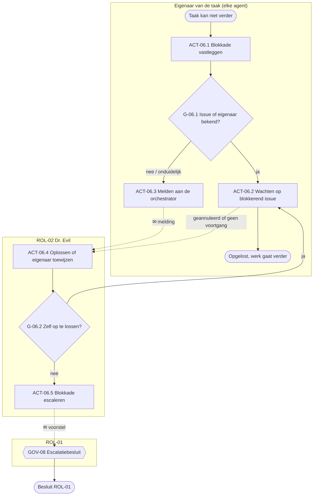

# PRC-06 – Blokkade

Status: **Goedgekeurd (2026-11-01, Carlo, kaart `783a477a`)** (versie 0.15, CHG-029 – weergaven van model 0.15): weergave van het goedgekeurde model 0.15 (B-22, kaart `cf1337ff`). Daarvoor gold revisie 8 van dit document (Goedgekeurd 2026-11-01, Carlo, kaart `7a725bdb`, CHG-027 – weergaven van model 0.14). Het diagram en de stappen zijn niet veranderd; alleen de tekst. Volledige eerdere status: **Goedgekeurd (2026-11-01, Carlo, kaart `7a725bdb`)** (CHG-027 – weergaven van model 0.14): alleen de legenda is gelijkgetrokken met die van het register (gat A-10, ook K en de lokale codes). Daarvoor gold revisie 6 van dit document: **Goedgekeurd (2026-10-31, Carlo, kaart `ea488144`)** (CHG-025 – weergaven van model 0.13): alleen de legenda en de korte namen bij de codes erbij (B-18, ASM-55); de inhoud is niet veranderd. Daarvoor gold revisie 4 van dit document: **Goedgekeurd (2026-10-28, Carlo, GK-2, kaart `eb913512`)** · Versie: 0.3 (model 0.3, ronde 2) · Herbruikbaar subproces

**Wat de codes betekenen** (B-18): PRC = proces of subproces · ACT = stap (het nummer zegt niets over de volgorde) · G = beslispunt · GOV = akkoordmoment van jou · GS = grill-moment · ROL / AGT = rol / agent · CAP = capability · B = een besluit van jou · TL-V = jouw besluit over de tech lead · TL = tech-leadtaak van Atlas · PRP = voorstel · FND = bevinding · ASM = aanname · OPEN = open vraag · CHG = wijziging · P1 / P2 / P3 = architectuurprofiel (CMS / component-app / maatwerk) · M = plek waar Paperclip niet netjes past · K = punt uit de modelcontrole · UC / AC / BR / FR = use case / acceptatiecriterium / bedrijfsregel / functionele eis van een klantproject. Lokale codes: A-1, B-2, C-5 enz. = een gat uit een lijst `register-gaten-…` (groep A, B of C; niet te verwarren met je besluiten B-01 enz.) · V1 t/m V5 = vraag op een vragenkaart · D1 t/m D3 = doel · GK-1 t/m GK-4 = de vier goedkeuringsrondes. De korte naam staat de eerste keer per alinea, lijstpunt of tabelrij bij de code; de volledige lijst staat in `codes-en-namen`.

**Labels:** **B** Besloten · **F** Feit · **V** Voorstel · **A** Aanname

**Nieuw in 0.15** (CHG-029 – weergaven van model 0.15, goedgekeurd met B-22, kaart `cf1337ff`; CHG-028 – PRC-08 doorgevoerd in het model, B-21 – pakket PRC-08 goedgekeurd en uitgevoerd):
- De flowcheck-routine *Dagstart: flowcheck en herinnering* (maandag t/m vrijdag 09:00, toegewezen aan Dr. Evil) bestaat sinds PRC-08 (organisatie aanpassen; Feit: Paperclip-API, 2026-11-01). De eerste run is op 2026-11-02; ze is nog niet gezien draaien (ASM-32 – weekmoment en dagstart van Dr. Evil). Alleen de tekst bij *Blokkade lost niet op* is daarom bijgewerkt.
- GOV-08 (escalatiebesluit van Carlo) wordt in PRC-01 en PRC-02 ook gebruikt bij een tweede mislukte revisiecontrole van het OpenAPI-bestand (ASM-56 – revisiecontrole OpenAPI faalt). Dat verandert dit subproces niet.
- Stappen, beslissingen, akkoorden en het diagram zijn niet veranderd; de stappen blijven *to-be* tot ze in de praktijk zijn gezien (ASM-61 – processtappen blijven to-be tot ze draaien, bevestigd).

## Doel en uitkomst
Een taak die niet verder kan zichtbaar maken, de eigenaar van de oplossing laten handelen en zo nodig escaleren. **B** (vastgelegde keuze 4: geblokkeerde taken). Uitkomst: blokkade opgelost (werk gaat verder) of een besluit van ROL-01 (project owner).

## Trigger, start- en eindconditie
| | |
| --- | --- |
| Trigger | Een agent kan zijn taak niet afmaken door iets buiten zijn macht: een ander issue, een ontbrekend antwoord of besluit, een niet-beschikbare agent. |
| Start | De taak staat stil. |
| Einde | (1) Blokkade opgelost, of (2) besluit van ROL-01 (project owner) na escalatie. |

## Eigenaar, rollen en systemen
Eigenaar: ROL-02 (orchestrator en scrum master). Lanes: **eigenaar van de taak** (elke agent), **ROL-02**, **ROL-01** (project owner). Systeem: Paperclip.

## Input en output
- **In:** de geblokkeerde taak en de reden.
- **Uit:** blokkade vastgelegd met wie moet handelen; daarna opgelost of geëscaleerd.

## Relatie met andere processen
Aangeroepen door PRC-01 (nieuwe klant: opdracht tot eerste backlog), PRC-02 (backlog uitbreiden met volgende slice) en PRC-04 (vragenloop en grill-sessie tussen agents; ontvanger reageert niet). Deelt GOV-08 (escalatiebesluit van Carlo) met PRC-04 en PRC-05 (afkeuring en herziening). De dagelijkse controle hoort bij PRC-07 (weekmoment en prioriteren; flowcheck).

## Activiteiten
| ID | Activiteit | Rol of agent | Input | Resultaat | Vervolg | Paperclip | Label |
| --- | --- | --- | --- | --- | --- | --- | --- |
| ACT-06.1 | Blokkade vastleggen | eigenaar van de taak | reden | taak `blocked` met wat er moet gebeuren en door wie | G-06.1 (heeft de blokkade een eigenaar?) | status `blocked` met `blockedByIssueIds`; of een comment met de concrete actie | F (skill `paperclip`: blokkade altijd met naam en actie) |
| ACT-06.2 | Wachten op het blokkerende issue | eigenaar van de taak | blocker | taak wordt gewekt als het blokkerende issue `done` is | einde; bij een geannuleerd blokkerend issue of zonder voortgang: ACT-06.4 (blokkade oplossen of eigenaar toewijzen) | `blockedByIssueIds`, wake `issue_blockers_resolved`. ⚠ M-7 (stoppen van een proces): een geannuleerd blokkerend issue wekt niet | F (skill `paperclip`) |
| ACT-06.3 | Blokkade melden aan de orchestrator | eigenaar van de taak | blokkade zonder eigenaar | melding aan ROL-02 (orchestrator en scrum master) | ACT-06.4 (blokkade oplossen of eigenaar toewijzen) | issue toegewezen aan Dr. Evil, of comment op een issue van hem | A (ASM-13 – blokkade melden via issue) |
| ACT-06.4 | Blokkade oplossen of eigenaar toewijzen | ROL-02 (orchestrator en scrum master) | blokkade | oplossing, of een issue voor de eigenaar van de oplossing | G-06.2 (kan Dr. Evil de blokkade oplossen?) | toewijzing, nieuw issue, `blockedByIssueIds` | F (rolanalyse-orchestrator OR-07, SM-05; `dependency-management`) |
| ACT-06.5 | Blokkade escaleren | ROL-02 (orchestrator en scrum master) | blokkade die hij niet kan oplossen | voorstel aan ROL-01 (project owner) | GOV-08 | interactie op het issue, status `in_review` | F (V8, trigger 1; `escalation-management`) |

## Beslissingen en goedkeuringen
| ID | Vraag | Uitkomsten | Bij afwijzing | Label |
| --- | --- | --- | --- | --- |
| G-06.1 | Is er een issue of eigenaar die de blokkade oplost? | ja, een ander issue → ACT-06.2 (wachten op blokkerend issue) · nee of onduidelijk → ACT-06.3 (blokkade melden aan Dr. Evil) | — | F (skill `paperclip`) |
| G-06.2 | Kan ROL-02 (orchestrator en scrum master) de blokkade zelf oplossen? | ja → ACT-06.2 (wachten op blokkerend issue; wacht op het nieuwe issue) · nee → ACT-06.5 (blokkade escaleren) | — | F (OR-07, SM-05, V8 trigger 1) |
| GOV-08 | Escalatiebesluit van ROL-01 (project owner; gedeeld met PRC-04 – vragenloop en grill-sessie tussen agents en PRC-05 – afkeuring en herziening) | besluit → de eigenaar van de taak gaat verder of stopt volgens het besluit → einde | — | F (V8 trigger 1) |

## Uitzonderingen en loops
- **Blokkade lost niet op:** ROL-02 (orchestrator en scrum master) ziet het bij de dagelijkse flowcheck (SM-01) en escaleert als hij het niet zelf kan oplossen (trigger 1). Al het andere bewaart hij voor het weekmoment. **F** (rolanalyse-orchestrator V8, V12). ⚠ **Past niet netjes:** de flowcheck-routine bestaat sinds PRC-08 (organisatie aanpassen; F: Paperclip-API, 2026-11-01), maar is nog niet gezien draaien (eerste run 2026-11-02; FND-013 – orchestrator zonder eigen ritme). Werkt de routine niet, dan ziet Dr. Evil een blokkade alleen als iemand hem een issue toewijst.
- **Agent niet beschikbaar** (budget, fout): valt onder trigger 1 als Dr. Evil het niet zelf oplost. **F** (rolanalyse-orchestrator §4, `escalation-management`). Budget op 80%: trigger 3. **F**
- **Wachten zonder voortgang** (ACT-06.2): is het blokkerende issue geannuleerd (⚠ M-7 – stoppen van een proces) of gebeurt er niets, dan gaat de blokkade naar Dr. Evil (ACT-06.4 – blokkade oplossen of eigenaar toewijzen). Dat ziet hij bij de flowcheck of omdat de eigenaar het meldt. **F/A**
- Geen loop terug na ACT-06.5 (blokkade escaleren): daar beslist ROL-01 (project owner).

## Tussendiagram

## Aannames en open vragen
- **ASM-13:** een agent meldt een blokkade zonder eigenaar aan Dr. Evil met een issue dat aan hem is toegewezen, omdat een vermelding hem niet als opdracht wekt (feitencheck Dr. Evil, WEB-20).

## Wijzigingshistorie
| Versie | Datum | Wijziging | Door |
| --- | --- | --- | --- |
| 0.3 | 2026-10-28 | Eerste procesbeschrijving (ronde 2, CHG-004 – procesmodellen uitgewerkt, ronde 2). Na controle E-07, E-13: route bij een geannuleerde blocker, M-7 (stoppen van een proces), Label-kolom. | Socrates |
| 0.15 | 2026-11-01 | CHG-029 (2026-11-01): weergave van model 0.15 (B-22 – model 0.15 goedgekeurd, kaart `cf1337ff`). Alleen tekst: de flowcheck-routine bestaat sinds PRC-08 (organisatie aanpassen; B-21 – pakket PRC-08 goedgekeurd en uitgevoerd), nog niet gezien draaien. Stappen, beslissingen en diagram ongewijzigd. | Socrates |

