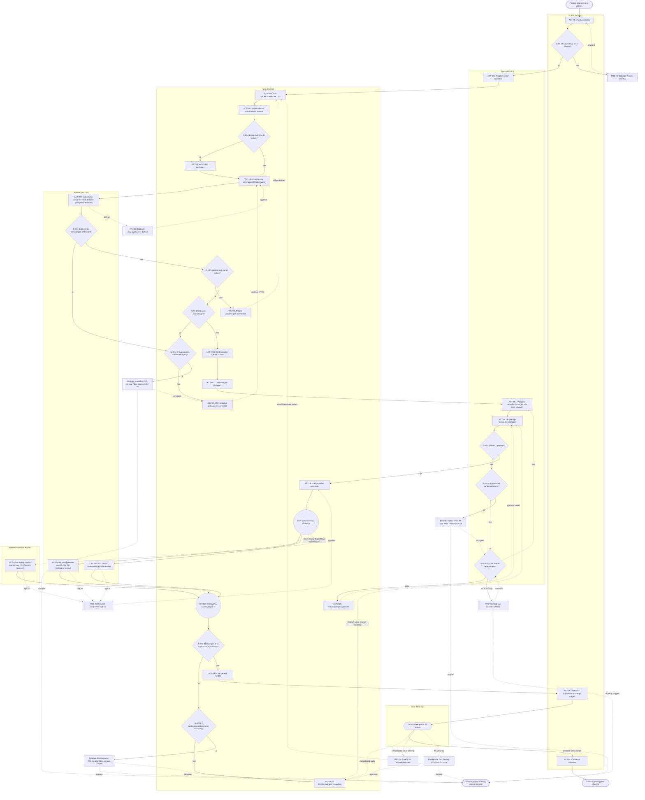

# PRC-09 – Feature uitvoeren (uitvoeringsloop)
Status: Goedgekeurd (2026-11-11, Carlo, kaarten c5c48ddf, 3a0909d3, 3de7be3d, 6f17eb2b) · Versie: 0.6 · **Gepauzeerd sinds 2026-11-18 (CHG-035, B-26, B-27).** Zolang geldt PRC-10. · Hoort bij voorstel CHG-033 (agentorganisatie op agent-skills en uitvoeringsloop, model 0.17) · Bouwt op: `register` WEB-19 r26 (model 0.17)

Met de vier kaarten is het voorstel goedgekeurd; de voorstellen (V) gelden nu als besloten. ASM-65 en ASM-72 blijven aannames tot OPEN-22 is uitgezocht en het model is gemeten. Keuze n verwijst naar `analyse` §10. In het diagram: `+` = parallelle poort, `O` = inclusieve poort.

**Wat de codes betekenen.** CHG = wijziging · AC = acceptatiecriterium · PRC = proces · ACT = stap · G = beslispunt · GOV = akkoordmoment van Carlo · ROL = rol · AGT = agent · CAP = capability · ASM = aanname · OPEN = open vraag · FND = bevinding · PRP = voorstel · TL = tech-leadtaak van Atlas · B = besluit van Carlo · Labels van een reviewbevinding volgens `code-review-and-quality`: *Critical* en zonder label (verplicht) blokkeren, *Optional*, *Nit* en *FYI* niet. Neo = coding agent (AGT-06), Trace = tester (AGT-07). Labels: **B** = besloten (opdracht van Carlo op WEB-152, met de bijsturing `fb48a390` op WEB-17), **V** = voorstel, **A** = aanname, **F** = feit. Alles in dit proces is `to-be`.

## Doel en uitkomst
Een feature uit de backlog bouwen, testen en reviewen tot Carlo hem merget. Uitkomst: één gemergede PR per feature, met tests, documentatie en reviews (codereview per taak en na de laatste taak, securityreview, Bugbot). Los van de backlogloop, PRC-01 (nieuwe klant) en PRC-02 (backlog uitbreiden): die vullen de backlog, dit proces voert hem uit (B, punt 8).

## Trigger, start- en eindconditie
- **Trigger:** Dr. Evil pakt het bovenste feature-epic dat klaar is om op te pakken, in de volgorde uit PRC-07 (weekmoment en prioriteren).
- **Start:** epic met taken, AC-ID's, eigenaar en afhankelijkheden; bouwcontract goedgekeurd (GOV-06, akkoord bouwcontract per slice); `CLAUDE.md`, `AGENTS.md` en `CONSTRAINTS.md` in de repo; bij UI-werk een aangeleverd designsysteem. Dat is het eindpunt "Backlog gereed, overdracht naar implementatie" van PRC-01 en PRC-02.
- **Einde normaal:** Carlo heeft de PR gemerged (GOV-16, merge van de feature) en Dr. Evil heeft de feature afgerond.
- **Einde anders:** feature gestopt of teruggezet naar de backlog na een escalatiebesluit (GOV-08, escalatiebesluit van Carlo).

## Eigenaar, rollen en systemen
- **Eigenaar:** ROL-02 (orchestrator, Dr. Evil). Eindverantwoordelijk voor het resultaat: ROL-01 (Carlo) via GOV-16.
- **Rollen en agents:** ROL-01 Carlo · ROL-02 Dr. Evil (AGT-01) · ROL-06 developer: Neo (AGT-06, V) · ROL-07 tester: Trace (AGT-07, V) · ROL-08 reviewer: Sentinel (AGT-05; F: agent bestaat, V: krijgt deze rol) · externe reviewbot Bugbot (`@cursor-reviewer`; systeem, geen agent; Neo vraagt hem één keer per PR aan). Via PRC-04 (vragenloop tussen agents): ROL-03 Socrates (eisen) en ROL-04 Atlas (ontwerp). De ontwerper is Carlo (ASM-28, Carlo is de ontwerper).
- **Systemen:** Paperclip (epic, taken, review-issues, testplan, testrapport), GitHub (featurebranch, draft-PR, comments `@code-review`, `@security-review`, `@cursor-reviewer`, reviews als comment, CI, merge; een GitHub-hook maakt van een reviewcomment een Paperclip-issue en wekt Neo, ASM-65), repo van het klantproject (code, tests, technische documentatie in `docs/`, gebruikersdocumentatie in `docs/user/`, `CLAUDE.md`, `AGENTS.md` met de compacte ponytail-regels, `CONSTRAINTS.md`).

## Input en output
- **Input:** feature-epic met taken (AC-ID's, verwijzing naar FR/UC/BR, paginabrief bij frontend), bouwcontract, implementatieplan met taken, `CLAUDE.md` en `CONSTRAINTS.md`, designsysteem van de ontwerper.
- **Output:** gemergede PR; testplan en testrapport als documenten op het epic; technische en gebruikersdocumentatie in de PR; taken en epic op `done`; na de eerste feature een evaluatie van het model van Neo en Trace voor Carlo (keuze 12).

## Relatie met andere processen
- Start na PRC-01 of PRC-02 (backlog gereed) en PRC-07 (volgorde). Deelt alleen de backlog met die processen.
- Roept aan: PRC-03 (akkoord-poort, voor GOV-16), PRC-04 (vraag of wijzigingsverzoek), PRC-05 (afkeuring bij GOV-16), PRC-06 (blokkade), GOV-08 (escalatiebesluit) en GOV-12 (akkoord wijzigingsverzoek of productkeuze). Na de eerste feature leidt de evaluatie (ACT-09.20) tot een kaart voor Carlo; wil hij het model wijzigen, dan gaat dat via PRC-08 (organisatie aanpassen).
- Werk dat tijdens de bouw opduikt en niet nodig is voor de AC's van de feature, wordt een wens voor PRC-02; de feature groeit niet stilzwijgend (zie "Werk buiten de taak").

## Proces in gewone taal
1. Dr. Evil start de feature als hij klaar is en er ruimte is.
2. Trace schrijft eerst een kort testplan uit de acceptatiecriteria, zonder code te zien.
3. Per taak bouwt Neo via TDD, met de testgevallen uit het testplan plus eigen tests. Daarna refactort hij licht en pusht. Bij de eerste taak maakt hij een draft-PR. Dan vraagt hij `@code-review` aan met een comment op de PR; hij wacht zonder te pollen. Sentinel reviewt de commits sinds de laatst goedgekeurde review. Blokkerende fouten (*Critical* en verplicht) lost Neo meteen op. Andere opmerkingen mogen mee naar de volgende taak; bij de laatste taak verwerkt hij ze of wijst hij ze met reden af.
4. Na de laatste taak volgen een brede refactor over de hele feature en de documentatie. Daarna breidt Trace het plan uit met UI- en e2e-tests en draait hij alles.
5. Daarna vraagt Neo drie reviews tegelijk aan en wacht hij op alle drie: een laatste codereview door Sentinel (`@code-review`) over wat nog niet is goedgekeurd, de securityreview door Sentinel (`@security-review`) over de hele PR, en één keer per PR Bugbot (`@cursor-reviewer`) over de hele PR. Elke bevinding lost hij op of wijst hij met reden af. Na een fix volgen opnieuw de testrun, de laatste codereview en de securityreview; Bugbot niet.
6. Is alles groen, dan controleert Dr. Evil de poorten en vraagt hij Carlo te mergen.

## Activiteiten
| ID | Activiteit | Rol of agent | Input | Resultaat | Vervolg | Label |
|---|---|---|---|---|---|---|
| ACT-09.1 | Feature starten | Dr. Evil (ROL-02) | epic met taken, WIP-stand, volgorde PRC-07 | epic toegewezen aan Neo, testplantaak aan Trace, naam featurebranch | G-09.1 | V |
| ACT-09.2 | Testplan vooraf opstellen | Trace (ROL-07) | AC's, use cases, bouwcontract, paginabrieven; **geen code** | document `testplan` op het epic: testgevallen per AC met AC-ID en niveau (unit, integratie, UI/e2e) | ACT-09.3 | V |
| ACT-09.3 | Taak implementeren via TDD | Neo (ROL-06) | taak, testplan, meegenomen opmerkingen, `CLAUDE.md`, `CONSTRAINTS.md` | per gedrag eerst een falende test, dan minimale productiecode (ponytail-ladder); technische docs bij publieke API; lokaal groen. Bij de eerste taak eerst de featurebranch | ACT-09.4 | B (stap 1) |
| ACT-09.4 | Lichte refactor, committen en pushen | Neo | diff van de taak | alleen de code van deze taak vereenvoudigd, tests groen, commit en push | G-09.2 | B (stap 2); V (licht) |
| ACT-09.5 | Draft-PR aanmaken | Neo | featurebranch | draft-PR met body (doel, taken, bewijs) | ACT-09.6 | B (stap 3) |
| ACT-09.6 | Codereview aanvragen (@code-review) | Neo | PR, head-sha | comment `@code-review` op de PR; via de GitHub-hook wordt dat een review-issue voor Sentinel dat de taak blokkeert (wachten zonder pollen) | ACT-09.7 | B (stap 4; keuze 4); A (ASM-65) |
| ACT-09.7 | Codereview uitvoeren vanaf de laatst goedgekeurde review | Sentinel (ROL-08) | commits sinds de laatst goedgekeurde review (na een afkeuring ook de afgekeurde commits), open bevindingen van eerdere reviews, AC's, `CLAUDE.md`, `CONSTRAINTS.md` | icoon op de comment zodra de review begint; review als comment op de PR (labels volgens `code-review-and-quality`) met bereikregel en marker; verlaagde lat (`CONSTRAINTS.md`) is een bevinding; lijst open bevindingen bijgewerkt; ontwerpafwijking ook gemeld aan Atlas (TL-09, ontwerpafwijkingen afhandelen); review-issue gesloten | G-09.3 | B (keuze 1) |
| ACT-09.8 | Bevindingen oplossen en committen | Neo | bevindingen | fix met test (bug: eerst een falende test), commit, push | ACT-09.6 | B (stap 5) |
| ACT-09.9 | Open opmerkingen meenemen | Neo | open *Optional*- en *Nit*-opmerkingen | lijst open opmerkingen op de volgende taak | ACT-09.3 (volgende taak) | B (stap 6) |
| ACT-09.10 | Brede refactor over de feature | Neo | hele PR-diff (vanaf merge-base) | vereenvoudigde feature zonder gedragswijziging, tests groen, push | ACT-09.11 | B |
| ACT-09.11 | Documentatie bijwerken | Neo | feature, use cases, bestaande docs | technische documentatie (README, API-docs, why-commentaar) in `docs/`, voor developers en agents; gebruikersdocumentatie in `docs/user/`, voor de eindgebruikers van de app; in de PR | ACT-09.12 | B (punt 9; map: keuze 6); V (wie) |
| ACT-09.12 | Testplan uitbreiden en UI- en e2e-tests schrijven | Trace | testplan, gebouwde feature, paginabrieven | testplan aangevuld (UI met klikken, e2e, toegankelijkheid, randgevallen); ontbrekende tests als commits op de featurebranch (alleen testcode); UI- en e2e-tests met het testgereedschap van het project (zoals Playwright), die zolang Chrome niet in de runner staat alleen in CI draaien | ACT-09.13 | B (browser: keuze 7) |
| ACT-09.13 | Volledige testrun en testrapport | Trace | alle tests (UI en e2e als CI-resultaat zolang Chrome niet in de runner staat), gebruikersdocumentatie; bij herstel: de volledige CI-run plus de tests die de fix raakt | document `testrapport` op het epic: per AC geslaagd of gefaald, met bewijs; stappen uit de gebruikersdocumentatie nagelopen via tests | G-09.7 | B (browser: keuze 7) |
| ACT-09.14 | Testbevindingen oplossen | Neo | gefaalde tests met oorzaak code | fix; de gefaalde test blijft de reproductietest; push | ACT-09.13 | V |
| ACT-09.15 | Securityreview over de hele PR (@security-review) | Sentinel | hele PR (merge-base tot head), ook na herstel | icoon op de comment zodra de review begint; review als comment op de PR: securityas, secrets, dependencies; review-issue gesloten | G-09.13 | B (hele PR: Carlo, OPEN-16); A (ASM-65) |
| ACT-09.16 | Bugbot-review over de hele PR (@cursor-reviewer) | Externe reviewbot Bugbot | hele PR; één keer per PR, aangevraagd door Neo (ACT-09.22) | review op de PR door een ander model; wekt Neo via de GitHub-hook | G-09.13 | B (keuze 16, 18); A (ASM-65, ASM-66) |
| ACT-09.17 | Eindbevindingen verwerken | Neo | bevindingen uit ACT-09.15, 09.21 en 09.16, of de reden van een afwijzing bij GOV-16 | fix en push; elke bevinding, ook van Bugbot, opgelost of met reden afgewezen in de PR; open opmerkingen verwerkt of met reden afgewezen; werk buiten de taak volgens "Werk buiten de taak" | ACT-09.13 | V; B (Bugbot: keuze 17; werk buiten de taak: keuze 14) |
| ACT-09.18 | PR gereed melden | Neo | groene PR | PR van draft naar ready, body met bewijs (testrapport, reviews) | ACT-09.19 | V |
| ACT-09.19 | Poorten controleren en merge vragen | Dr. Evil | PR, testrapport, reviews, CI | poortcontrole vastgelegd (ook: elke afgewezen bevinding heeft een reden in de PR); kaart voor Carlo | GOV-16 | B (een mens merget) |
| ACT-09.20 | Feature afronden | Dr. Evil | gemergede PR | taken en epic op `done`; Atlas en Socrates geïnformeerd; na de eerste feature ook een kaart voor Carlo met het aantal reviewrondes per taak, de tokens per taak als Paperclip die toont, en een advies over het model van Neo en Trace; een wijziging van het model gaat via PRC-08 | einde | V; B (evaluatie: keuze 12) |
| ACT-09.21 | Laatste codereview (@code-review) | Sentinel | commits sinds de laatst goedgekeurde review (brede refactor, documentatie, tests van Trace; na herstel ook de fix), open bevindingen, AC's, `CLAUDE.md`, `CONSTRAINTS.md` | als ACT-09.7: icoon, review als comment op de PR met bereikregel en marker, lijst open bevindingen bijgewerkt, review-issue gesloten | G-09.13 | B (keuze 2); A (ASM-65) |
| ACT-09.22 | Eindreviews aanvragen | Neo | PR na een geslaagde testrun | comments `@code-review` en `@security-review` op de PR; zolang Bugbot deze PR nog niet heeft gereviewd ook `@cursor-reviewer` (één keer per PR); de review-issues voor Sentinel blokkeren de taak en de review van Bugbot wekt hem via de GitHub-hook (wachten zonder pollen) | G-09.12 | B (keuze 4, 16, 18); A (ASM-65) |

## Beslissingen en goedkeuringen
| ID | Vraag | Uitkomsten | Bij afwijzing of afwijking | Label |
|---|---|---|---|---|
| G-09.1 | Feature klaar om te starten? (AC's, bouwcontract goedgekeurd, afhankelijkheden af, ruimte in WIP, bij UI-werk het designsysteem aangeleverd) | ja → ACT-09.2 · nee → PRC-06 | na de blokkade terug naar ACT-09.1 | V |
| G-09.2 | Eerste taak van de feature? | ja → ACT-09.5 · nee → ACT-09.6 | – | B |
| G-09.3 | Blokkerende bevindingen (*Critical* of verplicht) of CI rood? | ja → G-09.4 · nee → G-09.5 | – | B; A (ASM-67) |
| G-09.4 | 2 reviewrondes achter elkaar zonder voortgang (het aantal open bevindingen daalt niet)? | nee → ACT-09.8 · ja → escalatie reviewlus | PRC-04 naar Atlas, daarna GOV-08; besluit doorgaan → ACT-09.8, stoppen → einde anders | V |
| G-09.5 | Laatste taak van de feature? | nee → ACT-09.9 · ja → G-09.6 | – | B |
| G-09.6 | Nog open opmerkingen (ook meegenomen)? | ja → G-09.4 (verwerken of met reden afwijzen) · nee → ACT-09.10 | – | B (stap 6); V (afwijzen met reden) |
| G-09.7 | Alle tests geslaagd? | ja → ACT-09.22 · nee → G-09.10 | – | B |
| G-09.10 | 2 testrondes achter elkaar zonder voortgang? | nee → G-09.8 · ja → escalatie testlus | zoals G-09.4; besluit doorgaan → G-09.8 | V |
| G-09.8 | Oorzaak van de gefaalde test? | code → ACT-09.14 · test → ACT-09.12 · eis of ontwerp onduidelijk → PRC-04 | na het antwoord opnieuw G-09.8; PRC-04 is begrensd (2 rondes zonder voortgang, dan GOV-08, escalatiebesluit van Carlo): doorgaan → G-09.8, stoppen → einde anders | V |
| G-09.12 | Eindreviews starten (inclusief splitsen) | → ACT-09.15 en ACT-09.21, altijd · → ACT-09.16, alleen zolang Bugbot deze PR nog niet heeft gereviewd (één keer per PR; bleef zijn review uit, dan opnieuw) | – | B (keuze 2, 16, 17) |
| G-09.13 | Eindreviews samenvoegen (wacht op alle gestarte reviews) | → G-09.9 | review blijft uit → PRC-06, daarna ACT-09.22 (wat uitbleef opnieuw aanvragen) | B (keuze 16, 18) |
| G-09.9 | Bevindingen (ook van Bugbot) of CI rood na de eindreviews? | ja → G-09.11 · nee → ACT-09.18 | – | V; B (Bugbot: keuze 17) |
| G-09.11 | 2 eindreviewrondes achter elkaar zonder voortgang? | nee → ACT-09.17 · ja → escalatie eindreviewlus | zoals G-09.4; besluit doorgaan → ACT-09.17 | V |
| **GOV-16** | **Merge van de feature (Carlo)** | akkoord: Carlo merget → ACT-09.20 · niet akkoord, code → ACT-09.17 · niet akkoord, eis of ontwerp → PRC-04 en GOV-12, daarna een nieuwe taak → ACT-09.3 | PRC-05 telt; na de 3e afkeuring legt Dr. Evil het voor als escalatie (ACT-05.3 → GOV-08): doorgaan → ACT-09.17, stoppen → einde anders | B; A (ASM-71) |

Fouten zijn *Critical*- en verplichte bevindingen of rode CI; opmerkingen zijn *Optional* en *Nit*; *FYI* vraagt niets (ASM-67, fouten en opmerkingen).

## Uitzonderingen en loops
- **Reviewlus per taak** (ACT-09.6 → 09.7 → G-09.3 → G-09.4 → 09.8 → 09.6): uitgang bij G-09.3 nee, of escalatie bij G-09.4.
- **Opmerkingen bij de laatste taak** (G-09.6 → G-09.4 → 09.8 → 09.6): zelfde telling als de reviewlus.
- **Meegenomen opmerkingen** (ACT-09.9 → 09.3): eindigt bij de laatste taak, want G-09.6 dwingt verwerken af.
- **Testlus** (ACT-09.13 → G-09.7 → G-09.10 → G-09.8 → 09.14 of 09.12 → 09.13): uitgang bij G-09.7 ja, of escalatie bij G-09.10. Elke oorzaak telt.
- **Eindreviewlus** (ACT-09.22 → G-09.12 → 09.15 en 09.21, de eerste keer ook 09.16 → G-09.13 → G-09.9 → G-09.11 → 09.17 → 09.13 → G-09.7 → 09.22): de fix gaat eerst langs de testrun; daarna opnieuw de laatste codereview en de securityreview, Bugbot niet. Uitgang bij G-09.9 nee, of escalatie bij G-09.11.
- **Maximum op elke lus:** de review-, test- en eindreviewlus via G-09.4, G-09.10 en G-09.11; de vraag bij G-09.8 via de grens van PRC-04 (GOV-08, stoppen → einde anders); de merge via PRC-05 (na de 3e afkeuring GOV-08); blokkades via de escalatie van PRC-06.
- **Diagram:** toont de hoofdroute, de lussen en de escalaties. De melding van een ernstige securitybevinding, vragen tijdens de bouw (PRC-04), het ontbreken van het designsysteem tijdens de bouw, CI die kapotgaat buiten de PR, het wachten via de GitHub-hook, de browser en werk buiten de taak staan alleen hier in de tekst.
- **Escalatie:** PRC-04 naar Atlas; lost dat het niet op, dan legt Dr. Evil het voor aan Carlo (GOV-08). Uitkomst: doorgaan met het besluit, of stoppen (feature gestopt of terug naar de backlog).
- **Afwijzing bij GOV-16:** terug naar ACT-09.17 of een nieuwe taak via ACT-09.3; PRC-05 telt, na de 3e afkeuring rechtstreeks escalatie naar Carlo (ACT-05.3 → GOV-08), niet eerst naar Atlas.
- **Geen designsysteem bij UI-werk:** G-09.1 nee; blokkade met Carlo als eigenaar (PRC-06). Tijdens de bouw: Neo zet de taak op geblokkeerd (regel in zijn instructies).
- **Vraag over eisen of ontwerp:** PRC-04; de taak staat geblokkeerd tot het antwoord er is. Een nieuw component zonder goedgekeurd ontwerp is een vraag aan de ontwerper (Carlo, rechtstreeks op het eigen issue, ASM-28).
- **Ontwerpafwijking die Sentinel vindt:** het is een bevinding in zijn review; hij meldt hem ook aan Atlas (PRC-04, TL-09). Atlas kiest of het model of de code verandert.
- **Ernstige securitybevinding:** Dr. Evil meldt hem aan Carlo (bestaande escalatieregel in de AGENTS.md van Dr. Evil).
- **Review (ook van Bugbot) of CI blijft uit, of CI kapot door een oorzaak buiten de PR:** PRC-06 (blokkade); daarna terug naar de wachtende stap.
- **Wachten op een review:** Neo vraagt elke review aan met een comment op de PR. Via de GitHub-hook wordt een comment voor Sentinel een Paperclip-issue dat de taak van Neo blokkeert; Sentinel zet een icoon op de comment zodra hij begint, plaatst zijn review als comment in GitHub en sluit het issue. De review van Bugbot wekt Neo via dezelfde hook. Neo pollt niet (ASM-65; of de hook werkt: OPEN-22).
- **Browser:** zolang Chrome niet in de runner staat, draaien UI- en e2e-tests alleen in CI en klikken Neo en Trace niet zelf in de app. Daarna test Dr. Evil de DevTools-koppeling opnieuw (OPEN-21, keuze 7).
- **Werk buiten de taak (keuze 14):** werk dat nodig is om de goedgekeurde AC's van de feature te halen, komt in deze PR. Neo beoordeelt dat; bij twijfel vraagt hij Atlas (PRC-04). Valt het buiten het bouwcontract, dan beslist Atlas, met Carlo's akkoord als het een goedkeuring van Carlo raakt (GOV-06, GOV-12). Past het niet in de lopende taak, dan maakt Dr. Evil op advies van Atlas een extra taak onder de feature (ACT-09.3). Ander werk, zoals een idee of uitbreiding die niet nodig is voor de AC's, is een productkeuze: een nieuwe wens bij Dr. Evil (PRC-02), later met een eigen PR.

## Tussendiagram

## Aannames en open vragen
- ASM-63 (feature is een epic): een feature is één epic zoals in ASM-02 (epic is een bovenliggend issue); één featurebranch en één PR per epic.
- ASM-64 (backlog in Paperclip): de backlog staat in Paperclip-issues, niet in `docs/backlog/` (F: AGENTS.md Dr. Evil, skill `backlog-management`).
- ASM-65 (review wekt zonder pollen): `@code-review` en `@security-review` voert Sentinel uit; via een GitHub-hook wordt de PR-comment een Paperclip-issue voor Sentinel dat de taak van Neo blokkeert, zodat die gewekt wordt zonder te pollen. De review van Bugbot wekt Neo via dezelfde hook. De werkwijze is besloten (keuze 4 en 18); aanname is alleen dat Paperclip de hook kan ontvangen, ook bij een review van Bugbot (OPEN-22).
- ASM-66 (cursor-reviewer is Bugbot): `@cursor-reviewer` is Bugbot, een externe reviewbot buiten Paperclip met een ander model dan Neo (Carlo, antwoord op OPEN-16). Hij reviewt één keer per PR de hele PR (keuze 16).
- ASM-67 (fouten en opmerkingen): fouten zijn *Critical*- en verplichte bevindingen (zonder label) of rode CI; opmerkingen zijn *Optional* en *Nit*; *FYI* vraagt niets. Volgt uit `code-review-and-quality` (vraag 2 van WEB-17, bevestigd met de kaart).
- ASM-68 vervalt: vervangen door besluiten van Carlo. De securityreview gaat altijd over de hele PR, de laatste codereview vanaf de laatst goedgekeurde review (keuze 1, 2) en Bugbot één keer over de hele PR (keuze 16).
- ASM-69 (geen grill-momenten): PRC-09 heeft geen grill-momenten; taken, AC's, bouwcontract en testplan zijn het contract en vragen gaan via PRC-04 (ASM-40 en ASM-41: één sessie per moment, geen sessie zonder open punten).
- ASM-70 (één feature per coding agent): één feature tegelijk voor Neo.
- ASM-71 (merge is afname): de merge door Carlo is ook de afname van de feature.
- ASM-72 (Sentinel op ander model): Sentinel draait op een ander model dan Neo: Opus 5.5 high, Neo Sonnet 5.5 (keuze 10, 11). Aanname, niet getoetst: Opus 5.5 is sterker dan Sonnet 5.5, en Sentinel heeft voor reviews niet meer nodig dan Opus 5.5 high.
- OPEN-16 (wat zit achter de review-comments): beantwoord door Carlo (comment `1e15d0f6`). Sentinel luistert naar `@code-review` en `@security-review` via GitHub-hooks; `@code-review` vervangt `@ck-review` (Grok-bot); `@cursor-reviewer` is Bugbot, een tweede codereview één keer per PR, die Neo aanvraagt (keuze 16).
- OPEN-17 (plek gebruikersdocumentatie): beantwoord. In `docs/user/`, voor de eindgebruikers van de app; de rest van `docs/` is technisch (keuze 6).
- OPEN-18 (leest Claude AGENTS.md): beantwoord door Carlo: `CLAUDE.md` verwijst naar `AGENTS.md`, die dan altijd gelezen wordt. De werking test Dr. Evil bij de inrichting.
- OPEN-19 (wie deployt): beantwoord. Carlo; de loop eindigt bij de merge (FND-054).
- OPEN-20 (modellen voor Sentinel): beantwoord. In principe alle Claude-modellen en modellen van Grok en Cursor, met een sterke voorkeur voor Claude. Sentinel blijft op Opus 5.5 high (keuze 11).
- OPEN-21 (DevTools-MCP): deels beantwoord (test 2026-11-11). De MCP-server start, Chrome niet: systeembibliotheken ontbreken in de runner. Carlo laat Chrome met de bibliotheken in de runner zetten; daarna test Dr. Evil de koppeling opnieuw (keuze 7). Wie: ROL-01 (Chrome), AGT-01 (test).
- OPEN-22 (GitHub-hook in Paperclip): kan Paperclip een GitHub-hook ontvangen die van een PR-comment `@code-review` of `@security-review` een issue voor Sentinel maakt, en wekt die hook Neo ook bij een review van Bugbot? Niet onderzocht. Wie: AGT-01, bij de inrichting; lukt het niet, dan legt hij Carlo een alternatief voor.
- OPEN-23 (effort per taak): kan Paperclip per taak een andere effort instellen? Zo niet, dan draaien Neo en Trace overal op high (keuze 10, 13). Wie: AGT-01, bij de inrichting.

## Wijzigingshistorie
| Versie | Datum | Wijziging | Door |
|---|---|---|---|
| 0.1 | 2026-11-11 | Eerste concept, CHG-033 (WEB-152) | Socrates |
| 0.2 | 2026-11-11 | Na modelcontrole: escalatie per lus met einde "gestopt", maximum op alle lussen, parallelle poorten met ID, blokkades in het diagram, fix na eindreview langs de testrun, labels, ASM-72 en OPEN-20 | Socrates |
| 0.3 | 2026-11-11 | Na hercontrole: escalatie na de 3e afkeuring bij GOV-16 rechtstreeks naar Carlo (ESC4) | Socrates |
| 0.4 | 2026-11-11 | Na feitencheck (WEB-154): OPEN-18 en OPEN-20 bijgewerkt | Socrates |
| 0.5 | 2026-11-11 | Bijsturing Carlo (`fb48a390` op WEB-17): Neo en Trace, labels uit `code-review-and-quality` (ASM-67), designsysteem als startvoorwaarde bij UI-werk, `CLAUDE.md` en `CONSTRAINTS.md` in plaats van het conventiebestand, OPEN-21; na modelcontrole: stop na GOV-08 in de vraaglus bij G-09.8, maximum op alle lussen, OPEN-16 en OPEN-18 gelijk aan `analyse` | Socrates |
| 0.6 | 2026-11-11 | Goedgekeurd met vier kaarten; keuzes 1 t/m 18 verwerkt: codereview vanaf de laatst goedgekeurde review, ACT-09.21 (laatste codereview) en ACT-09.22 (eindreviews aanvragen), Bugbot één keer per PR, securityreview altijd hele PR, `docs/user/`, browser in CI, werk buiten de taak, evaluatie na de eerste feature; ASM-68 vervalt; OPEN-16 t/m 20 beantwoord; OPEN-22, OPEN-23 | Socrates |
| 0.18 | 2026-11-18 | CHG-035: gepauzeerd, inhoud ongewijzigd | Socrates |
