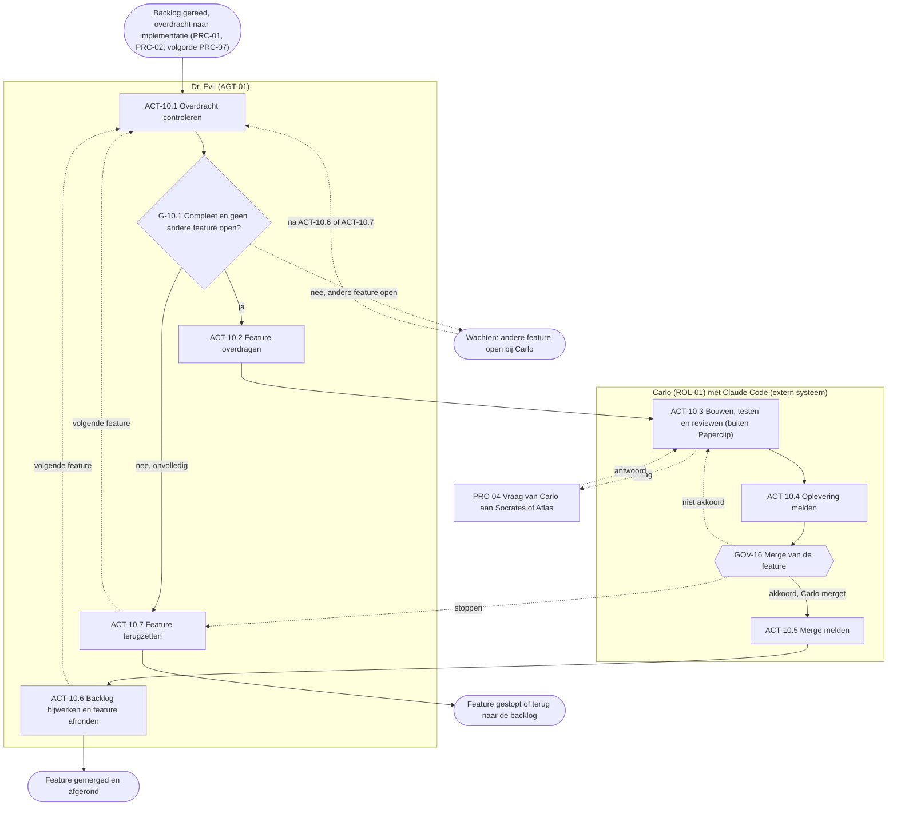

# PRC-10 – Feature overdragen aan Carlo (bouw buiten Paperclip)
Status: **Goedgekeurd (2026-11-18, Carlo, kaart 835d7148; CHG-035; B-27)** · Versie: 0.18 (model 0.18, CHG-035) · Hoort bij voorstel CHG-035 (PRC-09 gepauzeerd, bouw buiten Paperclip) · Bouwt op: `register` WEB-19 r27 (model 0.17), `prc-09` WEB-19 r1

Met kaart `835d7148` is CHG-035 goedgekeurd (B-27); de voorstellen (**V**) van CHG-035 gelden nu als besloten.

**Wat de codes betekenen.** PRC = proces · ACT = stap · G = beslispunt · GOV = akkoordmoment van Carlo · ROL = rol · AGT = agent · ASM = aanname · OPEN = open vraag · PRP = voorstel · CHG = wijziging · TL = tech-leadtaak van Atlas. R/A/C/I = uitvoerder / eindverantwoordelijke / geraadpleegd / geïnformeerd. Labels: **B** = besloten door Carlo (B-26, WEB-344; B-27, model 0.18 goedgekeurd), **V** = voorstel van Socrates, **A** = aanname, **F** = feit. Alles in dit proces is `to-be` en tijdelijk: het geldt zolang PRC-09 (feature uitvoeren) gepauzeerd is.

## Doel en uitkomst
Een feature die gereed is overdragen aan Carlo, die hem buiten Paperclip bouwt, test, reviewt en merget met Claude Code, en de backlog na de merge bijwerken. Uitkomst: epic en taken op `done`, backlog bijgewerkt. Vervangt PRC-09 zolang dat gepauzeerd is (B, punt 2 en 4). Hoe Carlo bouwt, test en reviewt, valt buiten dit model (B, buiten scope).

## Trigger, start- en eindconditie
- **Trigger:** er is een feature-epic met het eindpunt "Backlog gereed, overdracht naar implementatie" van PRC-01 (nieuwe klant) of PRC-02 (backlog uitbreiden), en het is de volgende in de volgorde van PRC-07 (weekmoment en prioriteren). **B**
- **Start:** epic met taken, AC-ID's, afhankelijkheden en verwijzingen naar FR, UC en BR; eigenaar van de taken is Carlo (ASM-78); bij frontendwerk een paginabrief; bouwcontract goedgekeurd (GOV-06, akkoord bouwcontract per slice) en implementatieplan; in de repo `CLAUDE.md`, `AGENTS.md` met de ponytail-regels en `CONSTRAINTS.md`. **B** (WEB-344 "Wat er bij de overdracht klaar moet zijn").
- **Einde normaal:** Carlo heeft de merge op het epic gemeld en Dr. Evil heeft de backlog bijgewerkt en het epic afgerond. **B**
- **Einde anders:** (1) Carlo meldt op het epic dat de feature stopt; Dr. Evil zet hem terug in de backlog of sluit hem, zoals Carlo meldt. (2) Het epic blijkt bij ACT-10.1 onvolledig; het gaat terug naar de backlogloop. **V**

## Eigenaar, rollen en systemen
- **Eigenaar:** ROL-02 (orchestrator, Dr. Evil, AGT-01). Eindverantwoordelijk voor het resultaat: ROL-01 (Carlo) via GOV-16 (merge van de feature).
- **Rollen:** ROL-01 Carlo, met Claude Code · ROL-02 Dr. Evil (AGT-01) · via PRC-04 (vragenloop): ROL-03 Socrates (eisen, paginabrieven) en ROL-04 Atlas (ontwerp, implementatie, TL-07).
- **Systemen:** Paperclip (epic, taken, comments, vraag-issues) · **Claude Code** (extern systeem: Carlo bouwt, test en reviewt daarmee; kan namens Carlo een comment op het epic zetten) · GitHub (PR, CI, merge door Carlo) · repo van het klantproject.

## Input en output
- **Input:** feature-epic op "Backlog gereed" (zie Start).
- **Output naar Carlo:** comment "gereed voor bouw" op het epic met de links naar de taken, het bouwcontract, het implementatieplan en de paginabrieven.
- **Terug van Carlo:** (1) bij de oplevering een comment op het epic met de link naar de PR en het testrapport; (2) na de merge een comment op het epic dat de PR is gemerged. **B**
- **Output van het proces:** taken en epic op `done`; backlog bijgewerkt; Socrates en Atlas geïnformeerd.

## Relatie met andere processen
- Start na PRC-01 of PRC-02 (backlog gereed) en PRC-07 (volgorde). Deelt alleen de backlog met die processen.
- Roept aan: PRC-04 (vraag van Carlo over eisen of ontwerp; Carlo is de vrager) en via PRC-04 GOV-12 (akkoord wijzigingsverzoek of productkeuze). Een onvolledig epic gaat terug naar de backlogloop: ACT-01.57 of ACT-02.54 (backlog gereed controleren), met het maximum daar. PRC-10 roept PRC-06 niet zelf aan.
- PRC-03 (akkoord-poort) en PRC-05 (afkeuring) worden niet aangeroepen: de merge (GOV-16) gebeurt buiten Paperclip, zonder kaart en zonder telling. **B** (B-27, kaart 4)
- PRC-09 (feature uitvoeren) is gepauzeerd; zie "Weer aanzetten" in het voorstel CHG-035.

## Proces in gewone taal
1. Dr. Evil controleert of het bovenste gereede epic compleet is en draagt het met een comment aan Carlo over.
2. Carlo bouwt, test en reviewt buiten Paperclip met Claude Code. Heeft hij een vraag over de eisen of het ontwerp, dan maakt hij een issue voor Socrates of Atlas (PRC-04).
3. Bij de oplevering zet Carlo, of Claude Code namens hem, een comment op het epic met de link naar de PR en het testrapport.
4. Carlo merget (GOV-16) en meldt de merge op het epic.
5. Dr. Evil werkt de backlog bij, zet taken en epic op `done` en informeert Socrates en Atlas. Daarna draagt hij de volgende feature over.

## Activiteiten
| ID | Activiteit | Rol of agent | Input | Resultaat | Vervolg | Label |
|---|---|---|---|---|---|---|
| ACT-10.1 | Overdracht controleren | Dr. Evil (ROL-02) | epic, volgorde PRC-07 | vastgesteld of het epic compleet is (zie Start) en of er geen andere feature bij Carlo openstaat | G-10.1 | B (inhoud); B (één feature tegelijk, ASM-74, B-27) |
| ACT-10.2 | Feature overdragen | Dr. Evil | compleet epic | comment "gereed voor bouw" op het epic met de links (zie Output naar Carlo); taken op naam van Carlo (ASM-78); epic blijft bij Dr. Evil, op `in_review` met Carlo als reviewer, en wacht op Carlo (PRP-071) | ACT-10.3 | B; A (ASM-73, ASM-78); B (status, PRP-071, B-27) |
| ACT-10.3 | Feature bouwen, testen en reviewen (buiten Paperclip) | Carlo (ROL-01) met Claude Code | epic, repo | PR met tests en testrapport; niet gemodelleerd | ACT-10.4 | B |
| ACT-10.4 | Oplevering melden | Carlo, of Claude Code namens hem | PR, testrapport | comment op het epic met de link naar de PR en het testrapport | GOV-16 | B |
| ACT-10.5 | Merge melden | Carlo | gemergede PR | comment op het epic: PR gemerged, met link | ACT-10.6 | B |
| ACT-10.6 | Backlog bijwerken en feature afronden | Dr. Evil | merge-melding | taken en epic op `done`; afhankelijke epics vrijgegeven; Socrates en Atlas geïnformeerd (I); volgende feature via ACT-10.1 | einde | B |
| ACT-10.7 | Feature terugzetten | Dr. Evil | melding van Carlo dat de feature stopt, of G-10.1 "onvolledig" | epic terug in de backlog of gesloten, zoals Carlo meldt; bij onvolledig: wat ontbreekt gemeld aan de eigenaar ervan (Socrates of Atlas), daarna opnieuw ACT-01.57 of ACT-02.54; is hetzelfde epic voor de 2e keer onvolledig, dan legt Dr. Evil het voor aan Carlo (GOV-08); Socrates en Atlas geïnformeerd; volgende feature via ACT-10.1 | einde anders | V |

## Beslissingen en goedkeuringen
| ID | Vraag | Uitkomsten | Bij afwijzing of afwijking | Label |
|---|---|---|---|---|
| G-10.1 | Feature compleet en geen andere feature open bij Carlo? | ja → ACT-10.2 · nee, onvolledig → ACT-10.7 (terug naar de backlogloop) · nee, andere feature open → wachten: geen herhaalde controle; ACT-10.6 of ACT-10.7 start ACT-10.1 opnieuw | wachten zonder melding wordt opgepakt in het weekmoment (ASM-76) | V |
| **GOV-16** | **Merge van de feature (Carlo, buiten Paperclip)** | akkoord: Carlo merget → ACT-10.5 · niet akkoord: Carlo werkt verder buiten Paperclip → ACT-10.3 · stoppen: Carlo meldt het op het epic → ACT-10.7 | geen telling (PRC-05) en geen escalatie: Carlo beslist zelf | B (merge bij Carlo, buiten Paperclip); B (geen telling, B-27) |

**GOV-16, zes onderdelen.** Bevoegd: ROL-01. Informatie: PR, testrapport en CI in GitHub en Claude Code; Dr. Evil ontvangt alleen de oplevering (ACT-10.4) en de merge-melding (ACT-10.5). Criteria: die van Carlo, buiten dit model. Bij goedkeuring: Carlo merget en meldt de merge op het epic (ACT-10.5); daarna rondt Dr. Evil af (ACT-10.6). Bij afwijzing: Carlo werkt verder buiten Paperclip (ACT-10.3). Escalatie: niet van toepassing, Carlo is de hoogste beslisser; stoppen meldt hij op het epic (ACT-10.7).

## Vragen tijdens de bouw
Carlo maakt een issue (PRC-04), zoals een implementatievraag van een developer (TL-07): over eisen of een paginabrief → Socrates; over ontwerp of implementatie → Atlas; over een pagina of patroon beslist Carlo zelf, want hij is de ontwerper (ASM-28). De ontvanger antwoordt per vraag en beslist alleen in zijn eigen vakgebied. Vraagt het antwoord een wijziging van iets wat Carlo goedkeurde of een productkeuze, dan gaat dat via GOV-12. Met Carlo als vrager telt niemand rondes en is er geen escalatie; het antwoord op het vraag-issue is het verslag, er komt geen apart contextverslag, en de vraag blokkeert geen werkissue (ASM-75). `vragen-en-akkoordrondes`, `architect-clarification` en `requirements-clarification` dekken dit nog niet; ze krijgen deze uitzondering na het akkoord (PRP-070). **B** (route); **B** (geen telling, geen contextverslag, ASM-75, PRP-070, B-27)

## Uitzonderingen en loops
- **Bouwlus** (ACT-10.3 → 10.4 → GOV-16 niet akkoord → ACT-10.3): buiten Paperclip; uitgang bij GOV-16 akkoord of stoppen. Het maximum bepaalt Carlo zelf, want hij is uitvoerder en beslisser. **V**
- **Onvolledige overdracht** (G-10.1 nee → ACT-10.7 → ACT-01.57 of ACT-02.54 → ACT-10.1): maximum 2 keer per epic; bij de 2e keer legt Dr. Evil het voor aan Carlo (GOV-08, escalatiebesluit): aanvullen of terug naar de backlog. **B** (kaart 12, B-27)
- **Wachten op een open feature** (G-10.1 → wachten): geen lus. Na ACT-10.6 of ACT-10.7 start ACT-10.1 opnieuw; blijft een melding uit, dan het weekmoment (ASM-76).
- **Geen melding van Carlo:** een epic dat bij Carlo openstaat, ziet Dr. Evil in het weekmoment (PRC-07); hij vraagt Carlo dan naar de stand. Geen blokkade, want Carlo is de uitvoerder. **A** (ASM-76)

## Tussendiagram

## Aannames en open vragen
- ASM-73 (epic blijft bij Dr. Evil): het epic blijft aan Dr. Evil toegewezen, op `in_review` met Carlo als reviewer, terwijl Carlo bouwt; een comment van Carlo wekt hem (feitencheck Dr. Evil, WEB-351). Of een comment van Claude Code namens Carlo hem wekt, toetst Dr. Evil bij de eerste overdracht (OPEN-29).
- ASM-74 (één feature tegelijk): Dr. Evil draagt één feature tegelijk aan Carlo over; de volgende pas na de merge-melding of het stoppen. Vervangt zolang ASM-70 (één feature per coding agent).
- ASM-75 (geen contextverslag met Carlo): bij een vraag van Carlo tijdens de bouw is het antwoord op het vraag-issue het verslag; geen telling, geen escalatie.
- ASM-76 (open feature in weekmoment): Dr. Evil ziet een feature die bij Carlo openstaat in het weekmoment en vraagt dan naar de stand. De routine *Weekmoment klaarzetten* staat sinds 2026-11-16 op pauze (FND-085). OPEN-26 beantwoord (feitencheck WEB-351, kaart 11): de routines draaiden tot 2026-11-16 en staan op pauze; Dr. Evil zet *Weekmoment klaarzetten* en *Dagstart* weer aan (FND-085 opgelost na uitvoering).
- OPEN-30 (overdracht dotnet-invoices): in `dotnet-invoices` ontbreken `CONSTRAINTS.md` en de ponytail-regels; ACT-10.1 vindt epics van dat project dan onvolledig (FND-086). Beantwoord (kaart 13): nee, eerst voegt Atlas `CONSTRAINTS.md` en de ponytail-regels toe (ACT-01.56), vóór de eerste overdracht.
- ASM-77 (taken done na merge): taken gaan pas op `done` bij ACT-10.6; de flowcheck die PRC-02 start (ACT-02.51) telt ze tot dan als open.
- ASM-78 (taken op naam van Carlo): Carlo is de eigenaar van de taken in een overgedragen epic, ook voor een blokkade (PRC-06, lane eigenaar van de taak); het epic blijft bij Dr. Evil (ASM-73).
- Documentatie: technische en gebruikersdocumentatie (`docs/`, `docs/user/`) maakt Carlo bij de bouw; ACT-09.11 is gepauzeerd. **B** (volgt uit B-26)
- Geen poortcontrole bij de merge: Dr. Evil controleert bij de oplevering geen tests, reviews of CI meer (ACT-09.19 is gepauzeerd); dat doet Carlo zelf. **B** (kaart 3, B-27)

## Wijzigingshistorie
| Versie | Datum | Wijziging | Door |
|---|---|---|---|
| 0.18 | 2026-11-18 | Eerste concept, CHG-035 (WEB-344, WEB-345); na modelcontrole: geldig diagram, geen lus via PRC-06, ACT-10.7 terug naar ACT-10.1, eigenaar van de taken, documentatie | Socrates |
| 0.18 | 2026-11-18 | Feitencheck verwerkt (WEB-350, WEB-351): status epic `in_review` (PRP-071), Carlo als vrager in de skills (PRP-070), OPEN-29, OPEN-30, weekmoment gepauzeerd | Socrates |
| 0.18 | 2026-11-18 | Goedgekeurd (kaart 835d7148, B-27) | Socrates |
