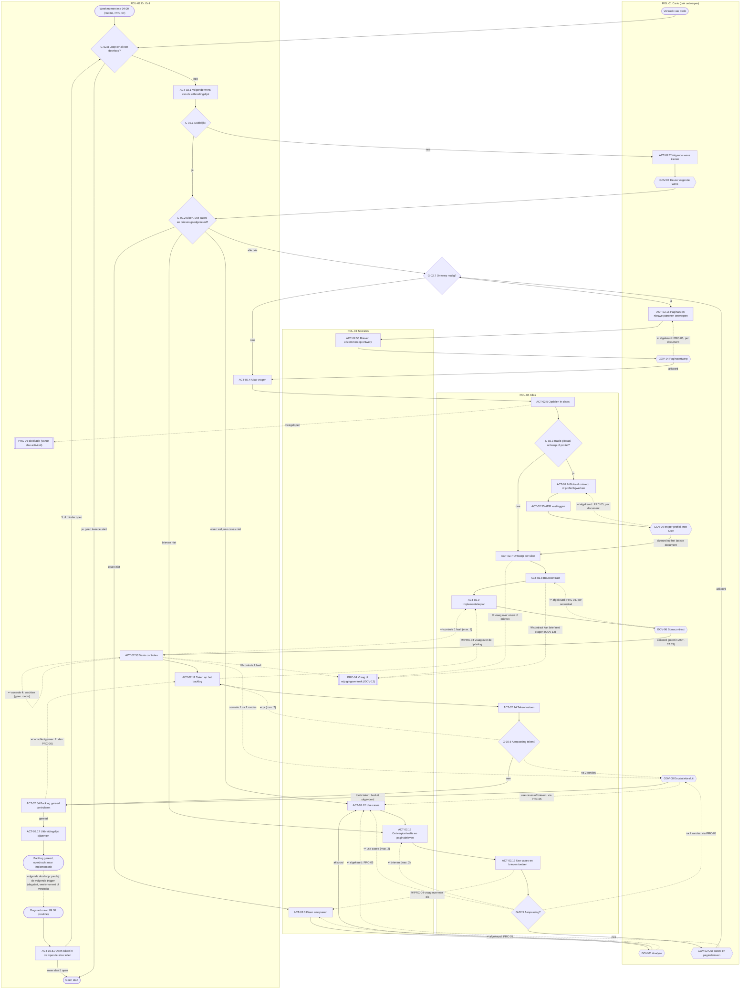

> **Vervallen** – geldend is `prc-02` r17. Dit is een archiefkopie; niet lezen of gebruiken.

# PRC-02 – Backlog uitbreiden met de volgende slice (UC2)

Status: **Goedgekeurd (2026-10-30, Carlo, kaart `fa26d50e`)**, alle 18 onderdelen (besluit B-14). Dit is het ingediende concept, ongewijzigd bewaard. De geldende tekst staat nu in `prc-02`. Vóór de goedkeuring: **Concept (2026-10-30), versie 0.11** (CHG-019: je antwoorden op de open vragen, besluit B-13; CHG-018: de gaten in het register 0.10 hersteld, kaart `a16387c4`; zie `v011-voorstel`). Tot je 0.11 goedkeurt, geldt 0.10: Goedgekeurd (2026-10-30, Carlo, kaart `f261b9ac`), versie 0.10 (model 0.10, CHG-015), besluit B-12. Daarvoor gold 0.9. · Primair proces, niveau 1, herhaalbaar

**Labels:** **B** = Besloten (jouw opdrachten, B-01 t/m B-13, TL-V1 t/m TL-V7). **F** = Feit (met bron). **V** = Voorstel (PRP), nog niet besloten. Sinds B-12 zijn PRP-029 t/m PRP-039 besloten en gelabeld `B (B-12: PRP-xxx)`. **A** = Aanname (ASM) of open vraag (OPEN).

**Nieuw in 0.11** (CHG-019, je antwoorden op de open vragen, B-13):
- **Drie triggers:** het weekmoment op maandag om 04:00; de flowcheck elke werkdag om 09:00 als er in de lopende slice nog 5 taken of minder open zijn (ACT-02.51, ASM-30, ASM-32); en jouw verzoek. Je noemde eerst 15%; nu is het een aantal: nog 5 open taken.
- **Claude Design** (ACT-02.16): je ontwerpt in Claude Design, met een export als vaste versie (B-13, PRP-042).
- **Nooit twee doorlopen tegelijk:** nieuwe beslissing G-02.8 (ASM-33, FND-036).
- **Herinnering:** wacht de keuze van de volgende wens (GOV-07) op jou, dan staat die elke werkdag om 09:00 in het herinneringsbericht van Dr. Evil, en op het weekmoment (ASM-35). Dat verandert B-09 ("pas op het weekmoment").
- **Toets van Atlas (ACT-02.13):** via een toets-issue (PRP-041, lost M-9 op).

**Nieuw in 0.10** (CHG-015, B-10, comment `6e69ec6e`):
- **Uitbreidingslijst** (B-10 UC2 stap 1): de lijst met mogelijke uitbreidingen is een vast onderdeel. Jij bepaalt de inhoud en de volgorde; Dr. Evil houdt hem bij in Paperclip (PRP-033). ACT-02.1 neemt de volgende wens van die lijst; aan het eind werkt Dr. Evil de lijst bij (ACT-02.17).
- **Ontwerpbehoefte per uitbreiding** (B-10 UC2 stap 2): Socrates bepaalt per geraakte pagina het ontwerpniveau en schrijft de paginabrieven (ACT-02.15, PRP-031). Atlas toetst ze samen met de use cases (ACT-02.13). Jij keurt ze goed in GOV-02.
- **Ontwerp waar nodig** (B-10 UC2 stap 2): een nieuw patroon, een nieuwe component of een merkbepalende of conversiegevoelige pagina krijgt een ontwerp (ACT-02.16), daarna stemt Socrates de brieven af (ACT-02.56) en volgt jouw akkoord **GOV-14** (PRP-031, PRP-032, PRP-036).
- **Slices en bouwcontract afgeleid van de ontwerpen en brieven, met de visie** (B-10 UC2 stap 3): ACT-02.5, 02.7 en 02.8. Het bouwcontract hangt af van het profiel (PRP-034).
- **Profiel bij elke uitbreiding**: G-02.3 vraagt ook of de wens een zwaarder profiel nodig maakt (groeisignalen, PRP-034). Een profielwijziging is een ADR en gaat langs GOV-09.

**Eerder:**
- **0.9** (CHG-013, B-09): de vraag bij GOV-07 komt direct, één keer.
- **0.8** (CHG-011, B-08): flowcheck als trigger, ADR bij elke wijziging van het globale ontwerp, vaste controles, Atlas toetst de taken, backlog gereed.
- **0.5** (CHG-007, TL-V7) en **0.4** (CHG-005, CHG-006): geen rol tech lead; use cases ook in UC2 (B-06).

**Basis en voorstellen.** Je vroeg de richting door te voeren in het concept (B-10, onderdeel C). Daarom staat mijn uitwerking in 0.10 in de basis, en niet in een aparte variant. Je keurde alle voorstellen goed (B-12, kaart `f261b9ac`); ze zijn nu gelabeld `B (B-12: PRP-xxx)`. Keur je een voorstel af, dan pas ik het concept aan en leg ik het opnieuw voor. (Afwijking van de uitbreidingsgids §2 stap 7, daar nu vastgelegd.)

## Doel en uitkomst
Het backlog aanvullen met de epics en taken van de volgende uitbreiding, met het ontwerp en de visie als leidraad: de pagina's eerst, het bouwcontract volgt. **B** (B-10)

## Trigger, start- en eindconditie
| | |
| --- | --- |
| Trigger | Drie triggers. **B** (B-08, PRP-014; B-13): (1) het weekmoment, maandag om 04:00 (PRC-07); (2) de flowcheck, elke werkdag om 09:00, vindt nog 5 of minder open taken in de lopende slice (ACT-02.51; ASM-30, ASM-32); (3) een verzoek van jou aan Dr. Evil. Loopt er al een doorloop, dan start er geen tweede (G-02.8, ASM-33). De routines bestaan nog niet (FND-013, M-4). |
| Start | PRC-01 is afgerond voor dit project (ASM-07); er is een uitbreidingslijst (gevuld in ACT-01.29 met jouw eigen lijst en de "later"-pagina's; nieuwe wensen geef je via Dr. Evil, de volgorde op het weekmoment, PRC-07). |
| Einde | **Backlog gereed, overdracht naar implementatie.** Daarna kan PRC-02 opnieuw starten. **B** |

## Eigenaar, rollen en systemen
Eigenaar: ROL-02. Lanes: ROL-01 Carlo (ook als ontwerper, ASM-28), ROL-02 Dr. Evil, ROL-03 Socrates, ROL-04 Atlas. Systemen: Paperclip (met de routines weekmoment en dagstart, nog in te richten), repository van het klantproject, Claude Design voor de ontwerpen (B-13; toegang voor de agents: FND-035, PRP-042).

## Input en output
- **In:** uitbreidingslijst met jouw volgorde, goedgekeurde eisen, visie, paginalijst, design systeem en patroonbibliotheek, technisch ontwerp en profiel, huidige backlog en voortgang.
- **Uit:** aanvulling op requirements, use cases en paginalijst, paginabrieven en waar nodig ontwerpen, opdeling in slices, zo nodig bijgewerkt globaal ontwerp of profiel met een ADR, ontwerp per slice, bouwcontract, implementatieplan, epics en taken op het backlog, bijgewerkte uitbreidingslijst.

## Relatie met andere processen
Roept PRC-03, PRC-04, PRC-05 (via PRC-03) en PRC-06 aan. Na een wijzigingsverzoek: GOV-12. Volgt op PRC-01. Start vanuit de flowcheck, het weekmoment (PRC-07) of een verzoek van jou; de volgorde van de uitbreidingslijst komt uit PRC-07 of rechtstreeks van ROL-01.

---

## Basis: jouw workflow met B-08, B-09 en B-10

### Activiteiten
In de volgorde van het proces. Nieuw of gewijzigd in 0.10 is **vet** in de kolom ID.

| ID | Activiteit | Rol | Input | Resultaat | Vervolg | Paperclip | Label |
| --- | --- | --- | --- | --- | --- | --- | --- |
| **ACT-02.51** | **Open taken in de lopende slice tellen** | ROL-02 | **taken van de lopende slice** | start van PRC-02 als er **nog 5 of minder taken open** zijn (ASM-30) | **5 of minder → G-02.8** · meer dan 5 → geen start | routine **dagstart, elke werkdag om 09:00** (ASM-32) ⚠ bestaat nog niet (FND-013, M-4) | B (B-08, PRP-014), B (B-13: drempel), A (ASM-30, ASM-32) |
| **G-02.8** | *Beslissing, zie hieronder* | | | | | | |
| **ACT-02.1** | Volgende wens bepalen volgens jouw volgorde | ROL-02 | **uitbreidingslijst**, focusdoel, **of jouw verzoek** | de volgende uitbreiding (**bij een verzoek: de wens uit het verzoek**), of direct één vraag aan ROL-01 op een issue (B-09) | G-02.1 | issues van de uitbreidingslijst ⚠ M-12 | B (TL-V2, B-09, B-13), B (B-10: de lijst), A (ASM-14) |
| **ACT-02.2** | Volgende wens kiezen | ROL-01 | vraag van Dr. Evil op een issue (direct, één keer); **zonder antwoord elke werkdag om 09:00 in het herinneringsbericht** | gekozen wens | G-02.2 | interactie op een issue, of de volgorde van de uitbreidingslijst | B (TL-V2, B-09, B-13), A (ASM-35) |
| **ACT-02.3** | Eisen van de wens analyseren | ROL-03 | wens, **visie** | aanvulling op `requirements.md`; zo nodig een bijgewerkte visie | PRC-03 → **GOV-01** | overdrachtsissue, document | F (OR-01, OR-02), B (B-12: PRP-033: visie bijwerken) |
| ACT-02.12 | Use cases van de wens opstellen of bijwerken | ROL-03 | goedgekeurde aanvulling op de requirements | `use-cases.md` met nieuwe of gewijzigde UC- en AC-ID's (in de vorm van het profiel, PRP-038) | ACT-02.15 | document op het issue van Socrates | B (B-06), B (B-12: PRP-038) |
| **ACT-02.15** | Ontwerpbehoefte bepalen en paginabrieven opstellen | ROL-03 | use cases van de wens, paginalijst, patroonbibliotheek, visie | bijgewerkte paginalijst; per geraakte pagina het ontwerpniveau (brief of ontwerp, met het criterium) en een paginabrief; of "geen pagina geraakt" | ACT-02.13 | document `pages.md` op het issue van Socrates | B (B-10, UC2 stap 2: nagaan welk ontwerp nodig is), B (B-12: PRP-031: criteria en brief) |
| **ACT-02.13** | Use cases en paginabrieven van de wens toetsen | ROL-04 | use cases, paginabrieven, requirements, technisch ontwerp | geen opmerkingen, of opmerkingen per use case en per brief (genoeg voor een bouwcontract; klopt "bestaand patroon" met de componenten) | G-02.5 | **toets-issue voor Atlas (zoals een vraag, PRC-04); het issue van Socrates wacht `blocked`; daarna jouw kaart (GOV-02)** | B (B-06), B (B-12: PRP-031), V (PRP-041) |
| **G-02.7** | *Beslissing, zie hieronder* | | | | | | |
| **ACT-02.16** | Pagina's en nieuwe patronen ontwerpen | ROL-01 (ontwerper) | goedgekeurde brieven, design systeem, patroonbibliotheek, visie | ontwerp van de pagina's met ontwerpniveau "ontwerp"; bijgewerkte patroonbibliotheek; grafisch (**in de regel in Claude Design**) of in code met mock data, de mock data gemarkeerd als niet bindend | ACT-02.56 | **link naar Claude Design met een export als bijlage**, of een branch in de repo ⚠ M-11 (FND-035) | B (B-10, UC2 stap 2: door jou, een designer-agent of een frontend developer), B (B-12: PRP-031, PRP-032), B (B-13: Claude Design), V (PRP-042), A (ASM-28) |
| **ACT-02.56** | Paginabrieven en ontwerp op elkaar afstemmen | ROL-03 | ontwerpen, brieven | bijgewerkte brieven met een lijst van de verschillen | PRC-03 → **GOV-14** | document | B (B-12: PRP-032) |
| ACT-02.4 | Atlas vragen wat er nu gebouwd moet worden | ROL-02 | wens met goedgekeurde eisen, use cases, brieven en waar nodig ontwerpen | opdracht-issue voor Atlas | ACT-02.5 | nieuw issue, toegewezen aan Atlas | B (UC2: "de tech lead" = Atlas, TL-V7) |
| **ACT-02.5** | Wens opdelen in slices en volgorde bepalen | ROL-04 | wens, eisen, **paginabrieven en ontwerpen, visie**, technisch ontwerp | slices met pagina's, use cases, AC's en technische volgorde | G-02.3 | document | B (TL-V2, B-02), B (B-10, UC2 stap 3) |
| **ACT-02.6** | Globaal ontwerp of profiel bijwerken | ROL-04 | wens die het globale ontwerp of het profiel raakt (uitkomst G-02.3) | geraakte documenten van het technisch ontwerp van het profiel; bij een zwaarder profiel ook de nieuwe documenten van dat profiel (bijvoorbeeld een domeinmodel); zijn de use cases licht (PRP-038), dan vraagt Atlas Socrates via PRC-04 ze naar de volledige vorm te brengen, en ze komen mee in het akkoord met het ADR | ACT-02.55 | document | B (B-02), A (ASM-09), B (B-12: PRP-034: profielwijziging) |
| ACT-02.55 | Wijziging globaal ontwerp vastleggen in een ADR | ROL-04 | bijgewerkte documenten uit ACT-02.6 | ADR met reden, gevolgen en geraakte documenten; bij een profielwijziging een nieuw profiel-ADR dat het oude vervangt | PRC-03 → GOV-09 en per geraakt document van het profiel (P3: GOV-03 / 04 / 05 / 13; P1, P2: GOV-11 per document), samen met het ADR | document `docs/adr/` | B (B-08, PRP-017), B (B-12: PRP-034) |
| **ACT-02.7** | Ontwerp per slice opstellen | ROL-04 | slice, technisch ontwerp, **paginabrieven en ontwerpen** | per profiel: P1 templates, blokken en configuratie van de slice; P2 componenten, routes en de sequenties van nieuwe flows; P3 modules, componenten, interfaces en zo nodig sequentie- en klassendiagram | ACT-02.8 | document | B (UC2 "program design", B-02), B (B-12: PRP-034) |
| **ACT-02.8** | Bouwcontract opstellen | ROL-04 | ontwerp per slice, **goedgekeurde brieven en ontwerpen (bindend)**; **niet** de mock data | P2/P3: API-contracten; P1: templatecontract en API-contracten alleen voor eigen endpoints. Per veld een bronkolom | ACT-02.9 | document | B (UC2, TL-V4), B (B-10, UC2 stap 3), B (B-12: PRP-032, PRP-034) |
| ACT-02.9 | Implementatieplan opstellen | ROL-04 | ontwerp, bouwcontract | werkpakketten met afhankelijkheden en AC-verwijzingen; frontendpakketten verwijzen naar brief en paginatype | PRC-03 → **GOV-06** (bij een voorwaarde van stap 5 ook ontwerp en plan, PRP-028) | document | B (B-02, TL-V3), B (B-12: PRP-037) |
| **ACT-02.53** | Vaste controles uitvoeren | ROL-02 | goedgekeurd bouwcontract, werkpakketten | vooraf de poort: GOV-06, **GOV-02 (met de brieven) en waar nodig GOV-14**, en de akkoorden op de geraakte documenten (met het ADR) zijn er (ASM-21); (1) elk werkpakket verwijst naar FR/UC/AC (op werkpakketten, want de taken bestaan nog niet: ASM-21), (2) geen nieuwe eis of scope, (4) flowlimieten (wachten telt niet als ronde: ASM-22). Controle 3 (past in het globale ontwerp) zit in ACT-02.14 | ACT-02.11; bij (1) terug naar Atlas (ACT-02.9), na 2 rondes escalatie (GOV-08); bij (2) een wijzigingsverzoek via PRC-04 (GOV-12); bij (4) wachten tot er ruimte is, zonder maximum; staat de slice tot het volgende weekmoment stil, dan melding op het weekmoment (PRC-07) | comment met de uitkomst | B (B-08, PRP-007 met de aanvulling uit 0.6), A (ASM-21, ASM-22), B (B-12: PRP-032: GOV-02 en GOV-14 in de poort) |
| ACT-02.11 | Taken maken en op het backlog zetten | ROL-02 | goedgekeurd bouwcontract, werkpakketten | epics en taken met eigenaar en afhankelijkheden; frontendtaken verwijzen naar brief en waar nodig ontwerp | ACT-02.14 | bovenliggend issue, onderliggende issues, `blockedByIssueIds`. ⚠ M-2 | B (UC2, TL-V3), B (B-12: PRP-037) |
| ACT-02.14 | Taken toetsen tegen de werkpakketten | ROL-04 | epics en taken van de slice, werkpakketten, globaal ontwerp | zie ACT-01.25; met controle 3 van PRP-007 (past in het globale ontwerp) | G-02.6 | `executionPolicy`-stage `review` met Atlas op het bovenliggende issue van de slice (epic) ⚠ M-10 | B (B-08, PRP-027) |
| **ACT-02.54** | "Backlog gereed" controleren | ROL-02 | epics en taken | zie ACT-01.57 (zonder het conventiebestand) | ACT-02.17, of terug naar ACT-02.11; lukt het na 2 keer niet, dan blokkade (PRC-06) | ⚠ M-3 | B (B-08, PRP-013) |
| **ACT-02.17** | Uitbreidingslijst bijwerken | ROL-02 | backlog, paginalijst, uitkomst van deze doorloop | de uitgevoerde uitbreiding staat op "in backlog"; nieuwe "later"-pagina's uit ACT-02.15 staan erop | einde | issues van de uitbreidingslijst ⚠ M-12 | B (B-10, UC2 stap 1), B (B-12: PRP-033) |

**Doorlopend:**
- Vragen van Atlas over eisen of brieven gaan naar Socrates → PRC-04. Vragen over het ontwerp gaan naar jou, zolang jij de ontwerper bent (ASM-28). Of een wens de architectuur of het profiel raakt, beslist Atlas via G-02.3; een profielwijziging keur jij goed (GOV-09).
- **Het bouwcontract wordt nooit de bron van een brief of ontwerp** (zie PRC-01). De enige weg terug is een vraag (PRC-04, max. 2 rondes) of een wijzigingsverzoek met jouw akkoord (GOV-12). **B** (B-10), **B** (B-12: PRP-032)
- Vragen van Dr. Evil over de implementatie bij het opdelen gaan naar Atlas → PRC-04 (B, ASM-03, TL-08).
- Opmerkingen van Atlas op de taken (ACT-02.14) gaan terug naar Dr. Evil (G-02.6). **B**
- Dr. Evil signaleert de behoefte aan een aparte agent (PRP-018, ASM-23); en zodra er developers zijn ook de behoefte aan een frontend-agent die ontwerpwerk kan overnemen (PRP-035). **B** (B-08: PRP-018), **B** (B-12: PRP-035)
- Vastlopen → PRC-06 (B).

### Beslissingen en goedkeuringen
In de volgorde van het proces.

| ID | Vraag | Uitkomsten | Bij afwijzing | Label |
| --- | --- | --- | --- | --- |
| **G-02.8** | **Loopt er voor dit project al een doorloop van PRC-02?** (een uitbreiding is gestart in ACT-02.1 en staat nog niet op "in backlog", ACT-02.17) | nee → ACT-02.1 · ja → geen tweede start; bij jouw verzoek zet Dr. Evil de wens bovenaan de uitbreidingslijst en meldt hij dat | — | A (ASM-33) |
| G-02.1 | Is de volgende wens duidelijk uit jouw volgorde? | ja → G-02.2 · nee → ACT-02.2 (GOV-07) | — | A (ASM-14) |
| **GOV-07** | Keuze van de volgende wens (ROL-01). Moment: direct, één keer (B-09). **Zonder antwoord: elke werkdag om 09:00 in het herinneringsbericht en op het weekmoment (B-13, ASM-35).** | gekozen → G-02.2 | n.v.t. | B (TL-V2, B-09, B-13) |
| **G-02.2** | Zijn de eisen, use cases en paginabrieven van de wens al goedgekeurd? | alle drie → G-02.7 · eisen en use cases wel, brieven niet (bijvoorbeeld een "later"-pagina uit PRC-01) → ACT-02.15 · eisen wel, use cases niet → ACT-02.12 · eisen niet → ACT-02.3 | — | F (OR-02), B (B-06), B (B-12: PRP-031: brieven) |
| GOV-01 | Akkoord analyse: requirements en bedrijfsregels, zo nodig de bijgewerkte visie (ROL-01) | akkoord → ACT-02.12 | PRC-05 → ACT-02.3 | B, B (B-12: PRP-033: visie) |
| G-02.5 | Vraagt de toets van Atlas om aanpassing van de use cases of de brieven? | nee → GOV-02 · use cases → ACT-02.12 · brieven → ACT-02.15 | na 2 rondes: escalatie (ACT-05.3 → GOV-08) | B (B-06, B-08), B (B-12: PRP-031) |
| **GOV-02** | Akkoord use cases **en paginabrieven met het ontwerpniveau** (ROL-01) | akkoord → G-02.7 | PRC-05 → ACT-02.12 of ACT-02.15; Atlas toetst de herziening opnieuw (ACT-02.13) | B (B-06), B (B-12: PRP-031, PRP-036) |
| **G-02.7** | Is er een ontwerp nodig? (minstens één geraakte pagina met ontwerpniveau "ontwerp") | ja → ACT-02.16 · nee → ACT-02.4 | — | B (B-10, UC2 stap 2), B (B-12: PRP-031: criteria) |
| **GOV-14** | **Akkoord paginaontwerp** (ROL-01): de ontwerpen en de bijgewerkte patroonbibliotheek, voor zover niet door jou gemaakt, en de bijgewerkte brieven met de lijst van verschillen. Eén kaart met een oordeel per document; Dr. Evil gaat pas verder als elk document een oordeel heeft (ASM-37) | akkoord → ACT-02.4 | PRC-05: ontwerp → ACT-02.16; brieven → ACT-02.56; elke producent herstelt zijn eigen document (ASM-37) | B (B-12: PRP-031, PRP-036), A (ASM-28), A (ASM-37) |
| **G-02.3** | Raakt de wens het globale ontwerp of vraagt hij een zwaarder profiel? (architectuur, technisch ontwerp van het profiel, database, of een groeisignaal uit PRP-034) | nee → ACT-02.7 · ja → ACT-02.6 → ACT-02.55 (ADR), daarna ACT-02.7 | — | B (B-02), A (ASM-09), B (B-12: PRP-034: profiel) |
| **GOV-09 en per profiel** | Akkoord op elk geraakt document, samen met het ADR (ROL-01): architectuurkeuze en profiel (GOV-09), bij een zwaarder profiel ook de bijgewerkte use cases; bij P3 GOV-03 / 04 / 05 / 13 in de volgorde van PRC-01; bij P1 en P2 GOV-11 per document | akkoord op het laatste geraakte document → ACT-02.7 | PRC-05 → ACT-02.6, per document; daarna opnieuw met het ADR (ACT-02.55) | F (`architect-database`), B (B-07, B-08, PRP-017), B (B-12: PRP-034) |
| **GOV-06** | Akkoord **bouwcontract** van de slice (ROL-01). Toets: elk veld heeft een bron in een goedgekeurde brief, UC/AC of BR. Bij een voorwaarde van stap 5 ook ontwerp en plan. | akkoord → ACT-02.53 | PRC-05: contract → ACT-02.8; ontwerp of plan → ACT-02.7 / ACT-02.9 | B (TL-V4, B-08, PRP-028), B (B-12: PRP-032, PRP-034) |
| G-02.6 | Vraagt de toets van Atlas om aanpassing van de taken? | nee → ACT-02.54 · ja → terug naar ACT-02.11 | na 2 rondes: escalatie, zoals G-01.5 (conflict Dr. Evil–Atlas: `escalation-management` trigger 2 → GOV-08) | B (B-08, PRP-027; maximum PRP-006) |
| GOV-08 | Escalatiebesluit (ROL-01) na 2 rondes: bij G-02.5 via PRC-05 (ACT-05.3), bij controle 1 van ACT-02.53, bij G-02.6 via `escalation-management` trigger 2. Uitgewerkt in PRC-05. | toets van de taken: Dr. Evil past de taken aan volgens het besluit, of laat ze zoals ze zijn (ACT-02.11), en gaat door naar ACT-02.54 · use cases: verder in PRC-05 (ACT-05.6; Socrates herziet, Atlas toetst opnieuw) · controle 1: Dr. Evil voert het besluit uit | n.v.t.: je kiest een optie of geeft een eigen besluit | B (escaleren naar jou), B (B-08, PRP-006, PRP-007, PRP-027) |
| **GOV-12** | Akkoord wijzigingsverzoek (ROL-01), als een vraag in PRC-04 of controle 2 van ACT-02.53 een goedgekeurde eis of het ontwerp verandert, **ook als een brief of ontwerp moet veranderen omdat het bouwcontract het niet kan dragen**. Uitgewerkt in PRC-04. | akkoord → verder met de gewijzigde eis | het goedgekeurde document blijft ongewijzigd; de vrager krijgt dat als antwoord | F (AGENTS.md Socrates en Atlas), B (B-08, PRP-022: voor Atlas), B (B-12: PRP-032) |

**Akkoorden: per document, zoals in 0.9.** Nieuw: GOV-02 omvat ook de paginabrieven; GOV-14 alleen als een uitbreiding een ontwerp nodig heeft. Volgt een uitbreiding een bestaand patroon, dan blijft het aantal akkoorden gelijk aan 0.9: GOV-01, GOV-02, (GOV-09 enz. als het ontwerp geraakt is) en GOV-06.

### Uitzonderingen en loops
- **Herhaalbaar:** na het eindpunt start PRC-02 opnieuw bij de volgende trigger. **B**
- **Trigger terwijl er al een doorloop loopt:** geen tweede start (G-02.8). Jouw verzoek gaat dan bovenaan de uitbreidingslijst. **A** (ASM-33)
- **Slice raakt in het weekend leeg:** de flowcheck draait alleen op werkdagen; het weekmoment op maandag om 04:00 start PRC-02. **A** (ASM-32)
- **Geen pagina geraakt** (bijvoorbeeld een koppeling zonder scherm): ACT-02.15 zegt dat, G-02.7 → nee. **B** (B-12: PRP-031)
- **Ontwerp wijkt af van de brief** (ACT-02.56): geen lus; de brief wordt bijgewerkt en de verschillen gaan mee in GOV-14. **B** (B-12: PRP-032)
- **Bouwcontract kan een brief niet dragen**: vraag via PRC-04 (max. 2 rondes) of wijzigingsverzoek (GOV-12). Het contract past de brief nooit zelf aan. **B** (B-10), **B** (B-12: PRP-032)
- **Profielwijziging** (G-02.3 → ACT-02.6): ADR, GOV-09 en de nieuwe documenten van het profiel. **B** (B-12: PRP-034)
- **Afkeuring** → PRC-05: max. 2 herzieningsrondes per document, daarna escalatie. **Vragen** → PRC-04: max. 2 rondes. **B**
- **Toets van Atlas** (G-02.5, G-02.6): max. 2 rondes, daarna GOV-08. **B**
- **Controles** (ACT-02.53, ACT-02.54): zoals in 0.9. **B**, **A** (ASM-21, ASM-22)

### Tussendiagram (basis)

*PRC-04 (Q3) en PRC-06 (B6) zijn aanroepen van een subproces; ze keren terug naar de vragende of geblokkeerde stap, zoals in 0.9. Een afkeuring gaat per document of onderdeel naar de eigen activiteit (zie "Bij afwijzing"): bij GOV-02 naar ACT-02.12 of ACT-02.15, bij GOV-14 naar ACT-02.16 of ACT-02.56. Na 2 rondes gaan G-02.5, G-02.6 en controle 1 naar GOV-08.*

---

**Restrisico (CHG-018):** jij bent de ontwerper én de goedkeurder, en het enige mens (FND-033). Heeft een uitbreiding een ontwerp nodig (G-02.7), dan ligt jouw ontwerpwerk (ACT-02.16) op het kritieke pad van die doorloop.

## Aannames en open vragen
- ASM-02, ASM-03, ASM-07, ASM-09, ASM-14, ASM-18, ASM-20 t/m ASM-25 (zoals in 0.9).
- **ASM-28 (nieuw):** jij bent de ontwerper zolang er geen designer- of frontend-agent is; een ontwerp van jezelf keur je niet apart goed (zie PRC-01).
- **ASM-29 (nieuw):** zie PRC-01.
- **ASM-30 (nieuw in 0.11):** een taak is open als ze niet `done` of `cancelled` is (ook geblokkeerd of in review telt mee). De lopende slice is de epic die het laatst op het backlog is gezet. "Nog 5 taken open" lees ik als: zodra het er 5 of minder zijn.
- **ASM-32 (nieuw in 0.11):** twee routines: weekmoment maandag 04:00, dagstart elke werkdag om 09:00 met de flowcheck en het herinneringsbericht. Nederlandse tijd. Het tijdstip van de flowcheck noemde je niet; ik heb het gelijk gezet met het bericht.
- **ASM-33 (nieuw in 0.11):** hoogstens één doorloop per project tegelijk (G-02.8). Een doorloop loopt van ACT-02.1 tot de uitbreiding op "in backlog" staat (ACT-02.17). Je verzoek tijdens een lopende doorloop start niets: de wens gaat bovenaan de uitbreidingslijst.
- **ASM-35 (nieuw in 0.11):** het bericht van 09:00 bevat alles wat op jou wacht, met links, oudste bovenaan; geen bericht als er niets wacht; als comment op het lopende weekmoment-issue.
- **ASM-14 (bijgewerkt in 0.11, CHG-018):** de volgende wens komt van de uitbreidingslijst, in jouw volgorde (PRP-033).
- **ASM-37 (nieuw in 0.11, CHG-018, ter bevestiging):** de regel van ASM-26 geldt ook voor GOV-14: één kaart met een oordeel per document (het ontwerp van de ontwerper, de brieven van Socrates); elke producent herstelt zijn eigen document, en Dr. Evil gaat pas verder als elk document een oordeel heeft.
- **ASM-38 (nieuw in 0.11, CHG-018, ter bevestiging):** de poort vóór ACT-02.4 controleert GOV-01, GOV-02 en waar nodig GOV-14; de vaste controles (ACT-02.53) controleren GOV-06, GOV-02 en waar nodig GOV-14.
- **ASM-39 (nieuw in 0.11, CHG-018, ter bevestiging):** de uitbreidingslijst (ACT-02.17) heeft bewust geen controleur: jij bepaalt inhoud en volgorde en ziet de lijst op het weekmoment (PRP-033).
- Beantwoord in 0.11 (B-13): OPEN-03 (drempel), OPEN-14 (Claude Design). Open: OPEN-13 (wachten op Atlas).

## Wijzigingshistorie
| Versie | Datum | Wijziging | Door |
| --- | --- | --- | --- |
| 0.3 | 2026-10-28 | Eerste procesbeschrijving (ronde 2, CHG-004). | Socrates |
| 0.4 | 2026-10-28 | CHG-005 (B-06, B-07), CHG-006 (TL-V6). | Socrates |
| 0.5 | 2026-10-28 | CHG-007 (TL-V7). | Socrates |
| 0.8 | 2026-10-29 | CHG-011 (B-08). | Socrates |
| 0.9 | 2026-10-30 | CHG-013 (B-09): moment van de vraag bij GOV-07. | Socrates |
| 0.10 | 2026-10-30 | **Goedgekeurd (2026-10-30, Carlo, kaart `f261b9ac`, B-12).** CHG-015 (na controle `v010-controle` K10-01, 06, 13, 14: G-02.2 met de brieven, 0.9-tekst van GOV-08, G-02.6, ACT-02.14, ACT-02.53, GOV-12 teruggezet, use cases bij een zwaarder profiel, start met jouw eigen lijst) (B-10, opdracht `6e69ec6e`): uitbreidingslijst (ACT-02.1, nieuw ACT-02.17), ontwerpbehoefte en paginabrieven (nieuw ACT-02.15), ontwerp waar nodig (nieuw ACT-02.16, ACT-02.56, G-02.7, GOV-14), slices en bouwcontract uit brieven en ontwerpen (ACT-02.5, 02.7, 02.8), profiel bij G-02.3, ACT-02.4 (input), 02.6, 02.53, 02.54, 02.55. GOV-01, GOV-02 met de brieven, GOV-06 over het bouwcontract, GOV-09 met het profiel, GOV-12. G-02.2 met vier uitkomsten, G-02.3, G-02.5. Nieuw: ASM-28, ASM-29, OPEN-14. | Socrates |
| 0.11 | 2026-10-30 | **Concept.** CHG-019 (B-13, comments `f06fede2` en `a690e8f3`): drie triggers (weekmoment maandag 04:00, flowcheck elke werkdag 09:00 met de drempel van 5 open taken, verzoek van jou); nieuw G-02.8 (geen tweede doorloop); ACT-02.51 nieuwe naam en drempel; ACT-02.1 en ACT-02.2 (verzoek, herinnering); GOV-07 (herinnering elke werkdag); ACT-02.13 toets-issue (PRP-041). ACT-02.16 (Claude Design). Nieuw: ASM-30, ASM-32, ASM-33, ASM-35. CHG-018 (gaten in het register 0.10, kaart `a16387c4`): labels B (B-12) bij de uitzonderingen en bij "Doorlopend" (controle-pagina-0.4 P-05); GOV-14 één kaart met een oordeel per document (ASM-37); nieuw ASM-37, ASM-38, ASM-39. Activiteiten, beslissingen en diagrammen ongewijzigd. | Socrates |
