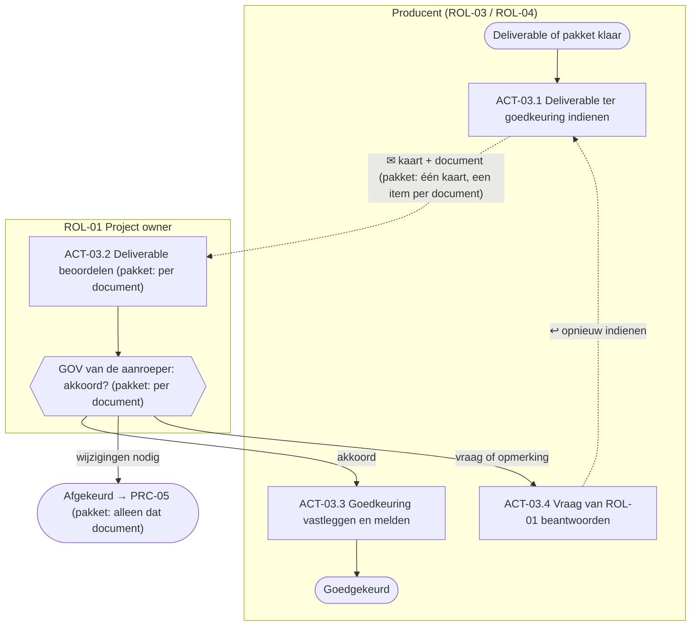

> **Vervallen** – geldend is `prc-03` r16. Dit is een archiefkopie; niet lezen of gebruiken.

# PRC-03 – Akkoord-poort project owner

Status: **Goedgekeurd (2026-10-31, Carlo, kaart `2ddaa565`)**, alle 11 onderdelen van de kaart goedgekeurd: PRC-04 0.12 (vragenloop en grill-sessie), PRC-01 en PRC-02 0.12 (grill-momenten volgens optie A), de weergaven (register, PRC-03, Paperclip-mapping, uitbreidingsgids 0.6, bevindingen), CHG-021 (herstel van de gaten in model 0.11) en de aannames ASM-42 t/m ASM-48. Dit is het ingediende concept, ongewijzigd bewaard. De geldende tekst staat nu in `prc-03`. Vóór de goedkeuring: **Concept, ter goedkeuring** (versie 0.12: CHG-022 grill-sessies, besluit B-15, kaart `d57f0546`; CHG-021 herstel van de gaten in model 0.11, opdracht op kaart `8215b600`). Tot je dit goedkeurt, geldt 0.11 (Goedgekeurd 2026-10-30, Carlo, kaart `fa26d50e`). Het diagram is niet veranderd (alleen tekst). · Daarvoor: 0.10, Goedgekeurd (2026-10-30, Carlo, kaart `f261b9ac`), revisie 8 van dit document · 0.8, Goedgekeurd (2026-10-29, Carlo, kaart `66da5f92`) · Eerder goedgekeurd: 0.5, Goedgekeurd (2026-10-28, Carlo, GK-2, kaart `eb913512`) · Herbruikbaar subproces

**Nieuw in 0.12** (CHG-021, gat A-12; CHG-022, jouw besluit B-15, kaart `d57f0546`):
- ACT-03.1: het mechanisme voor jouw akkoord is besloten. Het label is nu **B (B-14: PRP-040)** in plaats van "Voorstel 0.11 (PRP-040)": altijd een kaart `request_item_verdicts`, geen `approval`-stage en geen decisions.
- Bij een akkoord kan de producent het **contextverslag** van de grill-sessie(s) als bijlage bij de kaart noemen. Het verslag is input, geen deliverable. Het blijft **één akkoord**: de partner van de sessie bevestigde het verslag al (bij een sessie met jou als laatste vraag); UC1 houdt 4 akkoorden (B-15, V4; ASM-48).
- Geen nieuwe ID's; het diagram verandert niet.

**Nieuw in 0.10** (CHG-015, jouw opdracht B-10, goedgekeurd in B-12, kaart `f261b9ac`):
- De akkoorden heten nu GOV-01 t/m GOV-15 (nieuw: GOV-14 ontwerp in UC2, GOV-15 Richting in UC1).
- Een pakket is GOV-10, GOV-11 of **GOV-15**. Een pakket kan meer producenten hebben: bij GOV-15 Atlas (profiel), de ontwerper en Socrates (brieven) (ASM-26, bevestigd).
- Geen nieuwe ID's; het diagram verandert niet.

**Nieuw in 0.8** (CHG-011, jouw keuze B-08, kaart `2b7a6d2d`):
- Een **pakket** (GOV-10 analysepakket, GOV-11 kernontwerp) gaat in één keer ter goedkeuring: één kaart, met een beoordeling per document (PRP-003, ASM-19).
- Jij besluit per document. Alleen de goedgekeurde documenten krijgen de status Goedgekeurd. De afgekeurde gaan door PRC-05; de rest blijft goedgekeurd.
- Geen nieuwe ID's. ACT-03.1 t/m ACT-03.3 zijn aangevuld, het diagram heeft een kleine aanvulling.

**Labels:** **B** = Besloten (jouw opdracht, B-01 t/m B-15, TL-V1 t/m TL-V7). **F** = Feit (huidige situatie, met bron). **V** = Voorstel (PRP). **A** = Aanname (ASM).

## Doel en uitkomst
Een deliverable, of een pakket documenten, zichtbaar laten goedkeuren of afkeuren door de project owner (ROL-01). Uitkomst: **Goedgekeurd** (vastgelegd op het issue) of **Afgekeurd met commentaar** (door naar PRC-05). Bij een pakket geldt de uitkomst per document. **B**

## Trigger, start- en eindconditie
| | |
| --- | --- |
| Trigger | Een aanroepend proces heeft een deliverable klaar voor een GOV-moment, of een pakket (GOV-10, GOV-11, GOV-15) (zie *Aanroepen*). |
| Start | Deliverable staat als document op het issue van de producent. Bij een pakket: alle documenten van het pakket. |
| Einde | (1) Goedgekeurd, of (2) afgekeurd en overgedragen aan PRC-05. Bij een pakket per document: goedgekeurde documenten zijn klaar, afgekeurde gaan naar PRC-05. |

## Eigenaar, rollen en systemen
Eigenaar: ROL-01. Lanes: **producent** (de agent die de deliverable maakt: ROL-03 of ROL-04) en **ROL-01**. Systeem: Paperclip.

## Input en output
- **In:** deliverable (document en revisie), GOV-ID van het aanroepende proces, producent. Bij een pakket: de documenten van het pakket. Zo nodig het contextverslag van de grill-sessie(s), als bijlage (input, geen deliverable). **B** (B-15), **A** (ASM-42)
- **Uit:** besluit van ROL-01, vastgelegd op het issue; bij goedkeuring status `Goedgekeurd (<datum>, Carlo)` in het document. Bij een pakket per document.

## Relatie met andere processen
Aangeroepen door PRC-01 en PRC-02 (en in PRC-04 bij een wijzigingsverzoek of, sinds 0.12, een productkeuze: GOV-12, B-15). Roept PRC-05 aan bij afkeuring, bij een pakket per afgekeurd document. Elke aanroep heeft een eigen GOV-ID (bijvoorbeeld GOV-10 akkoord analysepakket); de GOV-details (criteria, gevolgen) werkt ronde 3 uit.

## Activiteiten
| ID | Activiteit | Rol of agent | Input | Resultaat | Vervolg | Paperclip | Label |
| --- | --- | --- | --- | --- | --- | --- | --- |
| ACT-03.1 | Deliverable ter goedkeuring indienen | producent | deliverable; zo nodig het contextverslag van de grill-sessie(s) (document `contextverslag` op het issue van de producent) | document op het issue, comment met samenvatting en de vraag om akkoord, goedkeuringskaart; bij een pakket (GOV-10, GOV-11, GOV-15) en bij GOV-14 met twee makers (ASM-37, CHG-018) één kaart met een beoordeling per document. De comment kan het contextverslag als bijlage noemen; het verslag is geen item op de kaart en geen extra akkoord | GOV-poort | document (revisie), comment, status `in_review`. **B (B-14: PRP-040): altijd `request_item_verdicts`, ook bij één document**, gebonden aan de documentrevisie (tot 0.11 bij één document `request_confirmation`, zo werkte GK-1, F). Bij een pakket: één item per document (F: zo werken de kaarten op WEB-19, kaart `2b7a6d2d`), met `verdicts` alleen goedkeuren en afkeuren (`approve`, `reject`; geen `defer`). Geen `executionPolicy`-stage `approval` en geen decisions (OPEN-10 beantwoord, B-14: PRP-040) | B (akkoord), F (werkwijze: `bpmn-conventies`, `architect-modeling`), B (B-14: PRP-040), B (B-08, PRP-003: pakket), A (ASM-18: alleen goedkeuren en afkeuren), B (B-15: contextverslag als input, één akkoord), A (ASM-42: document `contextverslag`) |
| ACT-03.2 | Deliverable beoordelen en besluiten | ROL-01 | document, samenvatting | akkoord, of wijzigingen nodig met commentaar; bij een pakket per document | ACT-03.3 of PRC-05 | kaart accepteren of afwijzen; bij een pakket per document goed- of afkeuren; of een comment | B |
| ACT-03.3 | Goedkeuring vastleggen en melden | producent | besluit; bij een pakket pas als elk document een oordeel heeft | status `Goedgekeurd (<datum>, Carlo)` in het document (bij een pakket alleen in de goedgekeurde documenten); melding aan ROL-02 | einde | document (nieuwe revisie, alleen de status), comment, issue-status. Bij een pakket: pas als de kaart `answered` is (elk item heeft een oordeel) | F (AGENTS.md Socrates en Atlas: Goedgekeurd pas na zichtbare bevestiging; melden aan Dr. Evil), A (ASM-18: pakket) |
| ACT-03.4 | Vraag of opmerking van ROL-01 beantwoorden | producent | comment van ROL-01 | antwoord; zo nodig aangepaste deliverable en een nieuwe kaart | ACT-03.1 | comment; een comment van de gebruiker vervangt de open kaart (`supersedeOnUserComment`) | F (skill `paperclip`), A (ASM-10) |

## Beslissingen en goedkeuringen
| ID | Vraag | Uitkomsten | Bij afwijzing | Label |
| --- | --- | --- | --- | --- |
| GOV van de aanroeper (GOV-01 t/m GOV-15). Bij een pakket (GOV-10, GOV-11, GOV-15): per document | Keurt ROL-01 de deliverable goed? | **akkoord** → ACT-03.3 · **wijzigingen nodig** → PRC-05 · **vraag of opmerking zonder besluit** → ACT-03.4. Bij een pakket kent de kaart alleen goedkeuren en afkeuren; de producent handelt pas als elk document een oordeel heeft | PRC-05 met het commentaar; bij een pakket alleen voor het afgekeurde document | B (akkoord en afkeuring), A (ASM-10: vraag zonder besluit), B (B-08, PRP-003: per document), A (ASM-18: pakket) |

## Uitzonderingen en loops
- **Pakket met goedgekeurde en afgekeurde documenten:** de goedgekeurde documenten krijgen de status Goedgekeurd (ACT-03.3). Elk afgekeurd document gaat door PRC-05 en komt na herziening opnieuw ter goedkeuring. Bij GOV-11 werkt Atlas ook de latere documenten bij die door de herziening geraakt worden; bij GOV-10 werkt Socrates de geraakte use cases en kern mee bij en toetst Atlas de gewijzigde use cases opnieuw (ACT-01.23). Die komen opnieuw in hetzelfde pakket. **A** (ASM-18)
- **Pakket half beoordeeld:** een gedeeltelijk antwoord houdt de kaart open (`pending`) en wekt de producent wel; pas als elk item een oordeel heeft, is de kaart `answered`. **F** (skill `paperclip`, `request_item_verdicts`). De producent handelt pas als elk document een oordeel heeft; na een gedeeltelijke wekker wacht hij. De kaart kent alleen goedkeuren en afkeuren (geen `defer`). **A** (ASM-18)
- **Vraag in plaats van besluit (ACT-03.4 → ACT-03.1):** dit telt niet als afkeuringsronde. De uitgang ligt bij ROL-01: elke nieuwe kaart vraagt opnieuw om een besluit. **A** (ASM-10)
- **Geen reactie van ROL-01:** de producent wacht (`in_review`). Er is geen termijn (ASM-35). **Elke werkdag om 09:00 stuurt Dr. Evil één herinneringsbericht met alles wat op ROL-01 wacht** (B-13; inhoud, plek en geen termijn: ASM-35). Op het weekmoment staan de openstaande akkoorden ook (SM-02: "wat klaarstaat"). **B** (B-13), **A** (ASM-35), **F** (rolanalyse-orchestrator SM-02). De huidige skills van Dr. Evil verbieden een herinnering tussendoor; aanpassing via PRC-08 (FND-037).
- **Contextverslag bij het akkoord (nieuw in 0.12):** ging er een grill-sessie aan de deliverable vooraf, dan kan de producent het contextverslag als bijlage in de comment noemen. Zo zie je wat in de sessie is vastgesteld en door wie. Je beoordeelt het verslag niet apart: de partner van de sessie heeft het al bevestigd (bij een sessie met jou was dat de laatste vraag, geen akkoord). Het blijft één akkoord per GOV-moment; UC1 houdt 4 akkoorden. **B** (B-15, V4), **A** (ASM-42, ASM-48)
- **Nieuwe revisie terwijl de kaart open staat:** de kaart vervalt (`stale_target`), de producent dient opnieuw in. **F** (skill `paperclip`, target binding). Of een pakketkaart ook vervalt als één document een nieuwe revisie krijgt, heb ik niet vastgesteld.

## Tussendiagram

## Aannames en open vragen
- **ASM-10:** een vraag of opmerking van ROL-01 zonder besluit telt niet als afkeuring; pas "Wijzigingen nodig" start PRC-05.
- **ASM-18:** bij GOV-11 werkt Atlas de documenten af in de vaste volgorde en legt ze samen voor. Keurt ROL-01 een document af, dan gaat alleen dat document door PRC-05; geraakte latere documenten komen opnieuw in hetzelfde pakket. Bij GOV-10 geldt hetzelfde voor de use cases en de kern als de requirements zijn afgekeurd. Bij een pakket handelt de producent pas als elk document een oordeel heeft; de kaart kent alleen goedkeuren en afkeuren (uitgebreid na controle-model-v08, L-04, L-13).
- **ASM-19 (vervallen in 0.11, CHG-018):** was "het model gebruikt de vorm met 3 akkoorden in UC1" (bevestigd op kaart `66da5f92`). Sinds je PRP-036 goedkeurde (B-12) zijn het er 4 (GOV-10, GOV-15, GOV-11, GOV-06).
- **ASM-37 (nieuw in 0.11, CHG-018, bevestigd: B-14):** de regel van ASM-26 geldt ook voor GOV-14: één kaart met een oordeel per document (het ontwerp van de ontwerper, de brieven van Socrates); elke producent herstelt zijn eigen document, en Dr. Evil gaat pas verder als elk document een oordeel heeft.
- **OPEN-10 (beantwoord, B-14: PRP-040: altijd een kaart, geen decisions en geen approval-stage; PRP-041: toets van Atlas via een toets-issue):** welk Paperclip-mechanisme gebruiken we voor jouw akkoord: de goedkeuringskaart (`request_confirmation`, zoals nu) of een `approval`-stage in de `executionPolicy` van het issue? De stage houdt besluit, terugstuur-adres en geschiedenis op het issue zelf bij (skill `paperclip`, Cross-Agent Review Gates) en maakt tellen eenvoudiger (M-1). Hoe dat voor jou in de interface werkt, heb ik niet kunnen nagaan. Voor een pakket (GOV-10, GOV-11) is de kaart met een item per document een feit.
- **OPEN-09:** beantwoord in 0.11 (B-13): geen termijn, wel elke werkdag om 09:00 een herinneringsbericht.

## Wijzigingshistorie
| Versie | Datum | Wijziging | Door |
| --- | --- | --- | --- |
| 0.3 | 2026-10-28 | Eerste procesbeschrijving (ronde 2, CHG-004). Na controle E-12, E-13: G-03.1 samengevoegd met de GOV van de aanroeper (ID G-03.1 vervalt), Label-kolom, OPEN-10. | Socrates |
| 0.4 | 2026-10-28 | CHG-005: GOV-13 (databaseontwerp) toegevoegd aan de reeks; legenda B-01 t/m B-07, TL-V1 t/m TL-V6 (controle G-09). De werking van het subproces is niet veranderd. | Socrates |
| 0.5 | 2026-10-28 | CHG-007: TL-V7, ROL-05 vervalt. Producent-lane en tekst: ROL-05 eruit (nu ROL-03 of ROL-04); legenda TL-V1 t/m TL-V7. De werking van het subproces is niet veranderd. | Socrates |
| 0.8 | 2026-10-29 | CHG-011 (B-08, PRP-003): een pakket (GOV-10, GOV-11) in één keer indienen, met één beoordeling per document; besluit per document; alleen goedgekeurde documenten krijgen de status Goedgekeurd, afgekeurde gaan door PRC-05. Geen nieuwe ID's. Legenda B-01 t/m B-08. Na controle-model-v08: L-13 (pakketkaart `request_item_verdicts` met alleen goedkeuren en afkeuren; de producent handelt pas als elk document een oordeel heeft; ASM-18), L-04 (GOV-10: geraakte use cases en kern mee). | Socrates |
| 0.10 | 2026-10-30 | CHG-015 (B-10, goedgekeurd in B-12): GOV-01 t/m GOV-15; GOV-15 is ook een pakket, met meer producenten (ASM-26). Het diagram is niet veranderd. | Socrates |
| 0.11 | 2026-10-30 | **Goedgekeurd (2026-10-30, Carlo, kaart `fa26d50e`), B-14.** CHG-019 (B-13): alinea *Geen reactie van ROL-01*, regel bij OPEN-09. CHG-018 (kaart `a16387c4`): ASM-19 vervallen; nieuw ASM-37 (GOV-14 met een oordeel per document). Het diagram is niet veranderd. | Socrates |
| 0.12 | 2026-10-31 | **Concept.** CHG-021 (gat A-12, opdracht op kaart `8215b600`): ACT-03.1 label `B (B-14: PRP-040)` in plaats van "Voorstel 0.11 (PRP-040)"; het alternatief met een `approval`-stage vervalt in de tekst (OPEN-10 beantwoord). CHG-022 (B-15, kaart `d57f0546`): het contextverslag van de grill-sessie(s) kan als bijlage bij de kaart (input; ASM-42); het blijft één akkoord. Relatie met PRC-04: ook een productkeuze (GOV-12, B-15). Legenda B-01 t/m B-15. Geen nieuwe ID's; het diagram is niet veranderd. | Socrates |
