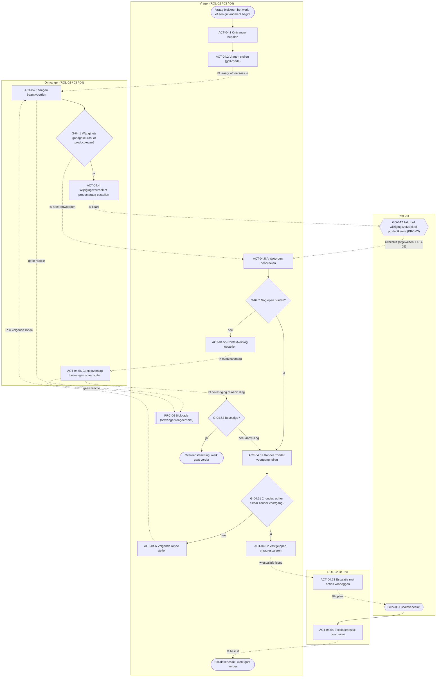

> **Vervallen** – geldend is `prc-04` r18. Dit is een archiefkopie; niet lezen of gebruiken.

# PRC-04 – Vragenloop en grill-sessie tussen agents

Status: **Goedgekeurd (2026-10-31, Carlo, kaart `2ddaa565`)**, alle 11 onderdelen van de kaart goedgekeurd: PRC-04 0.12 (vragenloop en grill-sessie), PRC-01 en PRC-02 0.12 (grill-momenten volgens optie A), de weergaven (register, PRC-03, Paperclip-mapping, uitbreidingsgids 0.6, bevindingen), CHG-021 (herstel van de gaten in model 0.11) en de aannames ASM-42 t/m ASM-48. Dit is het ingediende concept, ongewijzigd bewaard. De geldende tekst staat nu in `prc-04`. Vóór de goedkeuring: **Concept, ter goedkeuring** (versie 0.12: CHG-022 grill-sessies, besluit B-15, kaart `d57f0546`, en besluit B-16, kaart `a5523ebd`; CHG-021 herstel van de gaten in model 0.11, opdracht op kaart `8215b600`). Tot je dit goedkeurt, geldt 0.10 (Goedgekeurd 2026-10-30, Carlo, kaart `f261b9ac`; skillnamen CHG-017, kaart `a16387c4`). · Daarvoor: **Goedgekeurd (2026-10-30, Carlo, kaart `f261b9ac`)**, versie 0.10 (model 0.10, CHG-015, besluit B-12). Kleine tekstwijziging, het diagram is niet veranderd. · Daarvoor: 0.8, Goedgekeurd (2026-10-29, Carlo, kaart `66da5f92`) · Eerder goedgekeurd: 0.5, Goedgekeurd (2026-10-28, Carlo, GK-2, kaart `eb913512`) · Herbruikbaar subproces · CHG-017: skills bij naam (B-11), inhoud ongewijzigd; Goedgekeurd (2026-10-30, Carlo, kaart `a16387c4`), daarvoor revisie 8.

**Nieuw in 0.12** (CHG-022, jouw antwoorden op de kaart `d57f0546`, besluit B-15; jouw keuze voor optie A op de kaart `a5523ebd`, besluit B-16):
- **Elke vraag tussen agents is een grill-sessie (V1).** De vrager stelt per ronde alle vragen die nu te beantwoorden zijn, genummerd en elk met een aanbevolen antwoord. Feiten zoekt hij zelf op. Dit subproces is ook de route voor de grill-momenten tussen agents: alleen GS3 (PRC-01) en GS11 (PRC-02), plus elke vraag tussen agents (B-16).
- **Alleen rondes zonder voortgang tellen (V2).** Een ronde waarin minstens één punt is beslist, telt niet. Na 2 rondes achter elkaar zonder voortgang escaleert de vrager naar jou (GOV-08). Dit verandert B-08 voor dit subproces. Afkeuringen (PRC-05) houden het maximum van 2.
- **Elke agent beslist alleen in zijn eigen vakgebied (V3).** Een productkeuze, of een wijziging van iets wat jij goedkeurde, gaat altijd naar jou (G-04.1 → ACT-04.4 → GOV-12).
- **Overeenstemming staat in een contextverslag (V4).** Nieuw: ACT-04.55 (de vrager stelt het verslag op), ACT-04.56 (de ontvanger bevestigt of vult aan) en G-04.52 (bevestigd?). Een aanvulling telt als ronde (ASM-48).
- **Hernoemd:** ACT-04.2, 04.3, 04.4, 04.5, 04.6, 04.51; G-04.1, G-04.2, G-04.51; GOV-12 heet nu "Akkoord wijzigingsverzoek of productkeuze".
- **Gat A-9 (CHG-021):** een opmerking van Atlas bij de toets gaat via het toets-issue (B-14: PRP-041), niet meer via een review-stage.
- Het diagram is aangepast (nieuwe stappen en namen).

**Nieuw in 0.10** (CHG-015, jouw opdracht B-10, goedgekeurd in B-12, kaart `f261b9ac`):
- Twee regels in de routeringstabel: vragen over een paginabrief gaan naar Socrates, vragen over het ontwerp naar de ontwerper (nu jij, ASM-28).
- Geen nieuwe ID's; het diagram verandert niet.

**Nieuw in 0.8** (CHG-011, jouw keuze B-08, kaart `2b7a6d2d`):
- De variant is de basis geworden (PRP-005): maximaal **2 rondes** heen en weer per vraag, daarna escalatie naar jou (GOV-08). ACT-04.51 t/m ACT-04.54, G-04.51 en GOV-08 horen nu bij de basis. De sectie "Variant" vervalt.
- G-04.2 heeft nieuwe uitkomsten: "nee" gaat naar rondes tellen (ACT-04.51). De uitkomst "nee, vastgelopen → PRC-06" vervalt.
- **ASM-16 vervalt:** de vrager oordeelt niet meer zelf dat een vraag is vastgelopen. Een ontvanger die niet reageert blijft een blokkade (PRC-06).

**Labels:** **B** Besloten · **F** Feit · **A** Aanname (ASM-40 t/m ASM-43, ASM-45 en ASM-48 zijn nieuw in 0.12; ASM-40 en ASM-41 zijn bevestigd door B-16, kaart `a5523ebd`; de andere zijn ter bevestiging)

## Doel en uitkomst
Een agent krijgt antwoord op een vraag die zijn werk blokkeert, of verzamelt de context voor zijn stap, bij de agent die erover gaat, tot er overeenstemming is. **B** (B-15). Uitkomst: een bevestigd contextverslag (werk gaat verder), een goedgekeurd of afgewezen wijzigingsverzoek of productkeuze, of een escalatiebesluit van ROL-01. Een blokkade (PRC-06) ontstaat alleen als de ontvanger niet reageert.

## Trigger, start- en eindconditie
| | |
| --- | --- |
| Trigger | (1) Een agent (de vrager) kan niet verder zonder antwoord van een andere agent. (2) Een agent begint een stap met een grill-moment tussen agents (GS3, GS11; register `grillmomenten`). **B** (B-15, B-16; ASM-40) |
| Start | De vragen van de eerste ronde zijn geformuleerd. Heeft de vrager na het lezen geen open punten, dan start dit subproces niet en komt er geen contextverslag. Een contextverslag komt er alleen als er iets besproken is. **B** (B-16; ASM-41) |
| Einde | (1) Overeenstemming: bevestigd contextverslag (G-04.52), (2) wijzigingsverzoek of productkeuze besloten (GOV-12), daarna verder in de sessie, (3) escalatiebesluit van ROL-01 (GOV-08). Een blokkade (PRC-06) alleen als de ontvanger niet reageert. |

## Eigenaar, rollen en systemen
Eigenaar: ROL-02. Lanes: **vrager** en **ontvanger** (generieke lanes: ROL-02, 03 of 04, zie register), **ROL-02**, **ROL-01**. Systeem: Paperclip.

**Wie beantwoordt wat** (routering, gebruikt in ACT-04.1):
| Onderwerp | Ontvanger | Label |
| --- | --- | --- |
| Bedoeling van een eis, use case of acceptatiecriterium | ROL-03 Socrates | F (AGENTS.md van Socrates, Atlas en Dr. Evil: Socrates is de enige bron) |
| Globaal ontwerp, architectuur, domeinmodel, database; ontwerp per slice, API-contract, opdeling, implementatie | ROL-04 Atlas | B (B-02; UC2: "vragen over implementatie gaan terug naar de tech lead" = Atlas, TL-V7; TL-08), F (AGENTS.md Atlas) |
| Opmerking van Atlas bij de toets van de use cases en paginabrieven (ACT-01.23, ACT-02.13) | ROL-03 Socrates, via het toets-issue; de toets is een grill-sessie volgens dit subproces (GS3, GS11). Per toetsronde een nieuw toets-issue (ASM-45). | B (B-06), B (B-14: PRP-041), B (B-15, B-16) |
| Paginabrief of paginalijst: welke gegevens, acties of toestanden een pagina heeft (nieuw in 0.10) | ROL-03 Socrates | B (B-12: PRP-030, PRP-031) |
| Ontwerp van een pagina of patroon (nieuw in 0.10) | De ontwerper: nu ROL-01, rechtstreeks op het eigen issue (zie ACT-01.21/01.22 of ACT-01.4/01.5); geen PRC-04 zolang er geen ontwerp-agent is | B (B-12: PRP-032), A (ASM-28, bevestigd) |
| Vraag van Socrates of Atlas aan jou over hun eigen werk | ROL-01, rechtstreeks op het eigen issue (geen PRC-04) | B (UC1 stap 2 en 3; zie ACT-01.4, ACT-01.21) |
| Verschil dat Atlas vindt bij de toets van de taken (ACT-01.25, ACT-02.14; nieuw in 0.12) | ROL-02 Dr. Evil (hij maakte de taken) | B (B-08, PRP-027), A (controle K12-28) |
| Prioriteit of scope tussen verschillende stukken werk | ROL-01, via ROL-02 | F (rolanalyse-orchestrator §3, V8 trigger 5) |
| Productkeuze die in een sessie tussen agents opduikt (nieuw in 0.12) | ROL-01, via ACT-04.4 en GOV-12; de agents vullen haar niet samen in | B (B-15, V3) |

**Wie beslist in een sessie** (nieuw in 0.12, B-15 V3): Socrates over de bedoeling van de eisen, Atlas over het ontwerp (B-15, V3). Bij een vraag over de taken beslist Dr. Evil over de opdeling en Atlas over de technische punten daarin (F: koppelingen ACT-01.20, ACT-02.11; V5). Een productkeuze, of een wijziging van iets wat ROL-01 goedkeurde, beslist alleen ROL-01 (GOV-12). Feiten zoekt de vrager zelf op; die vraagt hij niet.

*Door TL-V7 is er geen rol tech lead: vragen over het ontwerp, globaal of per slice, gaan naar Atlas. Vragen van Atlas over eisen gaan naar Socrates.*

## Input en output
- **In:** de vraag of de context van de stap, het geblokkeerde werk, de documenten waarop de vraag gaat.
- **Uit:** een bevestigd contextverslag (document `contextverslag` op het eigen issue van de vrager, één sectie per sessie, ASM-42) met antwoorden en verwijzingen naar ID's (FR, UC, AC, ADR, slice); of een besloten wijzigingsverzoek of productkeuze; of een escalatiebesluit. Een blokkade alleen als de ontvanger niet reageert.

## Relatie met andere processen
Aangeroepen door PRC-01 en PRC-02, bij een vraag en bij de grill-momenten tussen agents (GS3, GS11). Roept PRC-03 aan bij een wijzigingsverzoek of productkeuze (**GOV-12**) en PRC-06 als de ontvanger niet reageert. GOV-08 wordt gedeeld met PRC-05 en PRC-06. De grill-vorm, de beslisregels, het contextverslag, de telling van de rondes en de escalatie lopen via `vragen-en-akkoordrondes` (B-08: PRP-023, uitgebreid in B-15; nog te maken). Sessies met jou lopen niet via dit subproces maar via de vraagstappen van de uitvoerder (ACT-01.4, ACT-01.21, of rechtstreeks op het eigen issue in PRC-02), met dezelfde regels en in de vorm van `grilling`.

## Activiteiten
| ID | Activiteit | Rol | Input | Resultaat | Vervolg | Paperclip | Label |
| --- | --- | --- | --- | --- | --- | --- | --- |
| ACT-04.1 | Ontvanger van de vraag bepalen | vrager | vraag, routeringstabel | ontvanger | ACT-04.2 | — | B/F (zie routeringstabel) |
| ACT-04.2 | Vragen stellen (grill-ronde) | vrager | vraag, of de context van de stap met de documenten waarop hij bouwt | vraag- of toets-issue met alle vragen van de eerste ronde, genummerd en elk met een aanbevolen antwoord; feiten zoekt de vrager zelf op; eigen werk wacht | ACT-04.3 | nieuw issue met toewijzing en `parentId`; eigen issue `blocked` met `blockedByIssueIds`. ⚠ M-7 | B (B-15, V1, V5), A (ASM-08), F (blockers wekken bij `done`: skill `paperclip`) |
| ACT-04.3 | Vragen beantwoorden | ontvanger | vraag-issue, eigen goedgekeurde documenten | antwoord per vraag met verwijzing naar ID's; beslist alleen in het eigen vakgebied | G-04.1 | comment, issue `done` → vrager wordt gewekt | B, B (B-15, V3), F (`requirements-clarification` voor Socrates) |
| ACT-04.4 | Wijzigingsverzoek of productvraag opstellen | ROL-03 (eisen) of ROL-04 (ontwerp) | vraag, gevolgen | wijzigingsverzoek met gevolgen voor de scope, of een productvraag met opties | PRC-03 → **GOV-12** | document op het vraag-issue, kaart voor ROL-01 | F (AGENTS.md Socrates en Atlas: een goedgekeurde eis of scope wijzigt alleen met akkoord van de gebruiker), B (B-15, V3: ook een productkeuze) |
| ACT-04.5 | Antwoorden beoordelen | vrager | antwoorden van de ronde | per punt: beslist of nog open; had de ronde voortgang (minstens één punt beslist)? | G-04.2 | — | B (B-15, V2) |
| ACT-04.6 | Volgende ronde stellen | vrager | open punten en wat de antwoorden hebben vrijgemaakt | volgende ronde vragen (grill-vorm) op hetzelfde vraag- of toets-issue | ACT-04.3 | comment, issue terug naar de ontvanger. ⚠ M-17 | B (vragenloop), B (B-15) |
| ACT-04.51 | Rondes zonder voortgang tellen | vrager | vraag-issue | aantal rondes achter elkaar zonder voortgang | G-04.51 | comments van de vrager op het vraag-issue. ⚠ M-1, M-15 | B (B-15, V2; was B-08, PRP-005) |
| ACT-04.52 | Vastgelopen vraag escaleren | vrager | vraag-issue met 2 rondes achter elkaar zonder voortgang | escalatie-issue voor ROL-02 | ACT-04.53 | nieuw issue toegewezen aan Dr. Evil | B (B-08, PRP-005), B (B-15, V2) |
| ACT-04.53 | Escalatie met opties voorleggen | ROL-02 | escalatie-issue | opties voor ROL-01 | GOV-08 | interactie op het escalatie-issue, status `in_review` | B (B-08, PRP-005), F (`escalation-management`) |
| ACT-04.54 | Escalatiebesluit doorgeven | ROL-02 | besluit | antwoord voor de vrager; vraag-issue `done` | einde | comment, issue `done` → vrager gewekt | B (B-08, PRP-005) |
| **ACT-04.55** | **Contextverslag opstellen** (nieuw in 0.12) | vrager | vraag- of toets-issue zonder open punten | sectie in het document `contextverslag` op het eigen issue: wat vaststaat (met bron), wat beslist is en door wie, wat naar ROL-01 ging, documenten met revisie | ACT-04.56 | document `contextverslag` op het eigen issue; link als comment op het vraag-issue. ⚠ M-16 | B (B-15, V4), A (ASM-42) |
| **ACT-04.56** | **Contextverslag bevestigen of aanvullen** (nieuw in 0.12) | ontvanger | contextverslag | bevestiging, of een aanvulling (een punt is anders of ontbreekt) | G-04.52 | comment op het vraag- of toets-issue, daarna issue `done` → vrager gewekt | B (B-15, V4), A (ASM-42) |

## Beslissingen en goedkeuringen
| ID | Vraag | Uitkomsten | Bij afwijzing | Label |
| --- | --- | --- | --- | --- |
| G-04.1 | Vraagt het antwoord om een wijziging van iets wat ROL-01 goedkeurde, of om een productkeuze? | nee → ACT-04.5 · ja → ACT-04.4 → PRC-03 (GOV-12) | — | F; productkeuze: B (B-15, V3) |
| GOV-12 | Akkoord wijzigingsverzoek of productkeuze (ROL-01) | akkoord → antwoord volgens het gewijzigde document → ACT-04.5 | PRC-05; afgewezen → het oude document blijft gelden → ACT-04.5 | F; voor Atlas B (B-08, PRP-022) |
| G-04.2 | Zijn er nog open punten? | nee → ACT-04.55 (contextverslag) · ja → ACT-04.51 (rondes zonder voortgang tellen) | — | B (loop), B (B-15, V4) |
| G-04.51 | Zijn er 2 rondes achter elkaar zonder voortgang geweest? | nee → ACT-04.6 · ja → ACT-04.52 | — | B (B-15, V2; was B-08, PRP-005) |
| **G-04.52** | **Bevestigt de ontvanger het contextverslag?** (nieuw in 0.12) | ja → einde "overeenstemming" · nee, met aanvulling → ACT-04.51 (telt als ronde; ASM-48) | — | B (B-15, V4), A (ASM-48) |
| GOV-08 | Escalatiebesluit (ROL-01), gedeeld met PRC-05 en PRC-06 | besluit → ACT-04.54 → einde "escalatiebesluit" | — | B (escaleren naar ROL-01); maximum hier: B (B-15, V2: 2 rondes achter elkaar zonder voortgang) |

## Uitzonderingen en loops
- **Volgende ronde (ACT-04.6 → ACT-04.3):** zoveel rondes als nodig, zolang er voortgang is. Een ronde zonder voortgang is een ronde waarin geen enkel punt is beslist. De vrager telt de rondes zonder voortgang achter elkaar (ACT-04.51). Na 2 escaleert hij via Dr. Evil naar jou (ACT-04.52 → ACT-04.53 → GOV-08). Na het besluit begint de telling opnieuw (**A**, ASM-48, zoals ASM-11). **B** (B-15, V2; was 2 rondes in totaal, B-08, PRP-005)
- **Aanvulling op het contextverslag (G-04.52 → ACT-04.51):** telt als ronde en loopt dus langs de telling. Neemt de vrager de aanvulling over, dan is er voortgang. **A** (ASM-48)
- **Sessie met ROL-01** (niet via dit subproces): daar telt niemand rondes, want jij bent zelf degene naar wie geëscaleerd zou worden. Antwoord je niet, dan staat de vraag in het herinneringsbericht (B-13). **A** (ASM-48)
- **Toets in rondes (GS3, GS11):** het toets-issue is aan Atlas toegewezen (B-14: PRP-041); bij de toets is Atlas de vrager en Socrates de ontvanger, die op zijn eigen issue wacht. Atlas stelt zijn vragen als comment op het toets-issue; hoe Socrates daarvoor gewekt wordt, is een open punt (⚠ M-17). Het contextverslag staat op het toets-issue (ASM-42). De grill-rondes binnen één toetsronde lopen op hetzelfde toets-issue. De toetsronden zelf (aanpassen door Socrates en opnieuw toetsen, G-01.4 en G-02.5) houden het maximum van 2. **B** (B-08, PRP-006), **A** (ASM-45)
- **Ontvanger reageert niet:** het vraag-issue blijft open; de vrager of Dr. Evil (flowcheck) behandelt het als blokkade → PRC-06. **A**. ⚠ M-4: de flowcheck bestaat nog niet.
- **Vraag-issue geannuleerd:** het werk van de vrager wordt dan niet gewekt (⚠ M-7). De vrager of Dr. Evil haalt de blocker weg. **F** (skill `paperclip`)

## Tussendiagram

## Aannames en open vragen
- **ASM-08** (ronde 1): een vraag loopt via een issue dat aan de ontvanger is toegewezen.
- **ASM-12:** een vraag tussen agents loopt rechtstreeks van vrager naar ontvanger, niet via Dr. Evil. Dr. Evil komt pas in beeld bij een blokkade of escalatie. Dit volgt de huidige instructies (AGENTS.md Socrates: vragen komen binnen via een issue dat aan hem is toegewezen; feitencheck Atlas: vragen over eisen via een issue).
- **ASM-40** (nieuw in 0.12, bevestigd door B-16, kaart `a5523ebd`): een grill-sessie komt waar context voor het eerst van de ene partij naar de andere gaat en nog niets als contract vastligt. Tussen agents is dat alleen GS3 en GS11, plus elke vraag tussen agents (register `grillmomenten`).
- **ASM-41** (nieuw in 0.12, bevestigd door B-16): geen open punten na het lezen → geen sessie, geen vraag en geen contextverslag.
- **ASM-42** (nieuw in 0.12, ter bevestiging): vorm en plek van het contextverslag (document `contextverslag` op het issue waarop de uitvoerder de stap doet; bij de toets van Atlas het toets-issue, bij Dr. Evil het issue waarop hij de taken maakt; één sectie per sessie; bevestiging als comment op het vraag- of toets-issue). Het verslag is er alleen als er iets besproken is (B-16).
- **ASM-43** (nieuw in 0.12, ter bevestiging): stappen in dit subproces en elke beginstap van een grill-moment hebben `vragen-en-akkoordrondes` als skill; zolang die er niet is, telt de stap als *ontbreekt*.
- **ASM-48** (nieuw in 0.12, ter bevestiging): een aanvulling op het contextverslag telt als ronde; na een escalatiebesluit begint de telling opnieuw; in een sessie met jou telt niemand rondes; het verslag is bij een akkoord alleen achtergrond.
- **ASM-45** (nieuw in 0.12, ter bevestiging): per toetsronde een nieuw toets-issue; de grill-rondes van één toetsronde op hetzelfde issue.
- **ASM-16 vervalt (0.8, B-08, PRP-005):** de vragenloop heeft een maximum van 2 rondes, dus "de vrager oordeelt vastgelopen" is niet meer de uitgang. Het ID wordt niet hergebruikt (register, `vervallen_ids`).

## Wijzigingshistorie
| Versie | Datum | Wijziging | Door |
| --- | --- | --- | --- |
| 0.3 | 2026-10-28 | Eerste procesbeschrijving (ronde 2, CHG-004). Na controle E-04, E-05, E-06 gesplitst in basis en variant; GOV-12 voor het wijzigingsverzoek; ACT-04.7 vervalt (wordt ACT-04.52), ID niet hergebruikt. | Socrates |
| 0.4 | 2026-10-28 | CHG-005: rij voor opmerkingen bij de toets van de use cases (B-06). CHG-006: noot bij de routering, ROL-04 en ROL-05 zijn één agent (TL-V6). | Socrates |
| 0.5 | 2026-10-28 | CHG-007: TL-V7, ROL-05 vervalt. Routeringstabel: de twee ontwerprijen samengevoegd tot één rij naar ROL-04 Atlas (vragen van Dr. Evil bij de opdeling: TL-08); noot vervangen; lanes vrager en ontvanger zonder ROL-05. | Socrates |
| 0.8 | 2026-10-29 | CHG-011 (B-08, PRP-005): de variant wordt de basis, de sectie "Variant" en het tweede diagram vervallen. ACT-04.51 t/m 04.54, G-04.51 en GOV-08 in de basis; G-04.2: "nee" gaat naar ACT-04.51, de uitkomst "vastgelopen → PRC-06" vervalt. ASM-16 vervalt. Blokkade (PRC-06) alleen nog als de ontvanger niet reageert. | Socrates |
| 0.10 | 2026-10-30 | CHG-015 (B-10, goedgekeurd in B-12): routeringsregels voor de paginabrief (Socrates) en het ontwerp (de ontwerper, nu ROL-01). Het diagram is niet veranderd. | Socrates |
| 0.12 | 2026-10-31 | **Concept.** CHG-022 (B-15, kaart `d57f0546`): vragenloop wordt ook grill-sessie. Nieuw: ACT-04.55, ACT-04.56, G-04.52. Hernoemd: ACT-04.2, 04.3, 04.4, 04.5, 04.6, 04.51; G-04.1, G-04.2, G-04.51; GOV-12. Telling alleen zonder voortgang (V2), beslisregels en productkeuze (V3), contextverslag (V4). Diagram aangepast. CHG-021 (A-9): toetsopmerking via het toets-issue. Nieuw: ASM-40 t/m ASM-43, ASM-45, ASM-48. Na controle `v012-controle`: K12-01 (aanvulling langs de telling), K12-06, K12-11, K12-14, K12-21. B-16 (optie A, kaart `a5523ebd`): grill-momenten tussen agents alleen GS3 en GS11, plus elke vraag; geen contextverslag zonder open punten; ASM-40 en ASM-41 bevestigd. Diagram en inhoud van PRC-04 niet veranderd. | Socrates |
