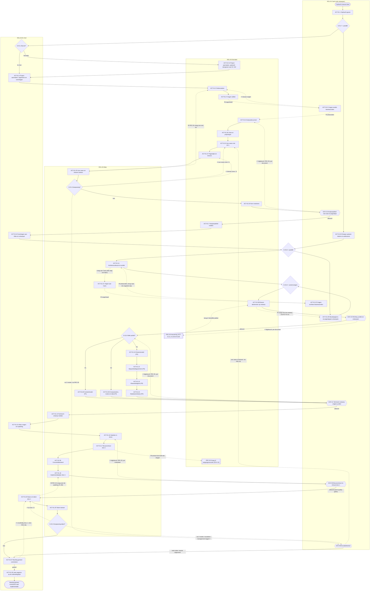

> **Vervallen** – geldend is `prc-01` r16. Dit is een archiefkopie; niet lezen of gebruiken.

# PRC-01 – Nieuwe klant: van opdracht tot eerste backlog (UC1)

Status: **Goedgekeurd (2026-10-31, Carlo, kaart `226c7ce7`)**, alle 11 onderdelen van de kaart goedgekeurd: CHG-023 (OpenAPI voor het bouwcontract), CHG-024 (codes met een korte naam), PRP-044 (korte namen in de conventies), de aannames ASM-49 t/m ASM-55 en de weergaven; besluit **B-19** (model 0.13 goedgekeurd). Dit is het ingediende concept, ongewijzigd bewaard. De geldende tekst staat nu in `prc-01`. Vóór de goedkeuring: **Concept, ter goedkeuring** (versie 0.13: CHG-023 OpenAPI voor het bouwcontract, besluit B-17, en CHG-024 codes met een korte naam, besluit B-18; beide van de kaart `42b39ff5`). Bouwt op model 0.12. Tot je dit goedkeurt, geldt 0.12 (Goedgekeurd 2026-10-31, Carlo, kaart `2ddaa565`). · Daarvoor: **Goedgekeurd (2026-10-31, Carlo, kaart `2ddaa565`)**, versie 0.12: CHG-022 grill-sessies, besluit B-15, kaart `d57f0546`, en besluit B-16, kaart `a5523ebd`; CHG-021 herstel van de gaten in model 0.11, opdracht op kaart `8215b600`, alle 11 onderdelen van de kaart goedgekeurd: PRC-04 0.12 (vragenloop en grill-sessie), PRC-01 en PRC-02 0.12 (grill-momenten volgens optie A), de weergaven (register, PRC-03, Paperclip-mapping, uitbreidingsgids 0.6, bevindingen), CHG-021 (herstel van de gaten in model 0.11) en de aannames ASM-42 t/m ASM-48. Daarvoor gold 0.11 (Goedgekeurd 2026-10-30, Carlo, kaart `fa26d50e`), revisie 10 van dit document. · Daarvoor: 0.11 (model 0.11: CHG-019, je antwoorden op de open vragen, B-13; CHG-018, de gaten in register 0.10), besluit B-14: alle onderdelen van de kaart goedgekeurd. Daarvoor gold 0.10, Goedgekeurd (2026-10-30, Carlo, kaart `f261b9ac`), revisie 9 van dit document. · Primair proces, niveau 1

**Labels:** **B** = Besloten (jouw opdrachten, B-01 t/m B-18, TL-V1 t/m TL-V7). **F** = Feit (huidige situatie, met bron). **V** = Voorstel (PRP), nog niet besloten. Sinds B-12 (model 0.10 goedgekeurd) zijn PRP-029 t/m PRP-039 besloten en gelabeld `B (B-12: PRP-xxx)`. **A** = Aanname (ASM) of open vraag (OPEN).

**B-10** is je opdracht *ontwerp-eerst en architectuurprofielen* (comment `6e69ec6e`, 2026-10-30): de stappen van UC1 en UC2 en het uitgangspunt "het ontwerp en de visie zijn leidend, de API-contracten volgen; de UI wordt nooit afgeleid van de API-contracten". Hoe die stappen precies lopen (volgorde, ontwerpniveau, profielen, akkoorden) was mijn uitwerking (**V**, met een PRP-nummer); je hebt PRP-029 t/m PRP-039 goedgekeurd in B-12 (model 0.10 goedgekeurd), dus nu **B** (B-12: PRP-xxx). De onderbouwing staat in het document `v010-voorstel`.

**Nieuw in 0.13** (CHG-023 – OpenAPI voor het bouwcontract, besluit B-17 – OpenAPI voor het bouwcontract; CHG-024 – codes met een korte naam, besluit B-18 – codes met een korte naam; kaart `42b39ff5`):
- **OpenAPI (B-17):** het bouwcontract van slice 1 (ACT-01.17 – bouwcontract van slice 1 opstellen) is bij P2 en P3 een OpenAPI-bestand. De leesbare versie die jij bij GOV-06 (akkoord bouwcontract per slice) goedkeurt, wordt eruit gemaakt. Bij P1 blijft het templatecontract een tabel, en komt er alleen OpenAPI waar echt een API is. Uitwerking in `v013-voorstel` §3 (ASM-49 t/m ASM-53, ter bevestiging).
- **Codes met een naam (B-18):** de legenda hieronder, en de eerste keer per sectie de korte naam bij een code. In het diagram staat al de naam van de stap.
- Geen nieuwe of vervallen stappen, beslissingen of akkoorden; het diagram verandert niet. UC1 houdt 4 akkoorden.

**Wat de codes betekenen** (B-18 – codes met een korte naam): PRC = proces · ACT = stap (het nummer zegt niets over de volgorde) · G = beslispunt · GOV = akkoordmoment van jou · GS = grill-moment · ROL / AGT = rol / agent · CAP = capability · B / TL-V = jouw besluit · TL = tech-leadtaak van Atlas · PRP = voorstel · FND = bevinding · ASM = aanname · OPEN = open vraag · CHG = wijziging · P1 / P2 / P3 = architectuurprofiel (CMS / component-app / maatwerk) · M = plek waar Paperclip niet netjes past · UC / AC / BR / FR = use case / acceptatiecriterium / bedrijfsregel / functionele eis van een klantproject. De eerste keer per sectie staat de korte naam erbij; de volledige lijst staat in `v013-codes-en-namen`.

**Nieuw in 0.12** (CHG-022 grill-sessies, besluit B-15 – grill-sessies om context te verzamelen, kaart `d57f0546`, en besluit B-16 – minder grill-momenten, optie A, kaart `a5523ebd`; CHG-021 herstel van de gaten in model 0.11, kaart `8215b600`):
- **Grill-sessies (B-15, B-16 – minder grill-momenten, optie A):** een grill-sessie komt waar context voor het eerst van de ene partij naar de andere gaat en er nog niets vastligt als contract (ASM-40 – waar grill-sessies komen). In dit proces zijn dat vier momenten: GS1 t/m GS4 (zie "Grill-sessies (nieuw in 0.12)" onder de activiteiten). Ze staan in de kolom Paperclip van de beginstap.
- **Diagram ongewijzigd:** een grill-sessie is een aanroep van PRC-04 (vragenloop en grill-sessie tussen agents; tussen agents, zie PRC-04 0.12) of van de bestaande vraagstappen ACT-01.4 (vragen van Socrates aan Carlo)/01.5 en ACT-01.21 (vragen van Atlas aan Carlo)/01.22 (met jou), zoals een vraag nu.
- **Contextverslag:** de uitkomst van een sessie als er iets besproken is, op het eigen issue van de uitvoerder; de volgende stap leest het als input (ASM-42 – inhoud van het contextverslag). Met jou is de bevestiging de laatste vraag van de sessie, **geen nieuw akkoord**: UC1 houdt 4 akkoorden. Geen open punten, dan geen sessie, geen vraag en geen verslag (ASM-41 – geen sessie zonder open punten, B-16 – minder grill-momenten, optie A).
- **Grill-vorm bij ACT-01.4 (vragen van Socrates aan Carlo) en ACT-01.21 (vragen van Atlas aan Carlo):** per ronde alle vragen genummerd, elk met een aanbevolen antwoord (FND-038 – register beschreef grilling verkeerd).
- **Telling:** in een sessie tellen alleen rondes zonder voortgang; na 2 zulke rondes achter elkaar escalatie (GOV-08 – escalatiebesluit van Carlo). Dit verandert B-08 (keuze uit de voorstellen) voor de vragenloop (PRC-04 – vragenloop en grill-sessie tussen agents); de regel bij "Uitzonderingen en loops" is daarop aangepast. De toets-lussen G-01.4 (toets nieuwe klant: use cases of brieven aanpassen?) en G-01.5 (toets nieuwe klant: taken aanpassen?) en de afkeuringen (PRC-05 – afkeuring en herziening) houden maximaal 2.
- **Skill:** elke stap met een grill-sessie krijgt `vragen-en-akkoordrondes` (besloten B-08 – keuze uit de voorstellen, nog te maken); tot die bestaat, telt hij als *ontbreekt* (ASM-43 – vragen-en-akkoordrondes als skill).
- **Herstelde gaten (CHG-021 – gaten in model 0.11 hersteld):** PRP-043 (templatecontract bij CMS-projecten) bij ACT-01.17 (bouwcontract van slice 1 opstellen) en GOV-06: bij P1 maakt `architect-api-contracts` het templatecontract per slice uit het contentmodel van `architect-cms-configuratie` (A-5). Per toetsronde een nieuw toets-issue bij ACT-01.23 (use cases en paginabrieven toetsen) en G-01.4 (toets nieuwe klant: use cases of brieven aanpassen?; B-2, ASM-45 – nieuw toets-issue per toetsronde). Het contentmodel bij P1 wordt per slice bijgewerkt (ACT-01.60 – contentmodel en platformconfiguratie opstellen, B-3, ASM-46 – contentmodel bij CMS-projecten).
- Nieuwe aannames: ASM-40 (waar grill-sessies komen) en ASM-41 (geen sessie zonder open punten) zijn bevestigd (B-16 – minder grill-momenten, optie A); bevestigd (kaart `2ddaa565`): ASM-42 (inhoud van het contextverslag), ASM-43 (vragen-en-akkoordrondes als skill), ASM-45 (nieuw toets-issue per toetsronde), ASM-46 (contentmodel bij CMS-projecten), ASM-48 (tellen van rondes bij contextverslag). Geen nieuwe of vervallen activiteiten, beslissingen of akkoorden.

**Nieuw in 0.11** (CHG-019, je antwoorden op de open vragen, B-13 – antwoorden op de open vragen):
- **Repository en project:** jij maakt de git-repository aan en zet de link in de opdracht (ACT-01.1). Wie de opdracht van jou krijgt, maakt het project in Paperclip aan: Dr. Evil in ACT-01.2 (project aanmaken en opdracht overdragen), of Socrates in ACT-01.51 (project aanmaken en directe opdracht melden; ASM-31 – project aanmaken bij directe opdracht, ASM-34 – link naar git-repository in opdracht). Het diagram verandert niet; alleen de namen van ACT-01.2 en ACT-01.51.
- **Claude Design:** het design systeem en de ontwerpen staan in de regel in Claude Design; je deelt een link of projectnaam (ACT-01.52 – design systeem maken en aanleveren, ACT-01.28 – sleutelpagina's en paginatypen ontwerpen). De agents hebben daar nu geen toegang toe (FND-035 – agents kunnen Claude Design niet openen). Besloten (B-14 – model 0.11 goedgekeurd): PRP-042 (toegang tot Claude Design): tot dat werkt, zet de ontwerper een export als vaste versie op het issue.
- **Toets van Atlas (ACT-01.23 – use cases en paginabrieven toetsen):** via een toets-issue in plaats van een review-stage, zodat het issue van Socrates niet op `done` springt vóór jouw akkoord (PRP-041 – toets van Atlas via toets-issue, lost M-9 – akkoord na toets van Atlas op).

**Nieuw in 0.10** (CHG-015 – ontwerp-eerst en architectuurprofielen toegevoegd, B-10 – ontwerp eerst en architectuurprofielen):
- **Design systeem bij de start** (B-10 – ontwerp eerst en architectuurprofielen stap 1): jij maakt en levert het aan (ACT-01.52 – design systeem maken en aanleveren). Dat ID was de variant van het uitgestelde PRP-011 (design systeem bij de start); het gaat met hetzelfde ID naar de basis. PRP-011 vervalt, want B-10 vervangt het.
- **Visie en projecttype** (B-10 – ontwerp eerst en architectuurprofielen stap 2): Socrates legt de productvisie vast en signaleert het projecttype (ACT-01.26 – visie en projecttype vastleggen, PRP-029 – volgorde van stappen bij nieuwe klant, PRP-034 – drie architectuurprofielen).
- **Paginalijst met "nu" en "later", ontwerpniveau en paginabrieven** (B-10 – ontwerp eerst en architectuurprofielen stap 3): Socrates, in het analysepakket (ACT-01.27 – paginalijst en paginabrieven opstellen, PRP-030 – paginalijst met nu en later, PRP-031 – ontwerpniveau per paginatype). Atlas toetst de brieven samen met de use cases (ACT-01.23 – use cases en paginabrieven toetsen).
- **Architectuurprofiel** (B-10 – ontwerp eerst en architectuurprofielen stap 2): Atlas kiest bij de architectuurkeuze een profiel en legt het vast in een ADR (ACT-01.11 – architectuurkeuze en profiel vastleggen, PRP-034 – drie architectuurprofielen).
- **Eerste pagina's ontwerpen** (B-10 – ontwerp eerst en architectuurprofielen stap 4): de sleutelpagina's en paginatypen, door jou zolang er geen designer- of frontend-agent is, grafisch of in code met mock data (ACT-01.28 – sleutelpagina's en paginatypen ontwerpen, PRP-031 – ontwerpniveau per paginatype, PRP-032 – wie ontwerpt pagina's en waarin). Socrates stemt de brieven af op het ontwerp (ACT-01.58 – paginabrieven en ontwerp afstemmen).
- **Nieuw akkoord GOV-15 "Richting":** architectuurkeuze met profiel, paginaontwerpen en bijgewerkte brieven, vóór het technisch ontwerp (PRP-036 – vier akkoorden bij nieuwe klant). De architectuurkeuze gaat uit GOV-11 (akkoord technisch ontwerp volgens profiel).
- **Technisch ontwerp volgens profiel** (G-01.6 – welk architectuurprofiel is goedgekeurd?): P1 contentmodel (ACT-01.60 – contentmodel en platformconfiguratie opstellen), P2 componenten-, route- en dataontwerp (ACT-01.59 – componenten-, route- en dataontwerp opstellen), P3 de bestaande keten (ACT-01.10 – domeinmodel opstellen bij maatwerk, 01.12, 01.13, 01.24). GOV-11 keurt het technisch ontwerp van het gekozen profiel goed (PRP-034 – drie architectuurprofielen).
- **Bouwcontract** (B-10 – ontwerp eerst en architectuurprofielen stap 5): API-contracten (P2, P3) of templatecontract (P1), afgeleid van de goedgekeurde brieven en ontwerpen (ACT-01.17 – bouwcontract van slice 1 opstellen, PRP-034 – drie architectuurprofielen, PRP-032 – wie ontwerpt pagina's en waarin).
- **Uitbreidingslijst** (B-10 – ontwerp eerst en architectuurprofielen, UC2 stap 1): Dr. Evil zet de "later"-pagina's op de lijst (ACT-01.29 – later-pagina's op uitbreidingslijst zetten, PRP-033 – uitbreidingslijst en stappen per uitbreiding).
- **Akkoorden: 4 in plaats van 3** (GOV-10 – akkoord analysepakket, GOV-15 – akkoord richting: architectuur en ontwerpen, GOV-11 – akkoord technisch ontwerp volgens profiel, GOV-06 – akkoord bouwcontract per slice). Wat dit verandert aan B-08 (keuze uit de voorstellen; ASM-19 – vorm met drie akkoorden), B-07 (volledig databaseontwerp van de kern), TL-V4 (Carlo keurt API-contracten goed) en B-06 (Socrates maakt, Atlas toetst use cases) staat onder "Bestaande besluiten".

**Eerder:**
- **0.8** (CHG-011 – keuze uit de voorstellen verwerkt, B-08 – keuze uit de voorstellen): één loket (ACT-01.51 – project aanmaken en directe opdracht melden), kern markeren (ACT-01.54 – kern markeren), 3 akkoorden, conventiebestand (ACT-01.56 – conventiebestand opstellen), Atlas toetst de taken (ACT-01.25 – taken slice 1 toetsen tegen werkpakketten), backlog gereed (ACT-01.57 – backlog gereed van slice 1 controleren).
- **0.5** (CHG-007, TL-V7): geen rol tech lead. Atlas doet de opdeling, de API-contracten en het implementatieplan.
- **0.4** (CHG-005, CHG-006 – Atlas voert tech-leadtaken uit): Socrates maakt de use cases, Atlas toetst ze (B-06 – Socrates maakt, Atlas toetst use cases). Databaseontwerp van de kern vóór het backlog (B-07 – volledig databaseontwerp van de kern). Architectuurkeuze vóór het domeinmodel.

De ID's volgen niet de volgorde van het proces. Een ID verandert niet als een stap verschuift. Nieuwe stappen uit jouw opdracht krijgen een basisnummer (ACT-01.26 t/m 01.29); stappen die alleen uit mijn voorstellen komen, een .5x-nummer (ACT-01.58 t/m 01.60), zoals de uitbreidingsgids voorschrijft.

**Basis en voorstellen.** Je vroeg de richting door te voeren in het concept (B-10 – ontwerp eerst en architectuurprofielen, onderdeel C). Daarom staat mijn uitwerking in 0.10 in de basis, en niet in een aparte variant. Je keurde alle voorstellen goed (B-12 – model 0.10 goedgekeurd, kaart `f261b9ac`); ze zijn nu gelabeld `B (B-12: ...)`, met het nummer van het voorstel. De .5x-nummers (ACT-01.58 t/m 01.60) laten zien welke stappen alleen uit een voorstel komen. Keur je een voorstel af, dan pas ik het concept aan en leg ik het opnieuw voor.

## Doel en uitkomst
Een opdracht voor een website of applicatie omzetten in een goedgekeurde analyse met visie, use cases en paginalijst, goedgekeurde ontwerpen van de eerste pagina's, een goedgekeurd technisch ontwerp volgens het architectuurprofiel, en een backlog met de epics en taken van de eerste vertical slice. Het ontwerp en de visie zijn leidend; het bouwcontract volgt. **B** (B-10 – ontwerp eerst en architectuurprofielen)

## Trigger, start- en eindconditie
| | |
| --- | --- |
| Trigger | ROL-01 (project owner) geeft een opdracht voor een nieuwe klant. **B** |
| Start | De opdracht staat als issue in Paperclip. **B** |
| Einde | **Backlog gereed, overdracht naar implementatie.** Dit is het enige eindpunt. **B** |

## Eigenaar, rollen en systemen
Eigenaar: ROL-02 (orchestrator en scrum master). Lanes: ROL-01 (project owner) Carlo (ook als **ontwerper**, ASM-28 – Carlo is de ontwerper), ROL-02 Dr. Evil, ROL-03 (business analist) Socrates, ROL-04 (systeemarchitect) Atlas. Er is geen rol tech lead: Atlas voert de taken TL-01 t/m TL-09 uit (TL-V7). Er is geen designer- of frontend-agent (F: Paperclip-API, 2026-10-30: vier agents). Systemen: Paperclip; repository van het klantproject (aangemaakt door jou, B-13 – antwoorden op de open vragen); Claude Design voor het design systeem en de ontwerpen (B-13; toegang voor de agents: FND-035 – agents kunnen Claude Design niet openen, PRP-042 – toegang tot Claude Design).

## Input en output
- **In:** opdracht, design systeem, antwoorden en akkoorden van ROL-01 (project owner).
- **Uit:** `requirements.md` met de markering "kern", `business-rules.md`, visie met projecttype, `use-cases.md` met UC- en AC-ID's (B-06 – Socrates maakt, Atlas toetst use cases; lichte vorm bij P1, PRP-038 – lichtere use cases bij eenvoudige site), paginalijst met "nu" en "later", ontwerpniveau en paginabrieven, ontwerpen van de sleutelpagina's en paginatypen met de patroonbibliotheek, architectuurkeuze met profiel-ADR, technisch ontwerp volgens het profiel, opdeling in slices, bouwcontract van slice 1, conventiebestand met UI-conventies, implementatieplan van slice 1, epics en taken van slice 1, de uitbreidingslijst met de "later"-pagina's.

## Relatie met andere processen
Roept PRC-03 (akkoord; GOV-10 – akkoord analysepakket, GOV-15 – akkoord richting: architectuur en ontwerpen en GOV-11 – akkoord technisch ontwerp volgens profiel als pakket), PRC-04 (vragen en grill-sessies tussen agents, B-15 – grill-sessies om context te verzamelen), PRC-05 (afkeuring en herziening; via PRC-03, per document) en PRC-06 (blokkade, vanuit elke activiteit) aan. Na het eindpunt volgt PRC-02 (backlog uitbreiden met volgende slice) voor de uitbreidingen op de uitbreidingslijst.

---

## Basis: jouw workflow met B-08 en B-10

### Activiteiten
In de volgorde van het proces. Nieuw of gewijzigd in 0.10 is **vet** in de kolom ID.

| ID | Activiteit | Rol | Input | Resultaat | Vervolg | Paperclip | Label |
| --- | --- | --- | --- | --- | --- | --- | --- |
| **ACT-01.1** | Opdracht geven | ROL-01 (project owner) | wens van de klant | opdracht-issue **met de link naar de git-repository die jij hebt aangemaakt** | G-01.7 (opdracht en design systeem tegelijk starten) | issue, toegewezen aan Dr. Evil of Socrates | B (stap 1), B (B-13: repository), A (ASM-34 – link naar git-repository in opdracht) |
| **ACT-01.52** | Design systeem maken en aanleveren | ROL-01 (project owner; ontwerper) | opdracht, huisstijl van de klant | design systeem: kleuren, typografie, basiscomponenten, toon; **in Claude Design, met een export als vaste versie** | G-01.8 (analysepakket en design systeem samenvoegen) | **link of projectnaam van Claude Design op het opdracht-issue, en de export als bijlage** ⚠ M-11 (FND-035 – agents kunnen Claude Design niet openen) | B (B-10 – ontwerp eerst en architectuurprofielen, UC1 stap 1), B (B-13: Claude Design), B (B-14: PRP-042 – toegang tot Claude Design: export); was V (PRP-011 – design systeem bij de start, vervalt) |
| **ACT-01.51** | **Project aanmaken en** rechtstreekse opdracht doorgeven aan de orchestrator | ROL-03 (business analist) | opdracht bij Socrates, **met de link naar de repository** | **Paperclip-project voor de klant met de repository;** melding aan Dr. Evil **in dat project**; wacht op toewijzing | ACT-01.2 | **project** ⚠ M-14 (project aanmaken in Paperclip; OPEN-15 – mogen agents een project aanmaken); issue toegewezen aan Dr. Evil | B (B-08 – keuze uit de voorstellen, PRP-001 – één loket voor opdrachten), B (B-13: project), A (ASM-31 – project aanmaken bij directe opdracht, ASM-34 – link naar git-repository in opdracht) |
| **ACT-01.2** | **Project aanmaken,** opdracht registreren en overdragen aan de analist | ROL-02 (orchestrator en scrum master) | opdracht-issue **met de link naar de repository** | **Paperclip-project voor de klant met de repository, als Socrates het nog niet aanmaakte;** overdrachtsissue voor Socrates **in dat project** | ACT-01.3 (plan, bedrijf en domein onderzoeken) | **project** ⚠ M-14 (project aanmaken in Paperclip; OPEN-15 – mogen agents een project aanmaken); nieuw issue met toewijzing en `parentId` | F (`requirements-orchestration`, OR-01), B (B-13: project), A (ASM-31 – project aanmaken bij directe opdracht, ASM-34 – link naar git-repository in opdracht) |
| ACT-01.3 | Plan, bedrijf en domein onderzoeken | ROL-03 (business analist) | opdracht, design systeem als het er al is | inzicht en vragen | ACT-01.4 (vragen van Socrates aan Carlo) | begint met grill-sessie GS1 (grill-sessie bij de analyse; vragen via ACT-01.4/01.5 op het eigen issue); uitkomst: contextverslag als er iets besproken is; dekt ook ACT-01.6 (analysedocument opstellen), 01.26, 01.27, 01.54 | B (stap 2), B (B-15 – grill-sessies om context te verzamelen, B-16 – minder grill-momenten, optie A) |
| ACT-01.4 | Vragen stellen aan de project owner | ROL-03 (business analist) | vragen | vragenkaart | ACT-01.5 (vragen van Socrates beantwoorden) | interactie `ask_user_questions`, status `in_review`; de rondes volgen de grill-vorm: alle vragen van de ronde genummerd, elk met een aanbevolen antwoord; de laatste vraag is de bevestiging van het contextverslag, geen nieuw akkoord; geen open punten → geen vraag en geen verslag (ASM-41 – geen sessie zonder open punten) | B (stap 2), F (skill `paperclip`), B (B-15 – grill-sessies om context te verzamelen, B-16 – minder grill-momenten, optie A) |
| ACT-01.5 | Vragen van de analist beantwoorden | ROL-01 (project owner) | vragenkaart | antwoorden | terug naar de stap die de vraag stelde: ACT-01.6 (analysedocument opstellen), of ACT-01.3 (plan, bedrijf en domein onderzoeken) bij nieuwe vragen (GS1 – grill-sessie bij de analyse); ACT-01.9 (use cases met acceptatiecriteria opstellen; GS2 – grill-sessie bij de use cases); ACT-01.58 (paginabrieven en ontwerp afstemmen; vraag over het ontwerp) | kaart beantwoorden | B (stap 2) |
| ACT-01.6 | Analysedocument opstellen | ROL-03 | antwoorden, onderzoek | `requirements.md` (en `business-rules.md`) | ACT-01.26 (visie en projecttype vastleggen) | document op het issue en in de repo | B (stap 2), A (ASM-01 – betekenis van het analysedocument) |
| **ACT-01.26** | Visie en projecttype vastleggen | ROL-03 (business analist) | requirements, antwoorden, onderzoek | visie: doel, doelgroepen, kernboodschap, hoofdstructuur, wat nu en wat later in principe; projecttype met signalen voor het profiel (soort en aantal pagina's, bedrijfslogica, eigen data, integraties, wie de content beheert, verwachte groei); voorstel voor de vorm van de use cases (licht of volledig) | ACT-01.9 (use cases met acceptatiecriteria opstellen) | document `vision.md` | B (B-10 – ontwerp eerst en architectuurprofielen, UC1 stap 2: visie), B (B-12: PRP-029 – volgorde van stappen bij nieuwe klant: door Socrates, in het analysepakket; PRP-034 – drie architectuurprofielen: projecttype; PRP-038 – lichtere use cases bij eenvoudige site: vorm use cases), A (ASM-27 – visie is de productvisie) |
| ACT-01.9 | Use cases met acceptatiecriteria opstellen | ROL-03 (business analist) | requirements en bedrijfsregels (concept), visie | `use-cases.md` met UC- en AC-ID's; bij projecttype "eenvoudige site" in lichte vorm | ACT-01.27 (paginalijst en paginabrieven opstellen) | document op het issue van Socrates; begint met grill-sessie GS2 (grill-sessie bij de use cases; vragen via ACT-01.4 – vragen van Socrates aan Carlo/01.5); uitkomst: contextverslag als er iets besproken is | B (B-06 – Socrates maakt, Atlas toetst use cases, B-08 – keuze uit de voorstellen), B (B-12: PRP-038 – lichtere use cases bij eenvoudige site: lichte vorm), B (B-15 – grill-sessies om context te verzamelen, B-16 – minder grill-momenten, optie A) |
| **ACT-01.27** | Paginalijst met "nu" en "later", ontwerpniveau en paginabrieven opstellen | ROL-03 (business analist) | visie, use cases, kern (concept), design systeem als het er is | paginalijst: per pagina doel, paginatype, UC/AC, "nu" of "later" met reden, ontwerpniveau (brief of ontwerp); een paginabrief voor elke "nu"-pagina (paginatype, gegevens, acties, toestanden, UC/AC) | ACT-01.23 (use cases en paginabrieven toetsen) | document `pages.md` | B (B-10 – ontwerp eerst en architectuurprofielen, UC1 stap 3), B (B-12: PRP-030 – paginalijst met nu en later: plek en vorm, PRP-031: ontwerpniveau) |
| ACT-01.23 | Use cases en paginabrieven toetsen | ROL-04 (systeemarchitect) | use cases, requirements, paginalijst en brieven | geen opmerkingen, of opmerkingen per use case (hoofdpad, uitzonderingen, gegevens) en per brief (genoeg om een bouwcontract af te leiden; klopt "bestaand patroon") | G-01.4 | **toets-issue voor Atlas (zoals een vraag, PRC-04 – vragenloop en grill-sessie tussen agents); het issue van Socrates wacht `blocked`; daarna jouw kaart (GOV-10 – akkoord analysepakket)**; per toetsronde een nieuw toets-issue, de grill-rondes van die toetsronde lopen op hetzelfde toets-issue (ASM-45 – nieuw toets-issue per toetsronde); begint met grill-sessie GS3 (grill-sessie bij de toets door Atlas; PRC-04 op het toets-issue); uitkomst: contextverslag als er iets besproken is | B (B-06 – Socrates maakt, Atlas toetst use cases), B (B-12: PRP-031 – ontwerpniveau per paginatype: toets van de brieven), B (B-14: PRP-041 – toets van Atlas via toets-issue), A (ASM-45), B (B-15 – grill-sessies om context te verzamelen, B-16 – minder grill-momenten, optie A) |
| ACT-01.54 | Kern markeren | ROL-03 (business analist) | requirements, use cases, paginalijst | eisen met markering "kern"; de "nu"-pagina's dekken de kern | PRC-03 (akkoord-poort van de project owner) → **GOV-10** (akkoord analysepakket) | document; GOV-10 is één kaart (`request_item_verdicts`) met een beoordeling per document | B (B-08 – keuze uit de voorstellen, PRP-015 – kern markeren bij de requirements) |
| ACT-01.7 | Goedgekeurde analyse en use cases melden | ROL-03 (business analist) | goedkeuring GOV-10 (akkoord analysepakket) | melding aan Dr. Evil | ACT-01.8 (ontwerp overdragen aan Atlas en ontwerper) | comment of issue voor Dr. Evil | F (AGENTS.md Socrates) |
| ACT-01.8 | Ontwerp overdragen aan de architect en de ontwerper | ROL-02 (orchestrator en scrum master) | goedgekeurd analysepakket (GOV-10 – akkoord analysepakket) | overdrachtsissue voor Atlas; melding aan de ontwerper (nu jij) dat de sleutelpagina's kunnen worden ontworpen | G-01.8 (analysepakket en design systeem samenvoegen) | nieuw issue met toewijzing; voor jou een comment of issue | F (`requirements-orchestration` stap 4), A (ASM-17 – overdracht pas na analysepakket), B (B-12: PRP-029 – volgorde van stappen bij nieuwe klant: ook de ontwerper) |
| **ACT-01.11** | Architectuurkeuze en architectuurprofiel vastleggen | ROL-04 | goedgekeurd analysepakket (vooral NFR's, visie met projecttype, paginalijst), design systeem | ADR's met de technologiekeuzes, **profiel-ADR (P1, P2 of P3) met de redenen en de groeisignalen**, context- en containerdiagram | G-01.9 (architectuurkeuze en ontwerpen samenvoegen) | document; begint met grill-sessie GS4 (grill-sessie bij de architectuurkeuze; vragen via ACT-01.21 – vragen van Atlas aan Carlo/01.22); uitkomst: contextverslag als er iets besproken is | F (AGENTS.md Atlas), B (TL-V5 – kern vooraf volledig ontwerpen), B (B-10 – ontwerp eerst en architectuurprofielen, UC1 stap 2: architectuur met profiel), B (B-12: PRP-034 – drie architectuurprofielen), B (B-15 – grill-sessies om context te verzamelen, B-16 – minder grill-momenten, optie A) |
| **ACT-01.28** | Sleutelpagina's en paginatypen ontwerpen | ROL-01 (project owner; ontwerper) | design systeem, paginalijst met brieven, visie | ontwerp van één sleutelpagina per paginatype van de "nu"-pagina's en van de pagina's met ontwerpniveau "ontwerp"; patroonbibliotheek (paginatypen en componenten); grafisch (**in de regel in Claude Design**) of in code met mock data, de mock data gemarkeerd als niet bindend | G-01.9 (architectuurkeuze en ontwerpen samenvoegen) | **link naar Claude Design met een export als bijlage**, of een branch in de repo ⚠ M-11 (FND-035 – agents kunnen Claude Design niet openen) | B (B-10 – ontwerp eerst en architectuurprofielen, UC1 stap 4: ontwerp door jou, een designer-agent of een frontend developer; ook in code met mock data), B (B-12: PRP-031: per paginatype, PRP-032 – wie ontwerpt pagina's en waarin), B (B-13: Claude Design), B (B-14: PRP-042 – toegang tot Claude Design), A (ASM-28 – Carlo is de ontwerper) |
| **ACT-01.58** | Paginabrieven en ontwerp op elkaar afstemmen | ROL-03 (business analist) | ontwerpen, paginabrieven | bijgewerkte brieven (gegevens of acties die het ontwerp toevoegt of weglaat) met een lijst van de verschillen; vragen over het ontwerp via ACT-01.4 (vragen van Socrates aan Carlo) | PRC-03 (akkoord-poort van de project owner) → **GOV-15** (akkoord richting: architectuur en ontwerpen) | document; GOV-15 is één kaart (`request_item_verdicts`) met een beoordeling per document | B (B-12: PRP-032 – wie ontwerpt pagina's en waarin) |
| **G-01.6** (welk architectuurprofiel is goedgekeurd?) | *Beslissing, zie hieronder* | | | | | | |
| **ACT-01.60** | Contentmodel en platformconfiguratie opstellen (profiel P1) | ROL-04 (systeemarchitect) | profiel-ADR, paginabrieven, ontwerpen | contentmodel (contenttypen, velden, taxonomieën, rollen), templates en blokken per paginatype, plugins, integraties; het contentmodel wordt per slice bijgewerkt als een uitbreiding dat vraagt (ACT-02.7 – ontwerp per slice opstellen, ASM-46 – contentmodel bij CMS-projecten) | PRC-03 (akkoord-poort van de project owner) → **GOV-11** (akkoord technisch ontwerp volgens profiel) | document | B (B-12: PRP-034 – drie architectuurprofielen), A (ASM-46) |
| **ACT-01.59** | Componenten-, route- en dataontwerp opstellen (profiel P2) | ROL-04 (systeemarchitect) | profiel-ADR, paginabrieven, ontwerpen, use cases | modules en componenten, routes, datastroom, sequentiediagrammen voor de kernflows, datamodel en databaseontwerp alleen bij een eigen database; bij een headless CMS (bijvoorbeeld Payload) het contentmodel | PRC-03 (akkoord-poort van de project owner) → **GOV-11** (akkoord technisch ontwerp volgens profiel) | document | B (B-12: PRP-034 – drie architectuurprofielen) |
| ACT-01.10 | Domeinmodel opstellen (profiel P3) | ROL-04 (systeemarchitect) | use cases, bedrijfsregels, architectuurkeuze | domeinmodel, `GLOSSARY.md` | ACT-01.12 (sequentiediagrammen opstellen bij maatwerk) | document | B (stap 3), F (`architect-modeling` fase 2), B (B-12: PRP-034 – drie architectuurprofielen: alleen P3) |
| ACT-01.12 | Sequentiediagrammen opstellen (profiel P3) | ROL-04 (systeemarchitect) | use cases, domeinmodel, **paginabrieven en ontwerpen** | sequentiediagrammen, in principe voor de hele kern | ACT-01.13 (klassendiagram opstellen bij maatwerk) | document | B (stap 3, TL-V5 – kern vooraf volledig ontwerpen), B (B-12: PRP-029 – volgorde van stappen bij nieuwe klant: na het paginaontwerp; PRP-034 – drie architectuurprofielen: alleen P3) |
| ACT-01.13 | Ontwerpklassendiagram opstellen (profiel P3) | ROL-04 (systeemarchitect) | domeinmodel, sequentiediagrammen | klassendiagram, in principe voor de hele kern | ACT-01.24 (databaseontwerp kern opstellen bij maatwerk) | document | B (stap 3, TL-V5 – kern vooraf volledig ontwerpen), B (B-12: PRP-034 – drie architectuurprofielen: alleen P3) |
| **ACT-01.24** | Databaseontwerp van de kern opstellen (profiel P3) | ROL-04 (systeemarchitect) | klassendiagram, sequentiediagrammen, requirements, ADR's, **paginabrieven** | databaseontwerp van de kern; databasesysteem in een ADR als dat nog niet vastligt | PRC-03 (akkoord-poort van de project owner) → **GOV-11** (akkoord technisch ontwerp volgens profiel) | document | B (B-07), F (`architect-database`), B (B-12: PRP-034 – drie architectuurprofielen: B-07 volledig in P3) |
| ACT-01.14 | Goedgekeurd technisch ontwerp melden | ROL-04 (systeemarchitect) | goedkeuring GOV-11 (akkoord technisch ontwerp volgens profiel) | melding aan Dr. Evil | ACT-01.15 (Atlas vragen om opdeling in slices) | comment of issue voor Dr. Evil | F (feitencheck Atlas, WEB-21) |
| ACT-01.15 | Atlas vragen om opdeling in vertical slices | ROL-02 (orchestrator en scrum master) | technisch ontwerp, paginalijst | opdracht-issue voor Atlas | ACT-01.16 (technisch ontwerp opdelen in slices) | nieuw issue, toegewezen aan Atlas | B (stap 4: "de tech lead" = Atlas, TL-V7 – geen rol tech lead) |
| ACT-01.16 | Technisch ontwerp opdelen in vertical slices | ROL-04 (systeemarchitect) | technisch ontwerp, eisen, **paginalijst ("nu"-pagina's), visie** | slices met pagina's, use cases, AC's en technische volgorde; slice 1 = het kleinste stuk dat van begin tot eind werkt, gekozen uit de "nu"-pagina's | ACT-01.17 (bouwcontract van slice 1 opstellen; inhoud en volgorde van slice 1 komen in GOV-06 – akkoord bouwcontract per slice) | document | B (stap 4, B-01 – flow zonder sprints, B-02 – ontwerp per slice, program design, TL-V2 – Carlo bepaalt de volgorde van wensen), B (B-10 – ontwerp eerst en architectuurprofielen, UC1 stap 5: afgeleid van de pagina's en de visie) |
| **ACT-01.17** | Bouwcontract van slice 1 opstellen | ROL-04 (systeemarchitect) | slice 1, **goedgekeurde paginabrieven en ontwerpen (bindend), visie**, technisch ontwerp; **niet** de mock data | P2/P3: API-contracten als **OpenAPI-bestand** (de bron) en een **leesbare versie** die eruit wordt gemaakt, met bovenaan de revisie van het OpenAPI-bestand (B-17). P1: templatecontract als tabel (velden per template uit het contentmodel), en OpenAPI alleen waar echt een API is: eigen endpoints, koppelingen of een headless CMS (B-17). Bij P1 maakt `architect-api-contracts` het templatecontract per slice uit het contentmodel van `architect-cms-configuratie`. Per veld een bron (brief, UC/AC of BR); waar er een OpenAPI-bestand is, daarin als eigen veld (ASM-50 – bron per veld in OpenAPI) | ACT-01.56 (conventiebestand opstellen) | document op het issue van het bouwcontract (leesbare versie; bij P1 de tabel); OpenAPI-bestand in de repository (ASM-53 – plek van bestand en leesbare versie) | B (B-02 – ontwerp per slice, program design, TL-V4 – Carlo keurt API-contracten goed), B (B-10 – ontwerp eerst en architectuurprofielen, UC1 stap 5: afgeleid van de goedgekeurde pagina's; mock data niet bindend), B (B-12: PRP-032 – wie ontwerpt pagina's en waarin: bronkolom; PRP-034 – drie architectuurprofielen: templatecontract bij P1), B (B-14: PRP-043 – templatecontract bij CMS-projecten), B (B-17), A (ASM-50, ASM-53) |
| ACT-01.56 | Conventiebestand opstellen | ROL-04 | technisch ontwerp, **design systeem, patroonbibliotheek** | codeconventies, projectstructuur, teststrategie, DoD voor een taak, **UI-conventies: design systeem en patroonbibliotheek zijn bindend; een nieuwe component zonder goedgekeurd ontwerp is een vraag** | ACT-01.18 (implementatieplan van slice 1 opstellen) | document in de repo | B (B-08 – keuze uit de voorstellen, PRP-010 – afspraken voor developers in slice 1), B (B-12: PRP-037 – design-consistentie bewaken: UI-conventies) |
| ACT-01.18 | Implementatieplan van slice 1 opstellen | ROL-04 (systeemarchitect) | slice 1, bouwcontract | technische werkpakketten met afhankelijkheden en AC-verwijzingen; elk frontendpakket verwijst naar paginabrief en paginatype; bij P1 vooral configuratie-, thema-, plugin- en contentpakketten | PRC-03 (akkoord-poort van de project owner) → **GOV-06** (akkoord bouwcontract per slice; bij een voorwaarde van stap 5 ook ontwerp en plan, PRP-028 – voorwaardelijk akkoord op ontwerp en plan) | document | B (B-02 – ontwerp per slice, program design, TL-V3 – Dr. Evil maakt taken uit werkpakketten, TL-V7 – geen rol tech lead), B (B-12: PRP-034 – drie architectuurprofielen, PRP-037 – design-consistentie bewaken) |
| ACT-01.20 | Epics en taken van slice 1 maken | ROL-02 (orchestrator en scrum master) | goedgekeurd bouwcontract, werkpakketten; vooraf de poort: GOV-06 (akkoord bouwcontract per slice) is er (`quality-gates`) | epics en taken met eigenaar en afhankelijkheden; elke frontendtaak verwijst naar paginabrief en, waar nodig, het ontwerp | ACT-01.25 (taken slice 1 toetsen tegen werkpakketten) | bovenliggend issue per epic, onderliggende issues, `blockedByIssueIds`. ⚠ M-2 (epics in Paperclip) | B (stap 4, TL-V3 – Dr. Evil maakt taken uit werkpakketten), B (B-08 – keuze uit de voorstellen, PRP-025 – skill voor poortcontrole uitbreiden), B (B-12: PRP-037 – design-consistentie bewaken) |
| **ACT-01.25** | Taken toetsen tegen de werkpakketten | ROL-04 (systeemarchitect) | epics en taken van slice 1, werkpakketten, technisch ontwerp | geen opmerkingen, of opmerkingen: werkpakket niet gedekt, afhankelijkheid klopt niet, taak past niet in het globale ontwerp, frontendtaak zonder brief | G-01.5 (toets nieuwe klant: taken aanpassen?) | `executionPolicy`-stage `review` met Atlas op het bovenliggende issue van de slice (epic) ⚠ M-10 (taken toetsen tegen werkpakketten) | B (B-08 – keuze uit de voorstellen, PRP-027 – Atlas toetst taken tegen werkpakketten), B (B-12: PRP-037 – design-consistentie bewaken) |
| ACT-01.57 | "Backlog gereed" controleren | ROL-02 (orchestrator en scrum master) | epics en taken | elke taak heeft AC-ID's, één eigenaar en afhankelijkheden; de slice is gedekt; het conventiebestand bestaat | ACT-01.29 (later-pagina's op uitbreidingslijst zetten), of terug naar ACT-01.20 (epics en taken slice 1 maken); lukt het na 2 keer niet, dan blokkade (PRC-06 – blokkade afhandelen) | ⚠ M-3 (eindpunt backlog gereed) | B (B-08 – keuze uit de voorstellen, PRP-013 – controle backlog gereed) |
| **ACT-01.29** | "Later"-pagina's op de uitbreidingslijst zetten | ROL-02 (orchestrator en scrum master) | jouw eigen lijst met mogelijke uitbreidingen, paginalijst ("later"), backlog | uitbreidingslijst met per uitbreiding: pagina's, reden "later", verwijzing naar de paginalijst | einde | issue per uitbreiding met status `backlog` onder het projectissue ⚠ M-12 (uitbreidingslijst in Paperclip) | B (B-10 – ontwerp eerst en architectuurprofielen, UC2 stap 1: de lijst), B (B-12: PRP-033 – uitbreidingslijst en stappen per uitbreiding: Dr. Evil vult hem bij het eindpunt) |
| ACT-01.21 | Vragen stellen aan de project owner (architect) | ROL-04 (systeemarchitect) | vraag over het ontwerp | vraag op het eigen issue | ACT-01.22 (vragen van Atlas beantwoorden) | interactie `ask_user_questions` op het issue van Atlas; de rondes volgen de grill-vorm: alle vragen van de ronde genummerd, elk met een aanbevolen antwoord; de laatste vraag is de bevestiging van het contextverslag, geen nieuw akkoord; geen open punten → geen vraag en geen verslag (ASM-41 – geen sessie zonder open punten) | B (stap 3), B (B-15 – grill-sessies om context te verzamelen, B-16 – minder grill-momenten, optie A) |
| ACT-01.22 | Vragen van de architect beantwoorden | ROL-01 (project owner) | vragenkaart | antwoorden | terug naar de activiteit van Atlas die de vraag stelde | kaart beantwoorden | B (stap 3) |

**Doorlopend:**
- Vragen tussen Atlas en Socrates → PRC-04 (vragenloop en grill-sessie tussen agents; B, stap 3 en 5). Vindt Atlas bij de toets (ACT-01.23 – use cases en paginabrieven toetsen) een probleem met een **eis** of een **brief**, dan is dat een vraag of wijzigingsverzoek via PRC-04, niet een aanpassing door Atlas (F, AGENTS.md Atlas).
- Vragen van Atlas en Socrates aan jou, ook over het ontwerp → ACT-01.21 (vragen van Atlas aan Carlo)/01.22 en ACT-01.4 (vragen van Socrates aan Carlo)/01.5, rechtstreeks (B, stap 3). Zolang jij de ontwerper bent, zijn vragen aan de ontwerper vragen aan jou; PRC-04 (vragenloop en grill-sessie tussen agents) hoeft daarvoor niet te veranderen (ASM-28 – Carlo is de ontwerper).
- **Het bouwcontract wordt nooit de bron van een brief of ontwerp.** Kan Atlas iets uit een brief niet bouwen, dan stelt hij een vraag (PRC-04 – vragenloop en grill-sessie tussen agents) of een wijzigingsverzoek (GOV-12 – akkoord wijzigingsverzoek of productkeuze). Een gewijzigde brief of een gewijzigd ontwerp komt opnieuw langs jouw akkoord; het contract volgt daarna. **B** (B-10: UI nooit uit de API), **B** (B-12: PRP-032 – wie ontwerpt pagina's en waarin)
- Vragen van Dr. Evil over de opdeling → PRC-04 (vragenloop en grill-sessie tussen agents) naar Atlas (B, UC2; ASM-03 – vragen over implementatie naar Atlas, TL-08 – vragen van Dr. Evil beantwoorden).
- Opmerkingen van Atlas op de taken (ACT-01.25 – taken slice 1 toetsen tegen werkpakketten) gaan terug naar Dr. Evil (G-01.5 – toets nieuwe klant: taken aanpassen?). Bij een conflict beslis jij (GOV-08 – escalatiebesluit van Carlo). **B** (B-08 – keuze uit de voorstellen, PRP-027 – Atlas toetst taken tegen werkpakketten)
- Elke activiteit kan vastlopen → PRC-06 (blokkade afhandelen; B).

### Grill-sessies (nieuw in 0.12)
Een grill-sessie komt waar context voor het eerst van de ene partij naar de andere gaat en er nog niets vastligt dat als contract kan dienen. Eén sessie per moment; die dekt ook de volgende stappen van dezelfde uitvoerder op dezelfde context. **B** (B-15 – grill-sessies om context te verzamelen, B-16 – minder grill-momenten, optie A)

| GS | Beginstap | Met wie | Dekt ook | Route |
| --- | --- | --- | --- | --- |
| GS1 (grill-sessie bij de analyse) | ACT-01.3 (plan, bedrijf en domein onderzoeken) | Socrates ↔ jij | ACT-01.6 (analysedocument opstellen), 01.26, 01.27, 01.54 | ACT-01.4 (vragen van Socrates aan Carlo) / ACT-01.5 (vragen van Socrates beantwoorden; vragenkaart op het eigen issue) |
| GS2 (grill-sessie bij de use cases) | ACT-01.9 (use cases met acceptatiecriteria opstellen) | Socrates ↔ jij | — | ACT-01.4 (vragen van Socrates aan Carlo) / ACT-01.5 (vragen van Socrates beantwoorden) |
| GS3 | ACT-01.23 (use cases en paginabrieven toetsen) | Atlas ↔ Socrates | — | PRC-04 (vragenloop en grill-sessie tussen agents) op het toets-issue |
| GS4 (grill-sessie bij de architectuurkeuze) | ACT-01.11 (architectuurkeuze en profiel vastleggen) | Atlas ↔ jij | — | ACT-01.21 (vragen van Atlas aan Carlo) / ACT-01.22 (vragen van Atlas beantwoorden) |

**Vervallen door B-16:** GS5 t/m GS8 uit het eerste concept (de nummers worden niet hergebruikt). GS5 (ACT-01.58 – paginabrieven en ontwerp afstemmen): een verschil tussen brief en ontwerp komt bij jouw akkoord (GOV-15 – akkoord richting: architectuur en ontwerpen) toch op tafel; bij een echt verschil stelt Socrates een vraag. GS6 (grill-sessie bij technisch ontwerp; ACT-01.60 – contentmodel en platformconfiguratie opstellen, 01.59, 01.10) en GS7 (grill-sessie bij opdeling in slices; ACT-01.16 – technisch ontwerp opdelen in slices): Atlas heeft Socrates net gegrild bij de toets (GS3 – grill-sessie bij de toets door Atlas) en jij keurde het pakket goed. GS8 (ACT-01.20 – epics en taken slice 1 maken): Atlas toetst de taken al (B-08: PRP-027 – Atlas toetst taken tegen werkpakketten). Een vraag die daar toch opkomt, gaat via PRC-04 (vragenloop en grill-sessie tussen agents) en is dan een grill-sessie. **B** (B-16 – minder grill-momenten, optie A)

Regels:
- **Telling:** alleen een ronde zonder voortgang telt; een ronde waarin minstens één punt is beslist, telt niet. Na 2 rondes achter elkaar zonder voortgang escaleert de vrager naar jou (GOV-08 – escalatiebesluit van Carlo). Dit geldt alleen voor de rondes binnen een sessie tussen agents (PRC-04 – vragenloop en grill-sessie tussen agents). **B** (B-15 – grill-sessies om context te verzamelen) In een sessie met jou telt niemand rondes: jij bent zelf degene naar wie geëscaleerd zou worden; antwoord je niet, dan staat de vraag in het herinneringsbericht (B-13 – antwoorden op de open vragen). **A** (ASM-48 – tellen van rondes bij contextverslag)
- **Maximum 2 blijft:** bij de toets-lussen G-01.4 (toets nieuwe klant: use cases of brieven aanpassen?) en G-01.5 (toets nieuwe klant: taken aanpassen?; per toetsronde een nieuw toets-issue, ASM-45 – nieuw toets-issue per toetsronde) en bij afkeuringen (PRC-05 – afkeuring en herziening). **B** (B-15 – grill-sessies om context te verzamelen), **A** (ASM-45)
- **Wie beslist:** tussen agents beslist elke agent alleen over zijn eigen vakgebied (Socrates: de bedoeling van de eisen; Atlas: het ontwerp). Een productkeuze, of een wijziging van iets wat jij goedkeurde, gaat altijd naar jou (GOV-12 – akkoord wijzigingsverzoek of productkeuze). Feiten zoekt de vrager zelf op. **B** (B-15 – grill-sessies om context te verzamelen)
- **Contextverslag:** er komt alleen een verslag als er iets besproken is. Overeenstemming is: geen open punten meer én de partner bevestigt het verslag. Het verslag staat op het eigen issue van de uitvoerder en is input voor de volgende stap. Geen open punten, dan geen sessie, geen vraag en geen verslag. **B** (B-15 – grill-sessies om context te verzamelen, B-16 – minder grill-momenten, optie A), **A** (ASM-42 – inhoud van het contextverslag)
- **Akkoorden:** de bevestiging van het contextverslag is de laatste vraag van de sessie, geen akkoord. UC1 houdt 4 akkoorden (GOV-10 – akkoord analysepakket, GOV-15 – akkoord richting: architectuur en ontwerpen, GOV-11 – akkoord technisch ontwerp volgens profiel, GOV-06 – akkoord bouwcontract per slice). **B** (B-15 – grill-sessies om context te verzamelen)

### Beslissingen en goedkeuringen
In de volgorde van het proces.

| ID | Vraag | Uitkomsten | Bij afwijzing | Label |
| --- | --- | --- | --- | --- |
| **G-01.7** | *Parallel (splitsen)*: opdracht en design systeem | → G-01.1 (bij wie komt de opdracht binnen?) en → ACT-01.52 (design systeem maken en aanleveren), tegelijk | — | B (B-12: PRP-029 – volgorde van stappen bij nieuwe klant) |
| G-01.1 | Bij wie komt de opdracht binnen? | Dr. Evil → ACT-01.2 (project aanmaken en opdracht overdragen) · Socrates → ACT-01.51 (project aanmaken en directe opdracht melden) → ACT-01.2 | — | B (stap 1), B (B-08 – keuze uit de voorstellen, PRP-001 – één loket voor opdrachten) |
| G-01.4 | Vraagt de toets van Atlas om aanpassing van de use cases of de brieven? | nee → ACT-01.54 (kern markeren; daarna GOV-10 – akkoord analysepakket) · use cases → terug naar ACT-01.9 (use cases met acceptatiecriteria opstellen) · brieven of paginalijst → terug naar ACT-01.27 (paginalijst en paginabrieven opstellen; Socrates past aan, Atlas toetst opnieuw) | na 2 rondes (elke toetsronde een nieuw toets-issue, ASM-45 – nieuw toets-issue per toetsronde): escalatie (ACT-05.3 – escalatie melden aan Dr. Evil → GOV-08 – escalatiebesluit van Carlo) | B (B-06 – Socrates maakt, Atlas toetst use cases), B (B-08 – keuze uit de voorstellen, PRP-006 – afkeuring: twee herzieningen, dan escalatie), B (B-12: PRP-031 – ontwerpniveau per paginatype: brieven), A (ASM-45) |
| **GOV-10** | Akkoord analysepakket: requirements, use cases (met het toetsresultaat van Atlas), bedrijfsregels, kern, **visie met projecttype, paginalijst met "nu"/"later", ontwerpniveau en paginabrieven** (ROL-01 – project owner). Eén kaart met een beoordeling per document. | akkoord → ACT-01.7 (goedgekeurde analyse en use cases melden), daarna ACT-01.8 (ontwerp overdragen aan Atlas en ontwerper) | PRC-05 (afkeuring en herziening), per document: requirements → ACT-01.6 (analysedocument opstellen); visie → ACT-01.26 (visie en projecttype vastleggen); use cases → ACT-01.9 (use cases met acceptatiecriteria opstellen) en opnieuw ACT-01.23 (use cases en paginabrieven toetsen); paginalijst en brieven → ACT-01.27 (paginalijst en paginabrieven opstellen) en opnieuw ACT-01.23; kern → ACT-01.54 (kern markeren). Geraakte latere documenten werkt Socrates mee bij; ze komen opnieuw in hetzelfde pakket (ASM-18 – afgekeurd document apart herzien). | B (B-08: PRP-003 – minder, betere akkoordmomenten, PRP-015 – kern markeren bij de requirements), B (B-12: PRP-036 – vier akkoorden bij nieuwe klant: uitgebreid met visie en paginalijst), A (ASM-18) |
| **G-01.8** | *Parallel (samenvoegen en splitsen)*: analysepakket overgedragen én design systeem aangeleverd | → ACT-01.11 (architectuurkeuze en profiel vastleggen) en → ACT-01.28 (sleutelpagina's en paginatypen ontwerpen), tegelijk | — | B (B-12: PRP-029 – volgorde van stappen bij nieuwe klant) |
| **G-01.9** | *Parallel (samenvoegen)*: architectuurkeuze en ontwerpen klaar. Alleen in de eerste doorloop; herwerk na een afkeuring bij GOV-15 (akkoord richting: architectuur en ontwerpen) loopt via PRC-05 (afkeuring en herziening) en niet door deze samenvoeging. | → ACT-01.58 (paginabrieven en ontwerp afstemmen) | — | B (B-12: PRP-029 – volgorde van stappen bij nieuwe klant) |
| **GOV-15** | **Akkoord "Richting"** (ROL-01 – project owner): architectuurkeuze met profiel-ADR, context- en containerdiagram; ontwerpen van de sleutelpagina's en paginatypen met de patroonbibliotheek, **voor zover niet door jou gemaakt**; bijgewerkte paginabrieven met de lijst van verschillen. Eén kaart met een beoordeling per document. | akkoord → G-01.6 (welk architectuurprofiel is goedgekeurd?) | PRC-05, per document: architectuur of profiel → ACT-01.11 (architectuurkeuze en profiel vastleggen); ontwerp → ACT-01.28 (sleutelpagina's en paginatypen ontwerpen); brieven → ACT-01.58. Na de herziening gaat het document via ACT-01.58 (brieven opnieuw afstemmen als het ontwerp veranderde) terug in hetzelfde pakket, **niet** opnieuw door G-01.9 (architectuurkeuze en ontwerpen samenvoegen). Kies je een ander profiel, dan werkt Atlas de ADR's bij en, als het zwaarder is dan het projecttype aangaf, werkt Socrates de use cases bij naar de volledige vorm; ze komen opnieuw in hetzelfde pakket. Elke producent handelt zijn eigen document (ASM-26 – oordeel per document bij ontwerppakket). | B (B-12: PRP-036 – vier akkoorden bij nieuwe klant, PRP-034 – drie architectuurprofielen), A (ASM-26) |
| **G-01.6** | Welk architectuurprofiel is goedgekeurd? | P1 → ACT-01.60 (contentmodel en platformconfiguratie opstellen) · P2 → ACT-01.59 (componenten-, route- en dataontwerp opstellen) · P3 → ACT-01.10 (domeinmodel opstellen bij maatwerk) | — (het profiel is goedgekeurd in GOV-15 – akkoord richting: architectuur en ontwerpen) | B (B-12: PRP-034 – drie architectuurprofielen) |
| **GOV-11** | **Akkoord technisch ontwerp volgens profiel** (ROL-01 – project owner): P1 contentmodel en platformconfiguratie; P2 componenten-, route- en dataontwerp; P3 domeinmodel, sequentiediagrammen, klassendiagram en databaseontwerp. Eén kaart met een beoordeling per document. Niet meer de architectuurkeuze (die zit in GOV-15). | akkoord → ACT-01.14 (goedgekeurd technisch ontwerp melden) | PRC-05 (afkeuring en herziening), per document naar de eigen activiteit (ACT-01.60 – contentmodel en platformconfiguratie opstellen / 01.59 / 01.10 / 01.12 / 01.13 / 01.24); geraakte latere documenten werkt Atlas mee bij (ASM-18 – afgekeurd document apart herzien) | B (B-08 – keuze uit de voorstellen, PRP-003 – minder, betere akkoordmomenten), B (B-12: PRP-034 – drie architectuurprofielen, PRP-036 – vier akkoorden bij nieuwe klant) |
| **GOV-06** | Akkoord **bouwcontract** van slice 1 (P2 en P3: de leesbare versie van het API-contract, gemaakt uit het OpenAPI-bestand, B-17 – OpenAPI voor het bouwcontract, met het bestand erbij, ASM-53; P1: het templatecontract als tabel, en waar er echt een API is ook de leesbare versie, B-17), met de inhoud en volgorde van slice 1 (ROL-01 – project owner). Toets: elk veld heeft een bron in een goedgekeurde brief, UC/AC of BR, niet in mock data; waar er een OpenAPI-bestand is, hoort de leesbare versie bij de revisie die erbij staat (ASM-52 – controles op het OpenAPI-bestand). Een nieuwe leesbare versie laat de kaart vervallen (ASM-53). Bij een voorwaarde van `architect-implementation-plan` stap 5 ook het ontwerp en het plan. Bij P1 maakt `architect-api-contracts` het templatecontract per slice uit het contentmodel van `architect-cms-configuratie`. | akkoord → ACT-01.20 (epics en taken slice 1 maken) | PRC-05 (afkeuring en herziening): contract → ACT-01.17 (bouwcontract van slice 1 opstellen); inhoud slice 1 → ACT-01.16 (technisch ontwerp opdelen in slices); ontwerp of plan → ACT-01.18 (implementatieplan van slice 1 opstellen) | B (TL-V4 – Carlo keurt API-contracten goed), B (B-08 – keuze uit de voorstellen, PRP-003 – minder, betere akkoordmomenten, PRP-028 – voorwaardelijk akkoord op ontwerp en plan), B (B-12: PRP-032 – wie ontwerpt pagina's en waarin, PRP-034 – drie architectuurprofielen: bouwcontract), B (B-14: PRP-043 – templatecontract bij CMS-projecten), B (B-17), A (ASM-52, ASM-53) |
| G-01.5 | Vraagt de toets van Atlas om aanpassing van de taken? | nee → ACT-01.57 (backlog gereed van slice 1 controleren) · ja → terug naar ACT-01.20 (epics en taken slice 1 maken) | na 2 rondes: escalatie (`escalation-management` trigger 2 → GOV-08 – escalatiebesluit van Carlo) | B (B-08 – keuze uit de voorstellen, PRP-027 – Atlas toetst taken tegen werkpakketten, PRP-006 – afkeuring: twee herzieningen, dan escalatie) |
| GOV-08 | Escalatiebesluit (ROL-01 – project owner) na 2 rondes: bij G-01.4 (toets nieuwe klant: use cases of brieven aanpassen?) via PRC-05 (afkeuring en herziening; ACT-05.3), bij G-01.5 (toets nieuwe klant: taken aanpassen?) via `escalation-management` trigger 2. | toets van de taken: Dr. Evil voert het besluit uit (ACT-01.20 – epics en taken slice 1 maken) en gaat door naar ACT-01.57 (backlog gereed van slice 1 controleren) · use cases of brieven: verder in PRC-05 (ACT-05.6 – besluit uitvoeren) | n.v.t. | B (B-08 – keuze uit de voorstellen, PRP-006 – afkeuring: twee herzieningen, dan escalatie, PRP-027 – Atlas toetst taken tegen werkpakketten) |

### Producten per architectuurprofiel (G-01.6)
V = verplicht, O = optioneel, — = niet van toepassing. Dit is de tabel waartegen GOV-11 (akkoord technisch ontwerp volgens profiel) en de poort (`quality-gates`) toetsen; hij staat ook in het register (`profielen`). **B** (B-12: PRP-034 – drie architectuurprofielen)

| Product (activiteit) | P1 Configuratie/CMS | P2 Component-app | P3 Maatwerk met domeinmodel |
| --- | --- | --- | --- |
| Visie, requirements, bedrijfsregels, kern (01.26, 01.6, 01.54) | V | V | V |
| Use cases met AC's (01.9) | V, lichte vorm (PRP-038 – lichtere use cases bij eenvoudige site) | V | V |
| Paginalijst en paginabrieven (01.27) | V | V | V |
| Design systeem, sleutelpagina's, paginatypen (01.52, 01.28) | V (templates en blokken) | V (componenten) | V |
| Architectuurkeuze met profiel-ADR (01.11) | V | V | V |
| Contentmodel en platformconfiguratie (01.60) | V | — (bij een headless CMS in 01.59) | — |
| Componenten-, route- en dataontwerp (01.59) | — | V | — (componenten per slice in 01.18) |
| Domeinmodel (01.10) | — | — | V |
| Sequentiediagrammen (01.12) | O, alleen koppelingen, in 01.60 | V voor kernflows, in 01.59 | V |
| Ontwerpklassendiagram (01.13) | — | — | V |
| Databaseontwerp (01.24, B-07 – volledig databaseontwerp van de kern) | — | V alleen bij eigen database, in 01.59 | V |
| Bouwcontract (01.17, TL-V4 – Carlo keurt API-contracten goed) | V templatecontract (tabel); OpenAPI alleen waar echt een API is (B-17) | V API-contracten: OpenAPI met leesbare versie (B-17) | V API-contracten: OpenAPI met leesbare versie (B-17) |
| Conventiebestand (01.56) | V | V | V |
| Implementatieplan (01.18) | V | V | V |

**Akkoorden in de basis: 4** (GOV-10, GOV-15 – akkoord richting: architectuur en ontwerpen, GOV-11, GOV-06 – akkoord bouwcontract per slice). In 0.8 waren het er 3. Het extra akkoord is GOV-15: daar keur je het profiel en de eerste ontwerpen goed vóórdat Atlas het technisch ontwerp maakt. Een ontwerp dat jij zelf maakt, keur je niet apart goed (ASM-28 – Carlo is de ontwerper). De paginalijst keur je goed in GOV-10, het profiel en het eerste paginaontwerp in GOV-15. Je koos voor 4 (B-12: PRP-036 – vier akkoorden bij nieuwe klant); het alternatief met 3, waarin GOV-15 opgaat in GOV-11, is niet gekozen (CHG-018 – gaten in register 0.10 hersteld). GOV-08 (escalatiebesluit van Carlo) is geen akkoord.

**Bestaande besluiten die 0.10 raakt** (niets ongemerkt; elk punt stond als voorstel op de kaart en is goedgekeurd, B-12 – model 0.10 goedgekeurd):
- **B-08 (keuze uit de voorstellen) / ASM-19 (vorm met drie akkoorden; 3 akkoorden):** wordt 4 (PRP-036 – vier akkoorden bij nieuwe klant). ASM-19 is daarmee vervallen (`vervallen_ids`, CHG-018 – gaten in register 0.10 hersteld).
- **TL-V5 en B-07 (kern vooraf, volledig databaseontwerp vóór het backlog):** gelden ongewijzigd voor **P3**. Bij P2 alleen een databaseontwerp als er een eigen database is; bij P1 n.v.t., want het platform beheert de database (PRP-034 – drie architectuurprofielen).
- **TL-V4 (jij keurt de API-contracten per slice goed):** blijft; bij P1 keur je het templatecontract goed, en API-contracten alleen voor eigen endpoints (PRP-034 – drie architectuurprofielen). Sinds 0.13 (B-17): bij P2 en P3 keur je de leesbare versie goed, gemaakt uit het OpenAPI-bestand; bij P1 de tabel, en OpenAPI alleen waar echt een API is (eigen endpoints, koppelingen of een headless CMS). Wat je goedkeurt, verandert inhoudelijk niet.
- **B-06 (use cases door Socrates, toets door Atlas):** blijft; bij P1 in lichte vorm (PRP-038 – lichtere use cases bij eenvoudige site).
- **TL-V7 (geen rol tech lead), B-01 (flow zonder sprints), B-02 (ontwerp per slice, program design), PRP-027 (Atlas toetst taken tegen werkpakketten), PRP-013 (controle backlog gereed), PRP-010 (afspraken voor developers in slice 1):** ongewijzigd (PRP-037 – design-consistentie bewaken vult het conventiebestand aan).
- **PRP-011 (uitgesteld):** vervalt, want B-10 (ontwerp eerst en architectuurprofielen; design systeem) vervangt het; ACT-01.52 (design systeem maken en aanleveren) gaat naar de basis.

**Wat dit vraagt** (uitvoering via PRC-08 – organisatie aanpassen, zie `v010-voorstel` PRP-035 – geen nieuwe agent nu): nieuwe skills `paginalijst-en-paginabrieven`, `architectuurprofielen`, `architect-cms-configuratie` en `architect-componentontwerp` (`paginaontwerp` alleen als er een ontwerp-agent komt) en uitbreiding van `requirements-analysis`, `uml-use-cases`, `architect-architecture-choice`, `architect-modeling`, `architect-database`, `architect-implementation-plan`, `backlog-management`, `quality-gates`, `architect-api-contracts`, `architect-use-case-review` en `architect-conventions`. Tot dan werkt elke agent met zijn huidige skills.

**Restrisico:**
- Jij bent de ontwerper én de goedkeurder, en het enige mens (FND-033 – geen ontwerper behalve Carlo). Het ontwerp per paginatype houdt het werk klein, maar je ontwerpwerk ligt op het kritieke pad van slice 1.
- Atlas en jij werken parallel na GOV-10 (akkoord analysepakket). Past het ontwerp niet bij het profiel (bijvoorbeeld een thema dat het niet kan), dan zie je dat pas bij GOV-15 (akkoord richting: architectuur en ontwerpen).
- Een te licht profiel bij een project dat groeit (PRP-034 – drie architectuurprofielen: groeisignalen bij elke uitbreiding).

### Uitzonderingen en loops
- **Afkeuring** bij GOV-10 (akkoord analysepakket), GOV-15 (akkoord richting: architectuur en ontwerpen), GOV-11 (akkoord technisch ontwerp volgens profiel) of GOV-06 (akkoord bouwcontract per slice) → PRC-05, per document: max. 2 herzieningsrondes per document, daarna escalatie (B, B-08: PRP-006 – afkeuring: twee herzieningen, dan escalatie).
- **Nieuwe vragen na antwoorden** (ACT-01.5 – vragen van Socrates beantwoorden → ACT-01.3 – plan, bedrijf en domein onderzoeken): de uitgang ligt bij Socrates. **F**
- **Opmerkingen van Atlas op de use cases of brieven** (G-01.4 – toets nieuwe klant: use cases of brieven aanpassen?): max. 2 rondes, daarna escalatie (ACT-05.3 – escalatie melden aan Dr. Evil → GOV-08 – escalatiebesluit van Carlo). **B** (B-08 – keuze uit de voorstellen), **B** (B-12: PRP-031 – ontwerpniveau per paginatype)
- **Ontwerp wijkt af van de brief** (ACT-01.58 – paginabrieven en ontwerp afstemmen): geen lus; Socrates werkt de brief bij en de verschillen staan in het pakket van GOV-15 (akkoord richting: architectuur en ontwerpen). Vragen over het ontwerp gaan naar jou (ACT-01.4 – vragen van Socrates aan Carlo). **B** (B-12: PRP-032 – wie ontwerpt pagina's en waarin)
- **Ander profiel gekozen bij GOV-15** (akkoord richting: architectuur en ontwerpen): Atlas werkt de ADR's bij; is het zwaarder dan het projecttype, dan werkt Socrates de use cases mee bij (ASM-18 – afgekeurd document apart herzien, ASM-26 – oordeel per document bij ontwerppakket). Telt als herziening van de architectuurkeuze.
- **Herziening raakt een later document** binnen GOV-10 (akkoord analysepakket), GOV-15 (akkoord richting: architectuur en ontwerpen) of GOV-11 (akkoord technisch ontwerp volgens profiel): de producent werkt het mee bij in hetzelfde pakket (ASM-18 – afgekeurd document apart herzien, ASM-26 – oordeel per document bij ontwerppakket).
- **Pakket half beoordeeld**: de producenten handelen pas als elk document een oordeel heeft. **A** (ASM-18 – afgekeurd document apart herzien)
- **Opmerkingen van Atlas op de taken** (G-01.5 – toets nieuwe klant: taken aanpassen? → ACT-01.20 – epics en taken slice 1 maken): max. 2 rondes, daarna GOV-08 (escalatiebesluit van Carlo). **B**
- **Backlog onvolledig** (ACT-01.57 – backlog gereed van slice 1 controleren → ACT-01.20 – epics en taken slice 1 maken): max. 2 keer, daarna PRC-06 (blokkade afhandelen). **B**
- **Vragenloop en grill-sessie** tussen agents → PRC-04 (vragenloop en grill-sessie tussen agents): na 2 rondes achter elkaar zonder voortgang escalatie (GOV-08 – escalatiebesluit van Carlo). Een ronde waarin minstens één punt is beslist, telt niet. **B**, **B** (B-15 – grill-sessies om context te verzamelen)

### Tussendiagram (basis)

*PRC-04 (vragenloop en grill-sessie tussen agents; Q4) en PRC-05 (afkeuring en herziening; R15) zijn aanroepen van een subproces; PRC-04 keert terug naar de vragende stap. G-01.7 (opdracht en design systeem tegelijk starten), G-01.8 (analysepakket en design systeem samenvoegen) en G-01.9 (architectuurkeuze en ontwerpen samenvoegen) zijn parallelle gateways (in Mermaid getekend als ruit met "+"). G-01.8 wacht op twee dingen: het overgedragen analysepakket én het design systeem. De afkeur-pijlen gaan per document naar de eigen activiteit (zie "Bij afwijzing"); bij GOV-11 (akkoord technisch ontwerp volgens profiel) naar de activiteit van het gekozen profiel, getekend via G-01.6 (welk architectuurprofiel is goedgekeurd?). De vraagpijlen bij ACT-01.11 (architectuurkeuze en profiel vastleggen) gelden voor alle activiteiten van Atlas. Na 2 rondes gaan G-01.4 (toets nieuwe klant: use cases of brieven aanpassen?) en G-01.5 (toets nieuwe klant: taken aanpassen?) naar GOV-08 (escalatiebesluit van Carlo); de afkeuringen escaleren in PRC-05 (G-05.1 – is dit de derde afkeuring?).*

---

## Variant
Er is geen variant meer. ACT-01.52 (was PRP-011, uitgesteld) staat in de basis, omdat B-10 (ontwerp eerst en architectuurprofielen) het design systeem bij de start besloten heeft.

---

## Aannames en open vragen
- ASM-01 (betekenis van het analysedocument), ASM-02 (epic als bovenliggend issue), ASM-03 (vragen over implementatie naar Atlas; ronde 1); ASM-17 (overdracht pas na analysepakket), ASM-18 (afgekeurd document apart herzien), ASM-20 (kleine ontwerpwijziging ook langs akkoord), ASM-21 (poort bouwcontract in vaste controles; zoals in 0.8; ASM-17 en ASM-18 in 0.11 bijgewerkt voor 0.10, CHG-018 – gaten in register 0.10 hersteld). ASM-19 (vorm met 3 akkoorden) is vervallen: je keurde PRP-036 (vier akkoorden bij nieuwe klant) goed, 4 akkoorden in UC1 (B-12 – model 0.10 goedgekeurd; CHG-018).
- **ASM-26 (oordeel per document bij ontwerppakket; nieuw):** GOV-15 (akkoord richting: architectuur en ontwerpen) heeft meer producenten (Atlas, de ontwerper, Socrates). Elke producent handelt zijn eigen afgekeurde document; geraakte latere documenten werkt de eigen producent mee bij (ASM-18 – afgekeurd document apart herzien per producent). Dr. Evil zet het pakket pas door als elk document een oordeel heeft.
- **ASM-27 (nieuw):** "de visie" in B-10 (ontwerp eerst en architectuurprofielen) is de productvisie (doel, doelgroepen, kernboodschap, hoofdstructuur, wat nu en later in principe). Socrates maakt haar in het analysepakket. De technische visie is de architectuurkeuze van Atlas. (Vraag 4 op de kaart.)
- **ASM-28 (nieuw):** zolang er geen designer- of frontend-agent is, ben jij de ontwerper. Feit: volgens AGENTS.md van Dr. Evil is Carlo "product owner, designer, frontend developer en CEO". Een ontwerp dat jij maakt, keur je niet apart goed; op de kaart beoordeel je dan alleen de bijgewerkte brieven.
- **ASM-29 (nieuw):** elk project in UC1 heeft een gebruikersinterface (website of applicatie, opdracht `a5a789fe`). Zonder UI vervallen de paginalijst en het ontwerp.
- **ASM-31 (nieuw in 0.11):** komt de opdracht bij Socrates, dan maakt hij eerst het project aan en meldt de opdracht dan aan Dr. Evil; inhoudelijk begint hij pas na toewijzing (PRP-001 – één loket voor opdrachten blijft). Komt hij bij Dr. Evil, dan maakt Dr. Evil het project aan. Er komt nooit een tweede project.
- **ASM-34 (nieuw in 0.11):** je zet de link naar de repository in de opdracht. Ontbreekt die, dan maakt de ontvanger het project zonder repository aan en vraagt hij de link na.
- **ASM-38 (kwaliteitspoorten bij stappen van Dr. Evil; nieuw in 0.11, CHG-018 – gaten in register 0.10 hersteld, bevestigd: B-14 – model 0.11 goedgekeurd):** de poort van `quality-gates` vóór ACT-01.15 (Atlas vragen om opdeling in slices) controleert GOV-15 (akkoord richting: architectuur en ontwerpen) en GOV-11 (akkoord technisch ontwerp volgens profiel).
- **ASM-39 (nieuw in 0.11, CHG-018 – gaten in register 0.10 hersteld, bevestigd: B-14 – model 0.11 goedgekeurd):** de uitbreidingslijst (ACT-01.29 – later-pagina's op uitbreidingslijst zetten) heeft bewust geen controleur: jij bepaalt inhoud en volgorde en ziet de lijst op het weekmoment (PRP-033 – uitbreidingslijst en stappen per uitbreiding).
- **ASM-40 (nieuw in 0.12, bevestigd door B-16 – minder grill-momenten, optie A, kaart `a5523ebd`):** een grill-sessie komt waar context voor het eerst van de ene partij naar de andere gaat en nog niets is vastgelegd dat als contract kan dienen: met jou bij de start van een stuk werk (analyse GS1 – grill-sessie bij de analyse/GS9, use cases GS2 – grill-sessie bij de use cases/GS10, architectuurkeuze GS4 – grill-sessie bij de architectuurkeuze; GS14 alleen bij wijziging van architectuur of profiel) en bij de overdracht Socrates → Atlas (GS3 – grill-sessie bij de toets door Atlas/GS11). Eén sessie per moment, die dekt ook de volgende stappen van dezelfde uitvoerder op dezelfde context. Geen vaste sessie bij stappen die bouwen op wat jij goedkeurde of wat net getoetst is, bij jouw eigen stappen, doorgeven/melden, controles/poorten en lijsten. Daarnaast is elke vraag tussen agents een grill-sessie (PRC-04 – vragenloop en grill-sessie tussen agents).
- **ASM-41 (nieuw in 0.12, bevestigd door B-16 – minder grill-momenten, optie A, kaart `a5523ebd`):** geen open punten → geen sessie, geen vraag en geen contextverslag. Zo krijg je geen extra vraag als er niets te vragen is.
- **ASM-42 (nieuw in 0.12, bevestigd (kaart `2ddaa565`)):** het contextverslag komt er alleen als er in een sessie iets besproken is (B-16 – minder grill-momenten, optie A). Het is een document `contextverslag` op het eigen issue van de uitvoerder. Per sessie één sectie met (1) wat vaststaat en de bron, (2) wat in de sessie is beslist en door wie, (3) wat naar jou ging (GOV-12 – akkoord wijzigingsverzoek of productkeuze) en de uitkomst, (4) welke documenten met welke revisie. De partner bevestigt met een comment op het vraag- of toets-issue (tussen agents), of jij als laatste vraag op de vragenkaart. Een volgende stap leest het verslag als input.
- **ASM-43 (vragen-en-akkoordrondes als skill; nieuw in 0.12, bevestigd (kaart `2ddaa565`)):** elke stap met een grill-sessie (de beginstap en de stappen waarin de rondes lopen: ACT-01.4 – vragen van Socrates aan Carlo, ACT-01.21 – vragen van Atlas aan Carlo, PRC-04 – vragenloop en grill-sessie tussen agents) krijgt `vragen-en-akkoordrondes` als skill. Zolang die skill niet bestaat, telt de stap als *ontbreekt*.
- **ASM-48** (tellen van rondes bij contextverslag; nieuw in 0.12, bevestigd (kaart `2ddaa565`)): een aanvulling op het contextverslag telt als ronde; na een escalatiebesluit begint de telling opnieuw; in een sessie met jou telt niemand rondes (antwoord je niet, dan staat de vraag in het herinneringsbericht, B-13 – antwoorden op de open vragen); het verslag is bij een akkoord alleen achtergrond.
- **ASM-45 (nieuw in 0.12, gat B-2, bevestigd (kaart `2ddaa565`)):** per toetsronde een nieuw toets-issue (het vorige staat op `done`); de grill-rondes binnen één toetsronde lopen op hetzelfde toets-issue, zoals de rondes van een vraag in PRC-04 (vragenloop en grill-sessie tussen agents; ACT-01.23 – use cases en paginabrieven toetsen, G-01.4 – toets nieuwe klant: use cases of brieven aanpassen?).
- **ASM-46 (contentmodel bij CMS-projecten; nieuw in 0.12, gat B-3, bevestigd (kaart `2ddaa565`)):** bij P1 maakt Atlas het contentmodel bij het technisch ontwerp (ACT-01.60 – contentmodel en platformconfiguratie opstellen) en werkt het per slice bij als een uitbreiding dat vraagt (ACT-02.7 – ontwerp per slice opstellen in PRC-02 – backlog uitbreiden met volgende slice).
- Beantwoord in 0.11 (B-13 – antwoorden op de open vragen): OPEN-04 (repository en project), OPEN-14 (plek van design systeem en ontwerpen; Claude Design). Beantwoord met B-14: OPEN-10 (mechanisme voor Carlo's akkoord; PRP-040 – akkoord altijd via kaart op issue en PRP-041 – toets van Atlas via toets-issue). Open: **OPEN-15 (nieuw):** mogen Dr. Evil en Socrates een project aanmaken?

## Wijzigingshistorie
| Versie | Datum | Wijziging | Door |
| --- | --- | --- | --- |
| 0.3 | 2026-10-28 | Eerste procesbeschrijving (ronde 2, CHG-004 – procesmodellen uitgewerkt, ronde 2). | Socrates |
| 0.4 | 2026-10-28 | CHG-005 (use cases en database besloten; B-06 – Socrates maakt, Atlas toetst use cases, B-07 – volledig databaseontwerp van de kern), CHG-006 (Atlas voert tech-leadtaken uit; TL-V6 – Atlas voert tech-leadtaken uit), herstel na controle. | Socrates |
| 0.5 | 2026-10-28 | CHG-007 (TL-V7): geen rol tech lead. | Socrates |
| 0.8 | 2026-10-29 | CHG-011 (keuze uit de voorstellen verwerkt; B-08 – keuze uit de voorstellen): de variant wordt de basis; 3 akkoorden. | Socrates |
| 0.10 | 2026-10-30 | **Goedgekeurd (2026-10-30, Carlo, kaart `f261b9ac`, B-12 – model 0.10 goedgekeurd).** CHG-015 (B-10, opdracht `6e69ec6e`): ontwerp-eerst en architectuurprofielen. Nieuw: ACT-01.26 (visie en projecttype vastleggen), 01.27, 01.28, 01.29, 01.58, 01.59, 01.60; G-01.6 t/m G-01.9; GOV-15 (akkoord richting: architectuur en ontwerpen). ACT-01.52 (design systeem maken en aanleveren) van variant naar basis (PRP-011 – design systeem bij de start vervalt). Gewijzigd: ACT-01.1 (opdracht geven; vervolg), 01.3, 01.6 (vervolg), 01.8, 01.9, 01.10, 01.11, 01.12, 01.13, 01.14, 01.15 (input), 01.16, 01.17, 01.18, 01.20, 01.23, 01.24, 01.25, 01.54, 01.56, 01.57; G-01.4 (toets nieuwe klant: use cases of brieven aanpassen?); GOV-10 (akkoord analysepakket), GOV-11 (akkoord technisch ontwerp volgens profiel), GOV-06 (akkoord bouwcontract per slice). Na controle `v010-controle`: K10-02 (herwerk na GOV-15 via PRC-05 – afkeuring en herziening, niet door G-01.9), K10-05 (naam ACT-01.7 – goedgekeurde analyse en use cases melden zoals 0.8), K10-08 (profieltabel), K10-09 (vraagpijl ACT-01.17 – bouwcontract van slice 1 opstellen → PRC-04 – vragenloop en grill-sessie tussen agents), K10-10 (basis en voorstellen), K10-12. Akkoorden van 3 naar 4. Nieuw: ASM-26 t/m ASM-29, OPEN-14 (plek van design systeem en ontwerpen). | Socrates |
| 0.11 | 2026-10-30 | **Goedgekeurd (2026-10-30, Carlo, kaart `fa26d50e`), B-14 (model 0.11 goedgekeurd).** CHG-019 (antwoorden op open vragen verwerkt; B-13 – antwoorden op de open vragen, comments `f06fede2` en `a690e8f3`): repository door jou (ACT-01.1), project door de ontvanger van de opdracht (ACT-01.2 – project aanmaken en opdracht overdragen, ACT-01.51 – project aanmaken en directe opdracht melden; nieuwe namen), Claude Design (ACT-01.52 – design systeem maken en aanleveren, ACT-01.28 – sleutelpagina's en paginatypen ontwerpen), toets-issue voor Atlas (ACT-01.23 – use cases en paginabrieven toetsen, PRP-041 – toets van Atlas via toets-issue). Nieuw: ASM-31 (project aanmaken bij directe opdracht), ASM-34 (link naar git-repository in opdracht), OPEN-15 (mogen agents een project aanmaken). Het diagram is alleen in twee namen veranderd; het aantal akkoorden blijft 4. CHG-018 (gaten in het register 0.10, kaart `a16387c4`): ASM-19 (vorm met drie akkoorden) vervallen; labels B (B-12 – model 0.10 goedgekeurd) bij de uitzonderingen (controle-pagina-0.4 P-05); nieuw ASM-38 (kwaliteitspoorten bij stappen van Dr. Evil), ASM-39 (uitbreidingslijst zonder controleur). Activiteiten, beslissingen en diagrammen ongewijzigd. | Socrates |
| 0.12 | 2026-10-31 | **Goedgekeurd (2026-10-31, Carlo, kaart `2ddaa565`).** CHG-022 (B-15, kaart `d57f0546`; B-16, kaart `a5523ebd`: minder grill-sessies): grill-sessies GS1 t/m GS4 in de kolom Paperclip van de beginstappen (ACT-01.3 – plan, bedrijf en domein onderzoeken, 01.9, 01.23, 01.11); de andere momenten uit het eerste concept vervallen (B-16); grill-vorm bij ACT-01.4 (vragen van Socrates aan Carlo) en ACT-01.21 (vragen van Atlas aan Carlo); nieuwe sectie "Grill-sessies"; regel voor de vragenloop bij de uitzonderingen (telling zonder voortgang). CHG-021 (gaten in model 0.11, kaart `8215b600`): PRP-043 (templatecontract bij CMS-projecten) bij ACT-01.17 (bouwcontract van slice 1 opstellen) en GOV-06 (akkoord bouwcontract per slice; A-5); ASM-45 (nieuw toets-issue per toetsronde) bij ACT-01.23 (use cases en paginabrieven toetsen) en G-01.4 (toets nieuwe klant: use cases of brieven aanpassen?; B-2); ASM-46 (contentmodel bij CMS-projecten) bij ACT-01.60 (contentmodel en platformconfiguratie opstellen; B-3). Labels B-01 t/m B-16. Nieuw: ASM-40 (waar grill-sessies komen) en ASM-41 (geen sessie zonder open punten; bevestigd door B-16); ASM-42 (inhoud van het contextverslag), ASM-43 (vragen-en-akkoordrondes als skill), ASM-45, ASM-46 (bevestigd (kaart `2ddaa565`)). Activiteiten, beslissingen, akkoorden (4) en diagram ongewijzigd. | Socrates |
| 0.13 | 2026-10-31 | **Concept, ter goedkeuring.** CHG-023 (B-17, kaart `42b39ff5`): OpenAPI bij ACT-01.17 (bouwcontract van slice 1 opstellen) en GOV-06 (akkoord bouwcontract per slice), in de profieltabel en bij TL-V4 (Carlo keurt API-contracten goed); ASM-49 t/m ASM-53 (ter bevestiging). CHG-024 (B-18): legenda en korte namen bij de codes (ASM-54 – herkomst van de korte naam, ASM-55 – waar de korte naam komt). Labels B-01 t/m B-18. Activiteiten, beslissingen, akkoorden (4) en diagram ongewijzigd. | Socrates |
