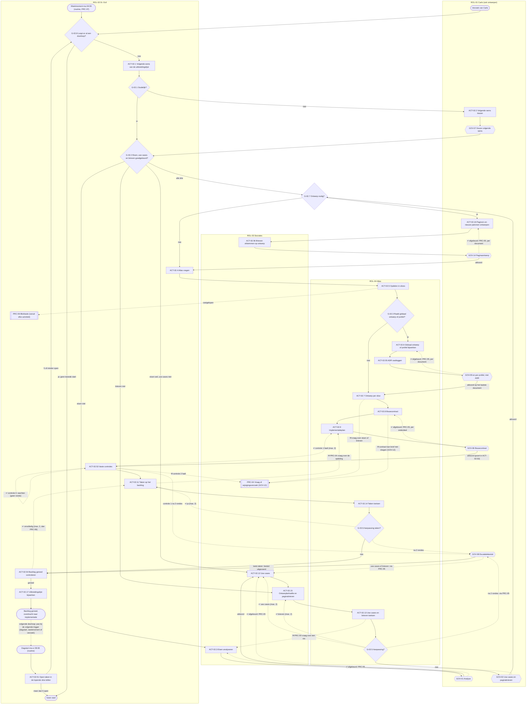

> **Vervallen** – geldend is `prc-02` r17. Dit is een archiefkopie; niet lezen of gebruiken.

# PRC-02 – Backlog uitbreiden met de volgende slice (UC2)

Status: **Goedgekeurd (2026-10-31, Carlo, kaart `226c7ce7`)**, alle 11 onderdelen van de kaart goedgekeurd: CHG-023 (OpenAPI voor het bouwcontract), CHG-024 (codes met een korte naam), PRP-044 (korte namen in de conventies), de aannames ASM-49 t/m ASM-55 en de weergaven; besluit **B-19** (model 0.13 goedgekeurd). Dit is het ingediende concept, ongewijzigd bewaard. De geldende tekst staat nu in `prc-02`. Vóór de goedkeuring: **Concept, ter goedkeuring** (versie 0.13: CHG-023 OpenAPI voor het bouwcontract, besluit B-17, en CHG-024 codes met een korte naam, besluit B-18; beide van de kaart `42b39ff5`). Bouwt op model 0.12. Tot je dit goedkeurt, geldt 0.12 (Goedgekeurd 2026-10-31, Carlo, kaart `2ddaa565`). · Daarvoor: **Goedgekeurd (2026-10-31, Carlo, kaart `2ddaa565`)**, versie 0.12: CHG-022 grill-sessies, besluit B-15, kaart `d57f0546`, en besluit B-16, kaart `a5523ebd`; CHG-021 herstel van de gaten in model 0.11, opdracht op kaart `8215b600`, alle 11 onderdelen van de kaart goedgekeurd: PRC-04 0.12 (vragenloop en grill-sessie), PRC-01 en PRC-02 0.12 (grill-momenten volgens optie A), de weergaven (register, PRC-03, Paperclip-mapping, uitbreidingsgids 0.6, bevindingen), CHG-021 (herstel van de gaten in model 0.11) en de aannames ASM-42 t/m ASM-48. Daarvoor gold 0.11 (Goedgekeurd 2026-10-30, Carlo, kaart `fa26d50e`), revisie 11 van dit document. · Daarvoor: 0.11 (model 0.11: CHG-019, je antwoorden op de open vragen, B-13; CHG-018, de gaten in register 0.10), besluit B-14: alle onderdelen van de kaart goedgekeurd. Daarvoor gold 0.10, Goedgekeurd (2026-10-30, Carlo, kaart `f261b9ac`), revisie 10 van dit document. · Primair proces, niveau 1, herhaalbaar

**Labels:** **B** = Besloten (jouw opdrachten, B-01 t/m B-18, TL-V1 t/m TL-V7). **F** = Feit (met bron). **V** = Voorstel (PRP), nog niet besloten. Sinds B-12 (model 0.10 goedgekeurd) zijn PRP-029 t/m PRP-039 besloten en gelabeld `B (B-12: PRP-xxx)`. **A** = Aanname (ASM) of open vraag (OPEN).

**Nieuw in 0.13** (CHG-023 – OpenAPI voor het bouwcontract, besluit B-17 – OpenAPI voor het bouwcontract; CHG-024 – codes met een korte naam, besluit B-18 – codes met een korte naam; kaart `42b39ff5`):
- **OpenAPI (B-17):** het bouwcontract van de slice (ACT-02.8 – bouwcontract opstellen) is bij P2 en P3 een OpenAPI-bestand. De leesbare versie die jij bij GOV-06 (akkoord bouwcontract per slice) goedkeurt, wordt eruit gemaakt. Bij P1 blijft het templatecontract een tabel, en komt er alleen OpenAPI waar echt een API is. Uitwerking in `v013-voorstel` §3 (ASM-49 t/m ASM-53, ter bevestiging).
- **Codes met een naam (B-18):** de legenda hieronder, en de eerste keer per sectie de korte naam bij een code. In het diagram staat al de naam van de stap.
- Geen nieuwe of vervallen stappen, beslissingen of akkoorden; het diagram verandert niet.

**Wat de codes betekenen** (B-18 – codes met een korte naam): PRC = proces · ACT = stap (het nummer zegt niets over de volgorde) · G = beslispunt · GOV = akkoordmoment van jou · GS = grill-moment · ROL / AGT = rol / agent · CAP = capability · B / TL-V = jouw besluit · TL = tech-leadtaak van Atlas · PRP = voorstel · FND = bevinding · ASM = aanname · OPEN = open vraag · CHG = wijziging · P1 / P2 / P3 = architectuurprofiel (CMS / component-app / maatwerk) · M = plek waar Paperclip niet netjes past · UC / AC / BR / FR = use case / acceptatiecriterium / bedrijfsregel / functionele eis van een klantproject. De eerste keer per sectie staat de korte naam erbij; de volledige lijst staat in `v013-codes-en-namen`.

**Nieuw in 0.12** (CHG-022 grill-sessies, besluit B-15 – grill-sessies om context te verzamelen, kaart `d57f0546`, en besluit B-16 – minder grill-momenten, optie A, kaart `a5523ebd`; CHG-021 herstel van de gaten in model 0.11, kaart `8215b600`):
- **Grill-sessies (B-15, B-16 – minder grill-momenten, optie A):** een grill-sessie komt waar context voor het eerst van de ene partij naar de andere gaat en er nog niets vastligt als contract (ASM-40 – waar grill-sessies komen). In dit proces zijn dat vier momenten: GS9 (grill-sessie bij analyse van wens), GS10 (grill-sessie bij use cases van wens), GS11 en GS14; GS14 alleen als architectuur of profiel verandert (zie "Grill-sessies (nieuw in 0.12)" onder de activiteiten). Ze staan in de kolom Paperclip van de beginstap.
- **Diagram ongewijzigd:** een grill-sessie is een aanroep van PRC-04 (vragenloop en grill-sessie tussen agents; tussen agents, zie PRC-04 0.12) of een vraag rechtstreeks aan jou op het eigen issue, zoals ACT-01.4 (vragen van Socrates aan Carlo)/01.5 en ACT-01.21 (vragen van Atlas aan Carlo)/01.22 in PRC-01 (nieuwe klant: opdracht tot eerste backlog).
- **Contextverslag:** de uitkomst van een sessie als er iets besproken is, op het eigen issue van de uitvoerder; de volgende stap leest het als input (ASM-42 – inhoud van het contextverslag). Met jou is de bevestiging de laatste vraag van de sessie, **geen nieuw akkoord**. Geen open punten, dan geen sessie, geen vraag en geen verslag (ASM-41 – geen sessie zonder open punten, B-16 – minder grill-momenten, optie A).
- **Telling:** in een sessie tellen alleen rondes zonder voortgang; na 2 zulke rondes achter elkaar escalatie (GOV-08 – escalatiebesluit van Carlo). Dit verandert B-08 (keuze uit de voorstellen) voor de vragenloop (PRC-04 – vragenloop en grill-sessie tussen agents); de regels bij "Doorlopend" en "Uitzonderingen en loops" zijn daarop aangepast. De toets-lussen G-02.5 (toets uitbreiding: use cases of brieven aanpassen?) en G-02.6 (toets uitbreiding: taken aanpassen?) en de afkeuringen (PRC-05 – afkeuring en herziening) houden maximaal 2.
- **Skill:** elke stap met een grill-sessie krijgt `vragen-en-akkoordrondes` (besloten B-08 – keuze uit de voorstellen, nog te maken); tot die bestaat, telt hij als *ontbreekt* (ASM-43 – vragen-en-akkoordrondes als skill).
- **Herstelde gaten (CHG-021 – gaten in model 0.11 hersteld):** herinnering bij ACT-02.1 (volgende wens bepalen uit de volgorde) elke werkdag om 09:00 en op het weekmoment (A-1); label ASM-35 (inhoud van het herinneringsbericht) bij GOV-07 (keuze van de volgende wens; C-9; B-13 – antwoorden op de open vragen en ACT-02.2 – volgende wens kiezen stonden er al); PRP-043 (templatecontract bij CMS-projecten) bij ACT-02.8 (bouwcontract opstellen) en GOV-06 (A-5); het contentmodel bij P1 per slice bijwerken in ACT-02.7 (ontwerp per slice opstellen; B-3, ASM-46 – contentmodel bij CMS-projecten); per toetsronde een nieuw toets-issue bij ACT-02.13 (wens: use cases en brieven toetsen) en G-02.5 (toets uitbreiding: use cases of brieven aanpassen?; B-2, ASM-45 – nieuw toets-issue per toetsronde); Dr. Evil beslist bij G-02.8 (loopt er al een uitbreiding?; B-4, ASM-47 – Dr. Evil beslist over lopende doorloop).
- Nieuwe aannames: ASM-40 (waar grill-sessies komen) en ASM-41 (geen sessie zonder open punten) zijn bevestigd (B-16 – minder grill-momenten, optie A); bevestigd (kaart `2ddaa565`): ASM-42 (inhoud van het contextverslag), ASM-43 (vragen-en-akkoordrondes als skill), ASM-45 t/m ASM-48. Geen nieuwe of vervallen activiteiten, beslissingen of akkoorden.

**Nieuw in 0.11** (CHG-019, je antwoorden op de open vragen, B-13 – antwoorden op de open vragen):
- **Drie triggers:** het weekmoment op maandag om 04:00; de flowcheck elke werkdag om 09:00 als er in de lopende slice nog 5 taken of minder open zijn (ACT-02.51 – open taken in lopende slice tellen, ASM-30 – wat telt als open taak, ASM-32 – weekmoment en dagstart van Dr. Evil); en jouw verzoek. Je noemde eerst 15%; nu is het een aantal: nog 5 open taken.
- **Claude Design** (ACT-02.16 – pagina's en nieuwe patronen ontwerpen): je ontwerpt in Claude Design, met een export als vaste versie (B-13 – antwoorden op de open vragen, PRP-042 – toegang tot Claude Design).
- **Nooit twee doorlopen tegelijk:** nieuwe beslissing G-02.8 (loopt er al een uitbreiding?; ASM-33 – hoogstens één doorloop per project, FND-036 – drie triggers voor tweede doorloop).
- **Herinnering:** wacht de keuze van de volgende wens (GOV-07 – keuze van de volgende wens) op jou, dan staat die elke werkdag om 09:00 in het herinneringsbericht van Dr. Evil, en op het weekmoment (ASM-35 – inhoud van het herinneringsbericht). Dat verandert B-09 (wanneer Dr. Evil de wens vraagt; "pas op het weekmoment").
- **Toets van Atlas (ACT-02.13 – wens: use cases en brieven toetsen):** via een toets-issue (PRP-041 – toets van Atlas via toets-issue, lost M-9 – akkoord na toets van Atlas op).

**Nieuw in 0.10** (CHG-015 – ontwerp-eerst en architectuurprofielen toegevoegd, B-10 – ontwerp eerst en architectuurprofielen, comment `6e69ec6e`):
- **Uitbreidingslijst** (B-10 – ontwerp eerst en architectuurprofielen UC2 stap 1): de lijst met mogelijke uitbreidingen is een vast onderdeel. Jij bepaalt de inhoud en de volgorde; Dr. Evil houdt hem bij in Paperclip (PRP-033 – uitbreidingslijst en stappen per uitbreiding). ACT-02.1 neemt de volgende wens van die lijst; aan het eind werkt Dr. Evil de lijst bij (ACT-02.17 – uitbreidingslijst bijwerken).
- **Ontwerpbehoefte per uitbreiding** (B-10 – ontwerp eerst en architectuurprofielen UC2 stap 2): Socrates bepaalt per geraakte pagina het ontwerpniveau en schrijft de paginabrieven (ACT-02.15 – ontwerpbehoefte bepalen en brieven opstellen, PRP-031 – ontwerpniveau per paginatype). Atlas toetst ze samen met de use cases (ACT-02.13 – wens: use cases en brieven toetsen). Jij keurt ze goed in GOV-02 (akkoord use cases en paginabrieven).
- **Ontwerp waar nodig** (B-10 – ontwerp eerst en architectuurprofielen UC2 stap 2): een nieuw patroon, een nieuwe component of een merkbepalende of conversiegevoelige pagina krijgt een ontwerp (ACT-02.16 – pagina's en nieuwe patronen ontwerpen), daarna stemt Socrates de brieven af (ACT-02.56 – brieven en ontwerp van wens afstemmen) en volgt jouw akkoord **GOV-14** (akkoord paginaontwerp; PRP-031 – ontwerpniveau per paginatype, PRP-032 – wie ontwerpt pagina's en waarin, PRP-036 – vier akkoorden bij nieuwe klant).
- **Slices en bouwcontract afgeleid van de ontwerpen en brieven, met de visie** (B-10 – ontwerp eerst en architectuurprofielen UC2 stap 3): ACT-02.5 (wens in slices opdelen en ordenen), 02.7 en 02.8. Het bouwcontract hangt af van het profiel (PRP-034 – drie architectuurprofielen).
- **Profiel bij elke uitbreiding**: G-02.3 (raakt de wens het globale ontwerp?) vraagt ook of de wens een zwaarder profiel nodig maakt (groeisignalen, PRP-034 – drie architectuurprofielen). Een profielwijziging is een ADR en gaat langs GOV-09 (akkoord architectuurkeuze en profiel).

**Eerder:**
- **0.9** (CHG-013 – moment van vraag naar volgende wens, B-09 – wanneer Dr. Evil de wens vraagt): de vraag bij GOV-07 (keuze van de volgende wens) komt direct, één keer.
- **0.8** (CHG-011 – keuze uit de voorstellen verwerkt, B-08 – keuze uit de voorstellen): flowcheck als trigger, ADR bij elke wijziging van het globale ontwerp, vaste controles, Atlas toetst de taken, backlog gereed.
- **0.5** (CHG-007, TL-V7) en **0.4** (CHG-005, CHG-006 – Atlas voert tech-leadtaken uit): geen rol tech lead; use cases ook in UC2 (B-06 – Socrates maakt, Atlas toetst use cases).

**Basis en voorstellen.** Je vroeg de richting door te voeren in het concept (B-10 – ontwerp eerst en architectuurprofielen, onderdeel C). Daarom staat mijn uitwerking in 0.10 in de basis, en niet in een aparte variant. Je keurde alle voorstellen goed (B-12 – model 0.10 goedgekeurd, kaart `f261b9ac`); ze zijn nu gelabeld `B (B-12: PRP-xxx)`. Keur je een voorstel af, dan pas ik het concept aan en leg ik het opnieuw voor. (Afwijking van de uitbreidingsgids §2 stap 7, daar nu vastgelegd.)

## Doel en uitkomst
Het backlog aanvullen met de epics en taken van de volgende uitbreiding, met het ontwerp en de visie als leidraad: de pagina's eerst, het bouwcontract volgt. **B** (B-10 – ontwerp eerst en architectuurprofielen)

## Trigger, start- en eindconditie
| | |
| --- | --- |
| Trigger | Drie triggers. **B** (B-08 – keuze uit de voorstellen, PRP-014 – vaste start voor de uitbreiding; B-13 – antwoorden op de open vragen): (1) het weekmoment, maandag om 04:00 (PRC-07 – weekmoment en prioriteren); (2) de flowcheck, elke werkdag om 09:00, vindt nog 5 of minder open taken in de lopende slice (ACT-02.51 – open taken in lopende slice tellen; ASM-30 – wat telt als open taak, ASM-32 – weekmoment en dagstart van Dr. Evil); (3) een verzoek van jou aan Dr. Evil. Loopt er al een doorloop, dan start er geen tweede (G-02.8 – loopt er al een uitbreiding?, ASM-33 – hoogstens één doorloop per project). De routines bestaan nog niet (FND-013 – orchestrator zonder eigen ritme, M-4 – flowcheck en herinnering). |
| Start | PRC-01 (nieuwe klant: opdracht tot eerste backlog) is afgerond voor dit project (ASM-07 – uitbreiden pas na eerste backlog); er is een uitbreidingslijst (gevuld in ACT-01.29 met jouw eigen lijst en de "later"-pagina's; nieuwe wensen geef je via Dr. Evil, de volgorde op het weekmoment, PRC-07 – weekmoment en prioriteren). |
| Einde | **Backlog gereed, overdracht naar implementatie.** Daarna kan PRC-02 (backlog uitbreiden met volgende slice) opnieuw starten. **B** |

## Eigenaar, rollen en systemen
Eigenaar: ROL-02 (orchestrator en scrum master). Lanes: ROL-01 (project owner) Carlo (ook als ontwerper, ASM-28 – Carlo is de ontwerper), ROL-02 Dr. Evil, ROL-03 (business analist) Socrates, ROL-04 (systeemarchitect) Atlas. Systemen: Paperclip (met de routines weekmoment en dagstart, nog in te richten), repository van het klantproject, Claude Design voor de ontwerpen (B-13 – antwoorden op de open vragen; toegang voor de agents: FND-035 – agents kunnen Claude Design niet openen, PRP-042 – toegang tot Claude Design).

## Input en output
- **In:** uitbreidingslijst met jouw volgorde, goedgekeurde eisen, visie, paginalijst, design systeem en patroonbibliotheek, technisch ontwerp en profiel, huidige backlog en voortgang.
- **Uit:** aanvulling op requirements, use cases en paginalijst, paginabrieven en waar nodig ontwerpen, opdeling in slices, zo nodig bijgewerkt globaal ontwerp of profiel met een ADR, ontwerp per slice, bouwcontract, implementatieplan, epics en taken op het backlog, bijgewerkte uitbreidingslijst.

## Relatie met andere processen
Roept PRC-03 (akkoord-poort van de project owner), PRC-04 (vragen en grill-sessies tussen agents, B-15 – grill-sessies om context te verzamelen), PRC-05 (afkeuring en herziening; via PRC-03) en PRC-06 (blokkade afhandelen) aan. Na een wijzigingsverzoek: GOV-12 (akkoord wijzigingsverzoek of productkeuze). Volgt op PRC-01 (nieuwe klant: opdracht tot eerste backlog). Start vanuit de flowcheck, het weekmoment (PRC-07 – weekmoment en prioriteren) of een verzoek van jou; de volgorde van de uitbreidingslijst komt uit PRC-07 of rechtstreeks van ROL-01 (project owner).

---

## Basis: jouw workflow met B-08, B-09 en B-10

### Activiteiten
In de volgorde van het proces. Nieuw of gewijzigd in 0.10 is **vet** in de kolom ID.

| ID | Activiteit | Rol | Input | Resultaat | Vervolg | Paperclip | Label |
| --- | --- | --- | --- | --- | --- | --- | --- |
| **ACT-02.51** | **Open taken in de lopende slice tellen** | ROL-02 (orchestrator en scrum master) | **taken van de lopende slice** | start van PRC-02 (backlog uitbreiden met volgende slice) als er **nog 5 of minder taken open** zijn (ASM-30 – wat telt als open taak) | **5 of minder → G-02.8** (loopt er al een uitbreiding?) · meer dan 5 → geen start | routine **dagstart, elke werkdag om 09:00** (ASM-32 – weekmoment en dagstart van Dr. Evil) ⚠ bestaat nog niet (FND-013 – orchestrator zonder eigen ritme, M-4 – flowcheck en herinnering) | B (B-08 – keuze uit de voorstellen, PRP-014 – vaste start voor de uitbreiding), B (B-13: drempel), A (ASM-30, ASM-32) |
| **G-02.8** (loopt er al een uitbreiding?) | *Beslissing, zie hieronder* | | | | | | |
| **ACT-02.1** | Volgende wens bepalen volgens jouw volgorde | ROL-02 (orchestrator en scrum master) | **uitbreidingslijst**, focusdoel, **of jouw verzoek** | de volgende uitbreiding (**bij een verzoek: de wens uit het verzoek**), of direct één vraag aan ROL-01 (project owner) op een issue (B-09 – wanneer Dr. Evil de wens vraagt); zonder antwoord staat de vraag elke werkdag om 09:00 in het herinneringsbericht, en op het weekmoment (B-13 – antwoorden op de open vragen, ASM-35 – inhoud van het herinneringsbericht) | G-02.1 (is de volgende wens duidelijk?) | issues van de uitbreidingslijst ⚠ M-12 (uitbreidingslijst in Paperclip) | B (TL-V2 – Carlo bepaalt de volgorde van wensen, B-09, B-13), B (B-10: de lijst), A (ASM-14 – volgende wens uit de volgorde), A (ASM-35) |
| **ACT-02.2** | Volgende wens kiezen | ROL-01 (project owner) | vraag van Dr. Evil op een issue (direct, één keer); **zonder antwoord elke werkdag om 09:00 in het herinneringsbericht** | gekozen wens | G-02.2 (zijn eisen en brieven al goedgekeurd?) | interactie op een issue, of de volgorde van de uitbreidingslijst | B (TL-V2 – Carlo bepaalt de volgorde van wensen, B-09 – wanneer Dr. Evil de wens vraagt, B-13 – antwoorden op de open vragen), A (ASM-35 – inhoud van het herinneringsbericht) |
| **ACT-02.3** | Eisen van de wens analyseren | ROL-03 (business analist) | wens, **visie** | aanvulling op `requirements.md`; zo nodig een bijgewerkte visie | PRC-03 (akkoord-poort van de project owner) → **GOV-01** (akkoord requirements en bedrijfsregels) | overdrachtsissue, document; begint met grill-sessie GS9 (grill-sessie bij analyse van wens; rechtstreeks met jou op het eigen issue, zoals ACT-01.4 – vragen van Socrates aan Carlo/01.5); uitkomst: contextverslag als er iets besproken is; dekt ook ACT-02.15 (ontwerpbehoefte bepalen en brieven opstellen) | F (OR-01, OR-02), B (B-12: PRP-033 – uitbreidingslijst en stappen per uitbreiding: visie bijwerken), B (B-15 – grill-sessies om context te verzamelen, B-16 – minder grill-momenten, optie A) |
| ACT-02.12 | Use cases van de wens opstellen of bijwerken | ROL-03 (business analist) | goedgekeurde aanvulling op de requirements | `use-cases.md` met nieuwe of gewijzigde UC- en AC-ID's (in de vorm van het profiel, PRP-038 – lichtere use cases bij eenvoudige site) | ACT-02.15 (ontwerpbehoefte bepalen en brieven opstellen) | document op het issue van Socrates; begint met grill-sessie GS10 (grill-sessie bij use cases van wens; rechtstreeks met jou op het eigen issue); uitkomst: contextverslag als er iets besproken is | B (B-06 – Socrates maakt, Atlas toetst use cases), B (B-12: PRP-038), B (B-15 – grill-sessies om context te verzamelen, B-16 – minder grill-momenten, optie A) |
| **ACT-02.15** | Ontwerpbehoefte bepalen en paginabrieven opstellen | ROL-03 (business analist) | use cases van de wens, paginalijst, patroonbibliotheek, visie | bijgewerkte paginalijst; per geraakte pagina het ontwerpniveau (brief of ontwerp, met het criterium) en een paginabrief; of "geen pagina geraakt" | ACT-02.13 (wens: use cases en brieven toetsen) | document `pages.md` op het issue van Socrates | B (B-10 – ontwerp eerst en architectuurprofielen, UC2 stap 2: nagaan welk ontwerp nodig is), B (B-12: PRP-031 – ontwerpniveau per paginatype: criteria en brief) |
| **ACT-02.13** | Use cases en paginabrieven van de wens toetsen | ROL-04 (systeemarchitect) | use cases, paginabrieven, requirements, technisch ontwerp | geen opmerkingen, of opmerkingen per use case en per brief (genoeg voor een bouwcontract; klopt "bestaand patroon" met de componenten) | G-02.5 | **toets-issue voor Atlas (zoals een vraag, PRC-04 – vragenloop en grill-sessie tussen agents); het issue van Socrates wacht `blocked`; daarna jouw kaart (GOV-02 – akkoord use cases en paginabrieven)**; per toetsronde een nieuw toets-issue, de grill-rondes van die toetsronde lopen op hetzelfde toets-issue (ASM-45 – nieuw toets-issue per toetsronde); begint met grill-sessie GS11 (grill-sessie bij toets van wens; PRC-04 op het toets-issue); uitkomst: contextverslag als er iets besproken is | B (B-06 – Socrates maakt, Atlas toetst use cases), B (B-12: PRP-031 – ontwerpniveau per paginatype), B (B-14: PRP-041 – toets van Atlas via toets-issue), A (ASM-45), B (B-15 – grill-sessies om context te verzamelen, B-16 – minder grill-momenten, optie A) |
| **G-02.7** (is er een ontwerp nodig?) | *Beslissing, zie hieronder* | | | | | | |
| **ACT-02.16** | Pagina's en nieuwe patronen ontwerpen | ROL-01 (project owner; ontwerper) | goedgekeurde brieven, design systeem, patroonbibliotheek, visie | ontwerp van de pagina's met ontwerpniveau "ontwerp"; bijgewerkte patroonbibliotheek; grafisch (**in de regel in Claude Design**) of in code met mock data, de mock data gemarkeerd als niet bindend | ACT-02.56 (brieven en ontwerp van wens afstemmen) | **link naar Claude Design met een export als bijlage**, of een branch in de repo ⚠ M-11 (FND-035 – agents kunnen Claude Design niet openen) | B (B-10 – ontwerp eerst en architectuurprofielen, UC2 stap 2: door jou, een designer-agent of een frontend developer), B (B-12: PRP-031 – ontwerpniveau per paginatype, PRP-032 – wie ontwerpt pagina's en waarin), B (B-13: Claude Design), B (B-14: PRP-042 – toegang tot Claude Design), A (ASM-28 – Carlo is de ontwerper) |
| **ACT-02.56** | Paginabrieven en ontwerp op elkaar afstemmen | ROL-03 (business analist) | ontwerpen, brieven | bijgewerkte brieven met een lijst van de verschillen | PRC-03 (akkoord-poort van de project owner) → **GOV-14** (akkoord paginaontwerp) | document | B (B-12: PRP-032 – wie ontwerpt pagina's en waarin) |
| ACT-02.4 | Atlas vragen wat er nu gebouwd moet worden | ROL-02 (orchestrator en scrum master) | wens met goedgekeurde eisen, use cases, brieven en waar nodig ontwerpen | opdracht-issue voor Atlas | ACT-02.5 (wens in slices opdelen en ordenen) | nieuw issue, toegewezen aan Atlas | B (UC2: "de tech lead" = Atlas, TL-V7 – geen rol tech lead) |
| **ACT-02.5** | Wens opdelen in slices en volgorde bepalen | ROL-04 (systeemarchitect) | wens, eisen, **paginabrieven en ontwerpen, visie**, technisch ontwerp | slices met pagina's, use cases, AC's en technische volgorde | G-02.3 (raakt de wens het globale ontwerp?) | document | B (TL-V2 – Carlo bepaalt de volgorde van wensen, B-02 – ontwerp per slice, program design), B (B-10 – ontwerp eerst en architectuurprofielen, UC2 stap 3) |
| **ACT-02.6** | Globaal ontwerp of profiel bijwerken | ROL-04 (systeemarchitect) | wens die het globale ontwerp of het profiel raakt (uitkomst G-02.3 – raakt de wens het globale ontwerp?) | geraakte documenten van het technisch ontwerp van het profiel; bij een zwaarder profiel ook de nieuwe documenten van dat profiel (bijvoorbeeld een domeinmodel); zijn de use cases licht (PRP-038 – lichtere use cases bij eenvoudige site), dan vraagt Atlas Socrates via PRC-04 (vragenloop en grill-sessie tussen agents) ze naar de volledige vorm te brengen, en ze komen mee in het akkoord met het ADR | ACT-02.55 (ontwerpbesluit vastleggen bij wijziging) | document; begint met grill-sessie GS14 (grill-sessie bij wijziging van architectuur; rechtstreeks met jou op het eigen issue, alleen als architectuur of profiel verandert); uitkomst: contextverslag als er iets besproken is; dekt ook ACT-02.55 | B (B-02 – ontwerp per slice, program design), A (ASM-09 – Atlas ontwerpt buiten kern per slice), B (B-12: PRP-034 – drie architectuurprofielen: profielwijziging), B (B-15 – grill-sessies om context te verzamelen, B-16 – minder grill-momenten, optie A) |
| ACT-02.55 | Wijziging globaal ontwerp vastleggen in een ADR | ROL-04 (systeemarchitect) | bijgewerkte documenten uit ACT-02.6 (globaal ontwerp of profiel bijwerken) | ADR met reden, gevolgen en geraakte documenten; bij een profielwijziging een nieuw profiel-ADR dat het oude vervangt | PRC-03 (akkoord-poort van de project owner) → GOV-09 (akkoord architectuurkeuze en profiel) en per geraakt document van het profiel (P3: GOV-03 – akkoord domeinmodel / 04 / 05 / 13; P1, P2: GOV-11 – akkoord technisch ontwerp volgens profiel per document), samen met het ADR | document `docs/adr/` | B (B-08 – keuze uit de voorstellen, PRP-017 – ontwerpbesluit bij elke ontwerpwijziging), B (B-12: PRP-034 – drie architectuurprofielen) |
| **ACT-02.7** | Ontwerp per slice opstellen | ROL-04 (systeemarchitect) | slice, technisch ontwerp, **paginabrieven en ontwerpen** | per profiel: P1 templates, blokken en configuratie van de slice, en het bijgewerkte contentmodel als de uitbreiding dat vraagt (ASM-46 – contentmodel bij CMS-projecten); P2 componenten, routes en de sequenties van nieuwe flows; P3 modules, componenten, interfaces en zo nodig sequentie- en klassendiagram | ACT-02.8 (bouwcontract opstellen) | document | B (UC2 "program design", B-02 – ontwerp per slice, program design), B (B-12: PRP-034 – drie architectuurprofielen), A (ASM-46) |
| **ACT-02.8** | Bouwcontract opstellen | ROL-04 (systeemarchitect) | ontwerp per slice, **goedgekeurde brieven en ontwerpen (bindend)**; **niet** de mock data | P2/P3: API-contracten als **OpenAPI-bestand** (de bron) en een **leesbare versie** die eruit wordt gemaakt, met bovenaan de revisie van het OpenAPI-bestand (B-17). P1: templatecontract als tabel (velden per template uit het contentmodel), en OpenAPI alleen waar echt een API is: eigen endpoints, koppelingen of een headless CMS (B-17). Bij P1 maakt `architect-api-contracts` het templatecontract per slice uit het contentmodel van `architect-cms-configuratie`. Per veld een bron; waar er een OpenAPI-bestand is, daarin als eigen veld (ASM-50 – bron per veld in OpenAPI) | ACT-02.9 (implementatieplan opstellen) | document op het issue van het bouwcontract (leesbare versie; bij P1 de tabel); OpenAPI-bestand in de repository (ASM-53 – plek van bestand en leesbare versie) | B (UC2, TL-V4 – Carlo keurt API-contracten goed), B (B-10 – ontwerp eerst en architectuurprofielen, UC2 stap 3), B (B-12: PRP-032 – wie ontwerpt pagina's en waarin, PRP-034 – drie architectuurprofielen), B (B-14: PRP-043 – templatecontract bij CMS-projecten), B (B-17), A (ASM-50, ASM-53) |
| ACT-02.9 | Implementatieplan opstellen | ROL-04 (systeemarchitect) | ontwerp, bouwcontract | werkpakketten met afhankelijkheden en AC-verwijzingen; frontendpakketten verwijzen naar brief en paginatype | PRC-03 (akkoord-poort van de project owner) → **GOV-06** (akkoord bouwcontract per slice; bij een voorwaarde van stap 5 ook ontwerp en plan, PRP-028 – voorwaardelijk akkoord op ontwerp en plan) | document | B (B-02 – ontwerp per slice, program design, TL-V3 – Dr. Evil maakt taken uit werkpakketten), B (B-12: PRP-037 – design-consistentie bewaken) |
| **ACT-02.53** | Vaste controles uitvoeren | ROL-02 (orchestrator en scrum master) | goedgekeurd bouwcontract, werkpakketten | vooraf de poort: GOV-06 (akkoord bouwcontract per slice), **GOV-02 (akkoord use cases en paginabrieven; met de brieven) en waar nodig GOV-14**, en de akkoorden op de geraakte documenten (met het ADR) zijn er (ASM-21 – poort bouwcontract in vaste controles); (1) elk werkpakket verwijst naar FR/UC/AC (op werkpakketten, want de taken bestaan nog niet: ASM-21), (2) geen nieuwe eis of scope, (4) flowlimieten (wachten telt niet als ronde: ASM-22 – wachten op flowlimiet is geen herziening). Controle 3 (past in het globale ontwerp) zit in ACT-02.14 (taken uitbreiding toetsen tegen werkpakketten) | ACT-02.11 (taken maken en op backlog zetten); bij (1) terug naar Atlas (ACT-02.9 – implementatieplan opstellen), na 2 rondes escalatie (GOV-08 – escalatiebesluit van Carlo); bij (2) een wijzigingsverzoek via PRC-04 (vragenloop en grill-sessie tussen agents; GOV-12 – akkoord wijzigingsverzoek of productkeuze); bij (4) wachten tot er ruimte is, zonder maximum; staat de slice tot het volgende weekmoment stil, dan melding op het weekmoment (PRC-07 – weekmoment en prioriteren) | comment met de uitkomst | B (B-08 – keuze uit de voorstellen, PRP-007 – uitbreiden zonder akkoord, met controles met de aanvulling uit 0.6), A (ASM-21, ASM-22), B (B-12: PRP-032 – wie ontwerpt pagina's en waarin: GOV-02 en GOV-14 in de poort) |
| ACT-02.11 | Taken maken en op het backlog zetten | ROL-02 (orchestrator en scrum master) | goedgekeurd bouwcontract, werkpakketten | epics en taken met eigenaar en afhankelijkheden; frontendtaken verwijzen naar brief en waar nodig ontwerp | ACT-02.14 (taken uitbreiding toetsen tegen werkpakketten) | bovenliggend issue, onderliggende issues, `blockedByIssueIds`. ⚠ M-2 (epics in Paperclip) | B (UC2, TL-V3 – Dr. Evil maakt taken uit werkpakketten), B (B-12: PRP-037 – design-consistentie bewaken) |
| ACT-02.14 | Taken toetsen tegen de werkpakketten | ROL-04 (systeemarchitect) | epics en taken van de slice, werkpakketten, globaal ontwerp | zie ACT-01.25 (taken slice 1 toetsen tegen werkpakketten); met controle 3 van PRP-007 (uitbreiden zonder akkoord, met controles; past in het globale ontwerp) | G-02.6 (toets uitbreiding: taken aanpassen?) | `executionPolicy`-stage `review` met Atlas op het bovenliggende issue van de slice (epic) ⚠ M-10 (taken toetsen tegen werkpakketten) | B (B-08 – keuze uit de voorstellen, PRP-027 – Atlas toetst taken tegen werkpakketten) |
| **ACT-02.54** | "Backlog gereed" controleren | ROL-02 (orchestrator en scrum master) | epics en taken | zie ACT-01.57 (backlog gereed van slice 1 controleren; zonder het conventiebestand) | ACT-02.17 (uitbreidingslijst bijwerken), of terug naar ACT-02.11 (taken maken en op backlog zetten); lukt het na 2 keer niet, dan blokkade (PRC-06 – blokkade afhandelen) | ⚠ M-3 (eindpunt backlog gereed) | B (B-08 – keuze uit de voorstellen, PRP-013 – controle backlog gereed) |
| **ACT-02.17** | Uitbreidingslijst bijwerken | ROL-02 (orchestrator en scrum master) | backlog, paginalijst, uitkomst van deze doorloop | de uitgevoerde uitbreiding staat op "in backlog"; nieuwe "later"-pagina's uit ACT-02.15 (ontwerpbehoefte bepalen en brieven opstellen) staan erop | einde | issues van de uitbreidingslijst ⚠ M-12 (uitbreidingslijst in Paperclip) | B (B-10 – ontwerp eerst en architectuurprofielen, UC2 stap 1), B (B-12: PRP-033 – uitbreidingslijst en stappen per uitbreiding) |

**Doorlopend:**
- Vragen van Atlas over eisen of brieven gaan naar Socrates → PRC-04 (vragenloop en grill-sessie tussen agents). Vragen over het ontwerp gaan naar jou, zolang jij de ontwerper bent (ASM-28 – Carlo is de ontwerper). Of een wens de architectuur of het profiel raakt, beslist Atlas via G-02.3 (raakt de wens het globale ontwerp?); een profielwijziging keur jij goed (GOV-09 – akkoord architectuurkeuze en profiel).
- **Het bouwcontract wordt nooit de bron van een brief of ontwerp** (zie PRC-01 – nieuwe klant: opdracht tot eerste backlog). De enige weg terug is een vraag (PRC-04 – vragenloop en grill-sessie tussen agents; na 2 rondes achter elkaar zonder voortgang escalatie, B-15 – grill-sessies om context te verzamelen) of een wijzigingsverzoek met jouw akkoord (GOV-12 – akkoord wijzigingsverzoek of productkeuze). **B** (B-10 – ontwerp eerst en architectuurprofielen), **B** (B-12: PRP-032 – wie ontwerpt pagina's en waarin), **B** (B-15)
- Vragen van Dr. Evil over de implementatie bij het opdelen gaan naar Atlas → PRC-04 (vragenloop en grill-sessie tussen agents; B, ASM-03 – vragen over implementatie naar Atlas, TL-08 – vragen van Dr. Evil beantwoorden).
- Opmerkingen van Atlas op de taken (ACT-02.14 – taken uitbreiding toetsen tegen werkpakketten) gaan terug naar Dr. Evil (G-02.6 – toets uitbreiding: taken aanpassen?). **B**
- Dr. Evil signaleert de behoefte aan een aparte agent (PRP-018 – tech-leadtaken bij aparte agent later, ASM-23 – wachttijd van uitbreidingen op Atlas); en zodra er developers zijn ook de behoefte aan een frontend-agent die ontwerpwerk kan overnemen (PRP-035 – geen nieuwe agent nu). **B** (B-08: PRP-018), **B** (B-12: PRP-035)
- Vastlopen → PRC-06 (blokkade afhandelen; B).

### Grill-sessies (nieuw in 0.12)
Een grill-sessie komt waar context voor het eerst van de ene partij naar de andere gaat en er nog niets vastligt dat als contract kan dienen. Eén sessie per moment; die dekt ook de volgende stappen van dezelfde uitvoerder op dezelfde context. **B** (B-15 – grill-sessies om context te verzamelen, B-16 – minder grill-momenten, optie A)

| GS | Beginstap | Met wie | Dekt ook | Route |
| --- | --- | --- | --- | --- |
| GS9 (grill-sessie bij analyse van wens) | ACT-02.3 (eisen van de wens analyseren) | Socrates ↔ jij | ACT-02.15 (ontwerpbehoefte bepalen en brieven opstellen) | rechtstreeks op het eigen issue (routering PRC-04 – vragenloop en grill-sessie tussen agents) |
| GS10 (grill-sessie bij use cases van wens) | ACT-02.12 (use cases van de wens opstellen) | Socrates ↔ jij | — | rechtstreeks op het eigen issue |
| GS11 (grill-sessie bij toets van wens) | ACT-02.13 (wens: use cases en brieven toetsen) | Atlas ↔ Socrates | — | PRC-04 (vragenloop en grill-sessie tussen agents) op het toets-issue |
| GS14 (grill-sessie bij wijziging van architectuur) | ACT-02.6 (globaal ontwerp of profiel bijwerken; alleen als architectuur of profiel verandert; komt zelden voor, er gaat al een ADR mee, PRP-017 – ontwerpbesluit bij elke ontwerpwijziging) | Atlas ↔ jij | ACT-02.55 (ontwerpbesluit vastleggen bij wijziging) | rechtstreeks op het eigen issue |

**Vervallen door B-16:** GS12 (grill-sessie bij brieven en ontwerp wens), GS13 (grill-sessie bij opdeling van wens) en GS15 (grill-sessie bij taken van wens) uit het eerste concept (de nummers worden niet hergebruikt). GS12 (ACT-02.56 – brieven en ontwerp van wens afstemmen): een verschil tussen brief en ontwerp komt bij jouw akkoord (GOV-14 – akkoord paginaontwerp) toch op tafel; bij een echt verschil stelt Socrates een vraag. GS13 (ACT-02.5 – wens in slices opdelen en ordenen): Atlas heeft Socrates net gegrild bij de toets (GS11 – grill-sessie bij toets van wens) en jij keurde het pakket goed. GS15 (ACT-02.11 – taken maken en op backlog zetten): Atlas toetst de taken al (B-08: PRP-027 – Atlas toetst taken tegen werkpakketten). Een vraag die daar toch opkomt, gaat via PRC-04 (vragenloop en grill-sessie tussen agents) en is dan een grill-sessie. **B** (B-16 – minder grill-momenten, optie A)

Regels:
- **Telling:** alleen een ronde zonder voortgang telt; een ronde waarin minstens één punt is beslist, telt niet. Na 2 rondes achter elkaar zonder voortgang escaleert de vrager naar jou (GOV-08 – escalatiebesluit van Carlo). Dit geldt alleen voor de rondes binnen een sessie tussen agents (PRC-04 – vragenloop en grill-sessie tussen agents). **B** (B-15 – grill-sessies om context te verzamelen) In een sessie met jou telt niemand rondes: jij bent zelf degene naar wie geëscaleerd zou worden; antwoord je niet, dan staat de vraag in het herinneringsbericht (B-13 – antwoorden op de open vragen). **A** (ASM-48 – tellen van rondes bij contextverslag)
- **Maximum 2 blijft:** bij de toets-lussen G-02.5 (toets uitbreiding: use cases of brieven aanpassen?) en G-02.6 (toets uitbreiding: taken aanpassen?; per toetsronde een nieuw toets-issue, ASM-45 – nieuw toets-issue per toetsronde) en bij afkeuringen (PRC-05 – afkeuring en herziening). **B** (B-15 – grill-sessies om context te verzamelen), **A** (ASM-45)
- **Wie beslist:** tussen agents beslist elke agent alleen over zijn eigen vakgebied (Socrates: de bedoeling van de eisen; Atlas: het ontwerp). Een productkeuze, of een wijziging van iets wat jij goedkeurde, gaat altijd naar jou (GOV-12 – akkoord wijzigingsverzoek of productkeuze). Feiten zoekt de vrager zelf op. **B** (B-15 – grill-sessies om context te verzamelen)
- **Contextverslag:** er komt alleen een verslag als er iets besproken is. Overeenstemming is: geen open punten meer én de partner bevestigt het verslag. Het verslag staat op het eigen issue van de uitvoerder en is input voor de volgende stap. Geen open punten, dan geen sessie, geen vraag en geen verslag. **B** (B-15 – grill-sessies om context te verzamelen, B-16 – minder grill-momenten, optie A), **A** (ASM-42 – inhoud van het contextverslag)
- **Akkoorden:** de bevestiging van het contextverslag is de laatste vraag van de sessie, geen akkoord. De akkoorden van UC2 blijven zoals hieronder; UC1 houdt 4 akkoorden. **B** (B-15 – grill-sessies om context te verzamelen)

### Beslissingen en goedkeuringen
In de volgorde van het proces.

| ID | Vraag | Uitkomsten | Bij afwijzing | Label |
| --- | --- | --- | --- | --- |
| **G-02.8** | **Loopt er voor dit project al een doorloop van PRC-02?** (een uitbreiding is gestart in ACT-02.1 – volgende wens bepalen uit de volgorde en staat nog niet op "in backlog", ACT-02.17 – uitbreidingslijst bijwerken). Dr. Evil (ROL-02 – orchestrator en scrum master) beslist. | nee → ACT-02.1 · ja → geen tweede start; bij jouw verzoek zet Dr. Evil de wens bovenaan de uitbreidingslijst en meldt hij dat | — | A (ASM-33 – hoogstens één doorloop per project), A (ASM-47 – Dr. Evil beslist over lopende doorloop) |
| G-02.1 | Is de volgende wens duidelijk uit jouw volgorde? | ja → G-02.2 (zijn eisen en brieven al goedgekeurd?) · nee → ACT-02.2 (volgende wens kiezen; GOV-07 – keuze van de volgende wens) | — | A (ASM-14 – volgende wens uit de volgorde) |
| **GOV-07** | Keuze van de volgende wens (ROL-01 – project owner). Moment: direct, één keer (B-09 – wanneer Dr. Evil de wens vraagt). **Zonder antwoord: elke werkdag om 09:00 in het herinneringsbericht en op het weekmoment (B-13 – antwoorden op de open vragen, ASM-35 – inhoud van het herinneringsbericht).** | gekozen → G-02.2 (zijn eisen en brieven al goedgekeurd?) | n.v.t. | B (TL-V2 – Carlo bepaalt de volgorde van wensen, B-09, B-13), A (ASM-35) |
| **G-02.2** | Zijn de eisen, use cases en paginabrieven van de wens al goedgekeurd? | alle drie → G-02.7 (is er een ontwerp nodig?) · eisen en use cases wel, brieven niet (bijvoorbeeld een "later"-pagina uit PRC-01 – nieuwe klant: opdracht tot eerste backlog) → ACT-02.15 (ontwerpbehoefte bepalen en brieven opstellen) · eisen wel, use cases niet → ACT-02.12 (use cases van de wens opstellen) · eisen niet → ACT-02.3 (eisen van de wens analyseren) | — | F (OR-02), B (B-06 – Socrates maakt, Atlas toetst use cases), B (B-12: PRP-031 – ontwerpniveau per paginatype: brieven) |
| GOV-01 | Akkoord analyse: requirements en bedrijfsregels, zo nodig de bijgewerkte visie (ROL-01 – project owner) | akkoord → ACT-02.12 (use cases van de wens opstellen) | PRC-05 (afkeuring en herziening) → ACT-02.3 (eisen van de wens analyseren) | B, B (B-12: PRP-033 – uitbreidingslijst en stappen per uitbreiding: visie) |
| G-02.5 | Vraagt de toets van Atlas om aanpassing van de use cases of de brieven? | nee → GOV-02 · use cases → ACT-02.12 (use cases van de wens opstellen) · brieven → ACT-02.15 (ontwerpbehoefte bepalen en brieven opstellen) | na 2 rondes (elke toetsronde een nieuw toets-issue, ASM-45 – nieuw toets-issue per toetsronde): escalatie (ACT-05.3 – escalatie melden aan Dr. Evil → GOV-08 – escalatiebesluit van Carlo) | B (B-06 – Socrates maakt, Atlas toetst use cases, B-08 – keuze uit de voorstellen), B (B-12: PRP-031 – ontwerpniveau per paginatype), A (ASM-45) |
| **GOV-02** | Akkoord use cases **en paginabrieven met het ontwerpniveau** (ROL-01 – project owner) | akkoord → G-02.7 (is er een ontwerp nodig?) | PRC-05 → ACT-02.12 (use cases van de wens opstellen) of ACT-02.15 (ontwerpbehoefte bepalen en brieven opstellen); Atlas toetst de herziening opnieuw (ACT-02.13 – wens: use cases en brieven toetsen) | B (B-06 – Socrates maakt, Atlas toetst use cases), B (B-12: PRP-031 – ontwerpniveau per paginatype, PRP-036 – vier akkoorden bij nieuwe klant) |
| **G-02.7** | Is er een ontwerp nodig? (minstens één geraakte pagina met ontwerpniveau "ontwerp") | ja → ACT-02.16 (pagina's en nieuwe patronen ontwerpen) · nee → ACT-02.4 (Atlas vragen wat nu gebouwd wordt) | — | B (B-10 – ontwerp eerst en architectuurprofielen, UC2 stap 2), B (B-12: PRP-031 – ontwerpniveau per paginatype: criteria) |
| **GOV-14** | **Akkoord paginaontwerp** (ROL-01 – project owner): de ontwerpen en de bijgewerkte patroonbibliotheek, voor zover niet door jou gemaakt, en de bijgewerkte brieven met de lijst van verschillen. Eén kaart met een oordeel per document; Dr. Evil gaat pas verder als elk document een oordeel heeft (ASM-37 – oordeel per document bij paginaontwerp) | akkoord → ACT-02.4 (Atlas vragen wat nu gebouwd wordt) | PRC-05 (afkeuring en herziening): ontwerp → ACT-02.16 (pagina's en nieuwe patronen ontwerpen); brieven → ACT-02.56 (brieven en ontwerp van wens afstemmen); elke producent herstelt zijn eigen document (ASM-37) | B (B-12: PRP-031 – ontwerpniveau per paginatype, PRP-036 – vier akkoorden bij nieuwe klant), A (ASM-28 – Carlo is de ontwerper), A (ASM-37) |
| **G-02.3** | Raakt de wens het globale ontwerp of vraagt hij een zwaarder profiel? (architectuur, technisch ontwerp van het profiel, database, of een groeisignaal uit PRP-034 – drie architectuurprofielen) | nee → ACT-02.7 (ontwerp per slice opstellen) · ja → ACT-02.6 (globaal ontwerp of profiel bijwerken) → ACT-02.55 (ontwerpbesluit vastleggen bij wijziging; ADR), daarna ACT-02.7 | — | B (B-02 – ontwerp per slice, program design), A (ASM-09 – Atlas ontwerpt buiten kern per slice), B (B-12: PRP-034: profiel) |
| **GOV-09 en per profiel** | Akkoord op elk geraakt document, samen met het ADR (ROL-01 – project owner): architectuurkeuze en profiel (GOV-09), bij een zwaarder profiel ook de bijgewerkte use cases; bij P3 GOV-03 / 04 / 05 / 13 in de volgorde van PRC-01 (nieuwe klant: opdracht tot eerste backlog); bij P1 en P2 GOV-11 (akkoord technisch ontwerp volgens profiel) per document | akkoord op het laatste geraakte document → ACT-02.7 (ontwerp per slice opstellen) | PRC-05 (afkeuring en herziening) → ACT-02.6 (globaal ontwerp of profiel bijwerken), per document; daarna opnieuw met het ADR (ACT-02.55 – ontwerpbesluit vastleggen bij wijziging) | F (`architect-database`), B (B-07 – volledig databaseontwerp van de kern, B-08 – keuze uit de voorstellen, PRP-017 – ontwerpbesluit bij elke ontwerpwijziging), B (B-12: PRP-034 – drie architectuurprofielen) |
| **GOV-06** | Akkoord **bouwcontract** van de slice (ROL-01 – project owner): bij P2 en P3 de leesbare versie van het API-contract, gemaakt uit het OpenAPI-bestand (B-17 – OpenAPI voor het bouwcontract), met het bestand erbij (ASM-53); bij P1 het templatecontract als tabel, en waar er echt een API is ook de leesbare versie (B-17). Toets: elk veld heeft een bron in een goedgekeurde brief, UC/AC of BR; waar er een OpenAPI-bestand is, hoort de leesbare versie bij de revisie die erbij staat (ASM-52 – controles op het OpenAPI-bestand). Een nieuwe leesbare versie laat de kaart vervallen (ASM-53). Bij een voorwaarde van stap 5 ook ontwerp en plan. Bij P1 maakt `architect-api-contracts` het templatecontract per slice uit het contentmodel van `architect-cms-configuratie`. | akkoord → ACT-02.53 (vaste controles uitvoeren) | PRC-05 (afkeuring en herziening): contract → ACT-02.8 (bouwcontract opstellen); ontwerp of plan → ACT-02.7 (ontwerp per slice opstellen) / ACT-02.9 (implementatieplan opstellen) | B (TL-V4 – Carlo keurt API-contracten goed, B-08 – keuze uit de voorstellen, PRP-028 – voorwaardelijk akkoord op ontwerp en plan), B (B-12: PRP-032 – wie ontwerpt pagina's en waarin, PRP-034 – drie architectuurprofielen), B (B-14: PRP-043 – templatecontract bij CMS-projecten), B (B-17), A (ASM-52, ASM-53) |
| G-02.6 | Vraagt de toets van Atlas om aanpassing van de taken? | nee → ACT-02.54 (backlog gereed van uitbreiding controleren) · ja → terug naar ACT-02.11 (taken maken en op backlog zetten) | na 2 rondes: escalatie, zoals G-01.5 (toets nieuwe klant: taken aanpassen?; conflict Dr. Evil–Atlas: `escalation-management` trigger 2 → GOV-08 – escalatiebesluit van Carlo) | B (B-08 – keuze uit de voorstellen, PRP-027 – Atlas toetst taken tegen werkpakketten; maximum PRP-006 – afkeuring: twee herzieningen, dan escalatie) |
| GOV-08 | Escalatiebesluit (ROL-01 – project owner) na 2 rondes: bij G-02.5 (toets uitbreiding: use cases of brieven aanpassen?) via PRC-05 (afkeuring en herziening; ACT-05.3 – escalatie melden aan Dr. Evil), bij controle 1 van ACT-02.53 (vaste controles uitvoeren), bij G-02.6 via `escalation-management` trigger 2. Uitgewerkt in PRC-05. | toets van de taken: Dr. Evil past de taken aan volgens het besluit, of laat ze zoals ze zijn (ACT-02.11 – taken maken en op backlog zetten), en gaat door naar ACT-02.54 (backlog gereed van uitbreiding controleren) · use cases: verder in PRC-05 (ACT-05.6; Socrates herziet, Atlas toetst opnieuw) · controle 1: Dr. Evil voert het besluit uit | n.v.t.: je kiest een optie of geeft een eigen besluit | B (escaleren naar jou), B (B-08 – keuze uit de voorstellen, PRP-006 – afkeuring: twee herzieningen, dan escalatie, PRP-007 – uitbreiden zonder akkoord, met controles, PRP-027 – Atlas toetst taken tegen werkpakketten) |
| **GOV-12** | Akkoord wijzigingsverzoek of productkeuze (ROL-01 – project owner; productkeuze: B-15 – grill-sessies om context te verzamelen, V3), als een vraag in PRC-04 (vragenloop en grill-sessie tussen agents) of controle 2 van ACT-02.53 (vaste controles uitvoeren) een goedgekeurde eis of het ontwerp verandert, **ook als een brief of ontwerp moet veranderen omdat het bouwcontract het niet kan dragen**. Uitgewerkt in PRC-04. | akkoord → verder met de gewijzigde eis | het goedgekeurde document blijft ongewijzigd; de vrager krijgt dat als antwoord | F (AGENTS.md Socrates en Atlas), B (B-08 – keuze uit de voorstellen, PRP-022 – skill voor vragen over ontwerp: voor Atlas), B (B-12: PRP-032 – wie ontwerpt pagina's en waarin) |

**Akkoorden: per document, zoals in 0.9.** Nieuw: GOV-02 (akkoord use cases en paginabrieven) omvat ook de paginabrieven; GOV-14 (akkoord paginaontwerp) alleen als een uitbreiding een ontwerp nodig heeft. Volgt een uitbreiding een bestaand patroon, dan blijft het aantal akkoorden gelijk aan 0.9: GOV-01 (akkoord requirements en bedrijfsregels), GOV-02, (GOV-09 – akkoord architectuurkeuze en profiel enz. als het ontwerp geraakt is) en GOV-06 (akkoord bouwcontract per slice).

### Uitzonderingen en loops
- **Herhaalbaar:** na het eindpunt start PRC-02 (backlog uitbreiden met volgende slice) opnieuw bij de volgende trigger. **B**
- **Trigger terwijl er al een doorloop loopt:** geen tweede start (G-02.8). Jouw verzoek gaat dan bovenaan de uitbreidingslijst. **A** (ASM-33 – hoogstens één doorloop per project)
- **Slice raakt in het weekend leeg:** de flowcheck draait alleen op werkdagen; het weekmoment op maandag om 04:00 start PRC-02 (backlog uitbreiden met volgende slice). **A** (ASM-32 – weekmoment en dagstart van Dr. Evil)
- **Geen pagina geraakt** (bijvoorbeeld een koppeling zonder scherm): ACT-02.15 (ontwerpbehoefte bepalen en brieven opstellen) zegt dat, G-02.7 (is er een ontwerp nodig?) → nee. **B** (B-12: PRP-031 – ontwerpniveau per paginatype)
- **Ontwerp wijkt af van de brief** (ACT-02.56 – brieven en ontwerp van wens afstemmen): geen lus; de brief wordt bijgewerkt en de verschillen gaan mee in GOV-14 (akkoord paginaontwerp). **B** (B-12: PRP-032 – wie ontwerpt pagina's en waarin)
- **Bouwcontract kan een brief niet dragen**: vraag via PRC-04 (vragenloop en grill-sessie tussen agents; na 2 rondes achter elkaar zonder voortgang escalatie) of wijzigingsverzoek (GOV-12 – akkoord wijzigingsverzoek of productkeuze). Het contract past de brief nooit zelf aan. **B** (B-10 – ontwerp eerst en architectuurprofielen), **B** (B-12: PRP-032 – wie ontwerpt pagina's en waarin), **B** (B-15 – grill-sessies om context te verzamelen)
- **Profielwijziging** (G-02.3 – raakt de wens het globale ontwerp? → ACT-02.6 – globaal ontwerp of profiel bijwerken): ADR, GOV-09 (akkoord architectuurkeuze en profiel) en de nieuwe documenten van het profiel. **B** (B-12: PRP-034 – drie architectuurprofielen)
- **Afkeuring** → PRC-05: max. 2 herzieningsrondes per document, daarna escalatie. **Vragen en grill-sessies** → PRC-04 (vragenloop en grill-sessie tussen agents): na 2 rondes achter elkaar zonder voortgang escalatie (GOV-08 – escalatiebesluit van Carlo); een ronde waarin minstens één punt is beslist, telt niet. **B**, **B** (B-15 – grill-sessies om context te verzamelen)
- **Toets van Atlas** (G-02.5 – toets uitbreiding: use cases of brieven aanpassen?, G-02.6 – toets uitbreiding: taken aanpassen?): max. 2 rondes, daarna GOV-08 (escalatiebesluit van Carlo). **B**
- **Controles** (ACT-02.53 – vaste controles uitvoeren, ACT-02.54 – backlog gereed van uitbreiding controleren): zoals in 0.9. **B**, **A** (ASM-21 – poort bouwcontract in vaste controles, ASM-22 – wachten op flowlimiet is geen herziening)

### Tussendiagram (basis)

*PRC-04 (vragenloop en grill-sessie tussen agents; Q3) en PRC-06 (blokkade afhandelen; B6) zijn aanroepen van een subproces; ze keren terug naar de vragende of geblokkeerde stap, zoals in 0.9. Een afkeuring gaat per document of onderdeel naar de eigen activiteit (zie "Bij afwijzing"): bij GOV-02 (akkoord use cases en paginabrieven) naar ACT-02.12 (use cases van de wens opstellen) of ACT-02.15 (ontwerpbehoefte bepalen en brieven opstellen), bij GOV-14 (akkoord paginaontwerp) naar ACT-02.16 (pagina's en nieuwe patronen ontwerpen) of ACT-02.56 (brieven en ontwerp van wens afstemmen). Na 2 rondes gaan G-02.5 (toets uitbreiding: use cases of brieven aanpassen?), G-02.6 (toets uitbreiding: taken aanpassen?) en controle 1 naar GOV-08 (escalatiebesluit van Carlo).*

---

**Restrisico (CHG-018 – gaten in register 0.10 hersteld):** jij bent de ontwerper én de goedkeurder, en het enige mens (FND-033 – geen ontwerper behalve Carlo). Heeft een uitbreiding een ontwerp nodig (G-02.7), dan ligt jouw ontwerpwerk (ACT-02.16 – pagina's en nieuwe patronen ontwerpen) op het kritieke pad van die doorloop.

## Aannames en open vragen
- ASM-02 (epic als bovenliggend issue), ASM-03 (vragen over implementatie naar Atlas), ASM-07 (uitbreiden pas na eerste backlog), ASM-09 (Atlas ontwerpt buiten kern per slice), ASM-14 (volgende wens uit de volgorde), ASM-18 (afgekeurd document apart herzien), ASM-20 t/m ASM-25 (zoals in 0.9).
- **ASM-28 (nieuw):** jij bent de ontwerper zolang er geen designer- of frontend-agent is; een ontwerp van jezelf keur je niet apart goed (zie PRC-01 – nieuwe klant: opdracht tot eerste backlog).
- **ASM-29 (elk project heeft een gebruikersinterface; nieuw):** zie PRC-01 (nieuwe klant: opdracht tot eerste backlog).
- **ASM-30 (nieuw in 0.11):** een taak is open als ze niet `done` of `cancelled` is (ook geblokkeerd of in review telt mee). De lopende slice is de epic die het laatst op het backlog is gezet. "Nog 5 taken open" lees ik als: zodra het er 5 of minder zijn.
- **ASM-32 (nieuw in 0.11):** twee routines: weekmoment maandag 04:00, dagstart elke werkdag om 09:00 met de flowcheck en het herinneringsbericht. Nederlandse tijd. Het tijdstip van de flowcheck noemde je niet; ik heb het gelijk gezet met het bericht.
- **ASM-33 (nieuw in 0.11):** hoogstens één doorloop per project tegelijk (G-02.8). Een doorloop loopt van ACT-02.1 (volgende wens bepalen uit de volgorde) tot de uitbreiding op "in backlog" staat (ACT-02.17). Je verzoek tijdens een lopende doorloop start niets: de wens gaat bovenaan de uitbreidingslijst.
- **ASM-35 (inhoud van het herinneringsbericht; nieuw in 0.11):** het bericht van 09:00 bevat alles wat op jou wacht, met links, oudste bovenaan; geen bericht als er niets wacht; als comment op het lopende weekmoment-issue.
- **ASM-14 (bijgewerkt in 0.11, CHG-018 – gaten in register 0.10 hersteld):** de volgende wens komt van de uitbreidingslijst, in jouw volgorde (PRP-033 – uitbreidingslijst en stappen per uitbreiding).
- **ASM-37 (oordeel per document bij paginaontwerp; nieuw in 0.11, CHG-018 – gaten in register 0.10 hersteld, bevestigd: B-14 – model 0.11 goedgekeurd):** de regel van ASM-26 geldt ook voor GOV-14 (akkoord paginaontwerp): één kaart met een oordeel per document (het ontwerp van de ontwerper, de brieven van Socrates); elke producent herstelt zijn eigen document, en Dr. Evil gaat pas verder als elk document een oordeel heeft.
- **ASM-38 (kwaliteitspoorten bij stappen van Dr. Evil; nieuw in 0.11, CHG-018 – gaten in register 0.10 hersteld, bevestigd: B-14 – model 0.11 goedgekeurd):** de poort vóór ACT-02.4 (Atlas vragen wat nu gebouwd wordt) controleert GOV-01 (akkoord requirements en bedrijfsregels), GOV-02 (akkoord use cases en paginabrieven) en waar nodig GOV-14 (akkoord paginaontwerp); de vaste controles (ACT-02.53 – vaste controles uitvoeren) controleren GOV-06 (akkoord bouwcontract per slice), GOV-02 en waar nodig GOV-14.
- **ASM-39 (nieuw in 0.11, CHG-018 – gaten in register 0.10 hersteld, bevestigd: B-14 – model 0.11 goedgekeurd):** de uitbreidingslijst (ACT-02.17 – uitbreidingslijst bijwerken) heeft bewust geen controleur: jij bepaalt inhoud en volgorde en ziet de lijst op het weekmoment (PRP-033 – uitbreidingslijst en stappen per uitbreiding).
- **ASM-40 (nieuw in 0.12, bevestigd door B-16 – minder grill-momenten, optie A, kaart `a5523ebd`):** een grill-sessie komt waar context voor het eerst van de ene partij naar de andere gaat en nog niets is vastgelegd dat als contract kan dienen: met jou bij de start van een stuk werk (analyse GS1 – grill-sessie bij de analyse/GS9, use cases GS2 – grill-sessie bij de use cases/GS10, architectuurkeuze GS4 – grill-sessie bij de architectuurkeuze; GS14 alleen bij wijziging van architectuur of profiel) en bij de overdracht Socrates → Atlas (GS3 – grill-sessie bij de toets door Atlas/GS11). Eén sessie per moment, die dekt ook de volgende stappen van dezelfde uitvoerder op dezelfde context. Geen vaste sessie bij stappen die bouwen op wat jij goedkeurde of wat net getoetst is, bij jouw eigen stappen, doorgeven/melden, controles/poorten en lijsten. Daarnaast is elke vraag tussen agents een grill-sessie (PRC-04 – vragenloop en grill-sessie tussen agents).
- **ASM-41 (nieuw in 0.12, bevestigd door B-16 – minder grill-momenten, optie A, kaart `a5523ebd`):** geen open punten → geen sessie, geen vraag en geen contextverslag. Zo krijg je geen extra vraag als er niets te vragen is.
- **ASM-42 (nieuw in 0.12, bevestigd (kaart `2ddaa565`)):** het contextverslag komt er alleen als er in een sessie iets besproken is (B-16 – minder grill-momenten, optie A). Het is een document `contextverslag` op het eigen issue van de uitvoerder. Per sessie één sectie met (1) wat vaststaat en de bron, (2) wat in de sessie is beslist en door wie, (3) wat naar jou ging (GOV-12 – akkoord wijzigingsverzoek of productkeuze) en de uitkomst, (4) welke documenten met welke revisie. De partner bevestigt met een comment op het vraag- of toets-issue (tussen agents), of jij als laatste vraag op de vragenkaart. Een volgende stap leest het verslag als input.
- **ASM-43 (vragen-en-akkoordrondes als skill; nieuw in 0.12, bevestigd (kaart `2ddaa565`)):** elke stap met een grill-sessie (de beginstap en de stappen waarin de rondes lopen: ACT-01.4 – vragen van Socrates aan Carlo, ACT-01.21 – vragen van Atlas aan Carlo, PRC-04 – vragenloop en grill-sessie tussen agents) krijgt `vragen-en-akkoordrondes` als skill. Zolang die skill niet bestaat, telt de stap als *ontbreekt*.
- **ASM-48** (tellen van rondes bij contextverslag; nieuw in 0.12, bevestigd (kaart `2ddaa565`)): een aanvulling op het contextverslag telt als ronde; na een escalatiebesluit begint de telling opnieuw; in een sessie met jou telt niemand rondes (antwoord je niet, dan staat de vraag in het herinneringsbericht, B-13 – antwoorden op de open vragen); het verslag is bij een akkoord alleen achtergrond.
- **ASM-45 (nieuw in 0.12, gat B-2, bevestigd (kaart `2ddaa565`)):** per toetsronde een nieuw toets-issue (het vorige staat op `done`); de grill-rondes binnen één toetsronde lopen op hetzelfde toets-issue, zoals de rondes van een vraag in PRC-04 (vragenloop en grill-sessie tussen agents; ACT-02.13 – wens: use cases en brieven toetsen, G-02.5 – toets uitbreiding: use cases of brieven aanpassen?).
- **ASM-46 (contentmodel bij CMS-projecten; nieuw in 0.12, gat B-3, bevestigd (kaart `2ddaa565`)):** bij P1 maakt Atlas het contentmodel bij het technisch ontwerp (ACT-01.60 – contentmodel en platformconfiguratie opstellen in PRC-01 – nieuwe klant: opdracht tot eerste backlog) en werkt het per slice bij als een uitbreiding dat vraagt (ACT-02.7 – ontwerp per slice opstellen).
- **ASM-47 (Dr. Evil beslist over lopende doorloop; nieuw in 0.12, gat B-4, bevestigd (kaart `2ddaa565`)):** bij G-02.8 (loopt er al een uitbreiding?) beslist Dr. Evil (ROL-02 – orchestrator en scrum master), zoals ASM-33 (hoogstens één doorloop per project) het al laat lezen.
- Beantwoord in 0.11 (B-13 – antwoorden op de open vragen): OPEN-03 (wanneer de uitbreiding start; drempel), OPEN-14 (plek van design systeem en ontwerpen; Claude Design). Open: OPEN-13 (drempel voor aparte agent naast Atlas; wachten op Atlas).

## Wijzigingshistorie
| Versie | Datum | Wijziging | Door |
| --- | --- | --- | --- |
| 0.3 | 2026-10-28 | Eerste procesbeschrijving (ronde 2, CHG-004 – procesmodellen uitgewerkt, ronde 2). | Socrates |
| 0.4 | 2026-10-28 | CHG-005 (use cases en database besloten; B-06 – Socrates maakt, Atlas toetst use cases, B-07 – volledig databaseontwerp van de kern), CHG-006 (Atlas voert tech-leadtaken uit; TL-V6 – Atlas voert tech-leadtaken uit). | Socrates |
| 0.5 | 2026-10-28 | CHG-007 (geen rol tech lead verwerkt; TL-V7 – geen rol tech lead). | Socrates |
| 0.8 | 2026-10-29 | CHG-011 (keuze uit de voorstellen verwerkt; B-08 – keuze uit de voorstellen). | Socrates |
| 0.9 | 2026-10-30 | CHG-013 (B-09 – wanneer Dr. Evil de wens vraagt): moment van de vraag bij GOV-07 (keuze van de volgende wens). | Socrates |
| 0.10 | 2026-10-30 | **Goedgekeurd (2026-10-30, Carlo, kaart `f261b9ac`, B-12 – model 0.10 goedgekeurd).** CHG-015 (ontwerp-eerst en architectuurprofielen toegevoegd; na controle `v010-controle` K10-01, 06, 13, 14: G-02.2 – zijn eisen en brieven al goedgekeurd? met de brieven, 0.9-tekst van GOV-08 – escalatiebesluit van Carlo, G-02.6 – toets uitbreiding: taken aanpassen?, ACT-02.14 – taken uitbreiding toetsen tegen werkpakketten, ACT-02.53 – vaste controles uitvoeren, GOV-12 – akkoord wijzigingsverzoek of productkeuze teruggezet, use cases bij een zwaarder profiel, start met jouw eigen lijst) (B-10 – ontwerp eerst en architectuurprofielen, opdracht `6e69ec6e`): uitbreidingslijst (ACT-02.1 – volgende wens bepalen uit de volgorde, nieuw ACT-02.17 – uitbreidingslijst bijwerken), ontwerpbehoefte en paginabrieven (nieuw ACT-02.15), ontwerp waar nodig (nieuw ACT-02.16 – pagina's en nieuwe patronen ontwerpen, ACT-02.56, G-02.7, GOV-14 – akkoord paginaontwerp), slices en bouwcontract uit brieven en ontwerpen (ACT-02.5 – wens in slices opdelen en ordenen, 02.7, 02.8), profiel bij G-02.3 (raakt de wens het globale ontwerp?), ACT-02.4 (Atlas vragen wat nu gebouwd wordt; input), 02.6, 02.53, 02.54, 02.55. GOV-01 (akkoord requirements en bedrijfsregels), GOV-02 (akkoord use cases en paginabrieven) met de brieven, GOV-06 (akkoord bouwcontract per slice) over het bouwcontract, GOV-09 (akkoord architectuurkeuze en profiel) met het profiel, GOV-12. G-02.2 met vier uitkomsten, G-02.3, G-02.5 (toets uitbreiding: use cases of brieven aanpassen?). Nieuw: ASM-28 (Carlo is de ontwerper), ASM-29 (elk project heeft een gebruikersinterface), OPEN-14 (plek van design systeem en ontwerpen). | Socrates |
| 0.11 | 2026-10-30 | **Goedgekeurd (2026-10-30, Carlo, kaart `fa26d50e`), B-14 (model 0.11 goedgekeurd).** CHG-019 (antwoorden op open vragen verwerkt; B-13 – antwoorden op de open vragen, comments `f06fede2` en `a690e8f3`): drie triggers (weekmoment maandag 04:00, flowcheck elke werkdag 09:00 met de drempel van 5 open taken, verzoek van jou); nieuw G-02.8 (loopt er al een uitbreiding?; geen tweede doorloop); ACT-02.51 (open taken in lopende slice tellen) nieuwe naam en drempel; ACT-02.1 (volgende wens bepalen uit de volgorde) en ACT-02.2 (volgende wens kiezen; verzoek, herinnering); GOV-07 (keuze van de volgende wens; herinnering elke werkdag); ACT-02.13 (wens: use cases en brieven toetsen) toets-issue (PRP-041 – toets van Atlas via toets-issue). ACT-02.16 (pagina's en nieuwe patronen ontwerpen; Claude Design). Nieuw: ASM-30 (wat telt als open taak), ASM-32 (weekmoment en dagstart van Dr. Evil), ASM-33 (hoogstens één doorloop per project), ASM-35 (inhoud van het herinneringsbericht). CHG-018 (gaten in het register 0.10, kaart `a16387c4`): labels B (B-12 – model 0.10 goedgekeurd) bij de uitzonderingen en bij "Doorlopend" (controle-pagina-0.4 P-05); GOV-14 (akkoord paginaontwerp) één kaart met een oordeel per document (ASM-37 – oordeel per document bij paginaontwerp); nieuw ASM-37, ASM-38 (kwaliteitspoorten bij stappen van Dr. Evil), ASM-39 (uitbreidingslijst zonder controleur). Activiteiten, beslissingen en diagrammen ongewijzigd. | Socrates |
| 0.12 | 2026-10-31 | **Goedgekeurd (2026-10-31, Carlo, kaart `2ddaa565`).** CHG-022 (B-15, kaart `d57f0546`; B-16, kaart `a5523ebd`: minder grill-sessies): grill-sessies GS9 (grill-sessie bij analyse van wens), GS10 (grill-sessie bij use cases van wens), GS11 (grill-sessie bij toets van wens) en GS14 (grill-sessie bij wijziging van architectuur; alleen als architectuur of profiel verandert) in de kolom Paperclip van de beginstappen (ACT-02.3 – eisen van de wens analyseren, 02.12, 02.13, 02.6); de andere momenten uit het eerste concept vervallen (B-16); nieuwe sectie "Grill-sessies"; regel voor de vragenloop bij "Doorlopend" en de uitzonderingen (telling zonder voortgang). CHG-021 (gaten in model 0.11, kaart `8215b600`): herinnering bij ACT-02.1 (volgende wens bepalen uit de volgorde; A-1); label ASM-35 (inhoud van het herinneringsbericht) bij GOV-07 (keuze van de volgende wens; C-9); PRP-043 (templatecontract bij CMS-projecten) bij ACT-02.8 (bouwcontract opstellen) en GOV-06 (akkoord bouwcontract per slice; A-5); ASM-46 (contentmodel bij CMS-projecten) bij ACT-02.7 (ontwerp per slice opstellen; B-3); ASM-45 (nieuw toets-issue per toetsronde) bij ACT-02.13 (wens: use cases en brieven toetsen) en G-02.5 (toets uitbreiding: use cases of brieven aanpassen?; B-2); ASM-47 (Dr. Evil beslist over lopende doorloop) bij G-02.8 (loopt er al een uitbreiding?; B-4). Labels B-01 t/m B-16. Nieuw: ASM-40 (waar grill-sessies komen) en ASM-41 (geen sessie zonder open punten; bevestigd door B-16); ASM-42 (inhoud van het contextverslag), ASM-43 (vragen-en-akkoordrondes als skill), ASM-45 t/m ASM-47 (bevestigd (kaart `2ddaa565`)). Activiteiten, beslissingen, akkoorden en diagram ongewijzigd. | Socrates |
| 0.13 | 2026-10-31 | **Concept, ter goedkeuring.** CHG-023 (B-17, kaart `42b39ff5`): OpenAPI bij ACT-02.8 (bouwcontract opstellen) en GOV-06 (akkoord bouwcontract per slice); ASM-49 t/m ASM-53 (ter bevestiging). CHG-024 (B-18): legenda en korte namen bij de codes (ASM-54 – herkomst van de korte naam, ASM-55 – waar de korte naam komt). Labels B-01 t/m B-18. Activiteiten, beslissingen, akkoorden en diagram ongewijzigd. | Socrates |
