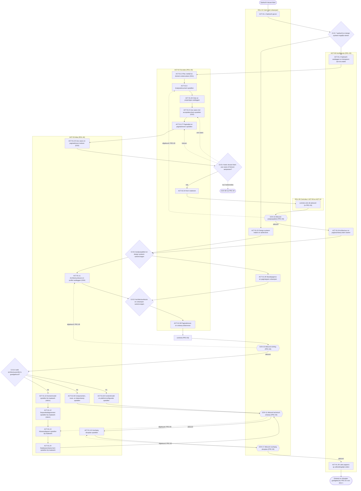
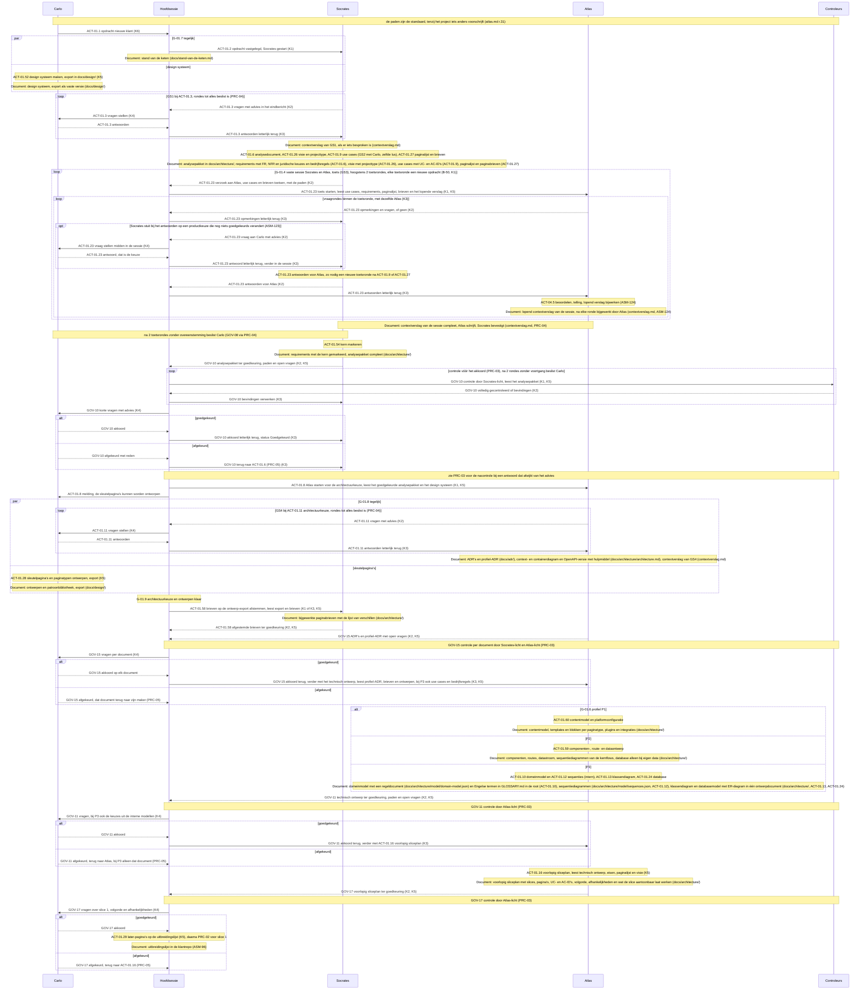

# PRC-01 – Nieuwe klant: van opdracht tot ontwerp en sliceplan
Status: procesniveau Goedgekeurd (2026-11-25, Carlo, B-43); stappen Goedgekeurd (2026-11-25, Carlo, B-44, B-45; model 1.0.11) · Versie: 1.0.9

**Legenda.**
- **Codes:** PRC = proces · ACT = stap (het nummer zegt niets over de volgorde) · G = beslispunt · GOV = akkoordmoment van Carlo · GS = grill-moment · ROL / AGT = rol / agent · ASM = aanname · OPEN = open vraag · FND = bevinding · B = besluit van Carlo.
- **Profielen:** P1 / P2 / P3 = architectuurprofiel (CMS / component-app / maatwerk). UC1 = dit proces.
- **Korte namen:** de korte naam staat de eerste keer bij de code. Stappen dragen hun naam als korte naam.

## Doel en uitkomst
Een opdracht voor een website of applicatie (maatwerk of met een CMS) omzetten in:
- een goedgekeurde analyse;
- een goedgekeurde richting, met de op de ontwerpen afgestemde paginabrieven;
- een goedgekeurd technisch ontwerp (bij maatwerk het ontwerpklassendiagram met databasemodel);
- een goedgekeurd voorlopig sliceplan.

## Trigger, start- en eindconditie
- **Trigger:** opdracht van ROL-01 (project owner) voor een nieuwe klant.
- **Start:** ROL-01 geeft de opdracht in de hoofdsessie van het project; de klantrepo bestaat (ASM-79 – één hoofdsessie per klantproject).
- **Einde:** GOV-11 (akkoord technisch ontwerp volgens profiel) en GOV-17 (akkoord voorlopig sliceplan) zijn goedgekeurd. De laatste stap (ACT-01.29) zet de later-pagina's op de uitbreidingslijst. Daarna start PRC-02 (backlog vullen per slice) voor slice 1 (ASM-95 – slice 1 start direct; CHG-042, B-44).

## Eigenaar, rollen en systemen
- **Eigenaar:** ROL-02 (regie), uitgevoerd door AGT-08 (hoofdsessie).
- **Rollen en lanes:**
  - ROL-01 (Carlo, ook ontwerper);
  - AGT-08 (hoofdsessie);
  - AGT-02 (agent Socrates);
  - AGT-03 (agent Atlas);
  - ROL-09 (controleur) met de lanes AGT-09 (Socrates-licht) en AGT-10 (Atlas-licht). De controle zit in PRC-03 (akkoord-poort van de project owner).
- **Systemen:** Claude Code, de klantrepo, en Claude Design (export).
- **Overdracht:** elke pijl tussen de lanes van agents loopt via de hoofdsessie (B-38 – overdracht via de hoofdsessie). Het kanaal per overdracht staat in het communicatiemodel (ronde 3).

## Input en output
- **Input:** opdracht, design systeem en ontwerpen van Carlo (export), en zijn antwoorden en akkoorden.
- **Output:**
  - requirements (FR, NFR en juridische keuzes, ASM-81);
  - visie met projecttype;
  - use cases met acceptatiecriteria;
  - bedrijfsregels en glossary;
  - paginalijst met brieven, afgestemd op de ontwerpen (ASM-86);
  - ADR's met profiel;
  - technisch ontwerp volgens profiel;
  - voorlopig sliceplan;
  - uitbreidingslijst (ASM-96; in de output gezet met CHG-042, B-44).

## Relatie met andere processen
- **Roept aan:** PRC-03 (bij GOV-10, GOV-15, GOV-11 en GOV-17), PRC-04 (grill-momenten en vragen), PRC-05 (afkeuring) en PRC-06 (blokkade).
- **Daarna:** PRC-02 voor slice 1.

## Activiteiten

| ID | Activiteit | Rol of agent | Input | Resultaat | Vervolg |
| --- | --- | --- | --- | --- | --- |
| ACT-01.1 | Opdracht geven | ROL-01 | wens van de klant | opdracht in de hoofdsessie | G-01.7 |
| ACT-01.52 | Design systeem maken en aanleveren | ROL-01 (ontwerper) | opdracht, huisstijl | design systeem met export in de klantrepo (OPEN-35 – plek van de ontwerp-export) | G-01.8 |
| ACT-01.2 | Opdracht vastleggen en doorgeven aan de analist | AGT-08 (ROL-02) | opdracht | stand van de keten in de klantrepo (ASM-80 – stand van de keten in bestanden); Socrates gestart | ACT-01.3 |
| ACT-01.3 | Plan, bedrijf en domein onderzoeken | AGT-02 (ROL-03) | opdracht, design systeem | inzicht en vragen; GS1 via PRC-04 | ACT-01.6 |
| ACT-01.6 | Analysedocument opstellen | AGT-02 | antwoorden, onderzoek | requirements met juridische keuzes (ASM-81), bedrijfsregels | ACT-01.26 |
| ACT-01.26 | Visie en projecttype vastleggen | AGT-02 | requirements, antwoorden | visie, projecttype, vorm van de use cases | ACT-01.9 |
| ACT-01.9 | Use cases met acceptatiecriteria opstellen | AGT-02 | requirements, visie | use cases met UC- en AC-ID's; GS2 via PRC-04 | ACT-01.27 |
| ACT-01.27 | Paginalijst en paginabrieven opstellen | AGT-02 | visie, use cases, design systeem | paginalijst met nu en later, ontwerpniveau, brieven | ACT-01.23 |
| ACT-01.23 | Use cases en paginabrieven toetsen | AGT-03 (ROL-04) | use cases, brieven, requirements | opmerkingen of geen; GS3 via PRC-04 | G-01.4 |
| ACT-01.54 | Kern markeren | AGT-02 | requirements, use cases, paginalijst | analysepakket compleet | PRC-03 → GOV-10 |
| ACT-01.8 | Architectuur en paginaontwerp laten starten | AGT-08 | goedgekeurd analysepakket | Atlas gestart; melding aan Carlo dat hij kan ontwerpen (ASM-17) | G-01.8 |
| ACT-01.11 | Architectuurkeuze en profiel vastleggen | AGT-03 | analysepakket, design systeem | ADR's, profiel-ADR, context- en containerdiagram; GS4 via PRC-04 | G-01.9 |
| ACT-01.28 | Sleutelpagina's en paginatypen ontwerpen | ROL-01 (ontwerper) | design systeem, paginalijst, visie | ontwerpen met export in de klantrepo | G-01.9 |
| ACT-01.58 | Paginabrieven en ontwerp afstemmen | AGT-02 | ontwerp-export, brieven | bijgewerkte brieven met verschillenlijst | PRC-03 → GOV-15 (pakket met de architectuurkeuze) |
| ACT-01.60 | Contentmodel en platformconfiguratie opstellen | AGT-03, bij P1 | profiel-ADR, brieven, ontwerpen | contentmodel en configuratie | PRC-03 → GOV-11 |
| ACT-01.59 | Componenten-, route- en dataontwerp opstellen | AGT-03, bij P2 | profiel-ADR, brieven, ontwerpen, use cases | componenten, routes, data, sequenties kernflows | PRC-03 → GOV-11 |
| ACT-01.10 | Domeinmodel opstellen bij maatwerk (intern) | AGT-03, bij P3 | use cases, bedrijfsregels, architectuur | domeinmodel met regeldocument | ACT-01.12 |
| ACT-01.12 | Sequentiediagrammen opstellen bij maatwerk (intern) | AGT-03, bij P3 | use cases, domeinmodel, brieven | sequenties voor de kern, door Atlas zelf (ASM-88 – Atlas genereert diagrammen in de keten) | ACT-01.13 |
| ACT-01.13 | Klassendiagram opstellen bij maatwerk | AGT-03, bij P3 | domeinmodel, sequenties | klassendiagram met keuzes als vragen | ACT-01.24 |
| ACT-01.24 | Databaseontwerp kern opstellen bij maatwerk | AGT-03, bij P3 | klassendiagram, sequenties, eisen, ADR's | databasemodel in hetzelfde document | PRC-03 → GOV-11 |
| ACT-01.16 | Voorlopig sliceplan opstellen | AGT-03 | technisch ontwerp, eisen, paginalijst, visie | slices met UC/AC, technische volgorde en wat elke slice aantoonbaar laat werken; slice 1 | PRC-03 → GOV-17 |
| ACT-01.29 | Later-pagina's op uitbreidingslijst zetten | AGT-08 | paginalijst (later), wensen van Carlo | uitbreidingslijst in de klantrepo (ASM-96 – uitbreidingslijst in de klantrepo) | einde; PRC-02 voor slice 1 |

## Beslissingen en goedkeuringen

| ID | Vraag | Uitkomsten | Bij afwijzing of afwijking |
| --- | --- | --- | --- |
| G-01.7 | Opdracht en design systeem tegelijk starten | → ACT-01.2 en → ACT-01.52 | — |
| G-01.4 | Toets nieuwe klant: use cases of brieven aanpassen? (beslisser ROL-04 over opmerkingen ja of nee; welk document verandert, beslist ROL-03) | nee → ACT-01.54 · use cases → ACT-01.9 · brieven of paginalijst → ACT-01.27, daarna opnieuw ACT-01.23 | Na 2 toetsrondes zonder overeenstemming beslist Carlo (GOV-08 – escalatiebesluit van Carlo, via ACT-04.53). |
| GOV-10 | Akkoord analysepakket (ROL-01), via PRC-03, controle door AGT-09 | akkoord → ACT-01.8 | PRC-05, per document terug naar ACT-01.6, 01.26, 01.9 (daarna opnieuw ACT-01.23), 01.27 (idem) of 01.54 (ASM-18). |
| G-01.8 | Analysepakket goedgekeurd én design systeem aangeleverd | → ACT-01.11 en → ACT-01.28, tegelijk | — |
| G-01.9 | Architectuurkeuze en ontwerpen klaar (alleen de eerste keer) | → ACT-01.58 | Herwerk na afkeuring loopt via PRC-05, niet hier. |
| GOV-15 | Akkoord richting: architectuur en ontwerpen (ROL-01), pakket via PRC-03. Bevat de ADR's (controle door AGT-10) en de afgestemde brieven (controle door AGT-09). Carlo's eigen ontwerp krijgt geen vragen (ASM-86 – afgestemde brieven in de richting). | akkoord → G-01.6 | PRC-05, per document: ADR's → ACT-01.11 · ontwerp → ACT-01.28 · brieven → ACT-01.58 (ASM-26). |
| G-01.6 | Welk architectuurprofiel is goedgekeurd? | P1 → ACT-01.60 · P2 → ACT-01.59 · P3 → ACT-01.10 | — |
| GOV-11 | Akkoord technisch ontwerp volgens profiel (ROL-01), via PRC-03, controle door AGT-10. Bij P3 gaan de zelf ingevulde keuzes uit alle vier de modellen als vraag mee. | akkoord → ACT-01.16 | PRC-05: P1 → ACT-01.60 · P2 → ACT-01.59 · P3 → ACT-01.13 of 01.24; de interne modellen werkt Atlas mee bij. |
| GOV-17 | Akkoord voorlopig sliceplan (ROL-01), via PRC-03, controle door AGT-10 | akkoord → ACT-01.29 | PRC-05 → ACT-01.16. |

## Uitzonderingen en loops
- **Toets-lus** (G-01.4): hoogstens 2 toetsrondes, daarna beslist Carlo. Elke toetsronde is een nieuwe opdracht aan Atlas (`vragen-en-akkoordrondes` werkwijze 8).
- **Controle-lus en akkoord:** in PRC-03. Na 2 controlerondes achter elkaar zonder voortgang beslist Carlo (ASM-90 – controle vastgelopen na 2 rondes).
- **Afkeuring:** PRC-05. Bij de 3e afkeuring van een document volgt een escalatie (GOV-08).
- **Vragen en grill-sessies:** PRC-04. Na 2 rondes achter elkaar zonder voortgang tussen agents volgt een escalatie; met Carlo telt niemand rondes.
- **Blokkade:** elke stap van een agent kan vastlopen → PRC-06.
- **Bouwcontract is nooit de bron van een brief of ontwerp:** dat speelt in PRC-02. Kan Atlas iets uit een brief niet ontwerpen, dan stelt hij een vraag of wijzigingsverzoek via PRC-04 (GOV-12).
- **Een ander profiel bij GOV-15:** Atlas werkt de ADR's bij. Zijn de use cases licht en vraagt het nieuwe profiel meer, dan werkt Socrates ze bij via PRC-04. Ze komen opnieuw in hetzelfde pakket.

## Tussendiagram

In het diagram staat de controle (ROL-09) als één knoop. Hij hoort bij elk akkoord en is uitgewerkt in PRC-03. Afkeuringen tonen één terugloop per poort; de volledige routes per document staan in de tabel.

## Interactiediagram

Status: Goedgekeurd als weergave van model 1.0 (2026-11-25, Carlo, B-51; opgezet in 1.0.23, CHG-064). Afgeleide weergave van de goedgekeurde stappen, beslispunten en akkoorden hierboven en van het communicatiemodel; geen nieuwe inhoud. Bij een verschil gelden de tabellen hierboven.

Kolommen: Carlo, hoofdsessie, Socrates, Atlas en de controleurs (Socrates-licht en Atlas-licht). Een doorgetrokken pijl is een opdracht, vraag of antwoord dat de hoofdsessie doorgeeft; een gestippelde pijl is een eindbericht of antwoord terug. Elk label begint met het ACT-, GOV- of G-ID; K1 t/m K9 zijn de kanalen uit `communicatiemodel.md`. Het volledige akkoord staat in PRC-03, de volledige vragenloop in PRC-04. Bij de melding van ACT-01.8 staat geen kanaal: het communicatiemodel noemt er geen.

## Aannames en open vragen
- **Bevestigd:**
  - ASM-17: overdracht pas na het analysepakket;
  - ASM-18: afgekeurd document apart herzien;
  - ASM-26: oordeel per document bij een pakket;
  - ASM-28: Carlo is de ontwerper;
  - ASM-46: contentmodel bij CMS-projecten;
  - ASM-51: Atlas kiest OpenAPI-versie en hulpmiddel;
  - ASM-62: Atlas kiest de sequenties voor de kern;
  - ASM-79 t/m ASM-81, ASM-86 en ASM-88.
- **Te bevestigen in ronde 2:**
  - ASM-90: controle vastgelopen na 2 rondes;
  - ASM-94: vragen aan Carlo via de vragenloop;
  - ASM-95: slice 1 start direct;
  - ASM-96: uitbreidingslijst in de klantrepo.
- **Open:**
  - OPEN-35: plek van de ontwerp-export, voorgelegd in ronde 2;
  - OPEN-11: proefrun van de skills.
- **Bekend risico:** FND-097 (slice 1 twee keer goedgekeurd). De skills van Atlas hebben nog geen vraag of akkoordmoment voor GOV-17; zie PRP-079.

## Wijzigingshistorie

| Versie | Datum | Wijziging | Door |
| --- | --- | --- | --- |
| 1.0.5 | 2026-11-25 | Eerste procesbeschrijving in model 1.0 (CHG-041), op basis van 0.18 `prc-01.md`. Niet overgenomen: ACT-01.4, 01.5, 01.7, 01.14, 01.15, 01.17, 01.18, 01.20, 01.21, 01.22, 01.25, 01.51, 01.56, 01.57, G-01.1, G-01.5 (zie `register.yaml`, `stappen_0_18_niet_overgenomen`). | AGT-02 |
| 1.0.6 | 2026-11-25 | Na de controles (CHG-043). De namen zijn teruggezet naar 0.18 waar alleen de schrijfwijze verschilde (ACT-01.10, 01.12, 01.13, 01.24, 01.29, 01.58, 01.59, 01.60; G-01.4, 01.6, 01.7, 01.8, 01.9). De eindconditie volgt de goedgekeurde tekst. ACT-01.16 is aangevuld, en bij G-01.4 is vastgelegd wie over welk document beslist. | AGT-02 |
| 1.0.7 | 2026-11-25 | Na de hercontrole (CHG-044): de uitbreidingslijst in de output staat in CHG-042 deel A. | AGT-02 |
| 1.0.9 | 2026-11-25 | Antwoorden van ronde 2 verwerkt (CHG-046, B-44): CHG-042 is goedgekeurd; de verwijzingen zijn bijgewerkt. | AGT-02 |
| 1.0.23 | 2026-11-25 | Sectie "Interactiediagram" toegevoegd (CHG-064, Concept): afgeleide weergave op verzoek van Carlo; stappen, beslispunten en akkoorden ongewijzigd. | AGT-02 |
| 1.0.24 | 2026-11-25 | Interactiediagram na de controles (CHG-065): eindbericht van Atlas voor GOV-15, notitie over het contextverslag van de toets, opmerking over het kanaal bij ACT-01.8. | AGT-02 |
| 1.0.25 | 2026-11-25 | Interactiediagram: wanneer een document ontstaat ("Document:"-notities) en wat de ander leest (CHG-067, alleen weergave, op verzoek van Carlo). | AGT-02 |
| 1.0.26 | 2026-11-25 | Documentnotities na de feitencontrole van Atlas (CHG-068): architecture.md, de plek van domeinmodel en sequenties, GLOSSARY.md in de root, sliceplan met wat de slice laat werken, input bij P3; notitie dat de paden de standaard zijn. | AGT-02 |
| 1.0.27 | 2026-11-25 | Interactiediagram: de toets als vaste sessie Socrates–Atlas, met lopend verslag en de productvraag aan Carlo midden in de sessie (CHG-069, B-50). Stappen ongewijzigd. | AGT-02 |
| 1.0.28 | 2026-11-25 | Interactiediagram na de feitencontrole van Atlas (CHG-070): binnen een toetsronde gaan de antwoorden van Socrates terug naar dezelfde Atlas (K3), die ze beoordeelt en het verslag bijwerkt; buitenste lus per toetsronde (K1), binnenste per vraagronde (K3). | AGT-02 |
| 1.0 | 2026-11-25 | Model 1.0 Goedgekeurd (Carlo, B-51; CHG-071). De toetssessie met twee lussen (1.0.28) is een uitwerking van CHG-066, gebaseerd op het goedgekeurde tekstdeel (PRC-04 "Toets door Atlas", communicatiemodel §4); diagram (c) van het voorstel toonde haar niet letterlijk. | AGT-02 |
