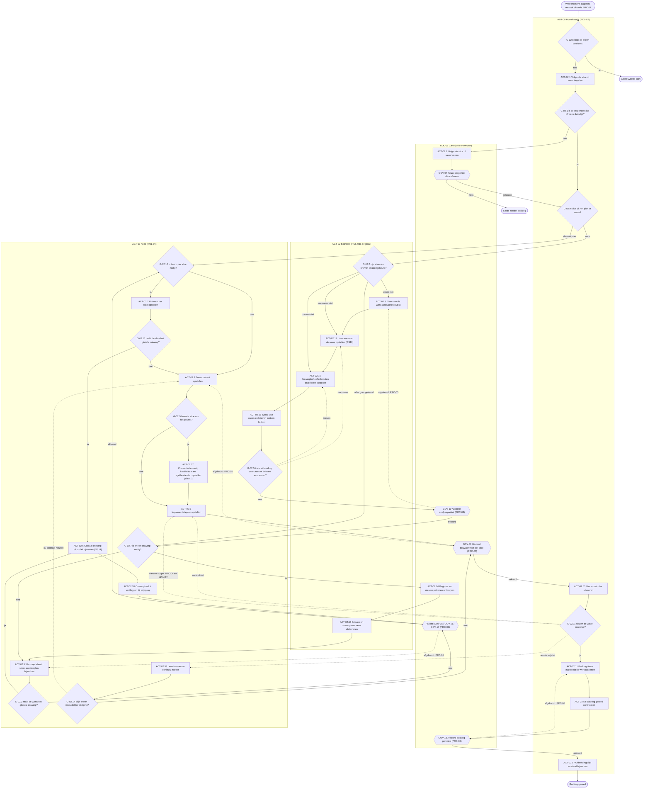

# PRC-02 – Backlog vullen per slice
Status: procesniveau Goedgekeurd (2026-11-25, Carlo, B-43); stappen Goedgekeurd (2026-11-25, Carlo, B-44, B-45; model 1.0.11; ACT-02.57, 02.54, 02.6 en 02.7 gewijzigd met CHG-056, B-47; ACT-02.11 met B-48) · Versie: 1.0.19

**Legenda.**
- **Codes:** PRC = proces · ACT = stap · G = beslispunt · GOV = akkoordmoment van Carlo · GS = grill-moment · ROL / AGT = rol / agent · ASM = aanname · OPEN = open vraag · FND = bevinding · B = besluit van Carlo.
- **Profielen:** P1 / P2 / P3 = architectuurprofiel (CMS / component-app / maatwerk). UC2 = dit proces.
- **Korte namen:** de korte naam staat de eerste keer bij de code. Stappen dragen hun naam als korte naam.

## Doel en uitkomst
Voor de volgende slice van het plan het program design maken (ontwerp per slice waar nodig, en het implementatieplan met werkpakketten) en het API-contract ("waar nodig": CHG-042 deel B, goedgekeurd in B-44). Daarmee het backlog in de klantrepo vullen. Is het een nieuwe wens buiten het plan, dan eerst de begintak: eisen, ontwerp en sliceplan bijwerken (B-36 – begintak voor een nieuwe wens). Herhaalbaar.

## Trigger, start- en eindconditie
- **Triggers:**
  - het weekmoment van PRC-07 (ritme: weekmoment en dagstart), maandag 12:00 (B-40);
  - de dagstart bij het openen van de sessie, bij 10 of minder taakbestanden die niet in done staan (B-41, B-42, ASM-89);
  - een verzoek van ROL-01 (project owner);
  - het einde van PRC-01 voor slice 1 (ASM-95; CHG-042, B-44).
- **Start:** GOV-17 (akkoord voorlopig sliceplan) is goedgekeurd, en er loopt geen andere doorloop (G-02.8, ASM-33 – hoogstens één doorloop per project).
- **Einde:** GOV-18 (akkoord backlog per slice) is goedgekeurd en het backlog van de slice staat in de klantrepo. De laatste stap (ACT-02.17) werkt de uitbreidingslijst en de stand bij. Daarna bouwt Carlo, buiten de scope (B-29).

## Eigenaar, rollen en systemen
- **Eigenaar:** ROL-02 (regie), uitgevoerd door AGT-08 (hoofdsessie).
- **Lanes:**
  - ROL-01 (Carlo, ook ontwerper);
  - AGT-08;
  - AGT-02 (agent Socrates), alleen in de begintak;
  - AGT-03 (agent Atlas);
  - ROL-09 met AGT-09 en AGT-10, binnen PRC-03.
- **Systemen:** Claude Code, en de klantrepo met het backlog in `docs/backlog/`: één bestand per taak of epic, in de statusmappen todo, in-progress en done (B-37, B-44, ASM-100 t/m ASM-102). Daarnaast de uitbreidingslijst (ASM-96).
- **Overdracht:** elke pijl tussen agents loopt via de hoofdsessie (B-38).

## Input en output
- **Input:**
  - het goedgekeurde sliceplan, het technisch ontwerp, de eisen en de brieven;
  - de uitbreidingslijst;
  - bij een wens: de wens van Carlo;
  - het backlog in `docs/backlog/`.
- **Output:**
  - bij een wens: bijgewerkte eisen, use cases, brieven, ontwerp en sliceplan;
  - per slice: waar nodig het ontwerp per slice, het bouwcontract, in slice 1 het conventiebestand, de kwaliteitslat en de regelbestanden (CHG-056), het implementatieplan en de backlog-items.

## Relatie met andere processen
- **Gestart door:** PRC-07, ROL-01 of PRC-01.
- **Roept aan:** PRC-03, PRC-04, PRC-05 en PRC-06.

## Activiteiten

| ID | Activiteit | Rol of agent | Input | Resultaat | Vervolg |
| --- | --- | --- | --- | --- | --- |
| ACT-02.1 | Volgende slice of wens bepalen | AGT-08 (ROL-02) | sliceplan, uitbreidingslijst, verzoek | volgende slice of wens (ASM-14) | G-02.1 |
| ACT-02.2 | Volgende slice of wens kiezen | ROL-01 | vraag van de hoofdsessie, met de optie "niets" | keuze (GOV-07 – keuze volgende slice of wens) | G-02.9, of einde bij "niets" (ASM-98) |
| ACT-02.3 | Eisen van de wens analyseren | AGT-02 (ROL-03) | wens, visie | aanvulling op eisen en bedrijfsregels, met juridische keuzes; GS9 via PRC-04 | ACT-02.12 |
| ACT-02.12 | Use cases van de wens opstellen | AGT-02 | aanvulling op de eisen | nieuwe of gewijzigde UC- en AC-ID's; GS10 via PRC-04 | ACT-02.15 |
| ACT-02.15 | Ontwerpbehoefte bepalen en brieven opstellen | AGT-02 | use cases, paginalijst, patronen, visie | paginalijst, ontwerpniveau en brieven | ACT-02.13 |
| ACT-02.13 | Wens: use cases en brieven toetsen | AGT-03 (ROL-04) | use cases, brieven, eisen, technisch ontwerp | opmerkingen of geen; GS11 via PRC-04 | G-02.5 |
| ACT-02.16 | Pagina's en nieuwe patronen ontwerpen | ROL-01 (ontwerper) | goedgekeurde brieven, design systeem | ontwerpen met export in de klantrepo | ACT-02.56 |
| ACT-02.56 | Brieven en ontwerp van wens afstemmen | AGT-02 | ontwerp-export, brieven | bijgewerkte brieven met verschillenlijst | ACT-02.5 |
| ACT-02.5 | Wens opdelen in slices en sliceplan bijwerken | AGT-03 | wens, eisen, brieven, ontwerpen, sliceplan | bijgewerkt sliceplan | G-02.3 |
| ACT-02.6 | Globaal ontwerp of profiel bijwerken | AGT-03 | wens of slice die het globale ontwerp raakt | bijgewerkt technisch ontwerp (zo nodig ook het sliceplan); zo nodig het conventiebestand, de kwaliteitslat, CLAUDE.md of AGENTS.md bijgewerkt bij een nieuwe NFR of afspraak (CHG-056); GS14 via PRC-04 als architectuur of profiel verandert | ACT-02.55 |
| ACT-02.55 | Ontwerpbesluit vastleggen bij wijziging | AGT-03 | bijgewerkte documenten | ADR (bij profielwijziging een nieuw profiel-ADR) | PRC-03 → pakket |
| ACT-02.7 | Ontwerp per slice opstellen | AGT-03 | slice, technisch ontwerp, brieven, ontwerpen | ontwerp per slice per profiel; bij P2 en P3 sequenties van nieuwe flows door Atlas zelf (ASM-88); zo nodig het conventiebestand, de kwaliteitslat, CLAUDE.md of AGENTS.md bijgewerkt (CHG-056) | G-02.13 |
| ACT-02.8 | Bouwcontract opstellen | AGT-03 | ontwerp per slice of technisch ontwerp, goedgekeurde brieven en ontwerpen | P2/P3: OpenAPI-bestand met leesbare versie; P1: templatecontract, met OpenAPI alleen waar echt een API is; geldig, revisie bovenaan | G-02.10; na een herziening via G-02.14: ACT-02.9 of direct GOV-06 |
| ACT-02.57 | Conventiebestand, kwaliteitslat en regelbestanden opstellen (slice 1) | AGT-03 | technisch ontwerp, design systeem, NFR's, architectuurkeuze en ADR's, bestaande CLAUDE.md en AGENTS.md (ASM-113) | één conventiebestand met UI-conventies; CONSTRAINTS.md met de kwaliteitslat en de definition of done (grenzen uit de NFR's, anders de vloer); CLAUDE.md kort, met commands, de indeling van docs/ en verwijzingen met leesmoment, zonder imports; AGENTS.md met werkregels voor de bouw (ASM-116 t/m ASM-119; CHG-056) | ACT-02.9 |
| ACT-02.9 | Implementatieplan opstellen | AGT-03 | ontwerp (per slice), bouwcontract | werkpakketten met AC's, brief en afhankelijkheden; sectie Breaking changes | PRC-03 → GOV-06 |
| ACT-02.53 | Vaste controles uitvoeren | AGT-08 | goedgekeurd contract, werkpakketten, OpenAPI-bestand | (1) werkpakket ↔ FR/UC/AC; (2) geen nieuwe scope; (3) revisie gelijk, niet bij P1 zonder API. Controle 3 door de hoofdsessie is een aanname (0.18 ASM-52; in de skill doet de bouwer haar) | G-02.11 |
| ACT-02.58 | Leesbare versie opnieuw maken | AGT-03 | huidig OpenAPI-bestand | nieuwe leesbare versie met nieuwe revisie (ASM-56) | G-02.14 |
| ACT-02.11 | Backlog-items maken uit de werkpakketten | AGT-08 | contract, werkpakketten | per taak een bestand in `docs/backlog/todo/` (vorm: ASM-102), met in de kop verwijzingen naar CLAUDE.md, AGENTS.md, het conventiebestand en CONSTRAINTS.md (B-48); per slice een epic-bestand (ASM-101) (B-30, B-44) | ACT-02.54 |
| ACT-02.54 | Backlog gereed controleren | AGT-08 | taak- en epicbestanden van de slice in `docs/backlog/todo/` | elk taakbestand heeft de velden van ASM-102; het epic noemt alle taken; slice gedekt; bij slice 1 conventiebestand, CONSTRAINTS.md, CLAUDE.md en AGENTS.md aanwezig (CHG-056) | PRC-03 → GOV-18 |
| ACT-02.17 | Uitbreidingslijst en stand bijwerken | AGT-08 | goedgekeurd backlog | uitbreidingslijst en stand bijgewerkt | einde |

## Beslissingen en goedkeuringen

| ID | Vraag | Uitkomsten | Bij afwijzing of afwijking |
| --- | --- | --- | --- |
| G-02.8 | Loopt er al een doorloop? (ROL-02) | nee → ACT-02.1 · ja → geen tweede start; een verzoek van Carlo gaat bovenaan de uitbreidingslijst en wordt gemeld | — |
| G-02.1 | Is de volgende slice of wens duidelijk? (ROL-02) | ja → G-02.9 · nee → ACT-02.2 | Antwoordt Carlo niet, dan wacht de doorloop. De dagstart noemt de vraag, en G-02.8 start geen tweede doorloop (ASM-98). |
| GOV-07 | Keuze volgende slice of wens (ROL-01) | gekozen → G-02.9 · "niets" → einde zonder backlog (ASM-98) | n.v.t. |
| G-02.9 | Slice uit het plan, of wens? (ROL-02) | slice → G-02.12 · wens → G-02.2 | — |
| G-02.2 | Zijn eisen en brieven al goedgekeurd? (ROL-03) | alle drie → G-02.7 · brieven niet → ACT-02.15 · use cases niet → ACT-02.12 · eisen niet → ACT-02.3 | — |
| G-02.5 | Toets uitbreiding: use cases of brieven aanpassen? (ROL-04 over opmerkingen ja of nee; welk document verandert, beslist ROL-03) | nee → PRC-03 → GOV-10 · use cases → ACT-02.12 · brieven → ACT-02.15 | Na 2 toetsrondes beslist Carlo (GOV-08 via ACT-04.53). |
| GOV-10 | Akkoord analysepakket van de wens (ROL-01), controle door AGT-09 | akkoord → G-02.7 | PRC-05 → ACT-02.3, 02.12 of 02.15; daarna opnieuw de toets ACT-02.13. |
| G-02.7 | Is er een ontwerp nodig? (ROL-01, via het ontwerpniveau uit GOV-10) | ja → ACT-02.16 · nee → ACT-02.5 | — |
| G-02.3 | Raakt de wens het globale ontwerp? (ROL-04) | ja → ACT-02.6 · nee → PRC-03 → pakket | — |
| Pakket | GOV-15, GOV-11 en GOV-17 via PRC-03 (ROL-01), één oordeel per document (ASM-26). **GOV-15** alleen bij een wijziging van architectuur of profiel (ASM-82) of een nieuw paginaontwerp met afgestemde brieven (ASM-86). **GOV-11** alleen als een document van het technisch ontwerp met akkoord veranderde. **GOV-17** als het sliceplan veranderde, en in de begintak altijd. | akkoord op alle documenten → G-02.12 | PRC-05, per document naar de eigen stap: ADR → ACT-02.55; technisch ontwerp → ACT-02.6; ontwerp → ACT-02.16; brieven → ACT-02.56; sliceplan → ACT-02.5. |
| G-02.12 | Ontwerp per slice nodig? Alleen buiten de kern of bij een uitbreiding (ROL-04; `architect-vertical-slices` r.27, `architect-api-contracts` r.18, ASM-09) | ja → ACT-02.7 · nee → ACT-02.8 (het goedgekeurde technisch ontwerp is dan het detailontwerp uit B-31) | — |
| G-02.13 | Raakt de slice het globale ontwerp? (ROL-04; `architect-implementation-plan` r.192) | nee → ACT-02.8 · ja → ACT-02.6, daarna ACT-02.55 en het pakket; na akkoord terug naar G-02.12 | — |
| G-02.10 | Eerste slice van het project? (ROL-04) | ja → ACT-02.57 · nee → ACT-02.9 | — |
| GOV-06 | Akkoord bouwcontract per slice (ROL-01), via PRC-03, controle door AGT-10. Ontwerp per slice en plan gaan mee als een voorwaarde geldt (atlas.md r.64). | akkoord → ACT-02.53 | PRC-05: contract → ACT-02.8. Alleen als ze meegingen: ontwerp → ACT-02.7, plan → ACT-02.9. |
| G-02.11 | Slagen de vaste controles? (ROL-02) | ja → ACT-02.11 · (1) faalt → ACT-02.9 · (2) nieuwe scope → PRC-04 (GOV-12) · (3) revisie wijkt af → ACT-02.58 | (1) na 2 rondes, of (3) de 2e keer voor dezelfde slice → GOV-08 via ACT-04.53. Bron: 0.18 ACT-02.53 en ASM-56. |
| G-02.14 | Blijft er een inhoudelijke wijziging tegenover het goedgekeurde contract? (ROL-04; Atlas kiest tussen terugdraaien en houden, `architect-api-contracts` r.43) | nee → PRC-03 → GOV-06 · ja → ACT-02.8: contract herzien, met de controle of het past bij het ontwerp en op breaking changes (r.33) en de herleidbaarheid per veld (r.49). Daarna ACT-02.9 alleen als de werkpakketten of de breaking changes veranderen, anders direct GOV-06 | — |
| GOV-18 | Akkoord backlog per slice (ROL-01), via PRC-03; tweede lezer is AGT-03 (ASM-83) | akkoord → ACT-02.17 | PRC-05 → ACT-02.11. |

## Uitzonderingen en loops
- **Herhaalbaar:** na het einde start PRC-02 opnieuw bij de volgende trigger.
- **Trigger tijdens een lopende doorloop:** er komt geen tweede start (G-02.8). Komen weekmoment en dagstart samen, dan start alleen de eerste een doorloop (ASM-84).
- **Sliceplan leeg en geen wens:**
  - Carlo kiest bij GOV-07 uit de wensen of "niets". Bij "niets" eindigt de doorloop zonder backlog (ASM-98 – leeg plan en geen wens).
  - Antwoordt Carlo niet, dan wacht de doorloop.
- **Slice raakt het globale ontwerp** (G-02.13): Atlas stopt en werkt eerst het globale ontwerp bij (ACT-02.6, ACT-02.55). Na het akkoord op het pakket gaat de slice verder.
- **Geen pagina geraakt:** G-02.7 → nee.
- **Bouwcontract kan een brief niet dragen:** Atlas stelt een vraag of wijzigingsverzoek via PRC-04 (GOV-12). Het contract past de brief nooit zelf aan.
- **Revisie wijkt af** (G-02.11, controle 3):
  - Atlas maakt de leesbare versie opnieuw (ACT-02.58) en kiest of hij de wijziging terugdraait of houdt (G-02.14).
  - Houdt hij haar, dan herziet hij het contract (ACT-02.8). Het plan (ACT-02.9) past hij alleen aan als de werkpakketten of de breaking changes veranderen.
  - Daarna gaat het contract opnieuw langs GOV-06.
  - Bij P1 zonder API is deze controle niet van toepassing.
- **Toets-lussen:** hoogstens 2 toetsrondes, daarna beslist Carlo.
- **Controle-lus:** in PRC-03 (ASM-90 – controle vastgelopen na 2 rondes).
- **Afkeuring:** PRC-05.
- **Blokkade:** PRC-06.
- **Flowlimiet:** vervalt (ASM-93 – flowlimiet vervalt). Het weekmoment kan daardoor een slice toevoegen terwijl er meer dan 10 items open staan; Carlo houdt de controle via GOV-18.

## Tussendiagram

Elke poort loopt via PRC-03: eerst de controle, dan de vragen aan Carlo. Bij GOV-18 is de controleur Atlas (ASM-83). Niet getekend: de escalaties (GOV-08) en de afkeuringsroutes per document; die staan in de tabel.

## Interactiediagram

Status: Goedgekeurd als weergave van model 1.0 (2026-11-25, Carlo, B-51; opgezet in 1.0.23, CHG-064). Afgeleide weergave van de goedgekeurde stappen, beslispunten en akkoorden hierboven en van het communicatiemodel; geen nieuwe inhoud. Bij een verschil gelden de tabellen hierboven.

Kolommen: Carlo, hoofdsessie, Socrates, Atlas en de controleurs (Socrates-licht en Atlas-licht). Een doorgetrokken pijl is een opdracht, vraag of antwoord dat de hoofdsessie doorgeeft; een gestippelde pijl is een eindbericht of antwoord terug. Elk label begint met het ACT-, GOV- of G-ID; K1 t/m K9 zijn de kanalen uit `communicatiemodel.md`. Het volledige akkoord staat in PRC-03, de volledige vragenloop in PRC-04.

```mermaid
sequenceDiagram
  participant C as Carlo
  participant H as Hoofdsessie
  participant S as Socrates
  participant A as Atlas
  participant K as Controleurs
  Note over C,K: de paden zijn de standaard, tenzij het project iets anders voorschrijft (atlas.md r.31)
  Note over C,H: start bij het weekmoment of de dagstart (PRC-07), een verzoek van Carlo (K6) of het einde van PRC-01
  Note over H: G-02.8 loopt er al een doorloop? Dan geen tweede start
  Note over H: ACT-02.1 volgende slice of wens bepalen (G-02.1)
  opt G-02.1 niet duidelijk
    H->>C: ACT-02.2 welke slice of wens, of niets? (K4)
    C-->>H: GOV-07 keuze, of niets (einde zonder backlog)
  end
  alt G-02.9 nieuwe wens (begintak)
    H->>S: ACT-02.3 wens analyseren, leest de wens en de visie (K1, K5)
    Note over S: G-02.2 al goedgekeurde eisen, use cases of brieven worden overgeslagen
    loop GS9 en GS10 met Carlo, rondes tot alles beslist is (PRC-04)
      S-->>H: ACT-02.3 vragen met advies (K2)
      H->>C: ACT-02.3 vragen stellen (K4)
      C-->>H: ACT-02.3 antwoorden
      H->>S: ACT-02.3 antwoorden letterlijk terug (K3)
    end
    Note over S: Document: aanvulling op requirements en bedrijfsregels met juridische keuzes, zo nodig de visie (docs/architecture/), contextverslag (contextverslag.md)
    Note over S: ACT-02.12 use cases, ACT-02.15 ontwerpbehoefte en brieven
    Note over S: Document: nieuwe of gewijzigde use cases met UC- en AC-ID's (ACT-02.12), paginalijst met ontwerpniveau en een brief per geraakte pagina (ACT-02.15), in docs/architecture/
    loop G-02.5 vaste sessie Socrates en Atlas, toets (GS11), hoogstens 2 toetsrondes, elke toetsronde een nieuwe opdracht (B-50, K1)
      S-->>H: ACT-02.13 verzoek aan Atlas, use cases en brieven toetsen, met de paden (K2)
      H->>A: ACT-02.13 toets starten, leest use cases, brieven, requirements, technisch ontwerp en het lopende verslag (K1, K5)
      loop vraagrondes binnen de toetsronde, met dezelfde Atlas (K3)
        A-->>H: ACT-02.13 opmerkingen en vragen, of geen (K2)
        H->>S: ACT-02.13 opmerkingen letterlijk terug (K3)
        opt Socrates stuit bij het antwoorden op een productkeuze die nog niets goedgekeurds verandert (ASM-123)
          S-->>H: ACT-02.13 vraag aan Carlo met advies (K2)
          H->>C: ACT-02.13 vraag stellen midden in de sessie (K4)
          C-->>H: ACT-02.13 antwoord, dat is de keuze
          H->>S: ACT-02.13 antwoord letterlijk terug, verder in de sessie (K3)
        end
        Note over S: ACT-02.13 antwoorden voor Atlas, zo nodig een nieuwe toetsronde na ACT-02.12 of ACT-02.15
        S-->>H: ACT-02.13 antwoorden voor Atlas (K2)
        H->>A: ACT-02.13 antwoorden letterlijk terug (K3)
        Note over A: ACT-04.5 beoordelen, telling, lopend verslag bijwerken (ASM-124)
        Note over A: Document: lopend contextverslag van de sessie, na elke ronde bijgewerkt door Atlas (contextverslag.md, ASM-124)
      end
    end
    Note over S,A: Document: contextverslag van de sessie compleet, Atlas schrijft, Socrates bevestigt (contextverslag.md, PRC-04)
    S-->>H: GOV-10 analysepakket van de wens ter goedkeuring, paden en open vragen (K2, K5)
    Note over H,K: GOV-10 controle door Socrates-licht (PRC-03)
    H->>C: GOV-10 vragen (K4)
    alt goedgekeurd
      C-->>H: GOV-10 akkoord
    else afgekeurd
      C-->>H: GOV-10 afgekeurd, terug naar ACT-02.3, 02.12 of 02.15 en opnieuw de toets (PRC-05)
    end
    opt G-02.7 ontwerp nodig
      Note over C: ACT-02.16 pagina's en nieuwe patronen ontwerpen, export (K5)
      Note over C: Document: ontwerpen, export (docs/design/)
      H->>S: ACT-02.56 brieven op het ontwerp afstemmen, leest export en brieven (K1 of K3, K5)
      Note over S: Document: bijgewerkte brieven met de lijst van verschillen (docs/architecture/)
      S-->>H: ACT-02.56 afgestemde brieven (K2, K5)
    end
    H->>A: ACT-02.5 wens in slices opdelen, leest wens, eisen, brieven, ontwerpen, visie, technisch ontwerp en sliceplan (K1, K5)
    Note over A: Document: bijgewerkt sliceplan met de slices van de wens (docs/architecture/)
    opt G-02.3 wens raakt het globale ontwerp
      Note over A: ACT-02.6 globaal ontwerp of profiel bijwerken (GS14 met Carlo alleen bij een andere architectuur of profiel), zo nodig regelbestanden bijwerken (ASM-120), ACT-02.55 ADR
      Note over A: Document: geraakte ontwerpdocumenten (docs/architecture/), zo nodig sliceplan, conventiebestand (docs/architecture/), CONSTRAINTS.md, CLAUDE.md of AGENTS.md (root) (ACT-02.6), ADR en bij een profielwijziging een nieuw profiel-ADR (docs/adr/, ACT-02.55)
    end
    A-->>H: GOV-17 pakket ter goedkeuring, sliceplan en zo nodig GOV-15 en GOV-11, paden en open vragen (K2, K5)
    Note over H,K: controle per document (PRC-03)
    H->>C: GOV-17 vragen per document (K4)
    alt goedgekeurd
      C-->>H: GOV-17 akkoord op elk document
    else afgekeurd
      C-->>H: GOV-17 afgekeurd, dat document terug naar zijn eigen stap (PRC-05)
    end
  else slice uit het plan
    Note over H,A: direct naar het program design
  end
  H->>A: G-02.12 Atlas starten voor het program design van de slice, leest slice, technisch ontwerp, brieven en ontwerpen, voor het bouwcontract ook de visie, de bestaande API's en architecture.md (K1 of K3, K5)
  opt G-02.12 ontwerp per slice nodig
    Note over A: ACT-02.7 ontwerp per slice, zo nodig regelbestanden bijwerken (ASM-120). G-02.13 raakt de slice het globale ontwerp, dan eerst ACT-02.6, ACT-02.55 en het pakket, daarna opnieuw G-02.12
    Note over A: Document: ontwerp per slice per profiel, bij P2 en P3 sequenties van nieuwe flows (docs/architecture/), zo nodig conventiebestand (docs/architecture/), CONSTRAINTS.md, CLAUDE.md of AGENTS.md (root)
  end
  Note over A: ACT-02.8 bouwcontract
  Note over A: Document: bouwcontract, bij P2 en P3 een OpenAPI-bestand (docs/architecture/) met leesbare versie op de documentlocatie, bij P1 een templatecontract als tabel en alleen bij een echte API een OpenAPI-bestand
  opt G-02.10 eerste slice
    Note over A: ACT-02.57 conventiebestand, kwaliteitslat en regelbestanden (lichte controle door Atlas-licht)
    Note over A: Document: conventiebestand (docs/architecture/), CONSTRAINTS.md, CLAUDE.md en AGENTS.md (root van de klantrepo)
  end
  Note over A: ACT-02.9 implementatieplan met werkpakketten
  Note over A: Document: implementatieplan met werkpakketten, AC-verwijzingen, afhankelijkheden en de sectie Breaking changes (standaard docs/architecture/implementation-plans/)
  A-->>H: GOV-06 bouwcontract ter goedkeuring, met ontwerp per slice en plan bij een voorwaarde, paden en open vragen (K2, K5)
  Note over H,K: GOV-06 controle door Atlas-licht (PRC-03)
  H->>C: GOV-06 vragen, ontwerp per slice en plan alleen bij een voorwaarde (K4)
  alt goedgekeurd
    C-->>H: GOV-06 akkoord
  else afgekeurd
    C-->>H: GOV-06 afgekeurd, contract terug naar ACT-02.8, ontwerp naar ACT-02.7 en plan naar ACT-02.9 alleen als ze meegingen (PRC-05)
  end
  Note over H: ACT-02.53 drie vaste controles, leest bouwcontract, werkpakketten en OpenAPI-bestand (G-02.11, K5)
  Note over H: dat de hoofdsessie controle 3 (revisie) doet, is een aanname (ASM-52, ASM-56)
  alt controles slagen
    Note over H: verder met de backlog-items
  else controle 1, werkpakket verwijst niet naar FR, UC of AC
    H->>A: ACT-02.53 werkpakket herstellen (K1 of K3)
    A-->>H: ACT-02.9 plan hersteld, daarna opnieuw GOV-06 (K2)
  else controle 3, revisie wijkt af
    H->>A: ACT-02.53 revisie wijkt af (K1 of K3)
    Note over A: ACT-02.58 leesbare versie opnieuw maken. G-02.14 geen inhoudelijke wijziging, dan GOV-06. Wel, dan eerst ACT-02.8, en ACT-02.9 alleen als de werkpakketten of de breaking changes veranderen
    Note over A: Document: nieuwe leesbare versie met de nieuwe revisie bovenaan
    A-->>H: ACT-02.58 klaar, daarna opnieuw GOV-06 (K2, K5)
  else controle 2, nieuwe scope
    Note over H,C: ACT-02.53 via PRC-04, met een contextverslag, naar GOV-12
  end
  Note over C,H: G-02.11 controle 1 na 2 rondes, of controle 3 de tweede keer voor dezelfde slice, dan GOV-08
  Note over H: ACT-02.11 backlog-items maken in docs/backlog/todo/, leest bouwcontract en werkpakketten (K5)
  Note over H: Document: per taak een taakbestand en per slice een epic-bestand (docs/backlog/todo/), in de kop verwijzingen naar CLAUDE.md, AGENTS.md, het conventiebestand en CONSTRAINTS.md
  opt vraag over de werkpakketten (ASM-109)
    H->>A: ACT-02.11 vraag aan Atlas (K1 of K3)
    A-->>H: ACT-02.11 antwoord (K2)
    Note over H: Document: contextverslag, door de hoofdsessie, Atlas bevestigt (contextverslag.md)
  end
  Note over H: ACT-02.54 backlog gereed controleren
  loop GOV-18 toets door Atlas, hoogstens 2 toetsrondes (PRC-03)
    H->>A: GOV-18 backlog-items toetsen, leest taak- en epicbestanden (K1, volgende ronde K1 of K3, K5)
    A-->>H: GOV-18 opmerkingen of geen (K2)
    Note over H: ACT-03.7 bij opmerkingen verwerkt de hoofdsessie ze zelf
  end
  Note over C,A: na 2 toetsrondes of bij een niet-technisch conflict beslist Carlo (GOV-08), op technische punten heeft Atlas het laatste woord
  H->>C: GOV-18 vragen over de backlog van de slice (K4)
  alt goedgekeurd
    C-->>H: GOV-18 akkoord
    Note over H: ACT-02.17 uitbreidingslijst en stand bijwerken, doorloop af
    Note over H: Document: uitbreidingslijst bijgewerkt (ASM-96), doorloop afgesloten in de stand (docs/stand-van-de-keten.md)
  else afgekeurd
    C-->>H: GOV-18 afgekeurd, terug naar ACT-02.11 (PRC-05)
  end
```

## Aannames en open vragen
- **Bevestigd:**
  - ASM-09: Atlas ontwerpt buiten de kern per slice;
  - ASM-14: volgende wens uit de volgorde;
  - ASM-20: kleine ontwerpwijziging ook langs akkoord;
  - ASM-21: poort bouwcontract in de vaste controles;
  - ASM-33: hoogstens één doorloop per project;
  - ASM-46: contentmodel bij CMS-projecten;
  - ASM-49, ASM-50, ASM-52, ASM-53, ASM-56, ASM-57: OpenAPI-bestand en leesbare versie;
  - ASM-82 t/m ASM-89.
- **Bevestigd in ronde 2 (B-44):**
  - ASM-93: flowlimiet vervalt;
  - ASM-95: slice 1 start direct;
  - ASM-96: uitbreidingslijst in de klantrepo;
  - ASM-98: leeg plan en geen wens.
- **Bevestigd in B-45 (uit de verwerking van B-44):**
  - ASM-100: Carlo zet items in in-progress (vraag 18);
  - ASM-101: epic-bestand per slice (vraag 19);
  - ASM-102: naam en inhoud van een taakbestand (vraag 20).
- **Open:**
  - OPEN-34: beantwoord (B-44), zie ASM-89 en ASM-100 t/m ASM-102;
  - OPEN-13: drempel voor een aparte agent naast Atlas.
- **Bekende risico's:**
  - FND-018: Atlas als knelpunt;
  - FND-094: geen skill voor backlog-items;
  - FND-097: slice 1 twee keer goedgekeurd.

## Wijzigingshistorie

| Versie | Datum | Wijziging | Door |
| --- | --- | --- | --- |
| 1.0.5 | 2026-11-25 | Eerste procesbeschrijving in model 1.0 (CHG-041), op basis van 0.18 `prc-02.md`. Slice 1 hoort nu hierbij (B-35); het conventiebestand is ACT-02.57 (was ACT-01.56). Niet overgenomen: ACT-02.4, ACT-02.14, ACT-02.51, G-02.6 en de losse akkoorden GOV-01, 02, 05, 09 en 14. | AGT-02 |
| 1.0.6 | 2026-11-25 | Na de controles (CHG-043). **Nieuw:** G-02.12 (ontwerp per slice alleen waar nodig), G-02.13 (uitgang als een slice het globale ontwerp raakt), ACT-02.58 en G-02.14 (kortere route bij een afwijkende revisie). **Aangepast:** het pakket na ACT-02.55 met voorwaarden per akkoord; GOV-07 met de uitkomst "niets"; de afkeuring bij GOV-06 alleen naar ontwerp of plan als die meegingen; de eindconditie volgt de goedgekeurde tekst. **Namen:** teruggezet naar 0.18 bij ACT-02.9, 02.12, 02.13, 02.15, 02.55, 02.56, G-02.2 en G-02.5. | AGT-02 |
| 1.0.7 | 2026-11-25 | Na de hercontrole (CHG-044). G-02.14 gaat nu over terugdraaien of houden; bij houden volgt eerst een herziening van het contract (ACT-02.8) en ACT-02.9 alleen als dat nodig is. Afkeuring van het ADR in het pakket gaat naar ACT-02.55. De bron bij G-02.12 is r.18. "Ontwerp per slice waar nodig" staat in CHG-042 deel B. | AGT-02 |
| 1.0.9 | 2026-11-25 | Antwoorden van ronde 2 verwerkt (CHG-046, B-44). Het backlog staat in `docs/backlog/`, met een bestand per taak of epic in de statusmappen todo, in-progress en done (ACT-02.11, ACT-02.54). CHG-042 is goedgekeurd. | AGT-02 |
| 1.0.11 | 2026-11-25 | ASM-100 t/m ASM-102 bevestigd (CHG-048, B-45). De stappen zijn niet veranderd. | AGT-02 |
| 1.0.18 | 2026-11-25 | CHG-056 doorgevoerd (goedgekeurd in B-47, ronde 3 vraag 26 en 35): ACT-02.57 heet "Conventiebestand, kwaliteitslat en regelbestanden opstellen (slice 1)" en maakt ook CONSTRAINTS.md, CLAUDE.md en AGENTS.md; ACT-02.54 controleert ze; ACT-02.6 en ACT-02.7 werken ze zo nodig bij. Geen nieuwe stap, beslispunt of akkoord; de routes in het diagram zijn gelijk (CHG-058). | AGT-02 |
| 1.0.19 | 2026-11-25 | ACT-02.11: de kop van elk taakbestand verwijst ook naar CLAUDE.md, AGENTS.md, het conventiebestand en CONSTRAINTS.md (B-48, ronde 3 vraag 37; CHG-059). | AGT-02 |
| 1.0.23 | 2026-11-25 | Sectie "Interactiediagram" toegevoegd (CHG-064, Concept): afgeleide weergave op verzoek van Carlo; stappen, beslispunten en akkoorden ongewijzigd. | AGT-02 |
| 1.0.24 | 2026-11-25 | Interactiediagram na de feitencontrole van Atlas (CHG-065): G-02.13 terug naar G-02.12; afkeuring bij GOV-06 per document; vaste controles volgens G-02.11 en G-02.14, met de escalatie en de aanname over controle 3; verwerking tussen de toetsrondes bij GOV-18 en "K1 of K3"; regelbestanden bijwerken (ASM-120); contextverslag bij nieuwe scope. | AGT-02 |
| 1.0.25 | 2026-11-25 | Interactiediagram: wanneer een document ontstaat ("Document:"-notities) en wat de ander leest (CHG-067, alleen weergave, op verzoek van Carlo). | AGT-02 |
| 1.0.26 | 2026-11-25 | Documentnotities na de feitencontrole van Atlas en socrates-licht (CHG-068): regelbestanden in de root, plek van sliceplan, OpenAPI-bestand en implementatieplan, input van het bouwcontract; notitie dat de paden de standaard zijn. | AGT-02 |
| 1.0.27 | 2026-11-25 | Interactiediagram: de toets als vaste sessie Socrates–Atlas, met lopend verslag en de productvraag aan Carlo midden in de sessie (CHG-069, B-50). Stappen ongewijzigd. | AGT-02 |
| 1.0.28 | 2026-11-25 | Interactiediagram na de feitencontrole van Atlas (CHG-070): binnen een toetsronde gaan de antwoorden van Socrates terug naar dezelfde Atlas (K3), die ze beoordeelt en het verslag bijwerkt; buitenste lus per toetsronde (K1), binnenste per vraagronde (K3). | AGT-02 |
| 1.0 | 2026-11-25 | Model 1.0 Goedgekeurd (Carlo, B-51; CHG-071). De toetssessie met twee lussen (1.0.28) is een uitwerking van CHG-066, gebaseerd op het goedgekeurde tekstdeel (PRC-04 "Toets door Atlas", communicatiemodel §4); diagram (c) van het voorstel toonde haar niet letterlijk. | AGT-02 |
