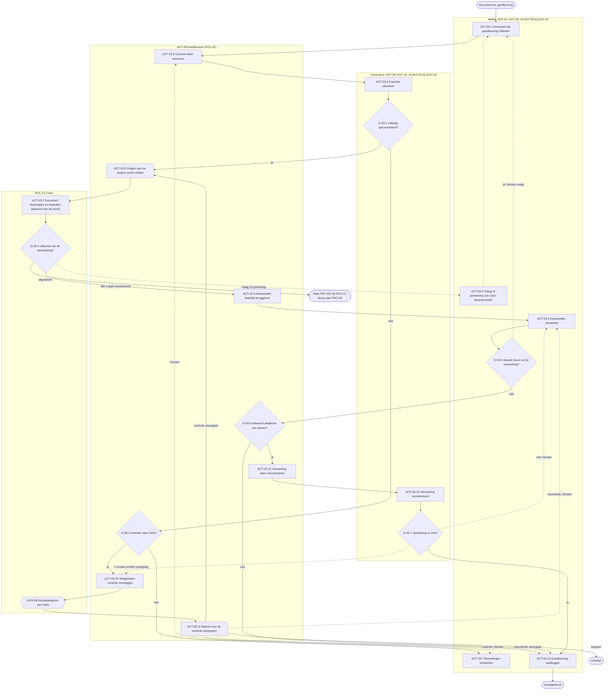
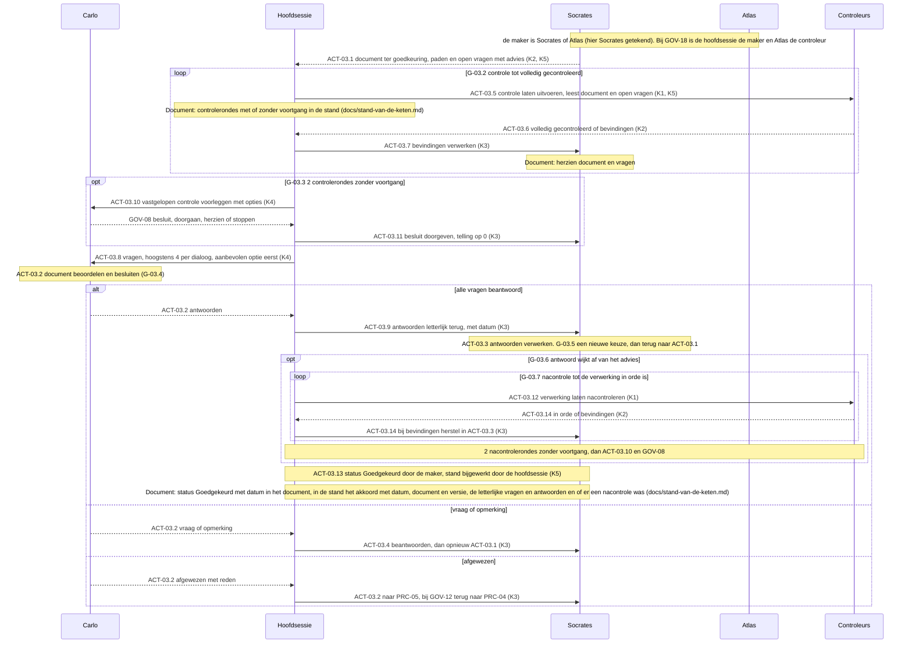

# PRC-03 – Akkoord-poort van de project owner
Status: procesniveau Goedgekeurd (2026-11-25, Carlo, B-43; start en einde gewijzigd met CHG-042, B-44); stappen Goedgekeurd (2026-11-25, Carlo, B-44, B-45; model 1.0.11) · Versie: 1.0.10

**Legenda.** PRC = proces · ACT = stap · G = beslispunt · GOV = akkoordmoment van Carlo · ROL / AGT = rol / agent · ASM = aanname · OPEN = open vraag · FND = bevinding · B = besluit van Carlo · "de poort" = het akkoord waarvoor PRC-03 wordt aangeroepen.

## Doel en uitkomst
Een deliverable laten goedkeuren of afkeuren door ROL-01 (project owner) via korte vragen over de keuzes in de hoofdsessie, na controle door ROL-09 (controleur). Bij GOV-18 (akkoord backlog per slice) toetst ROL-04 (systeemarchitect) in plaats daarvan (ASM-83). De nacontrole bij GOV-18 doet daarom ook Atlas (ASM-83).

Herbruikbaar subproces, aangeroepen voor:
- GOV-10 (akkoord analysepakket);
- GOV-15 (akkoord richting: architectuur en ontwerpen);
- GOV-11 (akkoord technisch ontwerp volgens profiel);
- GOV-17 (akkoord voorlopig sliceplan);
- GOV-06 (akkoord bouwcontract per slice);
- GOV-18;
- GOV-12 (akkoord wijzigingsverzoek of productkeuze).

## Trigger, start- en eindconditie
- **Trigger:** een maker dient een document of pakket in.
- **Start:** het document is ter goedkeuring ingediend. De controle vóór het akkoord is de eerste stap van de poort (CHG-042, B-44).
- **Einde:** een van de volgende uitkomsten:
  - Goedgekeurd: de maker zet de status. Week een antwoord af van het advies, dan gebeurt dat pas na de nacontrole (B-44, antwoord 3).
  - Afgekeurd naar PRC-05 (afkeuring en herziening). Bij GOV-12 is een afwijzing geen afkeuring: het document gaat terug naar PRC-04.
  - Escalatiebesluit (GOV-08 – escalatiebesluit van Carlo) na een vastgelopen controle.

## Eigenaar, rollen en systemen
- **Eigenaar:** ROL-01.
- **Lanes:**
  - ROL-01 en AGT-08 (hoofdsessie);
  - de maker: AGT-02 (agent Socrates), AGT-03 (agent Atlas), of AGT-08 bij GOV-18 (de rol per stap volgt in de RACI van ronde 3);
  - de controleur: AGT-09 (Socrates-licht) voor het werk van Socrates, AGT-10 (Atlas-licht) voor het werk van Atlas, AGT-03 bij GOV-18.
- **Systemen:** Claude Code (vragendialoog met hoogstens 4 vragen, alleen in de hoofdsessie) en de klantrepo (document en stand, ASM-80).

## Input en output
- **Input:** het document of pakket, met de open vragen in het eindbericht van de maker.
- **Output:** een goedgekeurd document met status en datum en een bijgewerkte stand; of een afkeuring met reden; of een escalatiebesluit.

## Relatie met andere processen
- **Aangeroepen door:** PRC-01, PRC-02 en PRC-04 (bij GOV-12).
- **Roept aan:** PRC-05 bij afkeuring.
- **Escalatie:** GOV-08 vanuit dit proces (ACT-03.10).

## Activiteiten

| ID | Activiteit | Rol of agent | Input | Resultaat | Vervolg |
| --- | --- | --- | --- | --- | --- |
| ACT-03.1 | Document ter goedkeuring indienen | maker | document of pakket | document in de klantrepo; eindbericht met één open vraag per keuze en aanname, met advies | ACT-03.5 |
| ACT-03.5 | Controle laten uitvoeren | AGT-08 (ROL-02) | paden, open vragen | controleur gestart; rondes en voortgang in de stand | ACT-03.6 |
| ACT-03.6 | Controle uitvoeren | AGT-09, AGT-10, of AGT-03 bij GOV-18 | document, vragen | AGT-09 en AGT-10: "volledig gecontroleerd" of bevindingen per document. AGT-03: "geen opmerkingen" of opmerkingen per werkpakket of item (`architect-implementation-plan` r.194) | G-03.2 |
| ACT-03.7 | Bevindingen verwerken | maker | bevindingen | herzien document en vragen | ACT-03.5 |
| ACT-03.8 | Vragen aan de project owner stellen | AGT-08 | open vragen, uitslag | vragendialogen van hoogstens 4, aanbevolen optie eerst | ACT-03.2 |
| ACT-03.2 | Document beoordelen en besluiten | ROL-01 | vragen | het akkoord van de poort: antwoord per vraag (bij een pakket per document, ASM-26, ASM-37), een vraag of opmerking, of een afwijzing | G-03.4 |
| ACT-03.4 | Vraag of opmerking van Carlo beantwoorden | maker | vraag of opmerking (ASM-10 – vraag van Carlo is geen afkeuring) | antwoord; zo nodig aangepast document en nieuwe vragen | ACT-03.1 |
| ACT-03.9 | Antwoorden letterlijk teruggeven | AGT-08 | antwoorden | antwoorden met datum aan de maker; akkoord expliciet gemeld | ACT-03.3 |
| ACT-03.3 | Antwoorden verwerken | maker | antwoorden en akkoord; bij herstel de bevindingen van de nacontrole | document verwerkt; de status blijft nog staan | G-03.5 |
| ACT-03.12 | Verwerking laten nacontroleren | AGT-08 | afwijkende antwoorden, verwerkt document | controleur van de poort gestart | ACT-03.14 |
| ACT-03.14 | Verwerking nacontroleren | controleur van de poort (AGT-09, AGT-10; bij GOV-18 AGT-03) | afwijkende antwoorden, verwerkt document | verwerking in orde, of bevindingen | G-03.7 |
| ACT-03.13 | Goedkeuring vastleggen | maker | verwerkt (en zo nodig nagecontroleerd) document | status Goedgekeurd (datum, Carlo); stand bijgewerkt | einde |
| ACT-03.10 | Vastgelopen controle voorleggen | AGT-08 | bevindingen van 2 controle- of nacontrolerondes zonder voortgang; bij GOV-18 van 2 toetsrondes of een conflict | opties voor Carlo, met beide standpunten | GOV-08 |
| ACT-03.11 | Besluit over de controle doorgeven | AGT-08 | besluit | telling van de rondes op 0; doorgaan, herzien of stoppen | **Na de controle vóór het akkoord:** doorgaan → ACT-03.8, herzien → ACT-03.7. **Na de nacontrole:** doorgaan → ACT-03.13, herzien → ACT-03.3. Stoppen → einde. |

## Beslissingen en goedkeuringen

| ID | Vraag | Uitkomsten | Bij afwijzing of afwijking |
| --- | --- | --- | --- |
| G-03.2 | Volledig gecontroleerd? Bij GOV-18: geen opmerkingen? (beslisser ROL-09; bij GOV-18 ROL-04) | ja → ACT-03.8 · nee → G-03.3 | — |
| G-03.3 | Controle naar Carlo? (ROL-02) | nee → ACT-03.7 · ja → ACT-03.10 | **Bij ROL-09:** ja na 2 controlerondes achter elkaar zonder voortgang (ASM-90). **Bij GOV-18:** ja na 2 toetsrondes, of meteen bij een conflict over niet-technische punten. Op technische punten heeft Atlas het laatste woord (ASM-83, B-44 vraag 17). |
| G-03.4 | Wat is de uitkomst? (ROL-01) | alle vragen beantwoord → ACT-03.9 · vraag of opmerking → ACT-03.4 · document afgewezen → PRC-05 | Een ander antwoord dan het advies is geen afwijzing (ASM-91). Een afgewezen wijzigingsverzoek of productkeuze (GOV-12) gaat niet naar PRC-05: het goedgekeurde document blijft ongewijzigd, en de vrager krijgt dat als antwoord (PRC-04, ACT-04.58). |
| G-03.5 | Levert de verwerking een nieuwe keuze op? (maker) | nee → G-03.6 · ja → ACT-03.1 met de nieuwe vraag | Geen afkeuring; de telling van PRC-05 loopt niet op (ASM-91). |
| G-03.6 | Week een antwoord van Carlo af van het advies? (ROL-02) | ja → ACT-03.12 (nacontrole) · nee → ACT-03.13 | B-44, antwoord 3 |
| G-03.7 | Is de verwerking in orde? (ROL-09; bij GOV-18 ROL-04) | ja → ACT-03.13 · nee → ACT-03.3 (herstel), daarna opnieuw G-03.5 | Na 2 nacontrolerondes achter elkaar zonder voortgang → ACT-03.10 (GOV-08), zoals ASM-90. |
| GOV-08 | Escalatiebesluit van Carlo (ROL-01) na een vastgelopen controle | besluit → ACT-03.11 | n.v.t. |

Het akkoord zelf (GOV-06, 10, 11, 12, 15, 17 of 18) is de beslissing van Carlo in ACT-03.2. Welk akkoord het is, hangt af van de poort die PRC-03 aanroept.

## Uitzonderingen en loops
- **Controle-lus:** ACT-03.5 → 03.6 → G-03.2 → G-03.3 → 03.7 → 03.5. Uitgang: bij ROL-09 na 2 rondes zonder voortgang; bij GOV-18 na 2 toetsrondes of bij een conflict. Na het besluit (ACT-03.11) begint de telling opnieuw.
- **Nacontrole-lus:** ACT-03.3 → G-03.5 → G-03.6 → ACT-03.12 → 03.14 → G-03.7 → 03.3. Dezelfde uitgang als de controle-lus. Na het besluit van Carlo gaat het verder bij de nacontrole: doorgaan is goedkeuring vastleggen (ACT-03.13), herzien is de verwerking herstellen (ACT-03.3).
- **Vraag van Carlo:** ACT-03.4 → ACT-03.1. Dit is geen afkeuring en geen ronde.
- **Nieuwe keuze na de antwoorden:** G-03.5 → ACT-03.1. Dit is geen afkeuring.
- **Pakket met meer makers** (GOV-15): elke maker dient zijn eigen document in, met een eigen controleur en een eigen oordeel (ASM-26). Het pakket is pas akkoord als elk document een oordeel heeft.
- **Carlo antwoordt niet:** de status blijft "wacht op antwoorden"; de dagstart noemt de open vragen (PRC-07).

## Tussendiagram

## Interactiediagram

Status: Goedgekeurd als weergave van model 1.0 (2026-11-25, Carlo, B-51; opgezet in 1.0.23, CHG-064). Afgeleide weergave van de goedgekeurde stappen en beslispunten hierboven en van het communicatiemodel (K1 t/m K9); geen nieuwe inhoud. Bij een verschil gelden de tabellen hierboven. Kolommen en pijlen als in PRC-01. De maker is als Socrates getekend; voor Atlas zijn de berichten gelijk.

## Aannames en open vragen
- **Bevestigd** (B-43, B-44):
  - ASM-10, ASM-26, ASM-37, ASM-80;
  - ASM-83, met het laatste woord van Atlas;
  - ASM-90;
  - ASM-91, met de nacontrole.
- **Open:** OPEN-37 (akkoord vastleggen zonder kaart, ronde 3).
- **Bekende risico's:** FND-093 (akkoord zonder eigen bewijs) en FND-098 (toets van backlog-items alleen op verzoek).

## Wijzigingshistorie

| Versie | Datum | Wijziging | Door |
| --- | --- | --- | --- |
| 1.0.5 | 2026-11-25 | Eerste procesbeschrijving in model 1.0 (CHG-041), op basis van 0.18 `prc-03.md`. | AGT-02 |
| 1.0.6 | 2026-11-25 | Na de controles (CHG-043): G-03.3 volgens ASM-90 en de regel van Atlas; ACT-03.6 met de uitkomst van Atlas; telling op 0 na ACT-03.11; één afwijzingsroute bij GOV-12; geen "GOV-xx" meer; naam ACT-03.4 volgens 0.18. | AGT-02 |
| 1.0.7 | 2026-11-25 | Laatste woord van Atlas bij G-03.3 (CHG-044). | AGT-02 |
| 1.0.8 | 2026-11-25 | Laatste woord van Atlas als vraag 17 (CHG-045). | AGT-02 |
| 1.0.9 | 2026-11-25 | Antwoorden van ronde 2 verwerkt (CHG-046, B-44): nacontrole van afwijkende antwoorden (antwoord 3). ACT-03.3 heet "Antwoorden verwerken"; nieuw zijn ACT-03.12, ACT-03.13, ACT-03.14, G-03.6 en G-03.7. Start en einde volgen CHG-042. | AGT-02 |
| 1.0.10 | 2026-11-25 | Na de nacontrole door socrates-licht (CHG-047): ACT-03.11 heeft een aparte route na een vastgelopen nacontrole (doorgaan → ACT-03.13, herzien → ACT-03.3), ook in het diagram. De nacontrole bij GOV-18 doet Atlas (ASM-83). | AGT-02 |
| 1.0.23 | 2026-11-25 | Sectie "Interactiediagram" toegevoegd (CHG-064, Concept): afgeleide weergave op verzoek van Carlo; stappen en beslispunten ongewijzigd. | AGT-02 |
| 1.0.25 | 2026-11-25 | Interactiediagram: de stand en het herziene document als "Document:"-notities, en wat de controleur leest (CHG-067, alleen weergave). | AGT-02 |
| 1.0 | 2026-11-25 | Model 1.0 Goedgekeurd (Carlo, B-51; CHG-071). | AGT-02 |
