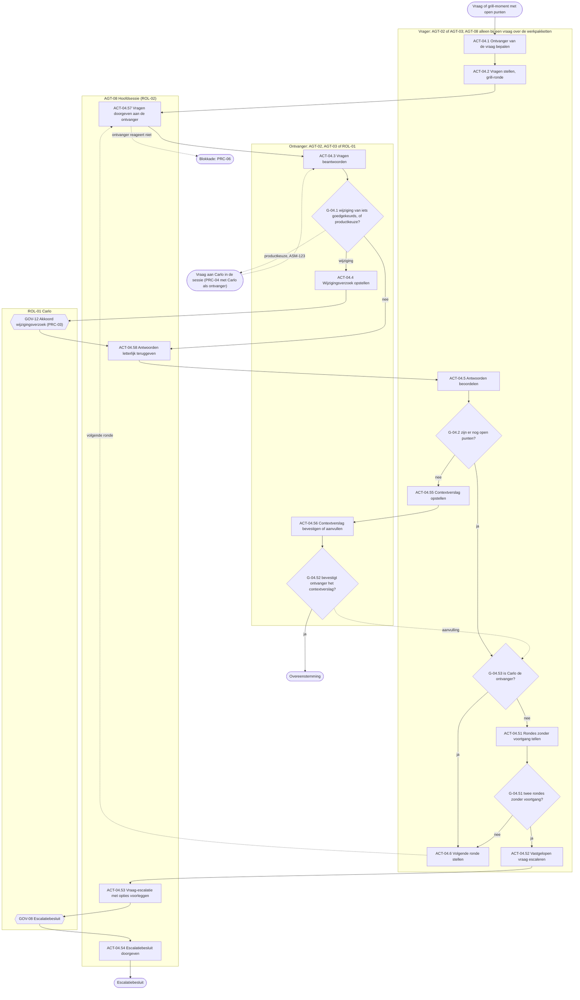
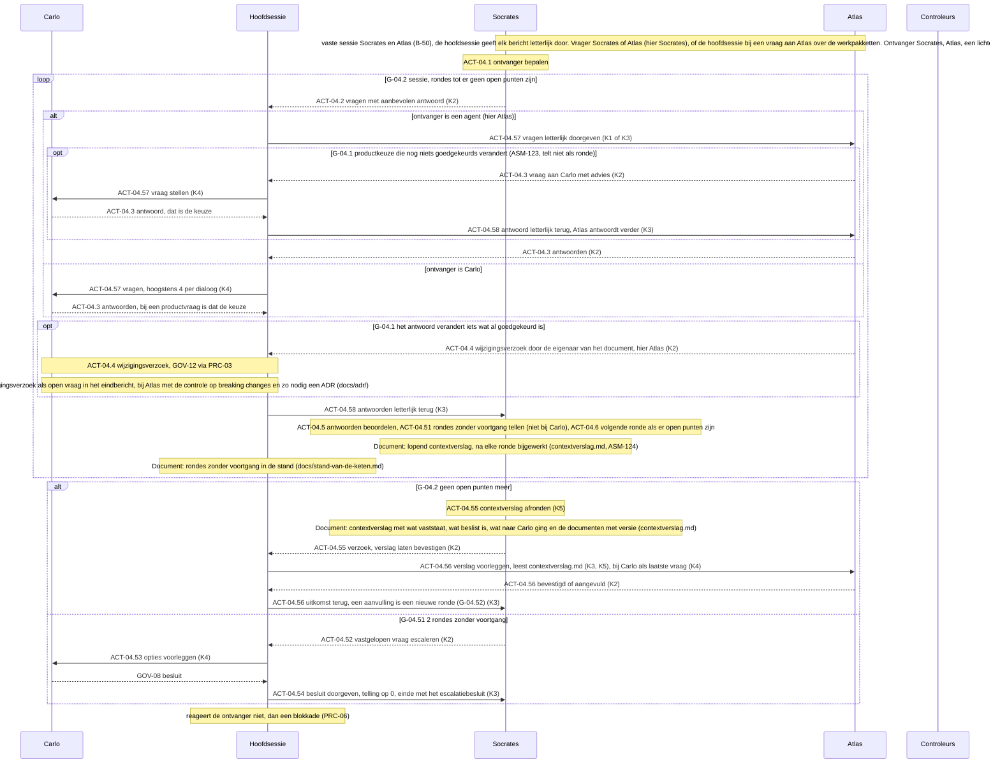

# PRC-04 – Vragenloop en grill-sessie
Status: procesniveau Goedgekeurd (2026-11-25, Carlo, B-43; naam gewijzigd met CHG-042, B-44, was "vragenloop en grill-sessie tussen agents"); stappen Goedgekeurd (2026-11-25, Carlo, B-44, B-45; model 1.0.11; vrager AGT-08 toegevoegd met CHG-052, B-46; vaste sessie Socrates en Atlas en productkeuze direct aan Carlo met CHG-066, B-50) · Versie: 1.0.28

**Legenda.** PRC = proces · ACT = stap · G = beslispunt · GOV = akkoordmoment van Carlo · GS = grill-moment · ROL / AGT = rol / agent · ASM = aanname · OPEN = open vraag · FND = bevinding · B = besluit van Carlo.

## Doel en uitkomst
Een vraag van een agent, of de context voor zijn stap, in grill-vorm afhandelen met wie erover gaat, via de hoofdsessie, tot een bevestigd contextverslag, met een uitgang.

Herbruikbaar subproces voor:
- alle vragen tussen Socrates en Atlas, en de toets van Atlas (GS3, GS11), als één vaste sessie Socrates–Atlas: de hoofdsessie geeft elk bericht letterlijk door, en de vrager houdt één lopend contextverslag bij (B-50, ASM-124);
- volgens ASM-94 ook de vragen aan ROL-01 (project owner) en de grill-sessies met hem (GS1, GS2, GS4, GS9, GS10, GS14).

## Trigger, start- en eindconditie
- **Trigger:** een agent heeft een vraag die zijn werk blokkeert, of begint een stap met een grill-moment. Na het lezen zijn er open punten; zonder open punten is er geen sessie (ASM-41).
- **Einde:** één van vier uitkomsten:
  - bevestigd contextverslag (overeenstemming);
  - besloten wijzigingsverzoek (GOV-12, via PRC-03), als een antwoord iets goedgekeurds verandert; een productkeuze gaat direct naar Carlo in de sessie (ASM-123);
  - escalatiebesluit (GOV-08 – escalatiebesluit van Carlo);
  - blokkade (PRC-06) als een ontvangende agent niet reageert.

## Eigenaar, rollen en systemen
- **Eigenaar:** ROL-02 (regie), uitgevoerd door AGT-08 (hoofdsessie).
- **Lanes:**
  - vrager: AGT-02 (agent Socrates) of AGT-03 (agent Atlas); de hoofdsessie (AGT-08) alleen bij een vraag aan Atlas over zijn werkpakketten tijdens ACT-02.11;
  - AGT-08;
  - ontvanger: AGT-02, AGT-03 of ROL-01;
  - ROL-01 voor GOV-08.
- **Systemen:** Claude Code (vragen in het eindbericht, de vragendialoog alleen in de hoofdsessie, hervatten met SendMessage) en de klantrepo (`contextverslag.md`, de stand met de telling, ASM-80).

## Input en output
- **Input:** de vraag of de open punten, de routeringstabel (`vragen-en-akkoordrondes` werkwijze 3) en de goedgekeurde documenten.
- **Output:** antwoorden, een contextverslag, een wijzigingsverzoek, of een escalatie.

## Relatie met andere processen
- **Aangeroepen door:** PRC-01 en PRC-02 (grill-momenten, toets, vragen), PRC-02 (G-02.11: nieuwe scope) en PRC-06 (ontbrekende input).
- **Roept aan:** PRC-03 (GOV-12) en PRC-06.

## Routering (ACT-04.1)

| Vraag over | Ontvanger |
| --- | --- |
| eisen, bedoeling van goedgekeurde eisen, paginabrieven | AGT-02 Socrates |
| alleen de bedoeling van goedgekeurde eisen, use cases of bedrijfsregels, als het antwoord letterlijk in een goedgekeurd document staat | AGT-09 Socrates-licht (ASM-87); vraagt het antwoord een keuze of interpretatie, dan meldt hij "start socrates" (`socrates-licht.md` r.30) en gaat de vraag naar AGT-02 |
| ontwerp (technisch), implementatie | AGT-03 Atlas |
| alleen de betekenis van het goedgekeurde ontwerp of een technische term | AGT-10 Atlas-licht (ASM-87); vraagt het antwoord een ontwerpkeuze, dan meldt hij "start atlas" (`atlas-licht.md` r.33) en gaat de vraag naar AGT-03 |
| product, volgorde, paginaontwerp of patroon, grill-moment met Carlo | ROL-01 (ontwerper zolang ASM-28 geldt) |

## Activiteiten

| ID | Activiteit | Rol of agent | Input | Resultaat | Vervolg |
| --- | --- | --- | --- | --- | --- |
| ACT-04.1 | Ontvanger van de vraag bepalen | vrager | vraag, routering | ontvanger; ook een vraag aan Carlo binnen een lopende sessie gaat zo (ASM-123) | ACT-04.2 |
| ACT-04.2 | Vragen stellen, grill-ronde | vrager | vragen, zelf opgezochte feiten | alle vragen genummerd met aanbevolen antwoord in het eindbericht; status wacht op antwoorden. Is AGT-08 de vrager, dan start of hervat zij AGT-03 direct met de vragen; er is geen eindbericht (CHG-052) | ACT-04.57 |
| ACT-04.57 | Vragen doorgeven aan de ontvanger | AGT-08 (ROL-02) | vragen | agent gestart of hervat; bij Carlo vragendialogen van hoogstens 4 | ACT-04.3 |
| ACT-04.3 | Vragen beantwoorden | ontvanger (AGT-02, AGT-03, AGT-09, AGT-10 of Carlo) | vragen, eigen documenten | antwoord per vraag; een agent beslist alleen in zijn vakgebied; AGT-09 en AGT-10 alleen als het antwoord letterlijk uit een goedgekeurd document volgt. Stuit een agent op een productkeuze die nog niets goedgekeurds verandert, dan stelt hij die direct aan Carlo in de lopende sessie; Carlo's antwoord is de keuze (ASM-123) | G-04.1 |
| ACT-04.4 | Wijzigingsverzoek opstellen (was: "Wijzigingsverzoek of productvraag opstellen", tot 1.0.26) | de eigenaar van het goedgekeurde document (ontvanger of vrager); de vrager als Carlo de ontvanger is (B-44, antwoord 6) | antwoord dat iets goedgekeurds verandert | wijzigingsverzoek als open vraag voor Carlo. Stelt Atlas het op, dan eerst de controle op breaking changes, en een ADR als het globale ontwerp verandert (`architect-clarification` r.20, r.26, r.27) | PRC-03 (GOV-12), daarna ACT-04.58 |
| ACT-04.58 | Antwoorden letterlijk teruggeven aan de vrager | AGT-08 | antwoorden | vrager hervat met de antwoorden en de datum | ACT-04.5 |
| ACT-04.5 | Antwoorden beoordelen | vrager | antwoorden | per punt beslist of open; voortgang ja of nee; het lopende contextverslag bijgewerkt (ASM-124) | G-04.2 |
| ACT-04.51 | Rondes zonder voortgang tellen | vrager | uitkomst, stand | telling in de stand (ASM-80) | G-04.51 |
| ACT-04.6 | Volgende ronde stellen | vrager | open punten | volgende ronde | ACT-04.57 |
| ACT-04.52 | Vastgelopen vraag escaleren | vrager | 2 rondes zonder voortgang | escalatie in het eindbericht: open punten, beide standpunten, advies. Is AGT-08 de vrager, dan legt zij de escalatie direct voor (CHG-052) | ACT-04.53 |
| ACT-04.53 | Vraag-escalatie met opties voorleggen | AGT-08 | escalatie | opties voor Carlo | GOV-08 |
| ACT-04.54 | Escalatiebesluit doorgeven | AGT-08 | besluit | besluit aan de vrager; telling op 0 (ASM-11) | einde |
| ACT-04.55 | Contextverslag opstellen | vrager; is AGT-08 de vrager, dan schrijft zij het en bevestigt AGT-03 het (CHG-052) | beslissingen van de sessie, het lopende verslag (ASM-124) | `contextverslag.md` compleet, met vier onderdelen (ASM-42) | ACT-04.56 |
| ACT-04.56 | Contextverslag bevestigen of aanvullen | ontvanger | verslag; bij Carlo als laatste vraag, geen akkoord | bevestiging of aanvulling (ASM-58) | G-04.52 |

## Beslissingen en goedkeuringen

| ID | Vraag | Uitkomsten | Bij afwijzing of afwijking |
| --- | --- | --- | --- |
| G-04.1 | Wijziging of productkeuze nodig? (beslisser: de ontvanger; bij Carlo als ontvanger de vrager) | nee → ACT-04.58 · productkeuze die niets goedgekeurds verandert → vraag aan Carlo in de lopende sessie (ASM-123), daarna verder met ACT-04.3 · wijziging van iets goedgekeurds → ACT-04.4 | Is Carlo de ontvanger, dan is zijn antwoord op een productvraag zelf de keuze. Die wordt bindend in het akkoord op het document waar ze in komt. Sinds B-50 geldt dat ook als de productkeuze opkomt in een sessie tussen agents (ASM-123). Verandert zijn antwoord een al goedgekeurd document, dan stelt de vrager eerst een wijzigingsverzoek op (ACT-04.4). Dat wordt vooraf gecontroleerd in PRC-03, en Carlo keurt het apart goed (GOV-12; B-44, antwoord 6; ASM-99 afgewezen). |
| GOV-12 | Akkoord wijzigingsverzoek of productkeuze (ROL-01), via PRC-03. Sinds B-50 alleen nog voor een wijziging van iets goedgekeurds; een productkeuze gaat direct naar Carlo (ASM-123) | akkoord → verder met de gewijzigde eis | Afgewezen: het document blijft ongewijzigd, en de vrager krijgt dat als antwoord (PRC-03, G-03.4; geen PRC-05). |
| G-04.2 | Zijn er nog open punten? (vrager) | nee → ACT-04.55 · ja → G-04.53 | — |
| G-04.53 | Is Carlo de ontvanger? (vrager) | ja → ACT-04.6, zonder telling (ASM-48, ASM-75, ASM-94) · nee → ACT-04.51 | Een vraag aan Carlo binnen een sessie tussen agents telt niet als ronde van die sessie (ASM-123). |
| G-04.51 | Twee rondes achter elkaar zonder voortgang? (vrager) | nee → ACT-04.6 · ja → ACT-04.52 | — |
| GOV-08 | Escalatiebesluit van Carlo (ROL-01) | besluit → ACT-04.54 | n.v.t. |
| G-04.52 | Bevestigt ontvanger het contextverslag? (ontvanger) | ja → einde, overeenstemming · nee, met aanvulling → G-04.53 | Bij een agent telt een aanvulling als ronde (ASM-48). |

## Uitzonderingen en loops
- **Rondes tussen agents:** na 2 rondes achter elkaar zonder voortgang volgt een escalatie (ACT-04.52). Een ronde waarin minstens één punt is beslist, telt niet.
- **Met Carlo:** niemand telt rondes. Antwoordt hij niet, dan blijft de status "wacht op antwoorden", en de dagstart noemt de open vragen (PRC-07).
- **Ontvangende agent reageert niet:** blokkade → PRC-06.
- **Toets door Atlas** (GS3, GS11): Atlas is de vrager en Socrates de ontvanger. Elke toetsronde is een nieuwe opdracht aan Atlas. Na 2 toetsrondes zonder overeenstemming beslist Carlo (via ACT-04.53).
- **Vaste sessie Socrates–Atlas** (B-50, ASM-124): de toets en de vragen tussen Socrates en Atlas zijn één sessie. De hoofdsessie geeft elk bericht letterlijk door en houdt de stand per ronde bij. De vrager werkt na elke ronde het lopende contextverslag bij, zodat de sessie na een vraag aan Carlo verdergaat waar ze was. Agents starten elkaar niet (B-38; technisch afgedwongen, feiten §1).
- **Productkeuze midden in de sessie** (ASM-123): de agent die het antwoord moet geven, of de vrager bij zijn eigen punt, stelt de keuze direct aan Carlo (K2, K4, K3), zonder controle vooraf. Het antwoord is de keuze; de sessie gaat daarna verder. Verandert het antwoord iets goedgekeurds, dan volgt ACT-04.4 en GOV-12.
- **Zonder open punten:** geen sessie, geen vraag en geen contextverslag (ASM-41).

## Tussendiagram

## Interactiediagram

Status: Goedgekeurd als weergave van model 1.0 (2026-11-25, Carlo, B-51; opgezet in 1.0.23, CHG-064; in 1.0.27 bijgewerkt met de vaste sessie Socrates–Atlas en de productvraag aan Carlo, B-50, CHG-069). Afgeleide weergave van de goedgekeurde stappen en beslispunten hierboven en van het communicatiemodel (K1 t/m K9); geen nieuwe inhoud. Bij een verschil gelden de tabellen hierboven. Kolommen en pijlen als in PRC-01. De vrager is als Socrates en de ontvanger als Atlas of Carlo getekend; voor de andere combinaties zijn de berichten gelijk.

## Aannames en open vragen
- **Bevestigd:**
  - ASM-11: telling begint opnieuw na escalatie;
  - ASM-28: Carlo is de ontwerper;
  - ASM-41: geen sessie zonder open punten;
  - ASM-42: inhoud van het contextverslag (plek: `contextverslag.md`);
  - ASM-48: tellen van rondes bij het contextverslag;
  - ASM-58: controleur bij het contextverslag;
  - ASM-75: vraag van Carlo zonder telling;
  - ASM-80: stand van de keten in bestanden.
- **Bevestigd in ronde 2 (B-44):** ASM-94 (vragen aan Carlo via de vragenloop, met de nieuwe naam). ASM-99 (antwoord van Carlo is het akkoord) is afgewezen: er komt eerst een wijzigingsverzoek.
- **Bevestigd in B-50 (CHG-066):** ASM-123 (productkeuze in de sessie direct aan Carlo) en ASM-124 (vaste sessie Socrates en Atlas met lopend verslag). ASM-125 is vervallen. Open, alleen van belang als agents elkaar ooit zelf gaan starten: OPEN-49 t/m OPEN-53.
- **Open:** OPEN-24 (bewust geen maximum aan vragen?), behandelen in ronde 3.

## Wijzigingshistorie

| Versie | Datum | Wijziging | Door |
| --- | --- | --- | --- |
| 1.0.5 | 2026-11-25 | Eerste procesbeschrijving in model 1.0 (CHG-041), op basis van 0.18 `prc-04.md`. Nieuw: Carlo als ontvanger (ASM-94), de doorgeefstappen van de hoofdsessie (ACT-04.57, ACT-04.58) en G-04.53. | AGT-02 |
| 1.0.6 | 2026-11-25 | Na de controles (CHG-043). G-04.1 en ACT-04.4 regelen nu Carlo als ontvanger. GOV-12 heeft één afwijzingsroute. De namen van ACT-04.2, ACT-04.53 en G-04.52 zijn teruggezet naar 0.18. | AGT-02 |
| 1.0.7 | 2026-11-25 | Na de hercontrole (CHG-044). AGT-10 staat in de routering voor de betekenis van het goedgekeurde ontwerp. ACT-04.4 heeft een voorwaarde voor Atlas (breaking changes, ADR). Een antwoord van Carlo dat iets goedgekeurds verandert, is het akkoord (ASM-99). | AGT-02 |
| 1.0.8 | 2026-11-25 | CHG-045: AGT-09 staat in de routering (bedoeling van goedgekeurde eisen). Bij ASM-99 volgt de controle achteraf. | AGT-02 |
| 1.0.9 | 2026-11-25 | Antwoorden van ronde 2 verwerkt (CHG-046, B-44). De nieuwe naam geldt (CHG-042). ASM-99 is afgewezen (antwoord 6): verandert het antwoord van Carlo iets wat al goedgekeurd is, dan komt er eerst een wijzigingsverzoek, dat vooraf wordt gecontroleerd. | AGT-02 |
| 1.0.16 | 2026-11-25 | CHG-052 doorgevoerd (goedgekeurd in B-46, ronde 3 vraag 11): de hoofdsessie mag vrager zijn bij een vraag aan Atlas over zijn werkpakketten tijdens ACT-02.11. Aangepast: de lanes, ACT-04.2, ACT-04.52, ACT-04.55 en het label van de vrager-lane in het diagram. De routes zijn niet veranderd (CHG-055). | AGT-02 |
| 1.0.23 | 2026-11-25 | Sectie "Interactiediagram" toegevoegd (CHG-064, Concept): afgeleide weergave op verzoek van Carlo; stappen en beslispunten ongewijzigd. | AGT-02 |
| 1.0.24 | 2026-11-25 | Interactiediagram (CHG-065): contextverslag en escalatie als twee uitgangen in één `alt`. | AGT-02 |
| 1.0.25 | 2026-11-25 | Interactiediagram: wijzigingsverzoek, stand en contextverslag als "Document:"-notities (CHG-067, alleen weergave). | AGT-02 |
| 1.0.27 | 2026-11-25 | CHG-066 doorgevoerd (goedgekeurd in B-50, vraag A en B; CHG-069). Vaste sessie Socrates–Atlas met lopend contextverslag (ASM-124); productkeuze midden in de sessie direct aan Carlo (ASM-123). Aangepast: doel, einde, output, ACT-04.1, 04.3, 04.4 (nieuwe naam "Wijzigingsverzoek opstellen"), 04.5, 04.55, G-04.1, G-04.53, GOV-12, de uitzonderingen, het stroomschema (G-04.1 met twee uitgangen) en het interactiediagram. | AGT-02 |
| 1.0.28 | 2026-11-25 | Na de feitencontrole van Atlas (CHG-070): ACT-04.4 wordt opgesteld door de eigenaar van het goedgekeurde document (ontvanger of vrager), zoals documenten-bijwerken voorschrijft; in het interactiediagram een bericht van Atlas als hij de eigenaar is. | AGT-02 |
| 1.0 | 2026-11-25 | Model 1.0 Goedgekeurd (Carlo, B-51; CHG-071). De uitvoerder van ACT-04.4 (1.0.28) was een wijziging van een goedgekeurde stap zonder voorstel vooraf; Carlo keurde haar goed als aanvulling 3 in B-51. | AGT-02 |
