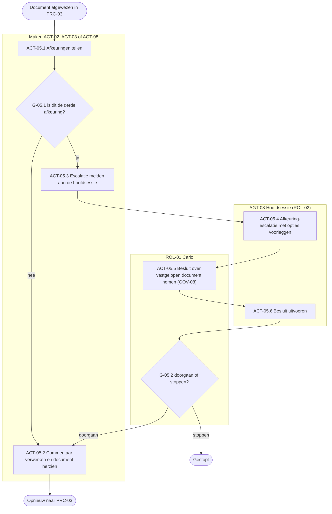
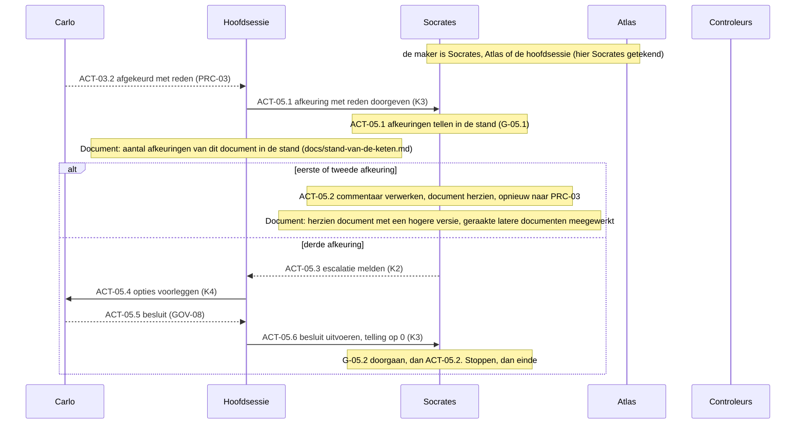

# PRC-05 – Afkeuring en herziening
Status: procesniveau Goedgekeurd (2026-11-25, Carlo, B-43); stappen Goedgekeurd (2026-11-25, Carlo, B-44, B-45; model 1.0.11) · Versie: 1.0.9 (geen inhoudelijke wijziging sinds 1.0.6)

**Legenda.** PRC = proces · ACT = stap · G = beslispunt · GOV = akkoordmoment van Carlo · ROL / AGT = rol / agent · ASM = aanname · B = besluit van Carlo.

## Doel en uitkomst
Een afgekeurd document gaat terug naar de maker met de reden. Na een vast aantal afkeuringen volgt een escalatie naar ROL-01 (project owner). Dit is een herbruikbaar subproces voor elke poort.

## Trigger, start- en eindconditie
- **Trigger:** ROL-01 wijst in PRC-03 (akkoord-poort van de project owner) een document af (G-03.4). Bij een pakket gebeurt dat per document.
- **Einde:** het herziene document gaat opnieuw naar PRC-03, of het werk stopt na het escalatiebesluit (GOV-08 – escalatiebesluit van Carlo).

## Eigenaar, rollen en systemen
- **Eigenaar:** ROL-02 (regie), uitgevoerd door AGT-08 (hoofdsessie).
- **Lanes:** de maker (AGT-02 agent Socrates, AGT-03 agent Atlas, of AGT-08), AGT-08 en ROL-01.
- **Systemen:** de klantrepo (document en stand met het aantal afkeuringen, ASM-80).

## Input en output
- **Input:** het afgekeurde document, met de reden.
- **Output:** een herzien document met een hogere versie, of een escalatiebesluit.

## Relatie met andere processen
- **Aangeroepen door:** PRC-03.
- **Roept aan:** PRC-03.

## Activiteiten

| ID | Activiteit | Rol of agent | Input | Resultaat | Vervolg |
| --- | --- | --- | --- | --- | --- |
| ACT-05.1 | Afkeuringen tellen | maker | afkeuring, stand | aantal afkeuringen van dit document in de stand | G-05.1 |
| ACT-05.2 | Commentaar verwerken en document herzien | maker | commentaar, document | herzien document; geraakte latere documenten meegewerkt (ASM-18) | PRC-03 |
| ACT-05.3 | Escalatie melden aan de hoofdsessie | maker | derde afkeuring | escalatie in het eindbericht, met de afkeuringen | ACT-05.4 |
| ACT-05.4 | Afkeuring-escalatie met opties voorleggen | AGT-08 (ROL-02) | escalatie | opties voor Carlo | ACT-05.5 |
| ACT-05.5 | Besluit over vastgelopen document nemen | ROL-01 | opties | besluit (GOV-08) | ACT-05.6 |
| ACT-05.6 | Besluit uitvoeren | AGT-08 | besluit | besluit aan de maker; telling op 0 (ASM-11) | G-05.2 |

## Beslissingen en goedkeuringen

| ID | Vraag | Uitkomsten | Bij afwijzing of afwijking |
| --- | --- | --- | --- |
| G-05.1 | Is dit de derde afkeuring van dit document? (maker) | nee → ACT-05.2 · ja → ACT-05.3 | — |
| GOV-08 | Escalatiebesluit van Carlo (ROL-01), in ACT-05.5 | besluit → ACT-05.6 | n.v.t. |
| G-05.2 | Doorgaan of stoppen? (ROL-01, in het besluit) | doorgaan → ACT-05.2 · stoppen → einde, gestopt | — |

## Uitzonderingen en loops
- **Herzieningslus** (PRC-05 → PRC-03 → PRC-05): bij de 3e afkeuring van hetzelfde document volgt een escalatie. Na het besluit begint de telling opnieuw (ASM-11).
- **Pakket:**
  - Alleen het afgekeurde document gaat terug.
  - Een document dat alleen wordt meegewerkt, telt niet als afkeuring.
  - Wordt het daarna afgekeurd, dan telt het wel (`vragen-en-akkoordrondes` werkwijze 9).
- **Een ander antwoord dan het advies** is geen afkeuring (ASM-91).

## Tussendiagram

## Interactiediagram

Status: Goedgekeurd als weergave van model 1.0 (2026-11-25, Carlo, B-51; opgezet in 1.0.23, CHG-064). Afgeleide weergave van de goedgekeurde stappen en beslispunten hierboven en van het communicatiemodel (K1 t/m K9); geen nieuwe inhoud. Bij een verschil gelden de tabellen hierboven. Kolommen en pijlen als in PRC-01. De maker is als Socrates getekend.

## Aannames en open vragen
- **Bevestigd:**
  - ASM-11: telling begint opnieuw na escalatie;
  - ASM-18: afgekeurd document apart herzien;
  - ASM-80: stand van de keten in bestanden.
- **Te bevestigen in ronde 2:** ASM-91 (wanneer een poort akkoord is).

## Wijzigingshistorie

| Versie | Datum | Wijziging | Door |
| --- | --- | --- | --- |
| 1.0.5 | 2026-11-25 | Eerste procesbeschrijving in model 1.0 (CHG-041), op basis van 0.18 `prc-05.md`. Nieuw: G-05.2 (stond in 0.18 in de vervolgkolom van ACT-05.6). | AGT-02 |
| 1.0.6 | 2026-11-25 | Na de controles (CHG-043): de namen van ACT-05.4, ACT-05.5 en ACT-05.6 zijn teruggezet naar 0.18. | AGT-02 |
| 1.0.23 | 2026-11-25 | Sectie "Interactiediagram" toegevoegd (CHG-064, Concept): afgeleide weergave op verzoek van Carlo; stappen en beslispunten ongewijzigd. | AGT-02 |
| 1.0.25 | 2026-11-25 | Interactiediagram: stand en herzien document als "Document:"-notities (CHG-067, alleen weergave). | AGT-02 |
| 1.0 | 2026-11-25 | Model 1.0 Goedgekeurd (Carlo, B-51; CHG-071). | AGT-02 |
