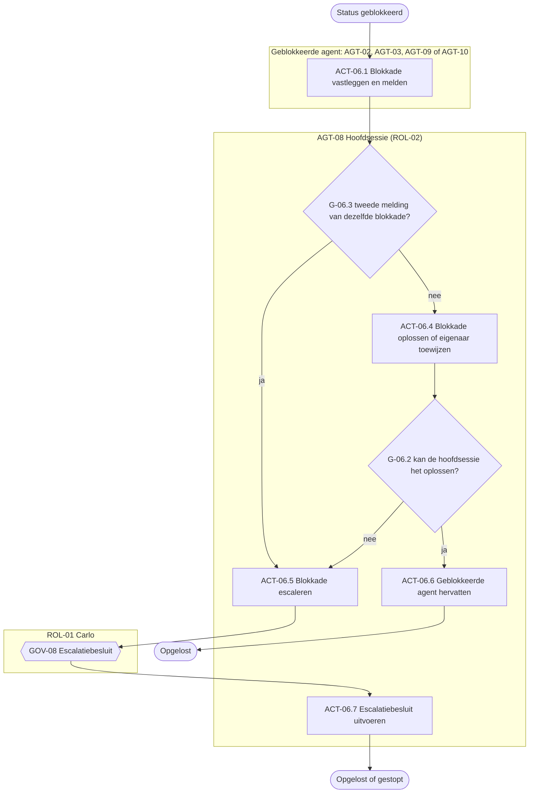
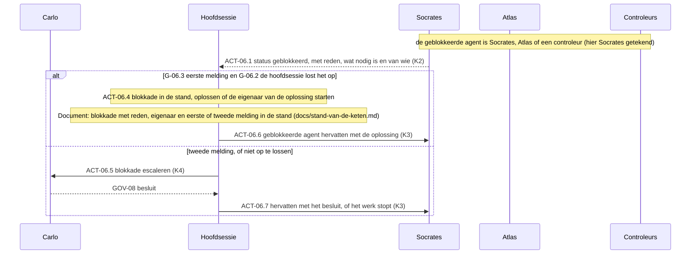

# PRC-06 – Blokkade afhandelen
Status: procesniveau Goedgekeurd (2026-11-25, Carlo, B-43); stappen Goedgekeurd (2026-11-25, Carlo, B-44, B-45; model 1.0.11) · Versie: 1.0.9 (alleen verwijzing bijgewerkt)

**Legenda.** PRC = proces · ACT = stap · G = beslispunt · GOV = akkoordmoment van Carlo · ROL / AGT = rol / agent · ASM = aanname · FND = bevinding · B = besluit van Carlo.

## Doel en uitkomst
Een geblokkeerde stap zichtbaar maken, de eigenaar van de oplossing laten handelen en zo nodig escaleren. Dit is een herbruikbaar subproces.

## Trigger, start- en eindconditie
- **Trigger:** een agent meldt de status "geblokkeerd" in zijn eindbericht.
- **Einde:** de blokkade is opgelost en de agent is hervat, of er is een escalatiebesluit (GOV-08 – escalatiebesluit van Carlo): opgelost of gestopt.

## Eigenaar, rollen en systemen
- **Eigenaar:** ROL-02 (regie), uitgevoerd door AGT-08 (hoofdsessie).
- **Lanes:** de geblokkeerde agent (AGT-02 agent Socrates, AGT-03 agent Atlas, AGT-09 Socrates-licht of AGT-10 Atlas-licht), AGT-08 en ROL-01 (project owner).
- **Systemen:** Claude Code (eindbericht, hervatten met SendMessage) en de klantrepo (stand, ASM-80).

## Input en output
- **Input:** de blokkade: de reden, wat er nodig is, en van wie.
- **Output:** een oplossing en een hervatte agent, of een besluit.

## Relatie met andere processen
- **Aangeroepen door:** elk proces met agentwerk, en PRC-04 (ontvanger reageert niet).
- **Roept aan:** PRC-04 als er input van een ander nodig is (in het register gezet met CHG-042, B-44).

## Activiteiten

| ID | Activiteit | Rol of agent | Input | Resultaat | Vervolg |
| --- | --- | --- | --- | --- | --- |
| ACT-06.1 | Blokkade vastleggen en melden | geblokkeerde agent | reden | eindbericht met status geblokkeerd: reden, wat nodig is en van wie | G-06.3 |
| ACT-06.4 | Blokkade oplossen of eigenaar toewijzen | AGT-08 (ROL-02) | blokkade | blokkade vastgelegd in de stand (ASM-80), zodat een tweede melding herkenbaar is; oplossing: de ander starten, input vragen via PRC-04, of een bestand aanwijzen | G-06.2 |
| ACT-06.6 | Geblokkeerde agent hervatten | AGT-08 | oplossing | agent hervat met de oplossing | einde, opgelost |
| ACT-06.5 | Blokkade escaleren | AGT-08 | blokkade zonder oplossing, of tweede melding | voorstel aan Carlo | GOV-08 |
| ACT-06.7 | Escalatiebesluit uitvoeren | AGT-08 | besluit | agent hervat met het besluit, of werk gestopt | einde |

## Beslissingen en goedkeuringen

| ID | Vraag | Uitkomsten | Bij afwijzing of afwijking |
| --- | --- | --- | --- |
| G-06.3 | Tweede melding van dezelfde blokkade? (ROL-02) | nee → ACT-06.4 · ja → ACT-06.5 (ASM-92 – tweede blokkade naar Carlo) | — |
| G-06.2 | Kan de hoofdsessie de blokkade oplossen of laten oplossen? (ROL-02) | ja → ACT-06.6 · nee → ACT-06.5 | — |
| GOV-08 | Escalatiebesluit van Carlo (ROL-01) | besluit → ACT-06.7 | n.v.t. |

## Uitzonderingen en loops
- **Terugkerende blokkade:** de tweede melding van dezelfde blokkade gaat naar Carlo (ASM-92). Daarmee is de lus begrensd (0.18 FND-061).
- **Carlo antwoordt niet:** de status blijft open, en de dagstart noemt de blokkade (PRC-07).

## Tussendiagram

## Interactiediagram

Status: Goedgekeurd als weergave van model 1.0 (2026-11-25, Carlo, B-51; opgezet in 1.0.23, CHG-064). Afgeleide weergave van de goedgekeurde stappen en beslispunten hierboven en van het communicatiemodel (K1 t/m K9); geen nieuwe inhoud. Bij een verschil gelden de tabellen hierboven. Kolommen en pijlen als in PRC-01. De geblokkeerde agent is als Socrates getekend.

## Aannames en open vragen
- **Te bevestigen in ronde 2:** ASM-92 (tweede blokkade naar Carlo).
- **Bekend risico:** FND-096 (de hoofdsessie is het enige knooppunt).

## Wijzigingshistorie

| Versie | Datum | Wijziging | Door |
| --- | --- | --- | --- |
| 1.0.5 | 2026-11-25 | Eerste procesbeschrijving in model 1.0 (CHG-041), op basis van 0.18 `prc-06.md`. Niet overgenomen: ACT-06.2, ACT-06.3 en G-06.1 (Paperclip-blockers). Nieuw: ACT-06.6, ACT-06.7 en G-06.3. | AGT-02 |
| 1.0.6 | 2026-11-25 | Na de controles (CHG-043): ACT-06.4 legt de blokkade vast in de stand, en de naam is teruggezet naar 0.18. "Roept aan: PRC-04" staat in voorstel CHG-042. | AGT-02 |
| 1.0.9 | 2026-11-25 | CHG-042 is goedgekeurd (B-44): "roept aan: PRC-04" staat nu in het register. | AGT-02 |
| 1.0.23 | 2026-11-25 | Sectie "Interactiediagram" toegevoegd (CHG-064, Concept): afgeleide weergave op verzoek van Carlo; stappen en beslispunten ongewijzigd. | AGT-02 |
| 1.0.25 | 2026-11-25 | Interactiediagram: de blokkade in de stand als "Document:"-notitie (CHG-067, alleen weergave). | AGT-02 |
| 1.0 | 2026-11-25 | Model 1.0 Goedgekeurd (Carlo, B-51; CHG-071). | AGT-02 |
