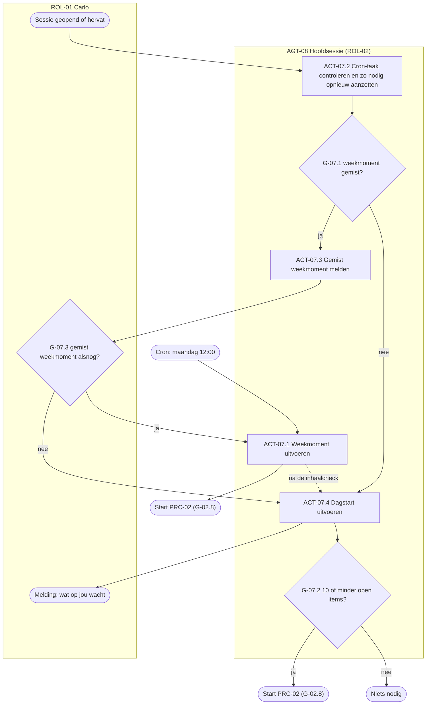
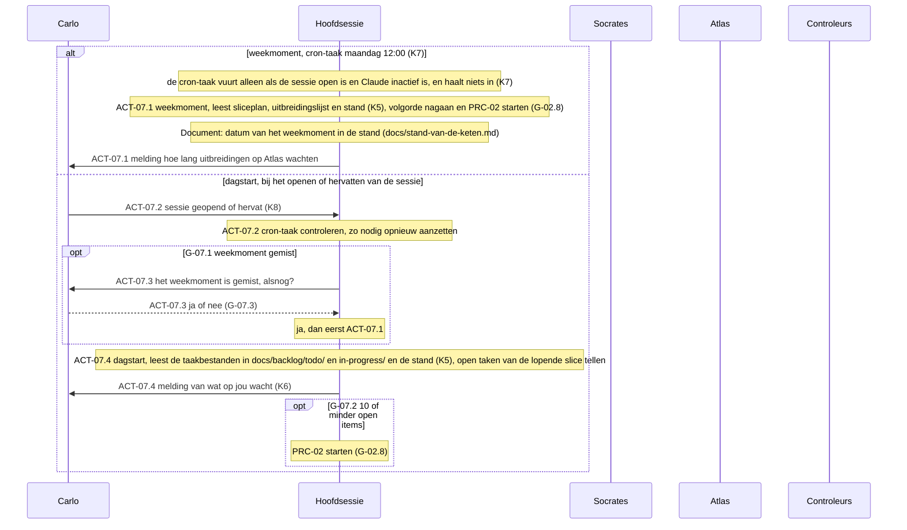

# PRC-07 – Ritme: weekmoment en dagstart
Status: procesniveau Goedgekeurd (2026-11-25, Carlo, B-43); stappen Goedgekeurd (2026-11-25, Carlo, B-44, B-45; model 1.0.11) · Versie: 1.0.11

**Legenda.** PRC = proces · ACT = stap · G = beslispunt · GOV = akkoordmoment van Carlo · ROL / AGT = rol / agent · ASM = aanname · OPEN = open vraag · FND = bevinding · B = besluit van Carlo.

## Doel en uitkomst
- **Weekmoment:** de volgorde van de slices en wensen nagaan, en PRC-02 (backlog vullen per slice) starten als er geen doorloop loopt, ongeacht de drempel.
- **Dagstart:** de taakbestanden tellen die niet in `docs/backlog/done/` staan, PRC-02 starten bij 10 of minder, en ROL-01 (project owner) melden wat op hem wacht.

## Trigger, start- en eindconditie
Twee starts:

**A. Weekmoment**
- Een cron-taak in de hoofdsessie van het project, op maandag om 12:00 Nederlandse tijd (B-40, ASM-85).
- Hij vuurt alleen als de sessie open is en Claude inactief is, en haalt niets in (feiten §4).
- Wat er gebeurt als Claude op dat moment bezig is, is OPEN-41.

**B. Openen of hervatten**
- Carlo opent of hervat de sessie van het project, in de terminal of in de VS Code-extensie. Of cron daar net zo werkt, is OPEN-40.
- De hoofdsessie controleert de cron-taak, meldt een gemist weekmoment (Carlo beslist of het alsnog gebeurt, B-44) en doet de dagstart (B-41).

**Einde:** PRC-02 is gestart (G-02.8 bewaakt dat er hoogstens één doorloop is), of er is niets nodig. De melding aan Carlo is gedaan.

## Eigenaar, rollen en systemen
- **Eigenaar:** ROL-02 (regie), uitgevoerd door AGT-08 (hoofdsessie).
- **Lanes:** AGT-08 en ROL-01.
- **Systemen:**
  - Claude Code: cron (CronCreate), sessie hervatten met `--resume` of `--continue`;
  - de klantrepo: het backlog in `docs/backlog/` (statusmappen todo, in-progress en done, B-44), de uitbreidingslijst, en de stand met de datum van het laatste weekmoment (ASM-80).

## Input en output
- **Input:** het sliceplan, het backlog in `docs/backlog/`, de uitbreidingslijst en de stand.
- **Output:**
  - een gestarte doorloop van PRC-02, of niets;
  - een melding van wat op Carlo wacht: open vragen, akkoorden, escalaties en blokkades;
  - bij het weekmoment ook de wachttijd op Atlas (ASM-23).

## Relatie met andere processen
- **Start:** PRC-02.
- **GOV-07** (keuze volgende slice of wens) gebeurt in PRC-02 (ACT-02.2).

## Activiteiten

| ID | Activiteit | Rol of agent | Input | Resultaat | Vervolg |
| --- | --- | --- | --- | --- | --- |
| ACT-07.1 | Weekmoment uitvoeren | AGT-08 (ROL-02) | cron maandag 12:00 (of de keuze van Carlo bij G-07.3), sliceplan, uitbreidingslijst, stand | volgorde nagegaan; wachttijd op Atlas gemeld (ASM-23, OPEN-13); PRC-02 gestart; datum in de stand | PRC-02; einde, of na G-07.3 verder met ACT-07.4 |
| ACT-07.2 | Cron-taak controleren en zo nodig opnieuw aanzetten | AGT-08 | sessie geopend of hervat | cron-taak aanwezig, of opnieuw aangezet en gemeld | G-07.1 |
| ACT-07.3 | Gemist weekmoment melden | AGT-08 | datum van het laatste weekmoment | melding aan Carlo dat het weekmoment is gemist, met de vraag of het alsnog moet (ASM-97 – gemist weekmoment alleen melden) | G-07.3 |
| ACT-07.4 | Dagstart uitvoeren | AGT-08 | taakbestanden in `docs/backlog/todo/` en `docs/backlog/in-progress/`, stand | aantal taakbestanden van de lopende slice die niet in done staan (ASM-89); melding van wat op Carlo wacht | G-07.2 |

## Beslissingen en goedkeuringen

| ID | Vraag | Uitkomsten | Bij afwijzing of afwijking |
| --- | --- | --- | --- |
| G-07.1 | Is er sinds de vorige keer een weekmoment gemist? (ROL-02) | ja → ACT-07.3 · nee → ACT-07.4 | — |
| G-07.3 | Wil Carlo het gemiste weekmoment alsnog? (ROL-01) | ja → ACT-07.1, daarna ACT-07.4 · nee of geen antwoord → ACT-07.4 | B-44, antwoord 10 |
| G-07.2 | Heeft de lopende slice 10 of minder taakbestanden in todo en in-progress? (ROL-02; B-42) | ja → PRC-02 (G-02.8) · nee → einde | — |

## Uitzonderingen en loops
- **Weekmoment en dagstart tegelijk:** alleen de eerste start een doorloop. De tweede ziet de lopende doorloop (G-02.8, ASM-33, ASM-84).
- **Sessie dicht op maandag 12:00:** de cron-taak slaat het moment over. Bij de volgende opening meldt ACT-07.3 het, en Carlo beslist of het alsnog gebeurt (B-44, antwoord 10).
- **Cron-taak weg** (nieuwe sessie zonder hervatten, of verlopen, OPEN-38): ACT-07.2 zet hem opnieuw aan.
- **Geen sessie open:** er gebeurt niets tot Carlo de sessie opent (FND-013 – orchestrator zonder eigen ritme).

## Tussendiagram

## Interactiediagram

Status: Goedgekeurd als weergave van model 1.0 (2026-11-25, Carlo, B-51; opgezet in 1.0.23, CHG-064). Afgeleide weergave van de goedgekeurde stappen en beslispunten hierboven en van het communicatiemodel (K1 t/m K9); geen nieuwe inhoud. Bij een verschil gelden de tabellen hierboven. Kolommen en pijlen als in PRC-01. Bij de melding van ACT-07.1 en de vraag van ACT-07.3 staat geen kanaal: het communicatiemodel noemt er geen.

## Aannames en open vragen
- **Bevestigd:**
  - ASM-23: wachttijd van uitbreidingen op Atlas;
  - ASM-33: hoogstens één doorloop per project;
  - ASM-84: tijden van het ritme;
  - ASM-85: cron in de hoofdsessie;
  - ASM-89: wanneer een backlog-item open is (taakbestand niet in done, B-44);
  - ASM-97: gemist weekmoment alleen melden (B-44, antwoord 10);
  - ASM-101: epic-bestand per slice; de dagstart telt alleen taakbestanden (B-45, vraag 19).
- **Open:**
  - OPEN-38: verloopt een cron-taak?
  - OPEN-40: cron in de VS Code-extensie?
  - OPEN-41: cron terwijl Claude bezig is?
  - OPEN-13: drempel voor een aparte agent naast Atlas.
- **Bekende risico's:** FND-013 (ritme alleen met een open sessie) en FND-094 (geen skill voor het ritme).

## Wijzigingshistorie

| Versie | Datum | Wijziging | Door |
| --- | --- | --- | --- |
| 1.0.5 | 2026-11-25 | Eerste uitwerking in model 1.0 (CHG-041). In 0.18 was dit proces context, zonder stappen. ACT-07.4 vervangt 0.18 ACT-02.51 en het herinneringsbericht. | AGT-02 |
| 1.0.6 | 2026-11-25 | Na de controles (CHG-043): in het register zet ACT-07.1 de datum van het weekmoment in de stand, zoals deze beschrijving al zei. De inhoud is verder niet veranderd. | AGT-02 |
| 1.0.9 | 2026-11-25 | Antwoorden van ronde 2 verwerkt (CHG-046, B-44). ACT-07.3 heet "Gemist weekmoment melden"; nieuw is G-07.3, waarbij Carlo beslist (antwoord 10). De dagstart telt taakbestanden die niet in `docs/backlog/done/` staan (antwoord 13 en 14). | AGT-02 |
| 1.0.11 | 2026-11-25 | ASM-101 bevestigd (CHG-048, B-45). De stappen zijn niet veranderd. | AGT-02 |
| 1.0.23 | 2026-11-25 | Sectie "Interactiediagram" toegevoegd (CHG-064, Concept): afgeleide weergave op verzoek van Carlo; stappen en beslispunten ongewijzigd. | AGT-02 |
| 1.0.24 | 2026-11-25 | Interactiediagram (CHG-065): weekmoment en dagstart als twee aparte starts in een `alt`, met de voorwaarde van de cron-taak (K7). | AGT-02 |
| 1.0.25 | 2026-11-25 | Interactiediagram: wat het weekmoment en de dagstart lezen, en de datum van het weekmoment in de stand als "Document:"-notitie (CHG-067, alleen weergave). | AGT-02 |
| 1.0 | 2026-11-25 | Model 1.0 Goedgekeurd (Carlo, B-51; CHG-071). | AGT-02 |
