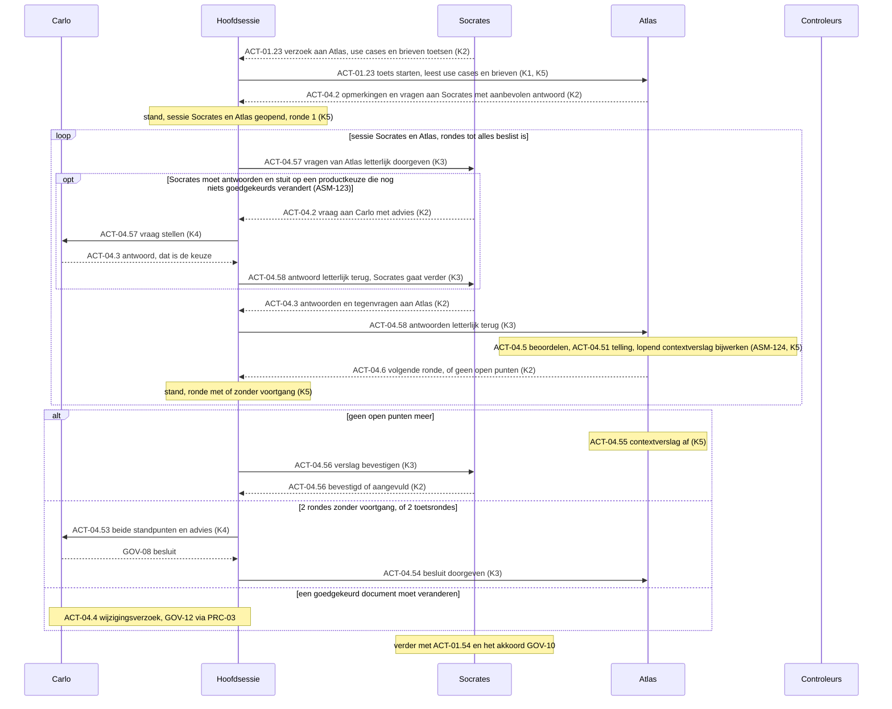
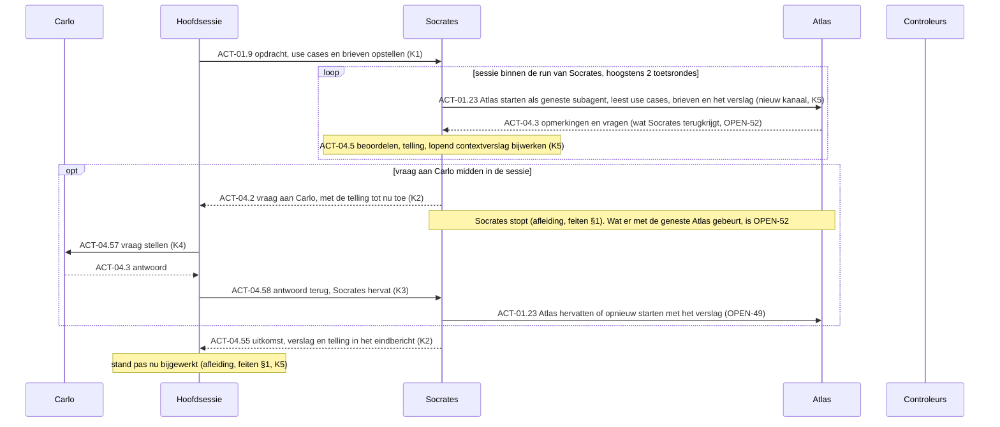

# Voorstel CHG-066: directe communicatie tussen Socrates en Atlas

| | |
| --- | --- |
| Status | Goedgekeurd (2026-11-25, Carlo, B-50): vraag A "Ja, via hoofdsessie", vraag B "Ja, direct"; C en D vervallen. Optie (c) is doorgevoerd in model 1.0.27 (CHG-069): register, `processen/PRC-04-vragenloop.md`, de interactiediagrammen van PRC-01, PRC-02 en PRC-04, `communicatiemodel.md` en de pagina. ASM-123 en ASM-124 bevestigd, ASM-125 vervallen; PRP-085 alleen deel B. Socrates-licht had dit voorstel (1.0.26) vooraf volledig gecontroleerd. |
| Aanleiding | Carlo vroeg bij vraag 2 van ronde 4: "is er helemaal geen communicatie tussen socrates en atlas?" Na de uitleg van de hoofdsessie schreef hij letterlijk: "ik denk dat directe communicatie tussen atlas en socrates nodig is. er zullen vragenloops zijn tussen die twee en grilling sessies nodig voor zaken die niet overeengekomen zijn. hierdoor kan socrates mogelijk extra vragen aan mij moeten stellen waardoor er mogelijk ook communicatie met mijn moet zijn in de loo[" (afgebroken; gelezen als "in de loop"). Dit raakt een goedgekeurd besluit (B-38). Volgens antwoord 6 van ronde 2 (ASM-99 afgewezen) gaat dat via een vooraf gecontroleerd voorstel dat Carlo apart goedkeurt. Ronde 4 blijft Concept; vraag 2 van ronde 4 volgt daarna. |
| Feiten | Alleen `bronnen/claude-code-feiten.md` (2026-11-25, §1 gecorrigeerd door de hoofdsessie), aangeduid als "feiten §n". Een afleiding staat als "afleiding (feiten §n)". Wat er niet in staat, is een open vraag (OPEN-49 t/m OPEN-53, in het register). |
| Datum | 2026-11-25 |

**Legenda.** CHG = wijziging · B = besluit van Carlo · PRC = proces · ACT = stap · G = beslispunt · GOV = akkoordmoment van Carlo · GS = grill-moment · K = kanaal uit `communicatiemodel.md` · ROL-01 Carlo · ROL-02 regie · AGT-02 Socrates · AGT-03 Atlas · AGT-08 hoofdsessie · ASM = aanname · OPEN = open vraag · PRP = voorstel voor agents en skills · FND = bevinding · r. = regelnummer.

## 1. Wat er nu is (goedgekeurd)

- **B-38** (ronde 1, antwoord 12): "Alle overdracht tussen agents loopt via de hoofdsessie. Agents starten elkaar niet; er komen geen agent teams."
- Technisch is dat afgedwongen: `Agent` staat bij geen van de vier agents in `tools` (regel 6 van socrates.md, socrates-licht.md, atlas.md en atlas-licht.md; feiten §1, gecorrigeerd 2026-11-25).
- Socrates en Atlas wisselen al vragen en antwoorden uit, maar de hoofdsessie geeft alles letterlijk door:
  - de toets van de use cases en brieven (ACT-01.23, ACT-02.13; GS3, GS11), hoogstens 2 toetsrondes, daarna Carlo;
  - vragen tussen agents (PRC-04): na 2 rondes zonder voortgang beslist Carlo (G-04.51, GOV-08), met een contextverslag dat de ontvanger bevestigt (ASM-58);
  - bestanden in de klantrepo (K5).
- Een productkeuze in een vraag tussen agents wordt een productvraag (G-04.1 "ja", ACT-04.4), die via PRC-03 met controle vooraf naar Carlo gaat (GOV-12). Is Carlo zelf de ontvanger, dan is zijn antwoord op een productvraag al de keuze; die wordt bindend in het akkoord op het document (G-04.1, afwijkend). Verandert een antwoord een goedgekeurd document, dan volgt altijd een wijzigingsverzoek met controle vooraf (B-44 antwoord 6; ASM-99 afgewezen).
- De hoofdsessie houdt de stand per ronde bij (ASM-104).
- De coördinator noemde ook ASM-38. Die gaat over de poorten van de skill quality-gates en speelt hier niet.

## 2. Opties

### (a) Geneste subagent: Socrates start Atlas zelf, of andersom

| | |
| --- | --- |
| Wat vaststaat | Een subagent kan subagents starten, standaard tot drie lagen onder het hoofdgesprek; het staat aan of uit via `Agent` in `tools` of `disallowedTools` (feiten §1). Nu staat `Agent` bij geen van de vier agents in `tools`; dan moet dat erbij (feiten §1). AskUserQuestion werkt niet in een subagent (feiten §1). SendMessage hervat een subagent met zijn volledige geschiedenis (feiten §2). Model en effort gelden per subagent (feiten §7). |
| Afleidingen | Heeft Socrates midden in de lus een vraag aan Carlo, dan moet hij stoppen met een eindbericht, want hij kan Carlo zelf niets vragen; de hoofdsessie stelt de vraag en hervat hem (afleiding, feiten §1 en §2). De hoofdsessie ziet wat er binnen de run van Socrates gebeurde pas in zijn eindbericht, dus de stand loopt achter tot dan (afleiding, feiten §1: de vragen en antwoorden lopen binnen de run van de starter). Open vragen van de geneste Atlas voor Carlo komen bij Socrates terecht, die ze moet doorgeven (afleiding, feiten §1). |
| Wat niet vaststaat | **OPEN-49:** kan een geneste subagent later met zijn eigen geschiedenis worden hervat, door de starter of door de hoofdsessie? **OPEN-50:** kan een agent uit de plugin socrates een agent uit de plugin atlas starten (feiten §6 noemt alleen de naam `<plugin>:<naam>`)? Samen te onderzoeken met OPEN-33. **OPEN-51:** komen permissieprompts van een geneste subagent bij de gebruiker? Feiten §1 noemt het alleen voor subagents op de voorgrond; dat het voor geneste subagents anders kan zijn, is een afleiding. **OPEN-52:** wat gebeurt er met een geneste Atlas als de run van de starter eindigt, en wat krijgt de starter van de geneste Atlas terug (zijn eindbericht, of meer)? **OPEN-53:** kan `tools` beperken welke agents een subagent mag starten (bijvoorbeeld alleen `atlas:atlas`, niet de controleurs)? |
| Hoe de lus loopt | De vrager start de ander binnen zijn eigen run. Heeft Socrates een vraag aan Carlo, dan stopt hij; de hoofdsessie stelt de vraag (K4) en hervat Socrates (K3). Of Socrates daarna dezelfde Atlas kan hervatten of een nieuwe moet starten met het verslag, hangt af van OPEN-49 en OPEN-52. |
| Wat Carlo wint | Socrates en Atlas spreken elkaar zonder tussenstap. De hoofdsessie houdt minder in haar context. |
| Wat het kost | **Zichtbaarheid:** de stand loopt achter tot het eindbericht van de starter (afleiding, feiten §1; FND-092). **Context:** de starter krijgt terug wat de geneste agent oplevert; wat precies, is OPEN-52. **Grenzen:** "hoogstens 2 rondes" en "de gestarte agent start niemand" zijn afspraken; de techniek stopt pas bij drie lagen, en of `tools` dit kan beperken, is OPEN-53. **Onzekerheid:** vijf open vragen (OPEN-49 t/m OPEN-53). |
| Agents en skills (voorstel, niet uitvoeren) | PRP-085 deel A: `Agent` in `tools` van `socrates.md` en `atlas.md` (r.6). In `socrates.md` r.20 ("Je opdracht komt van de aanroeper (de hoofdsessie) ... je kunt geen andere agents starten"), r.86 (de aanroeper start Atlas voor de toets) en r.99. In `atlas.md` r.20, r.36 en r.82 ("zet je in je eindbericht"), r.71 (wie atlas-licht laat controleren als Socrates de aanroeper is) en r.89 ("Je eindbericht is het enige wat de aanroeper van je ziet"): "aanroeper" wordt de hoofdsessie óf Socrates. `architect-use-case-review` r.16 en r.29. `vragen-en-akkoordrondes` (beide kopieën, PRP-083): het mechanisme, werkwijze 3, 6 en 8. `regie`: de hoofdsessie start de ander niet meer bij een verzoek tussen Socrates en Atlas, en zet de telling uit het eindbericht in de stand. |
| Geraakte goedgekeurde rijen | B-38; ROL-02 ("start de ander bij een verzoek aan de ander"); ACT-01.23 en ACT-02.13 (wie de toets start); G-01.4 en G-02.5 (telling); ACT-04.2 (vragen in het eindbericht), ACT-04.57 en ACT-04.58 (R AGT-08) als de ontvanger een agent is; ACT-04.52 t/m ACT-04.56 (escalatie en contextverslag via de hoofdsessie); ASM-58 (bevestiging via de hoofdsessie); ASM-104 (stand per ronde); de RACI van die stappen; `communicatiemodel.md`: de grondregel, een nieuw kanaal voor de geneste start, overdracht 6, 8 en 10, §4 (toets en vraag tussen agents); `processen/PRC-04-vragenloop.md` (lanes, start, diagrammen); `eindontwerp.html` (KAN, OVER, LOPEN, de bronblokken `seq-PRC-01`, `02`, `04`); FND-096 (de hoofdsessie als enig knooppunt) wordt kleiner. |

### (b) Agent teams: Socrates en Atlas sturen elkaar berichten

| | |
| --- | --- |
| Wat vaststaat | Teammates sturen elkaar berichten via een mailbox (feiten §3). De functie is experimenteel en staat standaard uit. Ze werkt alleen interactief. In-process teammates zijn niet te herstellen via `/resume` of `/rewind`. Er is één team per sessie met een vaste lead. De taakstatus kan achterlopen. Een teammate in plan mode krijgt zijn plan automatisch goedgekeurd als zijn permissiemodus niet is gewijzigd, en een teammate kan niet goedkeuren namens de gebruiker (feiten §3). De gedeelde takenlijst staat in `~/.claude/tasks/{team}/`, buiten de repo (feiten §5). |
| B-38 | Carlo besloot in ronde 1 uitdrukkelijk: "er komen geen agent teams". |
| Wat Carlo wint | Echte directe berichten. De lead krijgt automatisch het eindantwoord van een teammate (feiten §4). |
| Wat het kost | Een experimentele functie onder de hele keten. Wat er gebeurt, is na een herstart niet terug te halen; de stand en het verslag moeten toch in bestanden staan. De automatische plan-goedkeuring past niet bij "alleen Carlo keurt goed" (feiten, afleiding 2). |
| Agents en skills | Teaminstelling per project, `regie` als lead, de definities van Socrates en Atlas als teammates. Niet uitgewerkt, want niet geadviseerd. |
| Geraakte goedgekeurde rijen | B-38 (het deel over teams), D5, K1 t/m K3, PRC-03 en PRC-04, de stand (ASM-104). |

### (c) De hoofdsessie blijft het doorgeefluik, in één vaste, zichtbare sessie Socrates–Atlas (advies)

| | |
| --- | --- |
| Wat vaststaat | Alles wat nu werkt: K1 t/m K5 (feiten §1, §2, §5). Geen nieuwe techniek. |
| Wat verandert | 1. **Eén sessie Socrates–Atlas** (PRC-04 in grill-vorm), bij de toets of op elk moment waarop een van beiden het niet eens is of iets nodig heeft, zoals PRC-04 nu al toestaat. Ze krijgt één lopend contextverslag, dat de vrager na elke ronde bijwerkt (ASM-124). Zo gaat de sessie na een vraag aan Carlo verder waar ze was. 2. **Carlo midden in de sessie** (ASM-123): stuit een agent op een productkeuze, dan stelt hij die direct aan Carlo, als vraag in de lopende sessie (K2, K4, K3). Dat is de ontvanger, die het antwoord moet geven (werkwijze 4, G-04.1), of de vrager bij zijn eigen punt. De bestaande afwijking bij G-04.1 geldt dan: het antwoord van Carlo is zelf de keuze, en die wordt bindend in het akkoord op het document. ASM-123 voegt toe dat dit ook geldt als de productkeuze opkomt in een sessie tussen agents; nu wordt het daar een productvraag via ACT-04.4 en GOV-12, met controle vooraf. Verandert het antwoord een goedgekeurd document, dan blijft het een wijzigingsverzoek met controle vooraf (B-44 antwoord 6, ASM-99 afgewezen; ongewijzigd). 3. **Onenigheid:** na 2 rondes zonder voortgang beslist Carlo, zoals nu (G-04.51, GOV-08); de toets houdt hoogstens 2 toetsrondes. 4. De interactiediagrammen tonen de sessie als één kader, met de terugkeer. |
| Wat Carlo wint | Hij ziet het als één gesprek, maar de hoofdsessie geeft elk bericht letterlijk door. Een productvraag midden in de sessie komt sneller bij hem, zonder controleronde. De stand is per ronde bij. |
| Wat het kost | Per ronde extra stappen en tokens in de hoofdsessie; Carlo hoeft daar niets voor te doen. Een productvraag zonder controle vooraf kan onvolledig zijn; dat vangt de controle vóór het latere akkoord op. |
| Agents en skills (voorstel, niet uitvoeren) | PRP-085 deel B: `vragen-en-akkoordrondes` (beide kopieën, PRP-083), werkwijze 4: een productkeuze in een lopende sessie wordt een vraag aan Carlo in die sessie, geen productvraag via GOV-12; werkwijze 6: het contextverslag wordt per ronde bijgewerkt. `architect-use-case-review` r.22 (contextverslag in het eindbericht) en r.29 (een verslag per ronde, ASM-124). `regie`: een vraag aan Carlo uit een lopende sessie direct stellen en de agent hervatten; per ronde de stand bijwerken. De agentdefinities veranderen niet. |
| Geraakte goedgekeurde rijen | ACT-04.1 (routering: een vraag aan Carlo binnen een lopende sessie); G-04.53 (de telling van de sessie loopt niet door tijdens een vraag aan Carlo); ACT-04.2 en ACT-04.3 (de ontvanger mag een vraag aan Carlo stellen in plaats van ACT-04.4); G-04.1 (uitkomsten en afwijking); ACT-04.4 (alleen een wijziging van een goedgekeurd document gaat naar GOV-12); GOV-12 (opmerking); ACT-04.55 (het verslag wordt per ronde bijgewerkt); ASM-94 (geldt ook voor de vraag aan Carlo binnen de sessie); ASM-99 en B-44 antwoord 6 (ongewijzigd, wel genoemd); `communicatiemodel.md` §4 (één rij "Sessie tussen Socrates en Atlas" in plaats van de rijen voor de toets en de vraag tussen agents) en overdracht 8; `processen/PRC-04-vragenloop.md` (lanes, start, stroomschema en interactiediagram); `eindontwerp.html` (OVER, LOPEN, de bronblokken `seq-PRC-01`, `02`, `04`; KAN alleen nalezen, er komt geen kanaal bij). B-38 blijft. |

## 3. Advies

Optie (c), omdat ze werkt met techniek die vaststaat, de stand per ronde bijhoudt en Carlo in de sessie betrekt op het moment dat een productkeuze speelt. De prijs is dat de hoofdsessie elk bericht doorgeeft: de communicatie is voor Carlo één gesprek, maar technisch niet direct.

Optie (a) geeft echte directe communicatie: geen tussenstap en minder context in de hoofdsessie. Ze vraagt wel `Agent` in `tools`, aangepaste definities, en vijf antwoorden die niet in de feiten staan (OPEN-49 t/m OPEN-53). Kiest Carlo (a), dan adviseer ik: alleen de agent met de vraag start de ander; de telling en het verslag staan in het eindbericht en in de klantrepo; en eerst een proefrun van één doorloop.

Optie (b) wees Carlo in ronde 1 al af (B-38), en de functie is experimenteel.

## 4. Nieuwe aannames (alleen bij akkoord)

| ID | Tekst | Optie | Vraag |
| --- | --- | --- | --- |
| ASM-123 | Stuit een agent in een lopende sessie op een productkeuze die nog niets goedgekeurds verandert, dan stelt hij die direct aan Carlo: de ontvanger die het antwoord moet geven, of de vrager bij zijn eigen punt. Carlo's antwoord is de keuze (zoals de afwijking bij G-04.1). Verandert het antwoord een goedgekeurd document, dan volgt een wijzigingsverzoek (GOV-12). | a en c | B |
| ASM-124 | Een sessie tussen Socrates en Atlas heeft één lopend contextverslag, dat de vrager na elke ronde bijwerkt in de klantrepo. De ontvanger bevestigt het aan het eind (ASM-58). | a en c | A |
| ASM-125 | Alleen de agent met de vraag start de ander. Zolang OPEN-53 niet beantwoord is, is dat een afspraak, geen technische grens. | alleen a | C |

## 5. Concept-interactiediagram, optie (c)

Dezelfde kolommen als in de procesbestanden. Het voorbeeld: Atlas toetst de use cases en brieven (GS3) en heeft een punt waarover hij het met Socrates niet eens is; Socrates, die het antwoord moet geven, heeft daarbij een productvraag aan Carlo. PRC-04 en de procesbestanden veranderen pas na het akkoord.

Hoe de sessie terugkeert:
- Na een vraag aan Carlo gaat Socrates verder in dezelfde ronde; het antwoord staat in het verslag.
- Na een ronde met open punten gaat de lus terug naar de vrager (ACT-04.6).
- Na de sessie gaat Socrates verder waar hij was (hier ACT-01.54).
- De stand houdt de hoofdsessie per ronde bij; het verslag houdt de vrager bij in de klantrepo.

**Ter vergelijking, optie (a)** (alleen als Carlo daarvoor kiest). Wat er gebeurt met de geneste Atlas als Socrates stopt, en wat Socrates van hem terugkrijgt, is open (OPEN-49, OPEN-52).

## 6. Vragen aan Carlo

Letters, zodat ze niet botsen met vraag 1 en 2 van ronde 4. Vraag A en B vormen samen het akkoord op dit voorstel. Vraag C en D alleen bij nee op vraag A.

**Mededeling (geen vraag):** een punt waarover Socrates en Atlas het na 2 rondes zonder voortgang niet eens worden, komt bij jou, zoals nu.

A. Kies je voor één vaste sessie tussen Socrates en Atlas, waarin de hoofdsessie elk bericht letterlijk doorgeeft?
   - Het gaat om: jij ziet het als één gesprek, maar de hoofdsessie geeft elk bericht door. Dat kost per ronde extra stappen en tokens in de hoofdsessie, maar het werkt met bekende techniek en de stand blijft per ronde bij. Het alternatief is dat ze elkaar zelf starten: geen tussenstap en minder in de hoofdsessie, maar voor een vraag aan jou moet de sessie stoppen, en wat er dan met de gestarte agent gebeurt, is onbekend. Een team van agents wees je in ronde 1 al af.
   - Advies: ja, omdat het werkt met wat vaststaat en je de stand per ronde ziet.
   - Bij nee: ze starten elkaar zelf. Dan volgen vraag C en D, en hun instructies en rechten veranderen.
B. Mag degene die het antwoord moet geven je midden in zo'n sessie direct een productvraag stellen, zonder controle vooraf, als het antwoord nog niets verandert wat je al goedkeurde?
   - Het gaat om: nu wordt zo'n vraag eerst een apart voorstel met een controle. Met ja krijg je hem direct, zoals in de vragenrondes met jou, en is je antwoord de keuze. Die wordt vastgelegd als je het document goedkeurt, en dat wordt wel gecontroleerd. Verandert het antwoord iets wat je al goedkeurde, dan blijft het een wijzigingsvoorstel met controle vooraf.
   - Advies: ja.
   - Bij nee: elke productvraag gaat eerst langs een controle, en de sessie wacht daarop.
C. (Alleen bij nee op vraag A.) Mag alleen de agent met de vraag de ander starten?
   - Het gaat om: anders kan de gestarte agent zelf weer agents starten, tot drie lagen diep, en ontstaat een keten die de hoofdsessie niet ziet. Of dit technisch af te dwingen is, is nog onbekend.
   - Advies: ja.
   - Bij nee: ook de gestarte agent mag verder starten, tot drie lagen diep.
D. (Alleen bij nee op vraag A.) Proberen we het eerst in één doorloop, voordat de instructies van Socrates en Atlas definitief veranderen?
   - Het gaat om: een paar dingen zijn onbekend: of een gestarte Atlas later terug te halen is, wat er met hem gebeurt als Socrates stopt, of Socrates een agent uit een andere plugin mag starten, of je toestemmingsvragen van zo'n agent te zien krijgt, en of het starten te beperken is tot Atlas.
   - Advies: ja.
   - Bij nee: de instructies veranderen meteen, met het risico dat het in de praktijk niet werkt.

**Zo gesteld (2026-11-25), letterlijk.** De hoofdsessie stelde A en B met twee lage punten van socrates-licht verwerkt (W1 bij A, W2 bij B):

A. "Kies je voor één vaste sessie tussen Socrates en Atlas, waarin de hoofdsessie elk bericht letterlijk doorgeeft? Het gaat om: jij ziet het als één gesprek, maar de hoofdsessie geeft elk bericht door; dat kost per ronde extra stappen en tokens in de hoofdsessie, maar werkt met bekende techniek en de stand blijft per ronde bij. Het alternatief is dat ze elkaar zelf starten: geen tussenstap en (afleiding) minder in de hoofdsessie, maar voor een vraag aan jou moet de sessie stoppen, en wat er dan met de gestarte agent gebeurt, is onbekend; daarvoor moeten ook hun definities het starten toestaan. Een team van agents wees je in ronde 1 al af. Advies (Socrates): ja, omdat het werkt met wat vaststaat en je de stand per ronde ziet. Bij nee starten ze elkaar zelf en volgen nog twee vragen."

B. "Mag degene die het antwoord moet geven (of de vrager bij zijn eigen punt) je midden in zo'n sessie direct een productvraag stellen, zonder controle vooraf, als het antwoord nog niets verandert wat je al goedkeurde? Het gaat om: nu wordt zo'n vraag eerst een apart voorstel met controle. Met ja krijg je hem direct, zoals in de vragenrondes met jou, en is je antwoord de keuze; die wordt vastgelegd als je het document goedkeurt, en dat wordt wel gecontroleerd. Verandert het antwoord iets wat je al goedkeurde, dan blijft het een wijzigingsvoorstel met controle vooraf. Advies: ja. Bij nee gaat elke productvraag eerst langs een controle, en wacht de sessie daarop."

**Antwoorden (B-50):** A "Ja, via hoofdsessie"; B "Ja, direct". C en D vervallen.

## Koppeltabel (alleen voor de controle, niet voor Carlo)

| Vraag | Element |
| --- | --- |
| Mededeling | G-04.51, G-01.4, G-02.5 (ongewijzigd; was vraag 3, W2) |
| A | keuze c of a; b afgeraden (B-38); ASM-124; PRP-085 deel B (c) of deel A (a) |
| B | ASM-123; G-04.1 (afwijking), ACT-04.4, GOV-12; B-44 antwoord 6 en ASM-99 ongewijzigd |
| C | ASM-125; OPEN-53 |
| D | OPEN-49 t/m OPEN-53 |

## Wijzigingen in dit voorstel

| Versie | Wat |
| --- | --- |
| 2026-11-25, eerste concept | opties a, b, c; vragen 1 t/m 5 |
| 2026-11-25, herzien | feiten §1 gecorrigeerd (technisch afgedwongen); afleidingen gelabeld, OPEN-52 en OPEN-53 erbij (B1, Atlas); lijsten met geraakte rijen aangevuld (B2, Atlas); vraag A evenwichtig, advies met reden, §3 zonder "geen inhoudelijke winst" (B3); ASM-123 bij de ontvanger of de vrager bij zijn eigen punt (Atlas); OPEN-51 als afleiding (W1); vraag 3 als mededeling (W2); letters A t/m D (W4); vraag A en C elk één afspraak (W5) |
